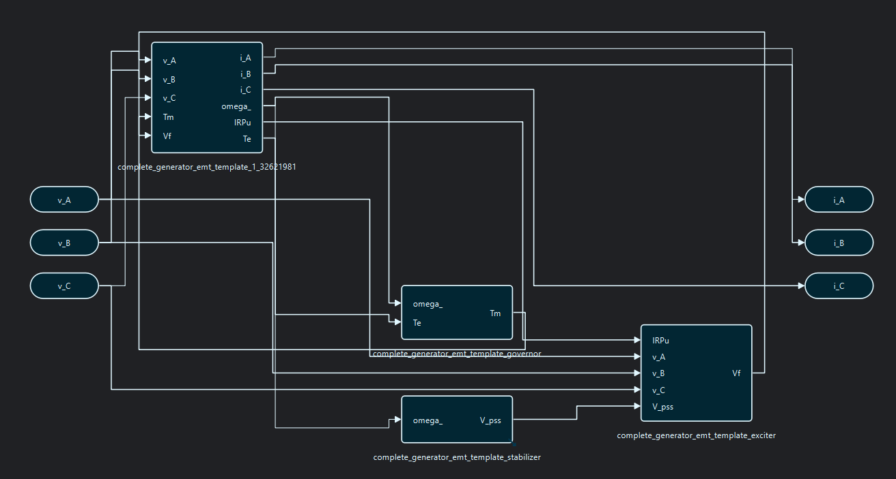
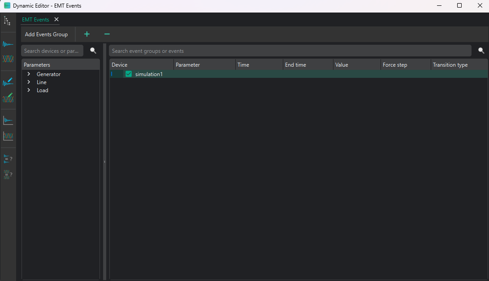
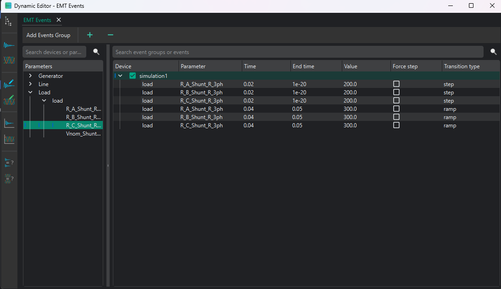
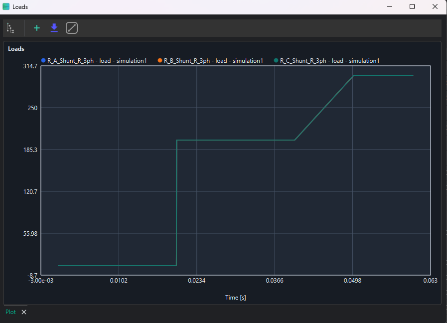

# EMT practical session: building and simulating a phase-domain model

**Updated:** 06-10-2026

## Contents

```{contents}
:depth: 2
:local:
```

## 1. About this session

This exercise uses the VeraGrid GUI to build a static network, create and save EMT device models, define event scenarios, prepare plots, run the EMT driver, and inspect phase-domain results. Read [EMT simulations](emt_simulations.md) for the formulation and settings, and [Dynamic workspace and editors](dynamic_editor.md) for a complete description of every workspace page.

### 1.1. EMT scope

EMT retains instantaneous phase voltages and currents. It is appropriate for this exercise because the load and line are represented in the phase domain and the plotted results include waveform-level behaviour.

## 2. Objectives of the session

The objective of this practical session is to create a two-bus system in VeraGrid using EMT models. The session combines static network definition, dynamic model assignment, event configuration and post-processing of simulation results.

At the end of the session, students should be able to:

- Create a small network in VeraGrid.
- Assign EMT dynamic templates.
- Configure step and ramp events that modify simulation parameters.
- Run an EMT simulation and identify the expected response.

## 3. System model

The system represents a two-bus system with a generator connected to a load by means of a line.


### 3.1. Modelling conventions and per-unit bases

| Quantity | Value | Comment |
|---|---:|---|
| System base power, `Sbase` | 100 MVA | Common base for the exercise |
| Nominal frequency, `f` | 50 Hz | Used for `omega_base = 2*pi*f` |
| AC nominal voltage | 10 kV | Buses 0 and 1 |

(emt-device-parameters)=
## 4. Device parameters

### 4.1. Static network creation and simulation settings

#### 4.1.1. Grid and bus data

| Object | Parameter | Value |
|---|---|---:|
| Grid | `Sbase` | 100 MVA |
| Grid | `freq` | 50 Hz |
| Bus 0 | `is_dc` | `False` |
| Bus 0 | `is_slack` | `True` |
| Bus 0 | `Vnom` | 10 kV |
| Bus 1 | `is_dc` | `False` |
| Bus 1 | `is_slack` | `False` |
| Bus 1 | `Vnom` | 10 kV |

(emt-simulation-settings)=
#### 4.1.2. Simulation settings

| Parameter | Value |
|---|---|
| Integration | `DAE_Trapezoidal` |
| Initialisation | `Explicit` |
| Solver | `Structural Compiled` |
| Tolerance | `1e-4` |
| Simulation time | `0.06` |
| Time step | `1e-6` |

### 4.2. Static model assignment

#### 4.2.1. Generator static data

| Device | Parameter | Value |
|---|---|---:|
| Generator 1 | `Vset` | 1.0 p.u. |
| Generator 1 | `Snom` | 100 MVA |
| Generator 1 | `r1` | 0.001 |
| Generator 1 | `x1` | 1.7 |

#### 4.2.2. Load static data

| Device | Parameter | Value |
|---|---|---:|
| Load | `P` | 1 MVA |
| Load | `Pa` | 0.33333 MVA |
| Load | `Pb` | 0.33333 MVA |
| Load | `Pc` | 0.33333 MVA |
| Load | `Q` | 0.0 MVA |
| Load | `Qa` | 0.0 MVA |
| Load | `Qb` | 0.0 MVA |
| Load | `Qc` | 0.0 MVA |
| Load | `conn` | `Y` |

#### 4.2.3. Line static data: tower template

| Device | Parameter | Value |
|---|---|---|
| Tower | Voltage | 10 kV |
| Tower | Wire | `-_ACSR_0.902` |

**Wire composition**

| X (m) | Y (m) | Phase |
|---:|---:|---:|
| -12 | 27 | 1 |
| 0 | 27 | 2 |
| 12 | 27 | 3 |

> How to create towers is explained in {ref}`Section 5.1 <emt-static-model-construction>`.

### 4.3. Dynamic model assignment

#### 4.3.1. Generator dynamic model

Use the **complete generator EMT template**, or create the generator by connecting the generator, exciter, governor and stabiliser blocks.

The generator has many different models. The recommendation is to build the generator using the generator, exciter, governor and stabiliser blocks in the library and connect them in the dynamic editor.

However, there is a faster way of creating the generator block: add the complete generator template from the catalogue and use it. The process to add the catalogue is explained in {ref}`Section 5.1 <emt-static-model-construction>`.

#### 4.3.2. Line dynamic model

Generally, the **Pi line** template is used. However, to see real wave transmission across the lines, the **Bergeron line model** is preferred.

#### 4.3.3. Load dynamic model

To keep the exercise simple, the **R load** is selected. The configuration must be selected from the static object.

(emt-events-section)=
### 4.4. EMT events

| Event | Device | Time interval (s) | Parameter | New value | Transition |
|---|---|---:|---|---:|---|
| Decrease load | Load | 0.02 | `R_A_Shunt_R_3ph` | 200 | Step |
| Decrease load | Load | 0.02 | `R_B_Shunt_R_3ph` | 200 | Step |
| Decrease load | Load | 0.02 | `R_C_Shunt_R_3ph` | 200 | Step |
| Increase load | Load | 0.04-0.05 | `R_A_Shunt_R_3ph` | 300 | Ramp |
| Increase load | Load | 0.04-0.05 | `R_B_Shunt_R_3ph` | 300 | Ramp |
| Increase load | Load | 0.04-0.05 | `R_C_Shunt_R_3ph` | 300 | Ramp |

## 5. EMT model construction

(emt-static-model-construction)=
### 5.1. Static model construction

This is the built model:


1. Add buses by dragging a bus from the **Library** in the left vertical bar to the centre of the diagram.
2. Add injections, such as generators, by right-clicking on the bus.

   

3. To add VSC or DC lines, first configure the DC buses as DC buses. To change the properties of a device or bus, use the 
left vertical bar and go to **Properties** or double-click on the device. Set the DC buses as `is_dc = True`. 
Take this opportunity to change all parameters in all buses. See the parameter values in {ref}`Section 4 <emt-device-parameters>`.
After that, drag a line connecting the buses to create the VSC devices between the AC and DC buses and the DC line between the DC buses.
4. Add all static parameters in the left vertical bar for all devices. See the parameter values in {ref}`Section 4 <emt-device-parameters>`.
5. To build lines, there are two options:
   - Complete the `R`, `X` and `B` properties of the line object directly in the diagram. These are balanced values.
   - Build a tower configuration to add line parameters from a tower and represent unbalanced lines.

   To build a tower configuration:

   1. Add the towers and wires in the catalogue. Go to **Model -> Add default catalogue** and select the required templates. RMS and EMT templates can also be added and used from this menu.

      

   2. Go to **Database -> Catalogue -> Towers**. Add a new tower by clicking the `+` button, or right-click and edit an existing tower. The tower editor will open. Select the required wire, add the wire positions and phases, and set the voltage of the line.

      

   3. Return to the main diagram and double-click on the line. Go to **Line editor**, select the required tower template, load the template values and click **Accept**. The `R`, `X`, `B` and rate values of the line will be updated in the line properties.

      

6. To check whether the static model is correct, run a power flow by clicking the power-flow icon in the upper bar. The result should be similar to the following:

   

### 5.2. Dynamic model construction

There are two ways to assign an EMT model:

1. Assign an existing `emt_template` in the device properties. Templates added with **Model → Add default catalogue** can be inspected under the EMT template database.
2. Open the dynamic workspace and build or edit the device model in an **EMT Editor** tab. This is the workflow used here.

Open the EMT editor from the selected device. The workspace keeps the device tree on the left and opens the model as a tab. Separate toolbar actions open EMT Events, EMT Compare, and EMT Plots.


The initial blocks are the device's grid connection contract. Keep them in the model and connect the source, line, load, or controller blocks to the appropriate voltage and current ports. AC terminals expose the applicable phases and neutral.

Add blocks by dragging them from the library to the canvas. Open **Block Properties** to inspect:

- **General options** for ports, variables, parameters, and operating-point bindings.
- **DAE model** for state, algebraic, and derivative variables, equations, and initialization expressions.
- **Runtime logic** and block-specific settings when present.
- Code, LaTeX, or PDF rendering for reviewing the model equations.

Set the required parameters, connect all ports, and validate the complete graph. Save the editor tab to apply its isolated working copy to the circuit. Events, Comparison, and Plots read the last saved model.

This is the final model for the generator when selecting the Thevenin equivalent generator, for example:


The following is an example of building a generator with all its controllers:



### 5.3. Events

Open **EMT Events** in the dynamic workspace. The left tree contains the parameters exported by saved EMT models; the right tree contains scenario groups and their events.

1. Create an `EmtEventsGroup` named, for example, `load_resistance_change`.
2. Locate the R-load parameters `R_A_Shunt_R_3ph`, `R_B_Shunt_R_3ph`, and `R_C_Shunt_R_3ph` in the left tree.
3. Drag each parameter into the group and configure the steps at `0.02 s` with value `200`.
4. Add ramps from `0.04 s` to `0.05 s` with final value `300`.
5. Confirm that the event names, transition type, times, and target values match {ref}`Section 4.4 <emt-events-section>`.



The following capture shows an example of populated EMT events; the exact target parameters depend on the saved model.



Each event group is simulated independently and receives its own result slice. A group with no events is also useful as a base-case reference.

### 5.4. Plot preparation

Open **EMT Plots** before running the simulation. Create a time-series group and add the three phase voltages, currents, and load-resistance parameters needed for comparison. Create an X-Y group only when one signal must be plotted against another. These plot definitions are saved with the circuit and also appear in the Results view.

## 6. Simulation and post-processing

### 6.1. Simulation

Open the EMT dynamic simulation command, verify the settings in {ref}`Section 4.1.2 <emt-simulation-settings>`, and start the driver.


Review the simulation log if initialization or convergence fails. The duration depends strongly on the time step, model size, solver, and number of event groups.

### 6.2. Dynamic results

Open **Results → EMT Dynamic** and select the `load_resistance_change` scenario. The results tree is organized by device and exported variable.

- Double-click a variable to draw its time trajectory.
- Open the time-series group prepared in EMT Plots to compare phases or control signals.
- Open an X-Y group to inspect one signal against another.
- Select a row to inspect its numerical samples in the table.

Check that the selected event group produced data and that it was initialized and converged successfully. Resistance and electrical trajectories should change at the step time and evolve over the ramp interval. If a curve is missing, confirm that the variable belongs to the saved model used for the run and that the scenario completed.




## 7. Suggestions

After completing the exercise, note any unclear model, event, plot, or result workflow and report it to the eRoots dynamic team.
