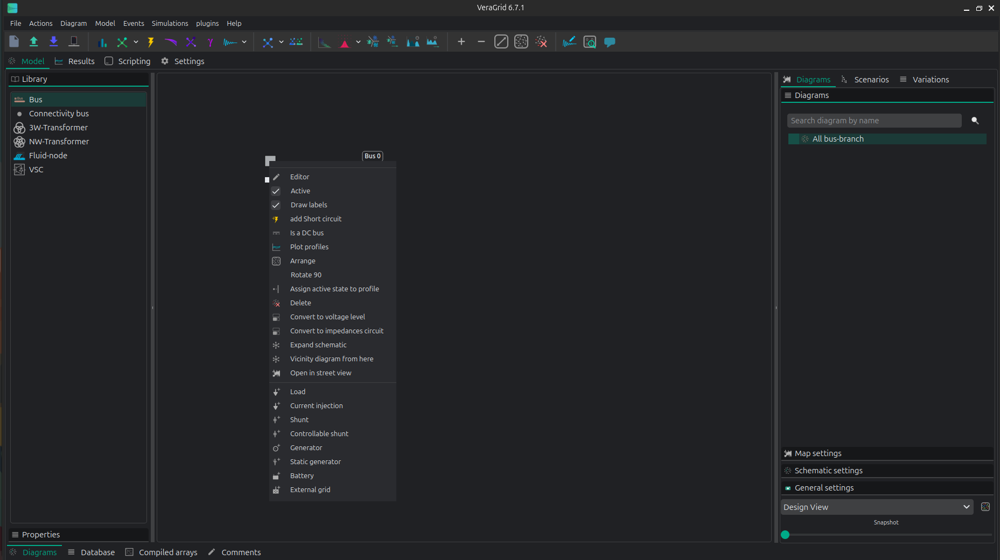

# RMS practical session: building and simulating a dynamic model

**Updated:** 06-10-2026

## Guide contents

```{contents}
:depth: 2
:local:
```

## 1. About this session

This exercise uses the VeraGrid GUI to build a static network, create and save RMS device models, define event scenarios, prepare plots, run the RMS driver, and inspect the results. Read [RMS simulations](rms_simulations.md) for the formulation and settings, and [Dynamic workspace and editors](dynamic_editor.md) for a complete description of every workspace page.

### 1.1. RMS scope

RMS represents the electrical network with fundamental-frequency phasors and retains the dynamic states needed for electromechanical and controller studies. It is appropriate for this load-change exercise because instantaneous phase waveforms are not required.

## 2. Objectives of the session

The objective of this practical session is to create a 2-bus system in VeraGrid using RMS models. The session combines static network definition, dynamic model assignment and construction, event configuration and post-processing of simulation results.

At the end of the session, students should be able to:

- Create a small network in VeraGrid.
- Assign RMS dynamic templates.
- Build models in the block editor.
- Configure step and ramp events that modify parameters of the simulation.
- Run an RMS simulation and identify the expected response.

## 3. System model

The system represents a two-bus system with a generator connected to a load by means of a line.


### 3.1. Modelling conventions and per-unit bases

| Quantity | Value | Comment |
|---|---:|---|
| System base power, `Sbase` | 100 MVA | Common base for the exercise |
| Nominal frequency, `f` | 50 Hz | Used for `omega_base = 2*pi*f` |
| AC nominal voltage | 10 kV | Buses 0 and 1 |

(rms-device-parameters)=
## 4. Device parameters

### 4.1. Static network creation and simulation settings

#### 4.1.1. Grid and bus data

| Object | Parameter | Value |
|---|---|---:|
| Grid | `Sbase` | 100 MVA |
| Grid | `freq` | 50 Hz |
| Bus 0 | `is_dc` | `False` |
| Bus 0 | `is_slack` | `True` |
| Bus 0 | `Vnom` | 10 kV |
| Bus 1 | `is_dc` | `False` |
| Bus 1 | `is_slack` | `False` |
| Bus 1 | `Vnom` | 10 kV |

(rms-simulation-settings)=
#### 4.1.2. Simulation settings

| Parameter | Value |
|---|---:|
| Integration | `DAE_BackEuler` |
| Initialization | Explicit |
| Tolerance | `1e-4` |
| Simulation time | 1 s |
| Time step | `1e-3` |

### 4.2. Static model assignment

#### 4.2.1. Generator static data

| Device | Parameter | Value |
|---|---|---:|
| Generator 1 | `Vset` | 1.0 p.u. |
| Generator 1 | `Snom` | 900 MVA |
| Generator 1 | `freq` | 50 Hz |
| Generator 1 | `r1` | 0.3 |
| Generator 1 | `x1` | 0.86 |

#### 4.2.2. Load static data

| Device | Parameter | Value |
|---|---|---:|
| Load 1 | `P` | 9.999999 MVA |
| Load 1 | `Q` | 0.999999 MVA |

#### 4.2.3. Line static data

| Device | Parameter | Value |
|---|---|---:|
| Line 1 | `R` | 0.029585 p.u. |
| Line 1 | `X` | 0.071005 p.u. |
| Line 1 | `B` | 0.03 p.u. |
| Line 1 | `rate` | 900 MVA |

(rms-dynamic-model-assignment)=
### 4.3. Dynamic model assignment

#### 4.3.1. Generator dynamic model: complete generator RMS template

| Device | Component | Parameter | Value |
|---|---|---|---:|
| Generator 1 | Exciter | `AEz` | 0.02 |
| Generator 1 | Exciter | `BEz` | 1.50 |
| Generator 1 | Exciter | `Se_threshold` | 1.0 |
| Generator 1 | Exciter | `EfeMaxPu` | 15.0 |
| Generator 1 | Exciter | `EfeMinPu` | -5.0 |
| Generator 1 | Exciter | `TolLi` | 0.05 |
| Generator 1 | Exciter | `VaMaxPu` | 2.5 |
| Generator 1 | Exciter | `VaMinPu` | -2.0 |
| Generator 1 | Exciter | `VeMinPu` | -2.0 |
| Generator 1 | Exciter | `VfeMaxPu` | 5 |
| Generator 1 | Exciter | `AEx` | 0.02 |
| Generator 1 | Exciter | `BEx` | 0.01 |
| Generator 1 | Exciter | `ToLLi` | 0.05 |
| Generator 1 | Exciter | `VeMinPu_submodel` | -5.1 |
| Generator 1 | Exciter | `VfeMaxPu_submodel` | 5 |
| Generator 1 | Stabilizer | `Ks` | 20 |
| Generator 1 | Stabilizer | `VPssMaxPu` | 1 |
| Generator 1 | Stabilizer | `VPssMinPu` | -1 |
| Generator 1 | Stabilizer | `SNom` | 1 |
| Generator 1 | GenQec | `fn` | 50 |
| Generator 1 | GenQec | `ws` | 314.159 |
| Generator 1 | GenQec | `M` | 3.5 |
| Generator 1 | GenQec | `D` | 10 |
| Generator 1 | GenQec | `Rs` | 0.003 |
| Generator 1 | GenQec | `Ra` | 0.003 |
| Generator 1 | GenQec | `Xd` | 1.8 |
| Generator 1 | GenQec | `Xq` | 1.7 |
| Generator 1 | GenQec | `Xd_prime` | 0.3 |
| Generator 1 | GenQec | `Xq_prime` | 0.55 |
| Generator 1 | GenQec | `Xd_2prime` | 0.25 |
| Generator 1 | GenQec | `Xq_2prime` | 0.35 |
| Generator 1 | GenQec | `Xl` | 0.15 |
| Generator 1 | GenQec | `Td0_prime` | 8 |
| Generator 1 | GenQec | `Tq0_prime` | 0.4 |
| Generator 1 | GenQec | `Td0_2prime` | 0.03 |
| Generator 1 | GenQec | `Tq0_2prime` | 0.05 |
| Generator 1 | GenQec | `Xd_prime_minus_Xl` |  |
| Generator 1 | GenQec | `Xq_prime_minus_Xl` |  |
| Generator 1 | GenQec | `Xdaux` |  |
| Generator 1 | GenQec | `Xdaux2` |  |
| Generator 1 | GenQec | `Xdaux3` |  |
| Generator 1 | GenQec | `Xqaux` |  |
| Generator 1 | GenQec | `Xqaux2` |  |
| Generator 1 | GenQec | `Xqaux3` |  |
| Generator 1 | GenQec | `A` | 5 |
| Generator 1 | GenQec | `B` | 1 |
| Generator 1 | Governor | `Pm_ref` |  |
| Generator 1 | Governor | `Kp` | -0.01 |
| Generator 1 | Governor | `Ki` | -0.01 |
| Generator 1 | Governor | `p0` | 1 |
| Generator 1 | Governor | `P0` | 0.01 |
| Generator 1 | Governor | `omega_ref` | 1 |
| Generator 1 | Governor | `K` | 10 |
| Generator 1 | Governor | `Pmax` | 12 |
| Generator 1 | Governor | `Pmin` | -1 |
| Generator 1 | Governor | `Uc` | -0.5 |
| Generator 1 | Governor | `Uo` | 0.5 |
| Generator 1 | Governor | `T_aux` | 0 |

#### 4.3.2. Line dynamic model: line RMS template

There are no parameters to change.

#### 4.3.3. Load dynamic model: load RMS template

There are no parameters to change.

(rms-events-section)=
### 4.4. RMS events

| Event | Device | Time interval | Parameter | New value | Transition |
|---|---|---:|---|---:|---|
| Decrease load | Load | 0.1 s | `Pl0` | -0.06 | Step |
| Increase load | Load | 0.2-0.3 s | `Pl0` | -0.1 | Ramp |

## 5. RMS model construction

### 5.1. Static model construction

This is the built model:


1. Buses are added by dragging a bus from the Library, located in the left vertical bar, to the centre.
2. Injections, such as generators and loads, are added by right-clicking on the bus.



3. Drag a line connecting the buses to create the line.
4. Add all static parameters in the left vertical bar for all devices. See the parameter values in {ref}`Section 4 <rms-device-parameters>`.
5. To check if the static model is correct, run a power flow by clicking on the corresponding icon in the upper bar. The result should be the following:


### 5.2. Dynamic model construction

There are two ways to assign an RMS model:

1. Assign an existing `rms_template` in the device properties. Templates added with the default catalogue can be inspected under the RMS template database.
2. Open the dynamic workspace and build or edit the device model in an **RMS Editor** tab. This is the workflow used here.

Open the RMS editor from the selected device. The workspace keeps the device tree on the left and opens the model as a tab. Separate toolbar actions open RMS Events, RMS Compare, and RMS Plots.


The initial blocks are the device's grid connection contract. Keep them in the model and connect the generator, line, or load blocks to the appropriate voltage and current ports.

Add blocks by dragging them from the library to the canvas. Open **Block Properties** to inspect:

- **General options** for ports, variables, parameters, and operating-point bindings.
- **DAE model** for state, algebraic, and derivative variables, equations, and initialization expressions.
- **Runtime logic** and block-specific settings when present.

Set the parameters in {ref}`Section 4.3 <rms-dynamic-model-assignment>`, connect all required ports, and validate the complete graph. Save the editor tab to apply its isolated working copy to the circuit. Events, Comparison, and Plots read the last saved model.

This is the final model for the generator:


### 5.3. Events

Open **RMS Events** in the dynamic workspace. The left tree contains the parameters exported by saved RMS models; the right tree contains scenario groups and their events.

1. Create an `RmsEventsGroup` named, for example, `load_change`.
2. Locate `Load 1` and its `Pl0` parameter in the left tree.
3. Drag `Pl0` into the new group and configure the step at `0.1 s` with value `-0.06`.
4. Add a ramp from `0.2 s` to `0.3 s` with final value `-0.1`.
5. Confirm that the event names, transition type, times, and target values match {ref}`Section 4.4 <rms-events-section>`.

Each event group is simulated independently and receives its own result slice. A group with no events is also useful as a base-case reference.

### 5.4. Plot preparation

Open **RMS Plots** before running the simulation. Create a time-series group and drag the generator, bus, and load variables that should be compared into it. These plot definitions are saved with the circuit and also appear in the Results view.

## 6. Simulation and post-processing

### 6.1. Simulation

Open the RMS dynamic simulation command, verify the settings in {ref}`Section 4.1.2 <rms-simulation-settings>`, and start the driver. Review the simulation log if initialization or convergence fails. The duration depends on the selected time step, model size, and number of event groups.

### 6.2. Dynamic results

Open **Results → RMS Dynamic** and select the `load_change` scenario. The results tree is organized by device and exported variable.

- Double-click a variable to draw its time trajectory.
- Open the time-series group prepared in RMS Plots to compare several signals.
- Create an X-Y group when one signal must be plotted against another.
- Select a row to inspect its numerical samples in the table.

Check that the selected event group produced data and that it was initialized and converged successfully. The load response should change at the step time and evolve over the ramp interval. If a curve is missing, confirm that the variable belongs to the saved model used for the run and that the scenario completed.

## 7. Suggestions

After completing the exercise, note any unclear model, event, plot, or result workflow and report it to the eRoots dynamic team.
