# 🧪 Dynamic simulation benchmarks

This page collects cross-software validation evidence for VeraGrid's dynamic
simulation tools. It covers RMS time-domain simulation, RMS small-signal
stability, and EMT Floquet stability.

For the formulation and result interfaces themselves, see
[RMS simulations](rms_simulations.md), [EMT simulations](emt_simulations.md),
[RMS Small-Signal stability](small_signal_stability_rms.md), and
[EMT Small-Signal stability](small_signal_stability_emt.md).

A benchmark is meaningful only when both programs represent the same physical
system, start from equivalent operating points, and expose comparable states.
Visual agreement is useful, but it is not sufficient on its own. The studies
below therefore combine trajectories or spectra with numerical error metrics
and an explicit description of the comparison scope.

## Benchmark map

| Reference software | VeraGrid study | Main comparison |
|---|---|---|
| ANDES | RMS time domain | Common physical-state trajectories, with and without an event |
| ANDES | RMS small signal | Operating point, state matrix, eigenvalues, and participation factors |
| DIgSILENT PowerFactory | RMS time domain | Responses of an interconnected system containing standard dynamic models |
| STAMP | RMS small signal | Eigenvalues of an equivalent WSCC dynamic model |
| STAMP | EMT Floquet | Rightmost continuous-time exponents derived from Floquet multipliers |
| PowerSimulationsDynamics.jl | RMS small signal | Matched modal spectra for three benchmark networks |

The comparisons do not claim that the programs use the same internal
formulation. They test whether equivalent models produce consistent physical
results within the stated experiment.

## How to read the results

The following quantities appear throughout this page:

- **Maximum absolute error** is the largest absolute difference over all
  compared samples and states.
- **RMSE** is the root-mean-square error over all compared samples and states.
- **Relative state-matrix error** is
  $\lVert A_{VG}-A_{ref}\rVert_F/\lVert A_{ref}\rVert_F$.
- **Eigenvalue error** is evaluated after matching the nearest corresponding
  modes. A relative percentage can become misleading for a mode very close to
  zero, so the absolute error and the spectrum plot must also be inspected.
- **Participation-factor error** is meaningful only for non-repeated modes.
  The basis of a repeated eigenspace is not unique.

Timing values are single wall-clock observations from the recorded validation
runs. They describe those runs and are not general performance guarantees.
Software version, hardware, linear algebra libraries, compilation caches, and
the selected solver settings can all change the result.

## 1. ANDES comparison

ANDES is an open-source Python framework for power-system dynamic analysis. It
provides an independent reference implementation for the phasor-domain tests.
The validation covers five systems of increasing size:

| Case | Compared states and modes |
|---|---:|
| Kundur two-area system without shunts | 8 |
| IEEE 14-bus system | 56 |
| IEEE 39-bus system | 130 |
| NPCC 140-bus system | 334 |
| WECC 179-bus system | 507 |

The comparisons use every common physical state. State names are mapped
between the two programs before values are compared. ANDES retains some
`BusFreq`, zero-time-constant, and limiter auxiliary states that VeraGrid folds
into algebraic equations. Those implementation-specific states are reported,
but they are not incorrectly paired with unrelated VeraGrid states.

### 1.1 RMS small-signal stability

The RMS small-signal study compares four layers of the calculation:

1. the power-flow operating point;
2. the exported state inventory;
3. the linearized state matrix and its eigenvalues;
4. participation factors for non-repeated modes.

All exported eigenvalues are retained. In WECC179, 21 repeated modes are
included in the eigenvalue comparison and spectrum but excluded from the
participation-factor norm because their individual eigenvectors can rotate
within the repeated eigenspace.

#### Operating-point agreement

| Case | Maximum voltage-magnitude error (pu) | Maximum angle error (rad) |
|---|---:|---:|
| Kundur | $2.990\times10^{-7}$ | $3.074\times10^{-7}$ |
| IEEE14 | $5.428\times10^{-9}$ | $1.408\times10^{-8}$ |
| IEEE39 | $1.724\times10^{-7}$ | $1.744\times10^{-7}$ |
| NPCC140 | $9.992\times10^{-16}$ | $5.773\times10^{-15}$ |
| WECC179 | $1.785\times10^{-6}$ | $7.764\times10^{-6}$ |

#### Linearization and modal agreement

| Case | Mean eigenvalue error | Maximum eigenvalue error | Relative $A$ error | Relative participation-factor error |
|---|---:|---:|---:|---:|
| Kundur | 0.000036% | 0.000070% | $1.692\times10^{-10}$ | $2.503\times10^{-5}$ |
| IEEE14 | 0.000001% | 0.000009% | $1.835\times10^{-9}$ | 0 |
| IEEE39 | 0.000012% | 0.000074% | $6.902\times10^{-8}$ | $7.683\times10^{-6}$ |
| NPCC140 | &lt;0.000001% | 0.000008% | $5.658\times10^{-8}$ | $2.249\times10^{-6}$ |
| WECC179 | 0.000040% | 0.000559% | $6.024\times10^{-7}$ | $3.075\times10^{-5}$ |

The mean absolute eigenvalue errors range from
$2.568\times10^{-8}\ \mathrm{s}^{-1}$ for NPCC140 to
$4.376\times10^{-6}\ \mathrm{s}^{-1}$ for WECC179. The largest absolute
state-matrix entry difference occurs in WECC179, but the matrix also contains
entries of approximately 540,000. Its relative Frobenius error is therefore
the more informative value: $6.024\times10^{-7}$.

#### Eigenvalue spectra

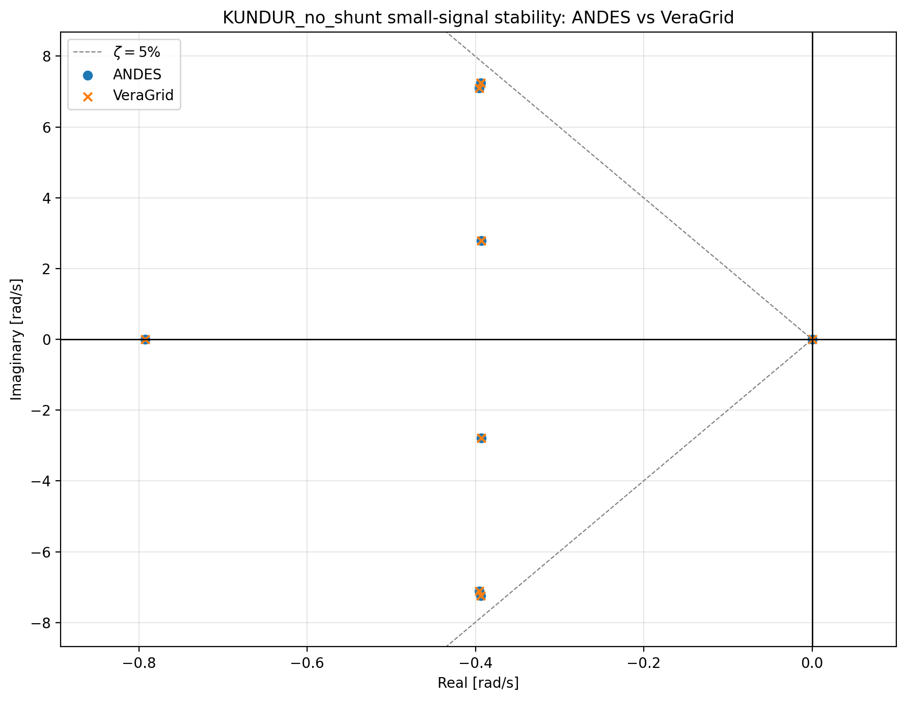

*Kundur two-area system. The ANDES circles and VeraGrid crosses overlap at the
resolution of the complete spectrum.*

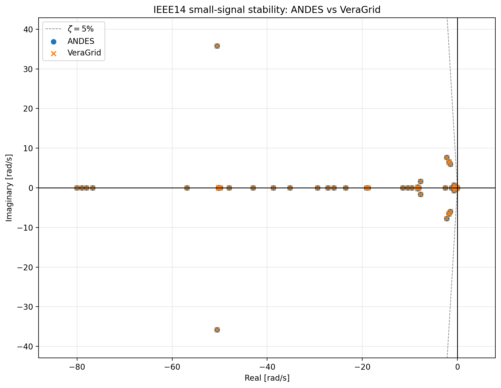

*IEEE14 complete eigenvalue spectrum.*

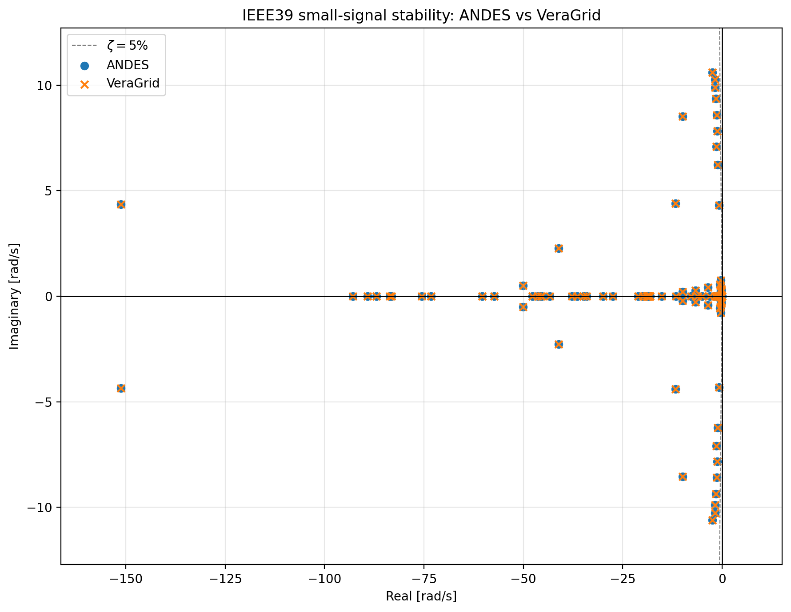

*IEEE39 complete eigenvalue spectrum.*

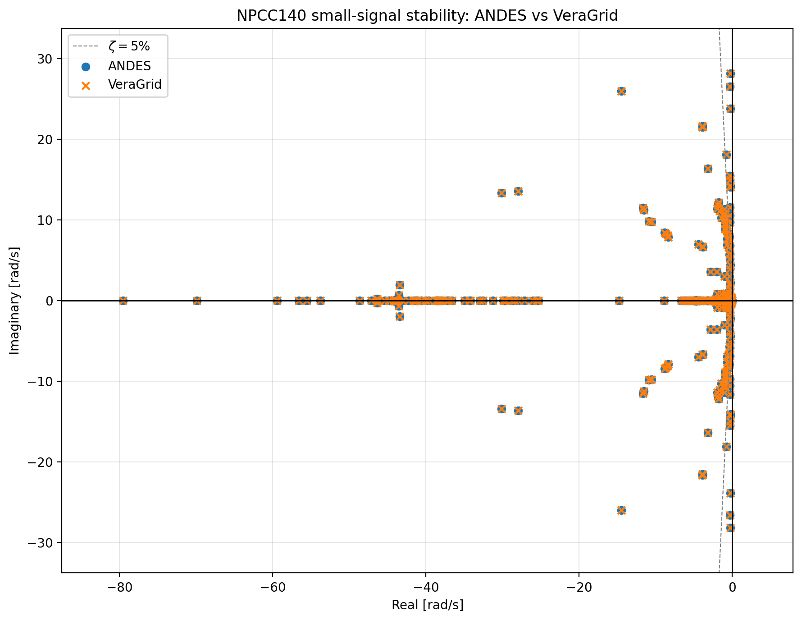

*NPCC140 complete eigenvalue spectrum.*

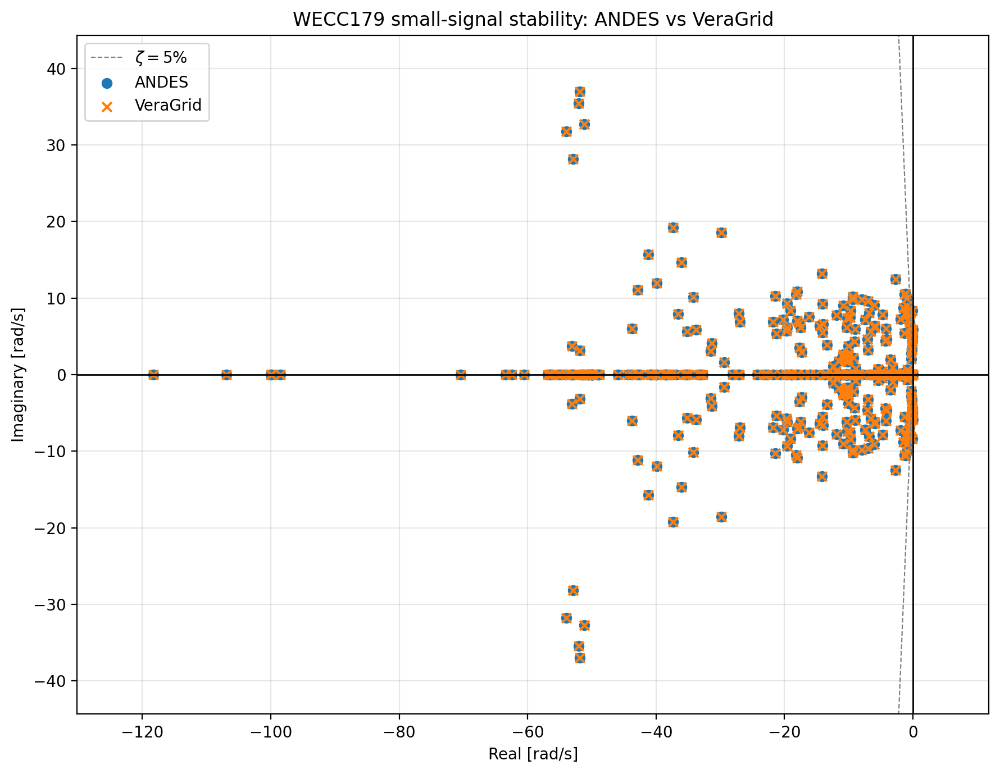

*WECC179 complete eigenvalue spectrum, including the repeated modes retained in
the eigenvalue comparison.*

The complete spectra show the global modal agreement, while the numerical
errors in the table provide the corresponding quantitative comparison near the
stability boundary.

Participation-factor agreement is summarized by the relative errors in the
table. Repeated WECC179 modes are excluded from this metric because their
individual eigenvector bases are not unique.

#### Recorded small-signal timings

The complete measured workflow includes case loading or construction,
power flow, dynamic preparation, numerical small-signal analysis, and result
export. The production kernel isolates the numerical small-signal calculation.

| Case | ANDES total (s) | VeraGrid total (s) | ANDES kernel (s) | VeraGrid kernel (s) |
|---|---:|---:|---:|---:|
| Kundur | 0.647732 | 1.829239 | 0.013852 | 0.030901 |
| IEEE14 | 0.614612 | 3.086192 | 0.002962 | 0.042896 |
| IEEE39 | 0.779038 | 3.437096 | 0.125438 | 0.055578 |
| NPCC140 | 2.544027 | 5.203009 | 0.342250 | 0.162901 |
| WECC179 | 1.927876 | 6.184687 | 0.376404 | 0.281134 |

ANDES is faster for the complete recorded workflow in all five runs. VeraGrid's
small-signal kernel is faster for IEEE39, NPCC140, and WECC179, while its
dynamic-model preparation and symbolic compilation dominate the complete
workflow. These single runs identify where time was spent; they should be
read as illustrative measurements rather than a general performance ordering.

### 1.2 RMS time-domain simulation

Two time-domain scenarios were compared with the fixed-step Backward Euler
method and a nonlinear tolerance of $10^{-6}$:

- **Base response:** 1 ms step, 1 s horizon, and the same
  $10^{-4}$ pu initial rotor-speed perturbation on the same machine.
- **Event response:** 1 ms step, 2 s horizon, initially unperturbed equilibrium,
  and an additive $10^{-4}$ pu rotor-speed-state step at $t=0.2$ s.

The event cases contain the complete requested 2,001-point time grid. No
adaptive time-step reduction was accepted. Both programs solve the power flow
twice: the first cold solve is a warm-up diagnostic, while the second warm solve
initializes RMS and is included in the analyzed timing. File export is excluded.

#### Common-state trajectory agreement

| Case | Base maximum error | Base RMSE | Event maximum error | Event RMSE |
|---|---:|---:|---:|---:|
| Kundur | $4.614090\times10^{-7}$ | $1.634077\times10^{-7}$ | $4.614090\times10^{-7}$ | $1.622421\times10^{-7}$ |
| IEEE14 | $1.169621\times10^{-4}$ | $1.189528\times10^{-5}$ | $1.169621\times10^{-4}$ | $8.522151\times10^{-6}$ |
| IEEE39 | $5.694527\times10^{-6}$ | $7.339261\times10^{-7}$ | $5.694640\times10^{-6}$ | $7.339084\times10^{-7}$ |
| NPCC140 | $4.780440\times10^{-7}$ | $6.554596\times10^{-8}$ | $4.780440\times10^{-7}$ | $6.554454\times10^{-8}$ |
| WECC179 | $1.535531\times10^{-3}$ | $4.515396\times10^{-5}$ | $1.535531\times10^{-3}$ | $3.827806\times10^{-5}$ |

The case-level diagnostics are important for interpreting the largest number:

- **Kundur:** the remaining difference is almost entirely a sub-microradian
  rotor-angle offset; rotor-speed differences are about $10^{-11}$ pu.
- **IEEE14:** the maximum residue is localized in zero-time-constant ESST3A
  `LAW2` states. The tested TGOV1 lower-limit transition agrees to
  $7.61\times10^{-10}$.
- **IEEE39:** the largest differences are nearly constant micro-scale offsets
  in governor and exciter states. They do not grow through the trajectory.
- **NPCC140:** every common trajectory remains below
  $5\times10^{-7}$ absolute error.
- **WECC179:** the largest difference is localized in ESST3A `LAW2` and the
  IEEEG1 limiter chain. VeraGrid's IEEEG1 template represents the normal
  interior-limiter regime and omits the ANDES valve-rate and anti-windup
  branches. The two models are therefore not globally equivalent after a
  limiter changes branch.

The close state matrices demonstrate local equivalence in the selected
linearization branch. They do not, by themselves, prove nonlinear equivalence
for every event or limiter regime.

#### Representative base trajectories

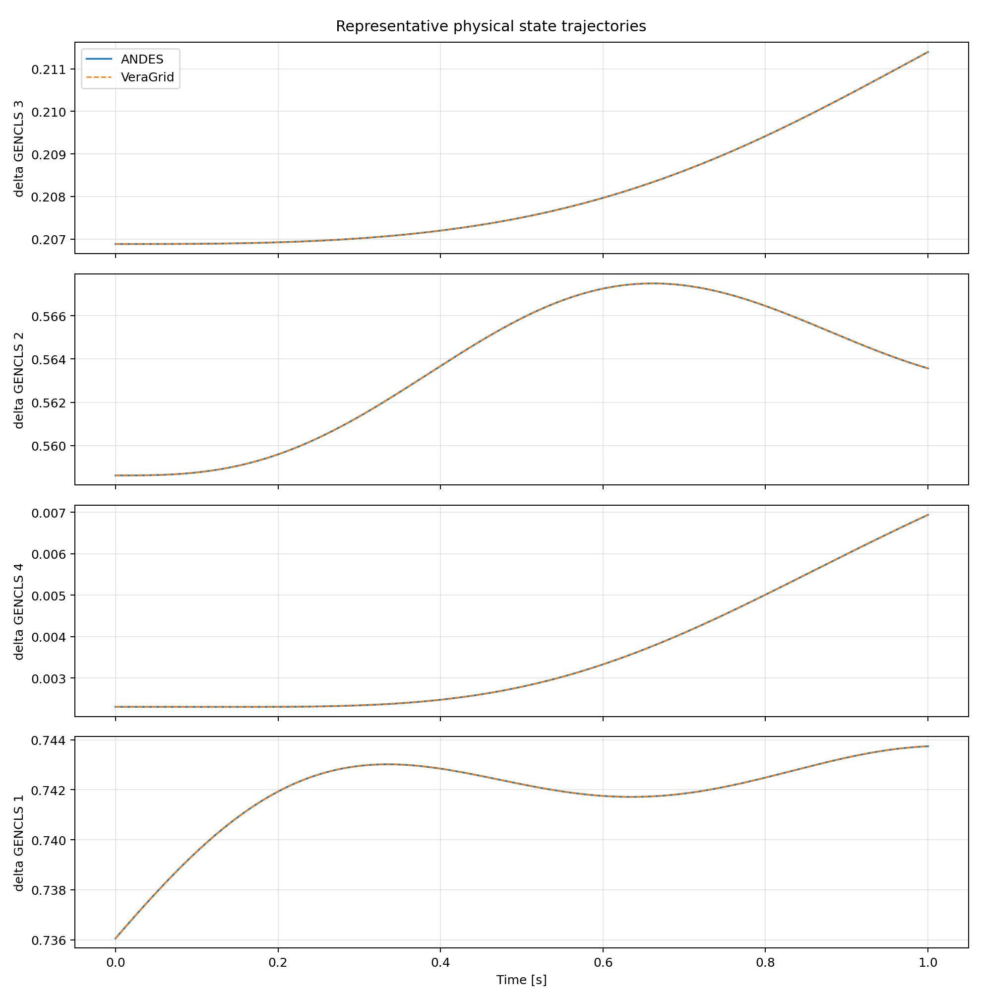

*Kundur representative physical states for the 1 s base response.*

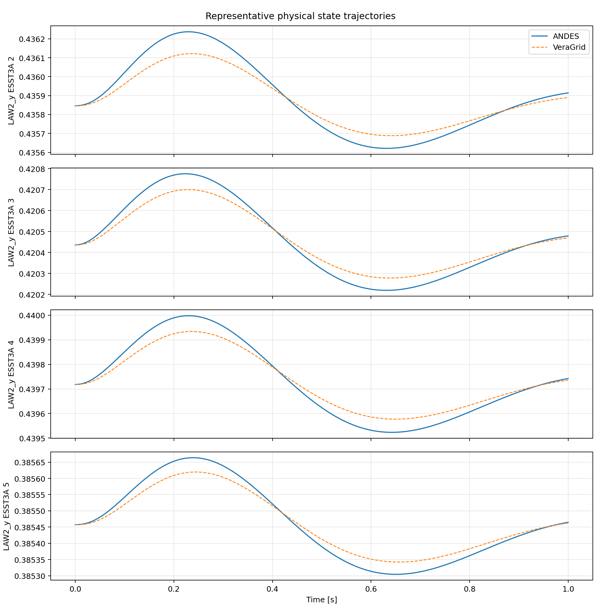

*IEEE14 representative physical states. The visible ESST3A `LAW2` differences
are consistent with the case diagnostics above.*

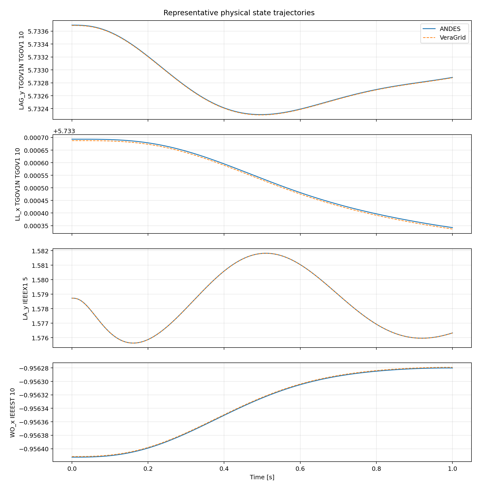

*IEEE39 representative physical states. The small, nearly constant offsets do
not develop into a growing trajectory divergence.*

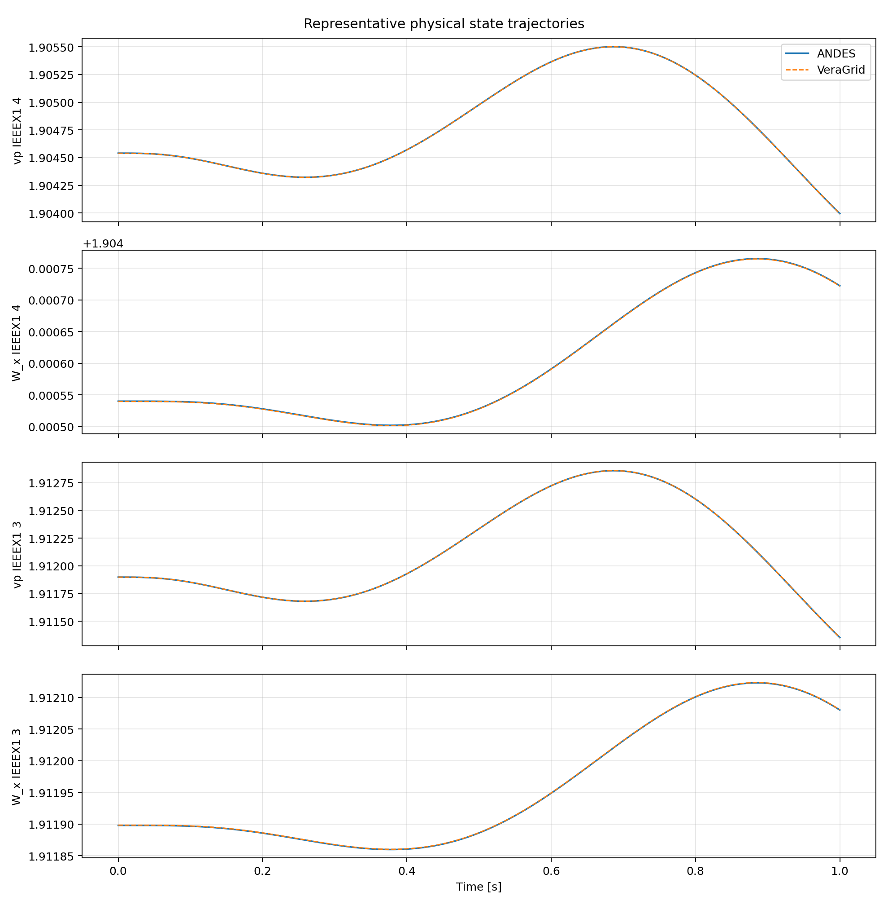

*NPCC140 representative physical states.*

The base-case maximum errors and RMSE values are reported in the common-state
agreement table. The figures are therefore used to show the physical
trajectories and their agreement, while the table provides the error scale
without duplicating one additional error plot per system.

#### Representative event trajectory

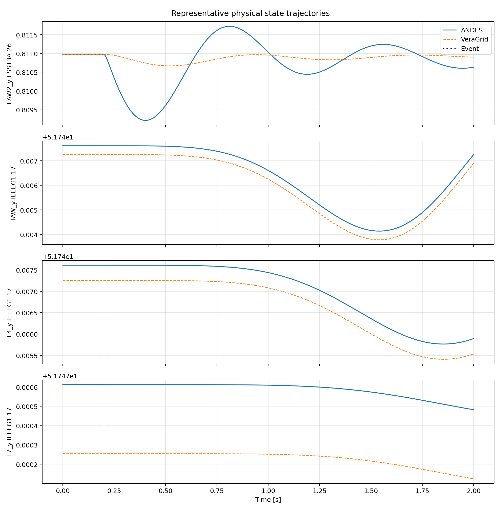

*WECC179 response to the event at $t=0.2$ s. The selected states expose the
documented ESST3A and IEEEG1 limiter-chain differences.*

The event marker and the four most informative physical trajectories are shown
directly in the figure. Their aggregate maximum error and RMSE are given in the
table above, and the case-level discussion identifies the states and model
branches responsible for the difference.

#### Recorded RMS timings

| Case | Base ANDES (s) | Base VeraGrid (s) | Event ANDES (s) | Event VeraGrid (s) |
|---|---:|---:|---:|---:|
| Kundur | 4.535880 | 5.057498 | 4.870898 | 5.445997 |
| IEEE14 | 9.597229 | 4.081667 | 25.810310 | 9.504345 |
| IEEE39 | 8.543582 | 9.962002 | 11.345670 | 31.876980 |
| NPCC140 | 14.851950 | 31.331610 | 20.462640 | 61.169760 |
| WECC179 | 13.882940 | 49.423460 | 58.890590 | 89.751240 |

These analyzed totals contain model setup, the warm power flow, dynamic
initialization and numerical preparation, and integration. The cold power flow
and result export are excluded. The winner changes with the network and
scenario because total DAE dimension, Jacobian sparsity and fill-in, nonlinear
iterations, factorization reuse, and model preparation all contribute.

## 2. PowerFactory comparison

### 2.1 RMS time-domain comparison

The RMS validation uses an interconnected system containing international
standard dynamic models. Multiple events are applied and equivalent output
signals from VeraGrid and DIgSILENT PowerFactory are overlaid. The recorded
study reports relative errors on the order of $10^{-5}$ for the compared
responses.

This comparison exercises the complete workflow rather than an isolated block:
network solution, model initialization, event processing, DAE integration, and
result extraction.

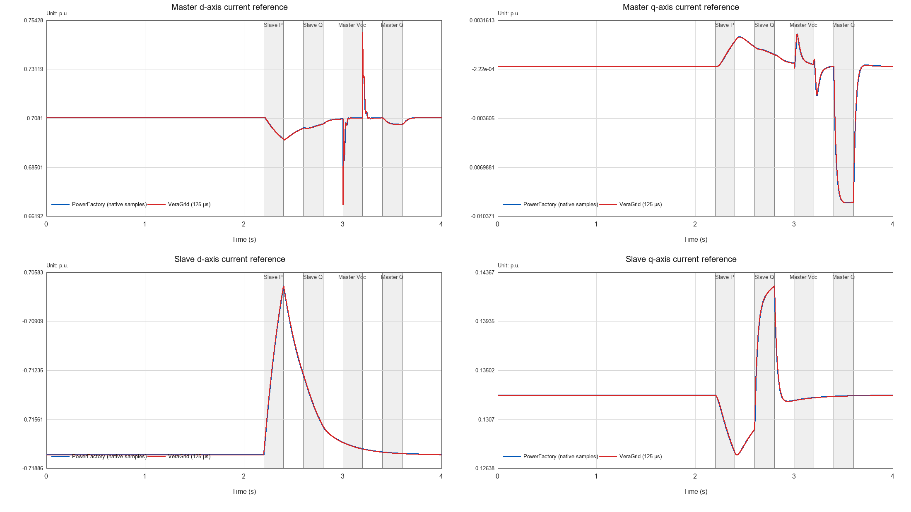

*PowerFactory and VeraGrid master/slave $d$- and $q$-axis current-reference
responses. The shaded intervals identify the applied active-power,
reactive-power, and DC-voltage events.*

### 2.2 PowerFactory DGS import coverage

The PowerFactory DGS parser was tested with approximately twelve example
networks, up to 240 buses, and a scope of 56 device types. The tested cases
imported successfully. This is an interoperability result rather than a
dynamic-solver benchmark: it shows the range of PowerFactory network data that
can be transferred into VeraGrid before carrying out a study.

## 3. STAMP comparison

STAMP provides a second independent implementation for modal validation. The
comparison covers both an RMS equilibrium and an EMT periodic orbit.

### 3.1 RMS small-signal comparison

The RMS benchmark uses a WSCC system with equivalent components, network data,
operating point, and dynamic equations. VeraGrid's native grid models are
replaced by fully dynamic models containing the states required for the STAMP
comparison. The corresponding eigenvalue spectra coincide.

This replacement is important: comparing a native algebraic network model with
a fully dynamic network realization would mix formulation differences with
solver differences. The benchmark instead aligns the mathematical model before
matching the modes.

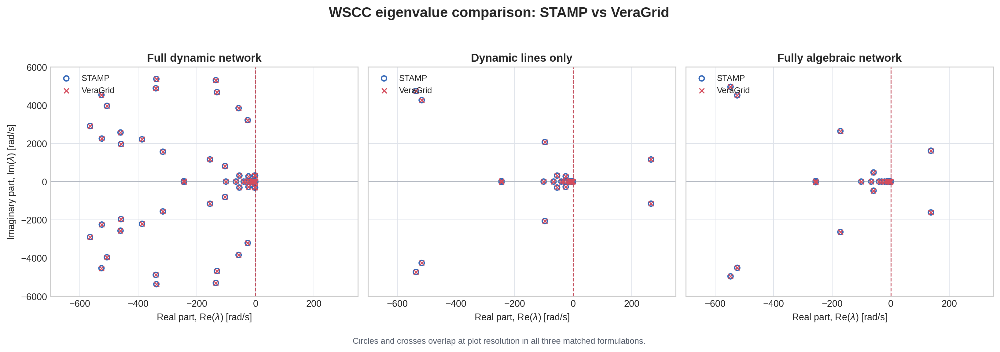

*STAMP and VeraGrid WSCC spectra for a fully dynamic network, dynamic lines
only, and a fully algebraic network. Circles and crosses overlap at the plotted
resolution in all three matched formulations.*

### 3.2 EMT Floquet comparison

For the EMT model, VeraGrid integrates the variational system over one complete
period to obtain the monodromy operator. Its Floquet multipliers $\mu$ are
converted to continuous-time exponents using

$$
\lambda = \frac{\log(\mu)}{T},
$$

where $T$ is the periodic-orbit period. The resulting rightmost exponents are
compared with the STAMP RMS eigenvalues.

The physically important rightmost modes agree closely. Strongly damped,
far-left EMT modes are less precise because their one-period multipliers are
extremely small. This does not normally alter the stability conclusion. The
full EMT model also contains additional modes associated with its three-phase
and larger state-space representation; these have no one-to-one RMS
counterpart and should not be forced into the matching set.

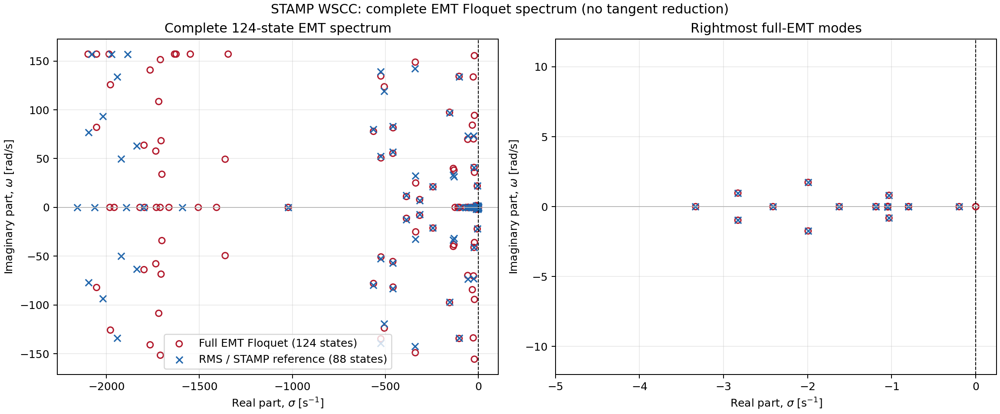

*Complete 124-state VeraGrid EMT Floquet spectrum and zoom of the rightmost
modes against the 88-state RMS/STAMP reference. Additional EMT-only modes are
retained in the complete-spectrum panel.*

## 4. PowerSimulationsDynamics.jl comparison

The RMS small-signal comparison with PowerSimulationsDynamics.jl uses
equivalent models, network data, and operating points for three systems:

| Case | Finite modes in each program | Recorded modal agreement |
|---|---:|---|
| Two-bus single-machine infinite-bus | 2 | Maximum difference approximately $9.1\times10^{-5}\ \mathrm{s}^{-1}$ |
| Three-bus system | 27 | Rightmost modes align; some internal modes show larger differences |
| IEEE 9-bus system | 45 | Median difference approximately $2.4\times10^{-7}\ \mathrm{s}^{-1}$ |

Modes are paired by nearest distance in the complex plane. Equal finite-mode
counts confirm that the compared state spaces have the same retained modal
dimension, but mode count alone is not a validation. The rightmost-mode match,
individual distances, and full spectra must be inspected together.

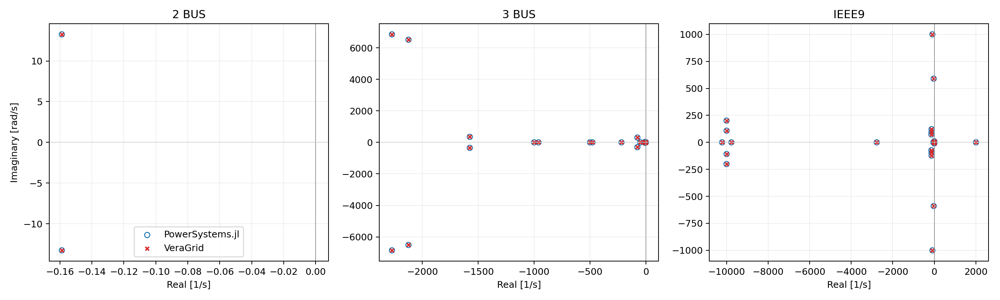

*Matched spectra for the two-bus, three-bus, and IEEE9 systems. The numerical
matching errors are reported in the table above.*
