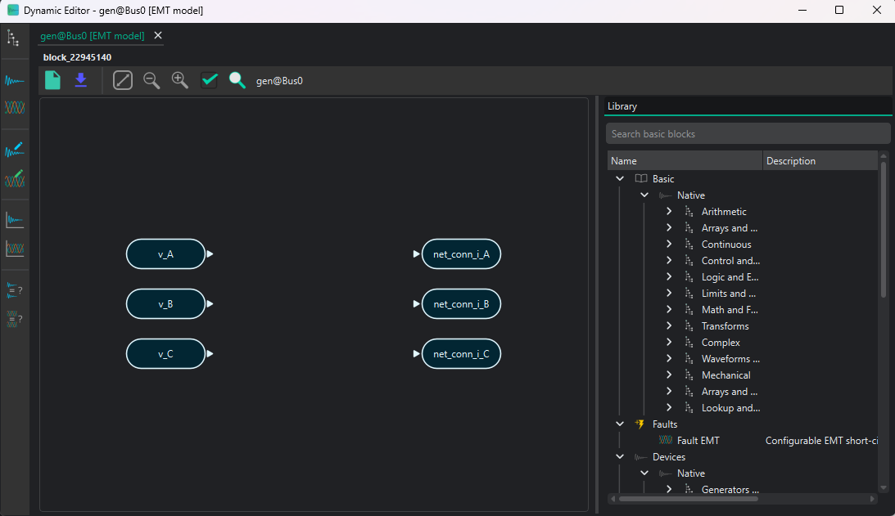
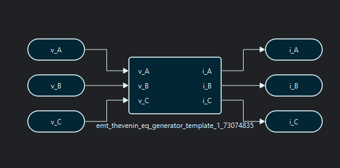
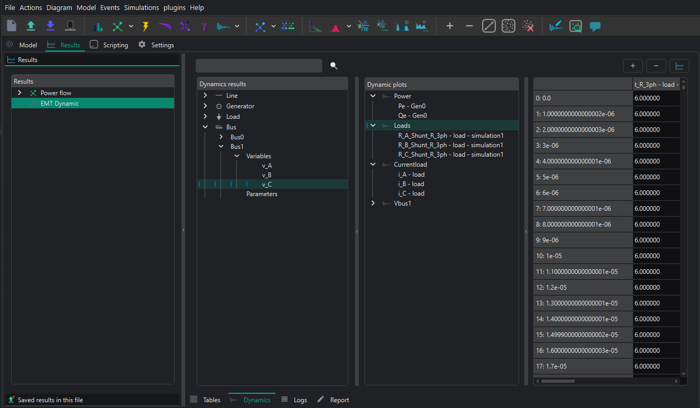

# 🔬 EMT simulations

Electromagnetic transient (EMT) simulation is VeraGrid's instantaneous phase-domain workflow. It resolves voltages and currents through time and is intended for phenomena that cannot be represented adequately by fundamental-frequency phasors.

```{toctree}
:maxdepth: 1

EMT_practical_session
```

## When to use EMT

EMT is appropriate for:

- switching and protection-driven transients;
- converter inner-loop and modulation interactions;
- detailed line or transformer transients;
- phase-domain and unbalanced behaviour;
- fast control interactions and waveform distortion.

Use [RMS simulation](rms_simulations.md) when the main interest is electromechanical or outer-control behaviour. The shared DAE and initialization concepts are described in [Dynamic simulation theory](dynamic_theory.md).

The EMT comparison with STAMP is collected in
[Dynamic simulation benchmarks](dynamic_benchmarks.md).

## EMT workflow

1. Build or import the static network.
2. Run and inspect the required power-flow operating point.
3. Assign saved EMT models to the participating devices.
4. Create at least one EMT event group; an empty group represents the base case.
5. Add optional step or ramp events.
6. Prepare persistent plot groups if required.
7. Configure the EMT settings and run the simulation.
8. Check initialization, convergence, and phase-domain trajectories for every scenario.

## Settings available in the GUI

The EMT settings panel exposes the following controls:

| GUI control | Available values or meaning |
|---|---|
| Time step | Interval between integration samples |
| Simulation time | End time of the study |
| Tolerance | Numerical convergence tolerance, entered as an exponent in the GUI |
| Integration method | `DAE_Trapezoidal`, `DAE_BackEuler`, or `DAE_bdf2` |
| Initialization method | `Explicit`, `ConsistentNewton`, `PseudoTransient`, or `Auto` |
| Solver type | `symbolic`, `structuralAD`, `structuralCompiled`, or `automatic` |
| Problem type | `CurrentBalance` |

`CurrentBalance` is the single EMT formulation currently presented to the user. The API uses the same core choices through `EmtOptions`.

EMT time steps are often in the microsecond range, but the correct value depends on the fastest electrical or control phenomenon. Confirm sensitive results with a smaller time step.

## Events

An `EmtEventsGroup` is one complete scenario. An `EmtEvent` changes one eligible model parameter using either a step or a ramp. Typical targets include load impedances, source references, gates, switching controls, and fault parameters.

Create and edit scenarios in the **EMT Events** page of the [dynamic workspace](dynamic_editor.md). The parameter tree is derived from the saved EMT models, so apply model-editor changes before configuring events.

## GUI example

The complete guided example is available in the [EMT practical session](EMT_practical_session.md). It builds a two-bus, three-phase case with a generator, a line, an R load, and resistance-change events.


The EMT editor supplies the device's phase-domain grid connection blocks. Add the required source, network, load, and controller blocks; connect their ports; validate the graph; and apply it to the device.





## Results in the GUI

Open **Results → EMT Dynamic** after the driver finishes. The view provides:

- a tree grouped by device and exported model variable;
- the persistent EMT plot groups defined in the EMT Plots page;
- a numerical table for the selected trajectory;
- the available event-group scenarios.

Double-click one variable to plot it directly. For a multi-signal plot, create or open a plot group and add the required variables. Time-series groups are appropriate for phase voltages, currents, and control states. X-Y groups are useful for phase planes and characteristic curves.

Before interpreting a curve, select the intended event group and verify its initialization and convergence status.



## Results from the API

`EmtResults` separates the ordinary variables and their derivative trajectories:

```text
values.shape      = (time samples, exported variables, event groups)
diff_values.shape = (time samples, differential variables, event groups)
```

The result object also provides:

- `time_array`: common time samples;
- `variables` and `diff_variables`: exported symbolic variables;
- `uid2idx_vars` and `uid2idx_diff`: UID-to-column mappings;
- `devices_vars_info`: variables grouped by owning device;
- `emt_events_group_names`: scenario labels;
- `has_event_group_results`: availability mask per scenario;
- `well_initialized` and `converged`: status per scenario;
- `get_vars_data(var_list, group_idx)`: selected trajectories for one scenario.

Use `has_event_group_results[group_idx]` before reading a scenario slice. For example, `results.values[:, :, group_idx]` returns the state and algebraic trajectories for one EMT scenario.

## API example

This example constructs a compact two-bus EMT case. The empty `EmtEventsGroup` is intentional: it defines the base-case scenario that the driver integrates.

```python
import numpy as np

import VeraGridEngine.api as vg
from VeraGridEngine.Devices.Branches.line import Line
from VeraGridEngine.Devices.Injections.generator import Generator
from VeraGridEngine.Devices.Injections.load import Load
from VeraGridEngine.Devices.Substation.bus import Bus
from VeraGridEngine.Simulations.EMT.emt_driver import EmtSimulationDriver
from VeraGridEngine.Simulations.EMT.emt_options import EmtOptions
from VeraGridEngine.Simulations.EMT.emt_results import EmtResults
from VeraGridEngine.Simulations.PowerFlow.power_flow_driver import PowerFlowOptions
from VeraGridEngine.Simulations.PowerFlow.power_flow_results import PowerFlowResults
from VeraGridEngine.Templates.Emt.load_RLC_emt_template import get_shunt_r_emt_template
from VeraGridEngine.Templates.Emt.pi_line_emt_template import get_pi_line_emt_template
from VeraGridEngine.Templates.Emt.thevenin_equivalent_emt_generator_template import (
    get_generator_thevenin_rl_emt_template_with_ref,
)
from VeraGridEngine.Utils.Symbolic.block import Block
from VeraGridEngine.Utils.Symbolic.templates_common_functions import set_emt_model
from VeraGridEngine.enumerations import DynamicIntegrationMethod, EmtInitializationMethod, EmtSolverTypes

grid: vg.MultiCircuit = vg.MultiCircuit(Sbase=100.0, fbase=50.0)

bus0: Bus = Bus(name="Bus0", Vnom=10.0, is_slack=True)
bus1: Bus = Bus(name="Bus1", Vnom=10.0)
grid.add_bus(bus0)
grid.add_bus(bus1)

line: Line = Line(
    name="Line 0-1",
    bus_from=bus0,
    bus_to=bus1,
    r=0.02,
    x=0.08,
    b=0.0,
    rate=100.0,
)
grid.add_line(line)

generator: Generator = Generator(
    name="Gen1",
    P=1.0,
    vset=1.0,
    Snom=100.0,
    r1=0.001,
    x1=1.7,
)
grid.add_generator(bus=bus0, api_obj=generator)

load: Load = Load(name="Load1", P=1.0, Q=0.0)
grid.add_load(bus=bus1, api_obj=load)

generator_model: Block = get_generator_thevenin_rl_emt_template_with_ref(grid.var_factory).block
line_model: Block = get_pi_line_emt_template(
    vf=grid.var_factory,
    phN=False,
    phA=True,
    phB=True,
    phC=True,
).block
load_model: Block = get_shunt_r_emt_template(
    vf=grid.var_factory,
    phA=True,
    phB=True,
    phC=True,
).block

set_emt_model(device=generator, model=generator_model, var_factory=grid.var_factory)
set_emt_model(device=line, model=line_model, var_factory=grid.var_factory)
set_emt_model(device=load, model=load_model, var_factory=grid.var_factory)

load.emt_model.set_parameter_in_model(
    var_name="R_A_Shunt_R_3ph",
    new_value=200.0,
)

base_case: vg.EmtEventsGroup = vg.EmtEventsGroup(name="Base case")
grid.add_emt_events_group(base_case)

power_flow_options: PowerFlowOptions = PowerFlowOptions(
    solver_type=vg.SolverType.NR,
    verbose=0,
)
power_flow_results: PowerFlowResults = vg.power_flow(grid, options=power_flow_options)

emt_options: EmtOptions = EmtOptions(
    time_step=1e-6,
    simulation_time=0.02,
    tolerance=1e-6,
    solver_type=EmtSolverTypes.StructuralAD,
    integration_method=DynamicIntegrationMethod.DaeTrapezoidal,
    initialization_method=EmtInitializationMethod.Auto,
    verbose=0,
)

driver: EmtSimulationDriver = EmtSimulationDriver(
    grid=grid,
    options=emt_options,
    pf_results=power_flow_results,
)
driver.run()

results: EmtResults | None = driver.results
if results is not None:
    group_index: int = 0
    if results.has_event_group_results[group_index]:
        scenario_values: np.ndarray = results.values[:, :, group_index]
        scenario_derivatives: np.ndarray = results.diff_values[:, :, group_index]
        print(results.converged[group_index])
        print(results.well_initialized[group_index])
        print(scenario_values.shape)
        print(scenario_derivatives.shape)
    else:
        print("The base-case scenario did not produce results.")
else:
    print("The EMT driver did not create a result object.")
```

The example shows the complete driver contract but is not a substitute for model-specific parameterization and validation. To add disturbances, create `EmtEvent` objects or use the EMT Events page instead of changing the model's stored base parameters.

## Practical checks

- Validate the static operating point before initializing EMT.
- Save model-editor changes before opening Events or Plots.
- Create at least one event group, including for an undisturbed case.
- Check `well_initialized`, `converged`, and `has_event_group_results` per group.
- Reduce the time step when assessing numerical sensitivity.
- For periodic-orbit stability, see [EMT Small-Signal stability: Floquet analysis](small_signal_stability_emt.md).
