<!-- Auto-generated by doc/generate_device_docs.py. Do not edit this file directly. -->

# 📐 Grid Modelling

Three-phase AC systems dominate power transmission and distribution for their efficiency, capacity, and compatibility.
While ideal systems are balanced and suitable for positive-sequence analysis, real networks often experience asymmetries
from untransposed lines, uneven loads, single-phase connections, and converter-based resources. The classical
symmetrical components method simplifies unbalanced fault analysis but struggles with strong sequence coupling,
non-linearities, and complex topologies.

Direct phase-domain (abc) modelling overcomes these limitations by representing actual phase quantities, naturally
handling asymmetry, non-linearities, and all fault types. It is particularly suited for transient simulations, EMTP
tools, and control design across all voltage levels.

Power systems comprise generators, transformers, lines, loads, and compensation equipment, interconnected from
generation through transmission and distribution to end users. Transmission operates at high voltages to reduce losses,
with transformers stepping voltages up or down as required. Transmission circuits often include series and shunt
compensation, while transformer winding configurations must be carefully modelled under unbalanced conditions. At the
distribution level, load points can be highly unbalanced due to single-phase connections.

<div style="text-align: center;">
    
</div>

## Bus

A `Bus` is the main electrical node in `MultiCircuit`. It holds voltage state variables and anchors injections, branch terminals, and operational limits.

This device belongs to the electrical topology and location hierarchy managed directly by `MultiCircuit`.

### Registered properties
Profile-enabled properties: `active`, `is_slack`, `Vm0`, `Va0`, `Vmin`, `Vmax`.

|       name        |    class_type     | unit |mandatory|max_chars|                      descriptions                      |has_profile|comment|
|-------------------|-------------------|------|---------|---------|--------------------------------------------------------|-----------|-------|
|idtag              |str                |      |False    |         |Unique ID                                               |False      |       |
|name               |str                |      |False    |         |Name of the device.                                     |False      |       |
|code               |str                |      |False    |         |Secondary ID                                            |False      |       |
|rdfid              |str                |      |False    |         |RDF ID for further compatibility                        |False      |       |
|action             |enum ActionType    |      |False    |         |Object action to perform. Only used for model merging.  |False      |       |
|selected_to_merge  |bool               |      |False    |         |Whether this object should be applied during diff merge.|False      |       |
|comment            |str                |      |False    |         |User comment                                            |False      |       |
|diff_changes       |MergeInformation   |      |False    |         |                                                        |False      |       |
|modelling_authority|Modelling Authority|      |False    |         |Modelling authority of this asset                       |False      |       |
|commissioned_date  |int                |      |False    |         |Commissioned date of the asset                          |False      |       |
|decommissioned_date|int                |      |False    |         |Decommissioned date of the asset                        |False      |       |
|build_status       |enum BuildStatus   |      |False    |         |Device build status. Used in expansion planning.        |False      |       |
|owners             |AssociationsList   |p.u.  |False    |         |Owners associations to injections                       |False      |       |
|rms_model          |DaeBlock           |      |False    |         |RMS dynamic model                                       |False      |       |
|emt_model          |DaeBlock           |      |False    |         |EMT dynamic model                                       |False      |       |
|active             |bool               |      |False    |         |Is the bus active? used to disable the bus.             |True       |       |
|is_slack           |bool               |      |False    |         |Force the bus to be of slack type.                      |True       |       |
|is_dc              |bool               |      |False    |         |Is this bus of DC type?.                                |False      |       |
|is_grounded        |bool               |      |False    |         |Is this bus connected to ground?.                       |False      |       |
|graphic_type       |enum BusGraphicType|      |False    |         |Graphic to use in the schematic.                        |False      |       |
|Vnom               |float              |kV    |False    |         |Nominal line voltage of the bus.                        |False      |       |
|Vm0                |float              |p.u.  |False    |         |Voltage module guess.                                   |True       |       |
|Va0                |float              |rad.  |False    |         |Voltage angle guess.                                    |True       |       |
|Vmin               |float              |p.u.  |False    |         |Lower range of allowed voltage module.                  |True       |       |
|Vmax               |float              |p.u.  |False    |         |Higher range of allowed voltage module.                 |True       |       |
|Vm_cost            |float              |e/unit|False    |         |Cost of over and under voltages                         |False      |       |
|angle_min          |float              |rad.  |False    |         |Lower range of allowed voltage angle.                   |False      |       |
|angle_max          |float              |rad.  |False    |         |Higher range of allowed voltage angle.                  |False      |       |
|angle_cost         |float              |e/unit|False    |         |Cost of over and under angles                           |False      |       |
|x                  |float              |px    |False    |         |x position in pixels.                                   |False      |       |
|y                  |float              |px    |False    |         |y position in pixels.                                   |False      |       |
|h                  |float              |px    |False    |         |height of the bus in pixels.                            |False      |       |
|w                  |float              |px    |False    |         |Width of the bus in pixels.                             |False      |       |
|country            |Country            |      |False    |         |Country of the bus                                      |False      |       |
|area               |Area               |      |False    |         |Area of the bus                                         |False      |       |
|zone               |Zone               |      |False    |         |Zone of the bus                                         |False      |       |
|substation         |Substation         |      |False    |         |Substation of the bus.                                  |False      |       |
|voltage_level      |Voltage level      |      |False    |         |Voltage level of the bus.                               |False      |       |
|bus_bar            |BusBar             |      |False    |         |Busbar associated to the bus.                           |False      |       |
|longitude          |float              |deg   |False    |         |longitude of the bus.                                   |False      |       |
|latitude           |float              |deg   |False    |         |latitude of the bus.                                    |False      |       |
|color              |str                |      |False    |         |Color to paint the element in the diagram               |False      |       |

## BusBar

A `BusBar` represents an explicit busbar object inside a voltage level. It is useful when diagram structure or substation-level topology needs to be preserved.

This device belongs to the electrical topology and location hierarchy managed directly by `MultiCircuit`.

### Registered properties
Profile-enabled properties: none.

|       name        |    class_type     |unit|mandatory|max_chars|                      descriptions                      |has_profile|comment|
|-------------------|-------------------|----|---------|---------|--------------------------------------------------------|-----------|-------|
|idtag              |str                |    |False    |         |Unique ID                                               |False      |       |
|name               |str                |    |False    |         |Name of the device.                                     |False      |       |
|code               |str                |    |False    |         |Secondary ID                                            |False      |       |
|rdfid              |str                |    |False    |         |RDF ID for further compatibility                        |False      |       |
|action             |enum ActionType    |    |False    |         |Object action to perform. Only used for model merging.  |False      |       |
|selected_to_merge  |bool               |    |False    |         |Whether this object should be applied during diff merge.|False      |       |
|comment            |str                |    |False    |         |User comment                                            |False      |       |
|diff_changes       |MergeInformation   |    |False    |         |                                                        |False      |       |
|modelling_authority|Modelling Authority|    |False    |         |Modelling authority of this asset                       |False      |       |
|commissioned_date  |int                |    |False    |         |Commissioned date of the asset                          |False      |       |
|decommissioned_date|int                |    |False    |         |Decommissioned date of the asset                        |False      |       |
|build_status       |enum BuildStatus   |    |False    |         |Device build status. Used in expansion planning.        |False      |       |
|owners             |AssociationsList   |p.u.|False    |         |Owners associations to injections                       |False      |       |
|voltage_level      |Voltage level      |    |False    |         |Voltage level of this BusBar                            |False      |       |

## VoltageLevel

A `VoltageLevel` groups buses and busbars that belong to the same nominal voltage inside a substation.

This device belongs to the electrical topology and location hierarchy managed directly by `MultiCircuit`.

### Registered properties
Profile-enabled properties: none.

|       name        |    class_type     |unit|mandatory|max_chars|                      descriptions                      |has_profile|comment|
|-------------------|-------------------|----|---------|---------|--------------------------------------------------------|-----------|-------|
|idtag              |str                |    |False    |         |Unique ID                                               |False      |       |
|name               |str                |    |False    |         |Name of the device.                                     |False      |       |
|code               |str                |    |False    |         |Secondary ID                                            |False      |       |
|rdfid              |str                |    |False    |         |RDF ID for further compatibility                        |False      |       |
|action             |enum ActionType    |    |False    |         |Object action to perform. Only used for model merging.  |False      |       |
|selected_to_merge  |bool               |    |False    |         |Whether this object should be applied during diff merge.|False      |       |
|comment            |str                |    |False    |         |User comment                                            |False      |       |
|diff_changes       |MergeInformation   |    |False    |         |                                                        |False      |       |
|modelling_authority|Modelling Authority|    |False    |         |Modelling authority of this asset                       |False      |       |
|commissioned_date  |int                |    |False    |         |Commissioned date of the asset                          |False      |       |
|decommissioned_date|int                |    |False    |         |Decommissioned date of the asset                        |False      |       |
|build_status       |enum BuildStatus   |    |False    |         |Device build status. Used in expansion planning.        |False      |       |
|owners             |AssociationsList   |p.u.|False    |         |Owners associations to injections                       |False      |       |
|Vnom               |float              |kV  |False    |         |Nominal voltage                                         |False      |       |
|substation         |Substation         |    |False    |         |Substation of this Voltage level (optional)             |False      |       |

## Substation

A `Substation` is the top-level station object used to group voltage levels, buses, and related physical assets.

This device belongs to the electrical topology and location hierarchy managed directly by `MultiCircuit`.

### Registered properties
Profile-enabled properties: `irradiation`, `temperature`, `wind_speed`.

|       name        |    class_type     |unit |mandatory|max_chars|                                                                                                         descriptions                                                                                                         |has_profile|comment|
|-------------------|-------------------|-----|---------|---------|------------------------------------------------------------------------------------------------------------------------------------------------------------------------------------------------------------------------------|-----------|-------|
|idtag              |str                |     |False    |         |Unique ID                                                                                                                                                                                                                     |False      |       |
|name               |str                |     |False    |         |Name of the device.                                                                                                                                                                                                           |False      |       |
|code               |str                |     |False    |         |Secondary ID                                                                                                                                                                                                                  |False      |       |
|rdfid              |str                |     |False    |         |RDF ID for further compatibility                                                                                                                                                                                              |False      |       |
|action             |enum ActionType    |     |False    |         |Object action to perform. Only used for model merging.                                                                                                                                                                        |False      |       |
|selected_to_merge  |bool               |     |False    |         |Whether this object should be applied during diff merge.                                                                                                                                                                      |False      |       |
|comment            |str                |     |False    |         |User comment                                                                                                                                                                                                                  |False      |       |
|diff_changes       |MergeInformation   |     |False    |         |                                                                                                                                                                                                                              |False      |       |
|modelling_authority|Modelling Authority|     |False    |         |Modelling authority of this asset                                                                                                                                                                                             |False      |       |
|commissioned_date  |int                |     |False    |         |Commissioned date of the asset                                                                                                                                                                                                |False      |       |
|decommissioned_date|int                |     |False    |         |Decommissioned date of the asset                                                                                                                                                                                              |False      |       |
|build_status       |enum BuildStatus   |     |False    |         |Device build status. Used in expansion planning.                                                                                                                                                                              |False      |       |
|owners             |AssociationsList   |p.u. |False    |         |Owners associations to injections                                                                                                                                                                                             |False      |       |
|longitude          |float              |deg  |False    |         |longitude.                                                                                                                                                                                                                    |False      |       |
|latitude           |float              |deg  |False    |         |latitude.                                                                                                                                                                                                                     |False      |       |
|color              |str                |     |False    |         |Color to paint the element in the map diagram                                                                                                                                                                                 |False      |       |
|area               |Area               |     |False    |         |Substation area, alternatively this can be obtained from the zone                                                                                                                                                             |False      |       |
|zone               |Zone               |     |False    |         |Substation area                                                                                                                                                                                                               |False      |       |
|country            |Country            |     |False    |         |Substation country, alternatively this can be obtained from the community                                                                                                                                                     |False      |       |
|community          |Community          |     |False    |         |Substation community, alternatively this can be obtained from the region                                                                                                                                                      |False      |       |
|region             |Region             |     |False    |         |Substation region, alternatively this can be obtained from the municipality                                                                                                                                                   |False      |       |
|municipality       |Municipality       |     |False    |         |Substation municipality                                                                                                                                                                                                       |False      |       |
|address            |str                |     |False    |         |Substation address                                                                                                                                                                                                            |False      |       |
|irradiation        |float              |W/m^2|False    |         |Substation solar irradiation                                                                                                                                                                                                  |True       |       |
|temperature        |float              |ºC   |False    |         |Substation temperature                                                                                                                                                                                                        |True       |       |
|wind_speed         |float              |m/s  |False    |         |Substation wind speed at 80m above the ground                                                                                                                                                                                 |True       |       |
|terrain_roughness  |float              |     |False    |         |This value is ised for wind speed extrapolation. Typical values: Not rough (sand, snow, sea): 0~0.02 Slightly rough (grass, cereal field): 0.02~0.2 Rough (forest, small houses): 1.0~1.5 Very rough (Large buildings):1.0~4.0|False      |       |

## Country

A `Country` groups assets at country scope for reporting, filtering, transfer-capacity studies, and geographic organization.

This device provides geographical or administrative context for topology and reporting.

### Registered properties
Profile-enabled properties: none.

|      name       |   class_type   |unit|mandatory|max_chars|                      descriptions                      |has_profile|comment|
|-----------------|----------------|----|---------|---------|--------------------------------------------------------|-----------|-------|
|idtag            |str             |    |False    |         |Unique ID                                               |False      |       |
|name             |str             |    |False    |         |Name of the device.                                     |False      |       |
|code             |str             |    |False    |         |Secondary ID                                            |False      |       |
|rdfid            |str             |    |False    |         |RDF ID for further compatibility                        |False      |       |
|action           |enum ActionType |    |False    |         |Object action to perform. Only used for model merging.  |False      |       |
|selected_to_merge|bool            |    |False    |         |Whether this object should be applied during diff merge.|False      |       |
|comment          |str             |    |False    |         |User comment                                            |False      |       |
|diff_changes     |MergeInformation|    |False    |         |                                                        |False      |       |
|longitude        |float           |deg |False    |         |longitude.                                              |False      |       |
|latitude         |float           |deg |False    |         |latitude.                                               |False      |       |
|color            |str             |    |False    |         |Color to paint the element in the map diagram           |False      |       |

## Community

A `Community` is an intermediate regional grouping that can be attached to buses and inherited by connected assets.

This device provides geographical or administrative context for topology and reporting.

### Registered properties
Profile-enabled properties: none.

|      name       |   class_type   |unit|mandatory|max_chars|                              descriptions                               |has_profile|comment|
|-----------------|----------------|----|---------|---------|-------------------------------------------------------------------------|-----------|-------|
|idtag            |str             |    |False    |         |Unique ID                                                                |False      |       |
|name             |str             |    |False    |         |Name of the device.                                                      |False      |       |
|code             |str             |    |False    |         |Secondary ID                                                             |False      |       |
|rdfid            |str             |    |False    |         |RDF ID for further compatibility                                         |False      |       |
|action           |enum ActionType |    |False    |         |Object action to perform. Only used for model merging.                   |False      |       |
|selected_to_merge|bool            |    |False    |         |Whether this object should be applied during diff merge.                 |False      |       |
|comment          |str             |    |False    |         |User comment                                                             |False      |       |
|diff_changes     |MergeInformation|    |False    |         |                                                                         |False      |       |
|longitude        |float           |deg |False    |         |longitude.                                                               |False      |       |
|latitude         |float           |deg |False    |         |latitude.                                                                |False      |       |
|color            |str             |    |False    |         |Color to paint the element in the map diagram                            |False      |       |
|country          |Country         |    |False    |         |Substation country, altenativelly this can be obtained from the community|False      |       |

## Region

A `Region` groups substations and buses below the community level and above municipalities.

This device provides geographical or administrative context for topology and reporting.

### Registered properties
Profile-enabled properties: none.

|      name       |   class_type   |unit|mandatory|max_chars|                              descriptions                              |has_profile|comment|
|-----------------|----------------|----|---------|---------|------------------------------------------------------------------------|-----------|-------|
|idtag            |str             |    |False    |         |Unique ID                                                               |False      |       |
|name             |str             |    |False    |         |Name of the device.                                                     |False      |       |
|code             |str             |    |False    |         |Secondary ID                                                            |False      |       |
|rdfid            |str             |    |False    |         |RDF ID for further compatibility                                        |False      |       |
|action           |enum ActionType |    |False    |         |Object action to perform. Only used for model merging.                  |False      |       |
|selected_to_merge|bool            |    |False    |         |Whether this object should be applied during diff merge.                |False      |       |
|comment          |str             |    |False    |         |User comment                                                            |False      |       |
|diff_changes     |MergeInformation|    |False    |         |                                                                        |False      |       |
|longitude        |float           |deg |False    |         |longitude.                                                              |False      |       |
|latitude         |float           |deg |False    |         |latitude.                                                               |False      |       |
|color            |str             |    |False    |         |Color to paint the element in the map diagram                           |False      |       |
|community        |Community       |    |False    |         |Substation community, altenativelly this can be obtained from the region|False      |       |

## Municipality

A `Municipality` stores local administrative context for buses and substations.

This device provides geographical or administrative context for topology and reporting.

### Registered properties
Profile-enabled properties: none.

|      name       |   class_type   |unit|mandatory|max_chars|                               descriptions                                |has_profile|comment|
|-----------------|----------------|----|---------|---------|---------------------------------------------------------------------------|-----------|-------|
|idtag            |str             |    |False    |         |Unique ID                                                                  |False      |       |
|name             |str             |    |False    |         |Name of the device.                                                        |False      |       |
|code             |str             |    |False    |         |Secondary ID                                                               |False      |       |
|rdfid            |str             |    |False    |         |RDF ID for further compatibility                                           |False      |       |
|action           |enum ActionType |    |False    |         |Object action to perform. Only used for model merging.                     |False      |       |
|selected_to_merge|bool            |    |False    |         |Whether this object should be applied during diff merge.                   |False      |       |
|comment          |str             |    |False    |         |User comment                                                               |False      |       |
|diff_changes     |MergeInformation|    |False    |         |                                                                           |False      |       |
|longitude        |float           |deg |False    |         |longitude.                                                                 |False      |       |
|latitude         |float           |deg |False    |         |latitude.                                                                  |False      |       |
|color            |str             |    |False    |         |Color to paint the element in the map diagram                              |False      |       |
|region           |Region          |    |False    |         |Substation region, alternatively this can be obtained from the municipality|False      |       |

## Area

An `Area` groups buses for operational aggregation and transfer-capacity workflows.

This device provides geographical or administrative context for topology and reporting.

### Registered properties
Profile-enabled properties: `spinning_reserve_requirement`.

|            name            |   class_type   |unit|mandatory|max_chars|                      descriptions                      |has_profile|comment|
|----------------------------|----------------|----|---------|---------|--------------------------------------------------------|-----------|-------|
|idtag                       |str             |    |False    |         |Unique ID                                               |False      |       |
|name                        |str             |    |False    |         |Name of the device.                                     |False      |       |
|code                        |str             |    |False    |         |Secondary ID                                            |False      |       |
|rdfid                       |str             |    |False    |         |RDF ID for further compatibility                        |False      |       |
|action                      |enum ActionType |    |False    |         |Object action to perform. Only used for model merging.  |False      |       |
|selected_to_merge           |bool            |    |False    |         |Whether this object should be applied during diff merge.|False      |       |
|comment                     |str             |    |False    |         |User comment                                            |False      |       |
|diff_changes                |MergeInformation|    |False    |         |                                                        |False      |       |
|longitude                   |float           |deg |False    |         |longitude.                                              |False      |       |
|latitude                    |float           |deg |False    |         |latitude.                                               |False      |       |
|color                       |str             |    |False    |         |Color to paint the element in the map diagram           |False      |       |
|spinning_reserve_requirement|float           |MW  |False    |         |Area spinning reserve requirement used in OPF.          |True       |       |

## Zone

A `Zone` is a market or study grouping used to aggregate buses and branches.

This device provides geographical or administrative context for topology and reporting.

### Registered properties
Profile-enabled properties: none.

|      name       |   class_type   |unit|mandatory|max_chars|                      descriptions                      |has_profile|comment|
|-----------------|----------------|----|---------|---------|--------------------------------------------------------|-----------|-------|
|idtag            |str             |    |False    |         |Unique ID                                               |False      |       |
|name             |str             |    |False    |         |Name of the device.                                     |False      |       |
|code             |str             |    |False    |         |Secondary ID                                            |False      |       |
|rdfid            |str             |    |False    |         |RDF ID for further compatibility                        |False      |       |
|action           |enum ActionType |    |False    |         |Object action to perform. Only used for model merging.  |False      |       |
|selected_to_merge|bool            |    |False    |         |Whether this object should be applied during diff merge.|False      |       |
|comment          |str             |    |False    |         |User comment                                            |False      |       |
|diff_changes     |MergeInformation|    |False    |         |                                                        |False      |       |
|longitude        |float           |deg |False    |         |longitude.                                              |False      |       |
|latitude         |float           |deg |False    |         |latitude.                                               |False      |       |
|color            |str             |    |False    |         |Color to paint the element in the map diagram           |False      |       |
|area             |Area            |    |False    |         |Area of this zone.                                      |False      |       |

## Generator

For the power flow simulations, generators had been modelled as simple power injections into the system, which was
completely valid. However, this is not sufficient when performing the short-circuit analysis, as the impedance of the
generator must also be taken into account. VeraGrid has been programmed to accept a $3 \times 3$ impedance matrix, which
includes both the self and mutual impedances between the $abc$ phases.

It is also common to encounter generator impedances in the sequence domain. Therefore, Fortescue’s theorem is
applied to obtain the equivalent values for the three phases:

$$
\vec{Z}_{gen_{abc}} =
\begin{bmatrix}
\vec{Z}_0 + \vec{Z}_1 + \vec{Z}_2 & \vec{Z}_0 + \vec{a}\vec{Z}_1 + \vec{a}^2\vec{Z}_2 & \vec{Z}_0 + \vec{a}^2\vec{Z}_1 + \vec{a}\vec{Z}_2 \\
\vec{Z}_0 + \vec{a}^2\vec{Z}_1 + \vec{a}\vec{Z}_2 & \vec{Z}_0 + \vec{Z}_1 + \vec{Z}_2 & \vec{Z}_0 + \vec{a}\vec{Z}_1 + \vec{a}^2\vec{Z}_2 \\
\vec{Z}_0 + \vec{a}\vec{Z}_1 + \vec{a}^2\vec{Z}_2 & \vec{Z}_0 + \vec{a}^2\vec{Z}_1 + \vec{a}\vec{Z}_2 & \vec{Z}_0 + \vec{Z}_1 + \vec{Z}_2
\end{bmatrix}
$$

Where the transformation eigenvector $\vec{a} = e^{j2\pi/3}$ is used.

The generator could be modelled during the short-circuit using the classic Thévenin equivalent, that is, as an ideal
voltage source in series with the generator’s impedance, as shown in the electrical circuit of the following figure:

<div style="text-align: center;">
    
</div>

However, this would require to add an additional bus to the original system between the generator’s impedance and the
ideal voltage source. Therefore, the generator can be also modelled using its Norton equivalent, that is, an ideal current source
in parallel with the generator’s impedance, as shown in the schematic bellow:

<div style="text-align: center;">
    
</div>

The Norton current source will take the value of the internal voltage multiplied by its admittance:

$$
\vec{I}_{N} = \vec{Y}_{gen} \cdot \ \vec{E}
$$

#### Example

```python
import VeraGridEngine.api as gce

logger = gce.Logger()
grid = gce.MultiCircuit()

# ----------------------------------------------------------------------------------------------------------------------
# Buses
# ----------------------------------------------------------------------------------------------------------------------
bus = gce.Bus(name='Bus', Vnom=4.16)
grid.add_bus(obj=bus)

# ----------------------------------------------------------------------------------------------------------------------
# Generator
# ----------------------------------------------------------------------------------------------------------------------
gen = gce.Generator(vset=1.0, r1=0.004, x1=0.5, r2=0.02, x2=0.5, r0=0.01, x0=0.08)
grid.add_generator(bus=bus, api_obj=gen)
```

### Registered properties
Profile-enabled properties: `active`, `Cost`, `shift_key`, `P`, `Pmin`, `Pmax`, `Q`, `Qmin`, `Qmax`, `control_mode`, `Pf`, `Vset`, `Cost2`, `Cost0`, `enabled_dispatch`, `must_run`, `srap_enabled`.

|          name          |       class_type        | unit  |mandatory|max_chars|                                           descriptions                                           |has_profile|comment|
|------------------------|-------------------------|-------|---------|---------|--------------------------------------------------------------------------------------------------|-----------|-------|
|idtag                   |str                      |       |False    |         |Unique ID                                                                                         |False      |       |
|name                    |str                      |       |False    |         |Name of the device.                                                                               |False      |       |
|code                    |str                      |       |False    |         |Secondary ID                                                                                      |False      |       |
|rdfid                   |str                      |       |False    |         |RDF ID for further compatibility                                                                  |False      |       |
|action                  |enum ActionType          |       |False    |         |Object action to perform. Only used for model merging.                                            |False      |       |
|selected_to_merge       |bool                     |       |False    |         |Whether this object should be applied during diff merge.                                          |False      |       |
|comment                 |str                      |       |False    |         |User comment                                                                                      |False      |       |
|diff_changes            |MergeInformation         |       |False    |         |                                                                                                  |False      |       |
|modelling_authority     |Modelling Authority      |       |False    |         |Modelling authority of this asset                                                                 |False      |       |
|commissioned_date       |int                      |       |False    |         |Commissioned date of the asset                                                                    |False      |       |
|decommissioned_date     |int                      |       |False    |         |Decommissioned date of the asset                                                                  |False      |       |
|build_status            |enum BuildStatus         |       |False    |         |Device build status. Used in expansion planning.                                                  |False      |       |
|owners                  |AssociationsList         |p.u.   |False    |         |Owners associations to injections                                                                 |False      |       |
|rms_model               |DaeBlock                 |       |False    |         |RMS dynamic model                                                                                 |False      |       |
|emt_model               |DaeBlock                 |       |False    |         |EMT dynamic model                                                                                 |False      |       |
|rms_template            |RMS template             |       |False    |         |Native RMS template used. Assigning it clears rms_fmu_template.                                   |False      |       |
|emt_template            |EMT template             |       |False    |         |Native EMT template used. Assigning it clears emt_fmu_template.                                   |False      |       |
|rms_fmu_template        |FMU template             |       |False    |         |RMS FMU template used only by RMS simulations. Assigning it clears rms_template.                  |False      |       |
|emt_fmu_template        |FMU template             |       |False    |         |EMT FMU template used only by EMT simulations. Assigning it clears emt_template.                  |False      |       |
|rms_fmu_import_config   |str                      |       |False    |         |Serialized FMU Co-Simulation RMS configuration                                                    |False      |       |
|emt_fmu_import_config   |str                      |       |False    |         |Serialized FMU Co-Simulation EMT configuration                                                    |False      |       |
|rms_fmu_me_import_config|str                      |       |False    |         |Serialized FMU Model Exchange RMS configuration                                                   |False      |       |
|emt_fmu_me_import_config|str                      |       |False    |         |Serialized FMU Model Exchange EMT configuration                                                   |False      |       |
|bus                     |Bus                      |       |False    |         |Connection bus                                                                                    |False      |       |
|active                  |bool                     |       |False    |         |Is the load active?                                                                               |True       |       |
|color                   |str                      |       |False    |         |Color to paint the element in the map diagram                                                     |False      |       |
|mttf                    |float                    |h      |False    |         |Mean time to failure                                                                              |False      |       |
|mttr                    |float                    |h      |False    |         |Mean time to recovery                                                                             |False      |       |
|capex                   |float                    |e/MW   |False    |         |Cost of investment. Used in expansion planning.                                                   |False      |       |
|opex                    |float                    |e/MWh  |False    |         |Cost of operation. Used in expansion planning.                                                    |False      |       |
|Cost                    |float                    |e/MWh  |False    |         |Cost of not served energy. Used in OPF.                                                           |True       |       |
|facility                |Facility                 |       |False    |         |Facility where this is located                                                                    |False      |       |
|technologies            |AssociationsList         |p.u.   |False    |         |Technologies associations to injections                                                           |False      |       |
|scalable                |bool                     |       |False    |         |Is the injection scalable? (only for data compatibility)                                          |False      |       |
|shift_key               |float                    |       |False    |         |Shift key for net transfer capacity                                                               |True       |       |
|longitude               |float                    |deg    |False    |         |longitude of the injection.                                                                       |False      |       |
|latitude                |float                    |deg    |False    |         |latitude of the injection.                                                                        |False      |       |
|use_kw                  |bool                     |       |False    |         |Consider the injections in kW and kVAr?                                                           |False      |       |
|conn                    |enum ShuntConnectionType |       |False    |         |Connection type for 3-phase studies                                                               |False      |       |
|phN                     |bool                     |       |False    |         |Is the neutral connected?                                                                         |False      |       |
|phA                     |bool                     |       |False    |         |Is phase A connected?                                                                             |False      |       |
|phB                     |bool                     |       |False    |         |Is phase B connected?                                                                             |False      |       |
|phC                     |bool                     |       |False    |         |Is phase C connected?                                                                             |False      |       |
|bus_pos                 |int                      |       |False    |         |Aid to locate devices on a busbar                                                                 |False      |       |
|P                       |float                    |MW     |False    |         |Active power                                                                                      |True       |       |
|Pmin                    |float                    |MW     |False    |         |Minimum active power. Used in OPF.                                                                |True       |       |
|Pmax                    |float                    |MW     |False    |         |Maximum active power. Used in OPF.                                                                |True       |       |
|Q                       |float                    |MVAr   |False    |         |Reactive power                                                                                    |True       |       |
|Qmin                    |float                    |MVAr   |False    |         |Minimum reactive power.                                                                           |True       |       |
|Qmax                    |float                    |MVAr   |False    |         |Maximum reactive power.                                                                           |True       |       |
|control_mode            |enum GeneratorControlMode|       |False    |         |Generator control mode                                                                            |True       |       |
|control_bus             |Bus                      |       |False    |         |Control bus                                                                                       |False      |       |
|Pf                      |float                    |       |False    |         |Power factor (cos(phi)). This is used for non-controlled generators.                              |True       |       |
|Vset                    |float                    |p.u.   |False    |         |Voltage setpoint for controlled generators; positive-sequence magnitude in three-phase power flow.|True       |       |
|k_droop                 |float                    |       |False    |         |QV droop constant.                                                                                |False      |       |
|dead_band               |float                    |kV     |False    |         |Droop dead band.                                                                                  |False      |       |
|Snom                    |float                    |MVA    |False    |         |Nominal power.                                                                                    |False      |       |
|use_reactive_power_curve|bool                     |       |False    |         |Use the reactive power capability curve?                                                          |False      |       |
|q_curve                 |Generator Q curve        |MVAr   |False    |         |Capability curve data (double click on the generator to edit)                                     |False      |       |
|R1                      |float                    |p.u.   |False    |         |Total positive sequence resistance.                                                               |False      |       |
|X1                      |float                    |p.u.   |False    |         |Total positive sequence reactance.                                                                |False      |       |
|R0                      |float                    |p.u.   |False    |         |Total zero sequence resistance on system base; used in U1 power flow for a grounded connection.   |False      |       |
|X0                      |float                    |p.u.   |False    |         |Total zero sequence reactance on system base; used in U1 power flow for a grounded connection.    |False      |       |
|R2                      |float                    |p.u.   |False    |         |Total negative sequence resistance on system base; used automatically in U1 power flow.           |False      |       |
|X2                      |float                    |p.u.   |False    |         |Total negative sequence reactance on system base; used automatically in U1 power flow.            |False      |       |
|Rs                      |float                    |p.u.   |False    |         |Stator winding resistance (AG).                                                                   |False      |       |
|Xs                      |float                    |p.u.   |False    |         |Stator leakage reactance (AG).                                                                    |False      |       |
|Xm                      |float                    |p.u.   |False    |         |Magnetizing reactance (AG).                                                                       |False      |       |
|Rr                      |float                    |p.u.   |False    |         |Rotor resistance (AG).                                                                            |False      |       |
|Xr                      |float                    |p.u.   |False    |         |Rotor reactance (AG).                                                                             |False      |       |
|Cost2                   |float                    |e/MW²/h|False    |         |Generation quadratic cost. Used in OPF.                                                           |True       |       |
|Cost0                   |float                    |e/h    |False    |         |Generation constant cost. Used in OPF.                                                            |True       |       |
|startup_cost            |float                    |e/h    |False    |         |Generation start-up cost. Used in OPF.                                                            |False      |       |
|shutdown_cost           |float                    |e/h    |False    |         |Generation shut-down cost. Used in OPF.                                                           |False      |       |
|min_time_up             |float                    |h      |False    |         |Minimum time that the generator has to be on when started. Used in OPF.                           |False      |       |
|min_time_down           |float                    |h      |False    |         |Minimum time that the generator has to be off when shut down. Used in OPF.                        |False      |       |
|ramp_up                 |float                    |MW/h   |False    |         |Maximum amount of generation increase per hour.                                                   |False      |       |
|ramp_down               |float                    |MW/h   |False    |         |Maximum amount of generation decrease per hour.                                                   |False      |       |
|enabled_dispatch        |bool                     |       |False    |         |Enabled for dispatch? Used in OPF.                                                                |True       |       |
|must_run                |bool                     |       |False    |         |P >= Pmin constraint. Used in OPF with unit commitment active.                                    |True       |       |
|emissions               |AssociationsList         |t/MWh  |False    |         |List of emissions                                                                                 |False      |       |
|fuels                   |AssociationsList         |t/MWh  |False    |         |List of fuels                                                                                     |False      |       |
|srap_enabled            |bool                     |       |False    |         |Is the unit available for SRAP participation?                                                     |True       |       |
|tpe                     |enum GeneratorType       |       |False    |         |Machine type of the generator.                                                                    |False      |       |
|is_static_generator     |bool                     |       |False    |         |Use the static generator short-circuit model.                                                     |False      |       |

## Battery

A `Battery` extends generator-style injection modelling with energy-capacity and state-of-charge parameters for storage studies.

This device connects to a bus and contributes power, current, or admittance to the solved network model.

### Registered properties
Profile-enabled properties: `active`, `Cost`, `shift_key`, `P`, `Pmin`, `Pmax`, `Q`, `Qmin`, `Qmax`, `control_mode`, `Pf`, `Vset`, `Cost2`, `Cost0`, `enabled_dispatch`, `must_run`, `srap_enabled`, `dispatch_mode`.

|          name          |       class_type        | unit  |mandatory|max_chars|                                           descriptions                                           |has_profile|comment|
|------------------------|-------------------------|-------|---------|---------|--------------------------------------------------------------------------------------------------|-----------|-------|
|idtag                   |str                      |       |False    |         |Unique ID                                                                                         |False      |       |
|name                    |str                      |       |False    |         |Name of the device.                                                                               |False      |       |
|code                    |str                      |       |False    |         |Secondary ID                                                                                      |False      |       |
|rdfid                   |str                      |       |False    |         |RDF ID for further compatibility                                                                  |False      |       |
|action                  |enum ActionType          |       |False    |         |Object action to perform. Only used for model merging.                                            |False      |       |
|selected_to_merge       |bool                     |       |False    |         |Whether this object should be applied during diff merge.                                          |False      |       |
|comment                 |str                      |       |False    |         |User comment                                                                                      |False      |       |
|diff_changes            |MergeInformation         |       |False    |         |                                                                                                  |False      |       |
|modelling_authority     |Modelling Authority      |       |False    |         |Modelling authority of this asset                                                                 |False      |       |
|commissioned_date       |int                      |       |False    |         |Commissioned date of the asset                                                                    |False      |       |
|decommissioned_date     |int                      |       |False    |         |Decommissioned date of the asset                                                                  |False      |       |
|build_status            |enum BuildStatus         |       |False    |         |Device build status. Used in expansion planning.                                                  |False      |       |
|owners                  |AssociationsList         |p.u.   |False    |         |Owners associations to injections                                                                 |False      |       |
|rms_model               |DaeBlock                 |       |False    |         |RMS dynamic model                                                                                 |False      |       |
|emt_model               |DaeBlock                 |       |False    |         |EMT dynamic model                                                                                 |False      |       |
|rms_template            |RMS template             |       |False    |         |Native RMS template used. Assigning it clears rms_fmu_template.                                   |False      |       |
|emt_template            |EMT template             |       |False    |         |Native EMT template used. Assigning it clears emt_fmu_template.                                   |False      |       |
|rms_fmu_template        |FMU template             |       |False    |         |RMS FMU template used only by RMS simulations. Assigning it clears rms_template.                  |False      |       |
|emt_fmu_template        |FMU template             |       |False    |         |EMT FMU template used only by EMT simulations. Assigning it clears emt_template.                  |False      |       |
|rms_fmu_import_config   |str                      |       |False    |         |Serialized FMU Co-Simulation RMS configuration                                                    |False      |       |
|emt_fmu_import_config   |str                      |       |False    |         |Serialized FMU Co-Simulation EMT configuration                                                    |False      |       |
|rms_fmu_me_import_config|str                      |       |False    |         |Serialized FMU Model Exchange RMS configuration                                                   |False      |       |
|emt_fmu_me_import_config|str                      |       |False    |         |Serialized FMU Model Exchange EMT configuration                                                   |False      |       |
|bus                     |Bus                      |       |False    |         |Connection bus                                                                                    |False      |       |
|active                  |bool                     |       |False    |         |Is the load active?                                                                               |True       |       |
|color                   |str                      |       |False    |         |Color to paint the element in the map diagram                                                     |False      |       |
|mttf                    |float                    |h      |False    |         |Mean time to failure                                                                              |False      |       |
|mttr                    |float                    |h      |False    |         |Mean time to recovery                                                                             |False      |       |
|capex                   |float                    |e/MW   |False    |         |Cost of investment. Used in expansion planning.                                                   |False      |       |
|opex                    |float                    |e/MWh  |False    |         |Cost of operation. Used in expansion planning.                                                    |False      |       |
|Cost                    |float                    |e/MWh  |False    |         |Cost of not served energy. Used in OPF.                                                           |True       |       |
|facility                |Facility                 |       |False    |         |Facility where this is located                                                                    |False      |       |
|technologies            |AssociationsList         |p.u.   |False    |         |Technologies associations to injections                                                           |False      |       |
|scalable                |bool                     |       |False    |         |Is the injection scalable? (only for data compatibility)                                          |False      |       |
|shift_key               |float                    |       |False    |         |Shift key for net transfer capacity                                                               |True       |       |
|longitude               |float                    |deg    |False    |         |longitude of the injection.                                                                       |False      |       |
|latitude                |float                    |deg    |False    |         |latitude of the injection.                                                                        |False      |       |
|use_kw                  |bool                     |       |False    |         |Consider the injections in kW and kVAr?                                                           |False      |       |
|conn                    |enum ShuntConnectionType |       |False    |         |Connection type for 3-phase studies                                                               |False      |       |
|phN                     |bool                     |       |False    |         |Is the neutral connected?                                                                         |False      |       |
|phA                     |bool                     |       |False    |         |Is phase A connected?                                                                             |False      |       |
|phB                     |bool                     |       |False    |         |Is phase B connected?                                                                             |False      |       |
|phC                     |bool                     |       |False    |         |Is phase C connected?                                                                             |False      |       |
|bus_pos                 |int                      |       |False    |         |Aid to locate devices on a busbar                                                                 |False      |       |
|P                       |float                    |MW     |False    |         |Active power                                                                                      |True       |       |
|Pmin                    |float                    |MW     |False    |         |Minimum active power. Used in OPF.                                                                |True       |       |
|Pmax                    |float                    |MW     |False    |         |Maximum active power. Used in OPF.                                                                |True       |       |
|Q                       |float                    |MVAr   |False    |         |Reactive power                                                                                    |True       |       |
|Qmin                    |float                    |MVAr   |False    |         |Minimum reactive power.                                                                           |True       |       |
|Qmax                    |float                    |MVAr   |False    |         |Maximum reactive power.                                                                           |True       |       |
|control_mode            |enum GeneratorControlMode|       |False    |         |Generator control mode                                                                            |True       |       |
|control_bus             |Bus                      |       |False    |         |Control bus                                                                                       |False      |       |
|Pf                      |float                    |       |False    |         |Power factor (cos(phi)). This is used for non-controlled generators.                              |True       |       |
|Vset                    |float                    |p.u.   |False    |         |Voltage setpoint for controlled generators; positive-sequence magnitude in three-phase power flow.|True       |       |
|k_droop                 |float                    |       |False    |         |QV droop constant.                                                                                |False      |       |
|dead_band               |float                    |kV     |False    |         |Droop dead band.                                                                                  |False      |       |
|Snom                    |float                    |MVA    |False    |         |Nominal power.                                                                                    |False      |       |
|use_reactive_power_curve|bool                     |       |False    |         |Use the reactive power capability curve?                                                          |False      |       |
|q_curve                 |Generator Q curve        |MVAr   |False    |         |Capability curve data (double click on the generator to edit)                                     |False      |       |
|R1                      |float                    |p.u.   |False    |         |Total positive sequence resistance.                                                               |False      |       |
|X1                      |float                    |p.u.   |False    |         |Total positive sequence reactance.                                                                |False      |       |
|R0                      |float                    |p.u.   |False    |         |Total zero sequence resistance on system base; used in U1 power flow for a grounded connection.   |False      |       |
|X0                      |float                    |p.u.   |False    |         |Total zero sequence reactance on system base; used in U1 power flow for a grounded connection.    |False      |       |
|R2                      |float                    |p.u.   |False    |         |Total negative sequence resistance on system base; used automatically in U1 power flow.           |False      |       |
|X2                      |float                    |p.u.   |False    |         |Total negative sequence reactance on system base; used automatically in U1 power flow.            |False      |       |
|Rs                      |float                    |p.u.   |False    |         |Stator winding resistance (AG).                                                                   |False      |       |
|Xs                      |float                    |p.u.   |False    |         |Stator leakage reactance (AG).                                                                    |False      |       |
|Xm                      |float                    |p.u.   |False    |         |Magnetizing reactance (AG).                                                                       |False      |       |
|Rr                      |float                    |p.u.   |False    |         |Rotor resistance (AG).                                                                            |False      |       |
|Xr                      |float                    |p.u.   |False    |         |Rotor reactance (AG).                                                                             |False      |       |
|Cost2                   |float                    |e/MW²/h|False    |         |Generation quadratic cost. Used in OPF.                                                           |True       |       |
|Cost0                   |float                    |e/h    |False    |         |Generation constant cost. Used in OPF.                                                            |True       |       |
|startup_cost            |float                    |e/h    |False    |         |Generation start-up cost. Used in OPF.                                                            |False      |       |
|shutdown_cost           |float                    |e/h    |False    |         |Generation shut-down cost. Used in OPF.                                                           |False      |       |
|min_time_up             |float                    |h      |False    |         |Minimum time that the generator has to be on when started. Used in OPF.                           |False      |       |
|min_time_down           |float                    |h      |False    |         |Minimum time that the generator has to be off when shut down. Used in OPF.                        |False      |       |
|ramp_up                 |float                    |MW/h   |False    |         |Maximum amount of generation increase per hour.                                                   |False      |       |
|ramp_down               |float                    |MW/h   |False    |         |Maximum amount of generation decrease per hour.                                                   |False      |       |
|enabled_dispatch        |bool                     |       |False    |         |Enabled for dispatch? Used in OPF.                                                                |True       |       |
|must_run                |bool                     |       |False    |         |P >= Pmin constraint. Used in OPF with unit commitment active.                                    |True       |       |
|emissions               |AssociationsList         |t/MWh  |False    |         |List of emissions                                                                                 |False      |       |
|fuels                   |AssociationsList         |t/MWh  |False    |         |List of fuels                                                                                     |False      |       |
|srap_enabled            |bool                     |       |False    |         |Is the unit available for SRAP participation?                                                     |True       |       |
|tpe                     |enum GeneratorType       |       |False    |         |Machine type of the generator.                                                                    |False      |       |
|is_static_generator     |bool                     |       |False    |         |Use the static generator short-circuit model.                                                     |False      |       |
|Enom                    |float                    |MWh    |False    |         |Nominal energy capacity.                                                                          |False      |       |
|max_soc                 |float                    |p.u.   |False    |         |Minimum state of charge.                                                                          |False      |       |
|min_soc                 |float                    |p.u.   |False    |         |Maximum state of charge.                                                                          |False      |       |
|soc_0                   |float                    |p.u.   |False    |         |Initial state of charge.                                                                          |False      |       |
|charge_efficiency       |float                    |p.u.   |False    |         |Charging efficiency.                                                                              |False      |       |
|discharge_efficiency    |float                    |p.u.   |False    |         |Discharge efficiency.                                                                             |False      |       |
|discharge_per_cycle     |float                    |p.u.   |False    |         |                                                                                                  |False      |       |
|dispatch_mode           |enum BatteryDispatchMode |       |False    |         |Battery dispatch behaviour.                                                                       |True       |       |

## Load

Given the diversity of loads in power networks, they are grouped into bulk consumption points and represented using the
ZIP model, which combines impedance, current, and power components.

<div style="text-align: center;">
    
</div>

In steady-state studies, loads are represented as three-phase power sinks, connected in star or delta. Since the
formulation uses phase-to-neutral voltages and line currents, all loads are modelled as
star-connected, requiring delta loads to be converted to star equivalents for impedance, current, and power injections.

<div style="text-align: center;">
    
</div>

The impedance component of the ZIP formulation shares the same admittance modelling described in the `Shunt` section.

### Constant current (I) modelling of three-phase star-connected loads

Traditionally, in positive sequence power flow analysis, constant current loads are directly stored in the $\vec{I}_0$
vector. However, since we are performing a three-phase power flow, the voltage angles of phases b and c are not zero,
so they must be taken into account. For both three-phase current star-connected loads, the defined phase currents are
stored in the vector $\vec{I}_0$ as follows:

$$
\vec{I}_0 =
\begin{bmatrix}
    \vec{I}_a^* \, e^{j \, \delta_a} \\
    \vec{I}_b^* \, e^{j \, \delta_b} \\
    \vec{I}_c^* \, e^{j \, \delta_c} \\
\end{bmatrix}
$$

<div style="text-align: center;">
    
</div>

#### Example

```python
import VeraGridEngine.api as gce
from VeraGridEngine import ShuntConnectionType

logger = gce.Logger()
grid = gce.MultiCircuit()

# ----------------------------------------------------------------------------------------------------------------------
# Buses
# ----------------------------------------------------------------------------------------------------------------------
bus = gce.Bus(name='Bus', Vnom=0.48)
grid.add_bus(obj=bus)

# ----------------------------------------------------------------------------------------------------------------------
# Three-phase star current load
# ----------------------------------------------------------------------------------------------------------------------
load = gce.Load(Ir1=0.160,
                Ii1=0.110,
                Ir2=0.120,
                Ii2=0.090,
                Ir3=0.120,
                Ii3=0.090)
load.conn = ShuntConnectionType.GroundedStar
grid.add_load(bus=bus, api_obj=load)
```

### Constant current (I) modelling of three-phase delta-connected loads

However, if the current load is defined in delta connection, the vector shown bellow will be used to mathematically
model the element:

$$
\vec{I}_0 =
\begin{bmatrix}
\dfrac{\vec{I}_{ab}^* \, e^{j \, (\delta_a - \delta_b)} - \vec{I}_{ca}^* \, e^{j \, (\delta_c - \delta_a)}}{\sqrt{3}} \\
\dfrac{\vec{I}_{bc}^* \, e^{j \, (\delta_b - \delta_c)} - \vec{I}_{ab}^* \, e^{j \, (\delta_a - \delta_b)}}{\sqrt{3}} \\
\dfrac{\vec{I}_{ca}^* \, e^{j \, (\delta_c - \delta_a)} - \vec{I}_{bc}^* \, e^{j \, (\delta_b - \delta_c)}}{\sqrt{3}} \\
\end{bmatrix}
$$

Note that for loads connected between phases, the voltage angle to be applied is not that of the
phase to which the current load will be mapped, but rather the angle of the voltage difference
between the two phases to which the current-defined load is connected. Then, the angles
will be updated in each iteration, adding significant complexity compared to the traditional power flow.

<div style="text-align: center;">
    
</div>

#### Example

```python
import VeraGridEngine.api as gce
from VeraGridEngine import ShuntConnectionType

logger = gce.Logger()
grid = gce.MultiCircuit()

# ----------------------------------------------------------------------------------------------------------------------
# Buses
# ----------------------------------------------------------------------------------------------------------------------
bus = gce.Bus(name='Bus', Vnom=0.48)
grid.add_bus(obj=bus)

# ----------------------------------------------------------------------------------------------------------------------
# Three-phase delta current load
# ----------------------------------------------------------------------------------------------------------------------
load = gce.Load(Ir1=0.160,
                Ii1=0.110,
                Ir2=0.120,
                Ii2=0.090,
                Ir3=0.120,
                Ii3=0.090)
load.conn = ShuntConnectionType.Delta
grid.add_load(bus=bus, api_obj=load)
```

### Constant current (I) modelling of two-phase loads

Two-phase current loads, connected for instance between phases $a$ and $c$, are modelled in the same way as three-phase
delta-connected loads. The only difference is that, in this case, the current is defined solely as $vec{I}_{ca}$, while the
other phase-to-phase currents remain zero:

$$
\vec{I}_0 =
\begin{bmatrix}
\dfrac{- \vec{I}_{ca}^* \, e^{j \, (\delta_c - \delta_a)}}{\sqrt{3}} \\
0 \\
\dfrac{ \vec{I}_{ca}^* \, e^{j \, (\delta_c - \delta_a)}}{\sqrt{3}} \\
\end{bmatrix}
$$

<div style="text-align: center;">
    
</div>

#### Example

```python
import VeraGridEngine.api as gce
from VeraGridEngine import ShuntConnectionType

logger = gce.Logger()
grid = gce.MultiCircuit()

# ----------------------------------------------------------------------------------------------------------------------
# Buses
# ----------------------------------------------------------------------------------------------------------------------
bus = gce.Bus(name='Bus', Vnom=0.48)
grid.add_bus(obj=bus)

# ----------------------------------------------------------------------------------------------------------------------
# Two-phase current load
# ----------------------------------------------------------------------------------------------------------------------
load = gce.Load(Ir1=0.0,
                Ii1=0.0,
                Ir2=0.0,
                Ii2=0.0,
                Ir3=0.170,
                Ii3=0.151)
load.conn = ShuntConnectionType.Delta
grid.add_load(bus=bus, api_obj=load)
```

### Constant current (I) modelling of single-phase loads

Finally, single-phase current loads, connected for instance to phase $b$, are modelled in the same way as three-phase
star-connected loads. The difference lies in the fact that the absent phases are stored with a value of zero.

$$
\vec{I}_0 =
\begin{bmatrix}
    0 \\
    \vec{I}_b^* \, e^{j \, \delta_b} \\
    0 \\
\end{bmatrix}
$$

<div style="text-align: center;">
    
</div>

#### Example

```python
import VeraGridEngine.api as gce
from VeraGridEngine import ShuntConnectionType

logger = gce.Logger()
grid = gce.MultiCircuit()

# ----------------------------------------------------------------------------------------------------------------------
# Buses
# ----------------------------------------------------------------------------------------------------------------------
bus = gce.Bus(name='Bus', Vnom=0.48)
grid.add_bus(obj=bus)

# ----------------------------------------------------------------------------------------------------------------------
# Single-phase current load
# ----------------------------------------------------------------------------------------------------------------------
load = gce.Load(Ir1=0.0,
                Ii1=0.0,
                Ir2=0.170,
                Ii2=0.080,
                Ir3=0.0,
                Ii3=0.0)
load.conn = ShuntConnectionType.GroundedStar
grid.add_load(bus=bus, api_obj=load)
```

### Constant power (P) modelling of three-phase star-connected loads

Finally, we will address the modelling of constant power loads. In the case of a three-phase power load connected in
star, the values defined by the user are stored in the $vec{S}_0$ vector for each phase:

$$
\vec{S}_0 =
\begin{bmatrix}
\vec{S}_a \\
\vec{S}_b \\
\vec{S}_c \\
\end{bmatrix}
$$

<div style="text-align: center;">
    
</div>

#### Example

```python
import VeraGridEngine.api as gce
from VeraGridEngine import ShuntConnectionType

logger = gce.Logger()
grid = gce.MultiCircuit()

# ----------------------------------------------------------------------------------------------------------------------
# Buses
# ----------------------------------------------------------------------------------------------------------------------
bus = gce.Bus(name='Bus', Vnom=0.48)
grid.add_bus(obj=bus)

# ----------------------------------------------------------------------------------------------------------------------
# Three-phase star power load
# ----------------------------------------------------------------------------------------------------------------------
load = gce.Load(P1=0.485,
                Q1=0.190,
                P2=0.068,
                Q2=0.060,
                P3=0.290,
                Q3=0.212)
load.conn = ShuntConnectionType.GroundedStar
grid.add_load(bus=bus, api_obj=load)
```

### Constant power (P) modelling of three-phase delta-connected loads

In contrast, if the three-phase power load is connected in delta, the developed transformation to its star equivalent
involves the phase-to-ground voltages. Then, the power transformation vector to star will be
updated in each iteration, adding significant complexity compared to the traditional power flow.

$$
\vec{S}_0 = 
\begin{bmatrix}
\dfrac{\vec{U}_a \cdot \vec{S}_{ab}}{\vec{U}_a - \vec{U}_b} - \dfrac{\vec{U}_a \cdot \vec{S}_{ca}}{\vec{U}_c - \vec{U}_a} \\
\dfrac{\vec{U}_b \cdot \vec{S}_{bc}}{\vec{U}_b - \vec{U}_c} - \dfrac{\vec{U}_b \cdot \vec{S}_{ab}}{\vec{U}_a - \vec{U}_b} \\
\dfrac{\vec{U}_c \cdot \vec{S}_{ca}}{\vec{U}_c - \vec{U}_a} - \dfrac{\vec{U}_c \cdot \vec{S}_{bc}}{\vec{U}_b - \vec{U}_c} \\
\end{bmatrix}
$$

<div style="text-align: center;">
    
</div>

#### Example

```python
import VeraGridEngine.api as gce
from VeraGridEngine import ShuntConnectionType

logger = gce.Logger()
grid = gce.MultiCircuit()

# ----------------------------------------------------------------------------------------------------------------------
# Buses
# ----------------------------------------------------------------------------------------------------------------------
bus = gce.Bus(name='Bus', Vnom=0.48)
grid.add_bus(obj=bus)

# ----------------------------------------------------------------------------------------------------------------------
# Three-phase delta power load
# ----------------------------------------------------------------------------------------------------------------------
load = gce.Load(P1=0.385,
                Q1=0.220,
                P2=0.385,
                Q2=0.220,
                P3=0.385,
                Q3=0.220)
load.conn = ShuntConnectionType.Delta
grid.add_load(bus=bus, api_obj=load)
```

### Constant power (P) modelling of two-phase loads

Two-phase power loads, connected for instance between phases $a$ and $c$, are modelled in the same way as three-phase
delta-connected loads. The only difference is that, in this case, the power is defined solely as $vec{S}_{ca}$, while the
other phase-to-phase powers remain zero:

$$
\vec{S}_0 = 
\begin{bmatrix}
-\dfrac{\vec{U}_a \cdot \vec{S}_{ca}}{\vec{U}_c - \vec{U}_a} \\
0 \\
\dfrac{\vec{U}_c \cdot \vec{S}_{ca}}{\vec{U}_c - \vec{U}_a} \\
\end{bmatrix}
$$

<div style="text-align: center;">
    
</div>

#### Example

```python
import VeraGridEngine.api as gce
from VeraGridEngine import ShuntConnectionType

logger = gce.Logger()
grid = gce.MultiCircuit()

# ----------------------------------------------------------------------------------------------------------------------
# Buses
# ----------------------------------------------------------------------------------------------------------------------
bus = gce.Bus(name='Bus', Vnom=0.48)
grid.add_bus(obj=bus)

# ----------------------------------------------------------------------------------------------------------------------
# Two-phase power load
# ----------------------------------------------------------------------------------------------------------------------
load = gce.Load(P1=0.0,
                Q1=0.0,
                P2=0.0,
                Q2=0.0,
                P3=0.160,
                Q3=0.110)
load.conn = ShuntConnectionType.Delta
grid.add_load(bus=bus, api_obj=load)
```

### Constant power (P) modelling of single-phase loads

Finally, single-phase power loads, connected for instance to phase $b$, are modelled in the same way as three-phase
star-connected loads. The difference lies in the fact that the absent phases are stored with a value of zero:

$$
\vec{S}_0 =
\begin{bmatrix}
0 \\
\vec{S}_b \\
0 \\
\end{bmatrix}
$$

<div style="text-align: center;">
    
</div>

#### Example

```python
import VeraGridEngine.api as gce
from VeraGridEngine import ShuntConnectionType

logger = gce.Logger()
grid = gce.MultiCircuit()

# ----------------------------------------------------------------------------------------------------------------------
# Buses
# ----------------------------------------------------------------------------------------------------------------------
bus = gce.Bus(name='Bus', Vnom=0.48)
grid.add_bus(obj=bus)

# ----------------------------------------------------------------------------------------------------------------------
# Single-phase power load
# ----------------------------------------------------------------------------------------------------------------------
load = gce.Load(P1=0.0,
                Q1=0.0,
                P2=0.170,
                Q2=0.125,
                P3=0.0,
                Q3=0.0)
load.conn = ShuntConnectionType.GroundedStar
grid.add_load(bus=bus, api_obj=load)
```

### Registered properties
Profile-enabled properties: `active`, `Cost`, `shift_key`, `P`, `Pa`, `Pb`, `Pc`, `Q`, `Qa`, `Qb`, `Qc`, `Ir`, `Ir1`, `Ir2`, `Ir3`, `Ii`, `Ii1`, `Ii2`, `Ii3`, `G`, `G1`, `G2`, `G3`, `B`, `B1`, `B2`, `B3`, `n_customers`.

|          name          |       class_type       |unit |mandatory|max_chars|                                  descriptions                                  |has_profile|comment|
|------------------------|------------------------|-----|---------|---------|--------------------------------------------------------------------------------|-----------|-------|
|idtag                   |str                     |     |False    |         |Unique ID                                                                       |False      |       |
|name                    |str                     |     |False    |         |Name of the device.                                                             |False      |       |
|code                    |str                     |     |False    |         |Secondary ID                                                                    |False      |       |
|rdfid                   |str                     |     |False    |         |RDF ID for further compatibility                                                |False      |       |
|action                  |enum ActionType         |     |False    |         |Object action to perform. Only used for model merging.                          |False      |       |
|selected_to_merge       |bool                    |     |False    |         |Whether this object should be applied during diff merge.                        |False      |       |
|comment                 |str                     |     |False    |         |User comment                                                                    |False      |       |
|diff_changes            |MergeInformation        |     |False    |         |                                                                                |False      |       |
|modelling_authority     |Modelling Authority     |     |False    |         |Modelling authority of this asset                                               |False      |       |
|commissioned_date       |int                     |     |False    |         |Commissioned date of the asset                                                  |False      |       |
|decommissioned_date     |int                     |     |False    |         |Decommissioned date of the asset                                                |False      |       |
|build_status            |enum BuildStatus        |     |False    |         |Device build status. Used in expansion planning.                                |False      |       |
|owners                  |AssociationsList        |p.u. |False    |         |Owners associations to injections                                               |False      |       |
|rms_model               |DaeBlock                |     |False    |         |RMS dynamic model                                                               |False      |       |
|emt_model               |DaeBlock                |     |False    |         |EMT dynamic model                                                               |False      |       |
|rms_template            |RMS template            |     |False    |         |Native RMS template used. Assigning it clears rms_fmu_template.                 |False      |       |
|emt_template            |EMT template            |     |False    |         |Native EMT template used. Assigning it clears emt_fmu_template.                 |False      |       |
|rms_fmu_template        |FMU template            |     |False    |         |RMS FMU template used only by RMS simulations. Assigning it clears rms_template.|False      |       |
|emt_fmu_template        |FMU template            |     |False    |         |EMT FMU template used only by EMT simulations. Assigning it clears emt_template.|False      |       |
|rms_fmu_import_config   |str                     |     |False    |         |Serialized FMU Co-Simulation RMS configuration                                  |False      |       |
|emt_fmu_import_config   |str                     |     |False    |         |Serialized FMU Co-Simulation EMT configuration                                  |False      |       |
|rms_fmu_me_import_config|str                     |     |False    |         |Serialized FMU Model Exchange RMS configuration                                 |False      |       |
|emt_fmu_me_import_config|str                     |     |False    |         |Serialized FMU Model Exchange EMT configuration                                 |False      |       |
|bus                     |Bus                     |     |False    |         |Connection bus                                                                  |False      |       |
|active                  |bool                    |     |False    |         |Is the load active?                                                             |True       |       |
|color                   |str                     |     |False    |         |Color to paint the element in the map diagram                                   |False      |       |
|mttf                    |float                   |h    |False    |         |Mean time to failure                                                            |False      |       |
|mttr                    |float                   |h    |False    |         |Mean time to recovery                                                           |False      |       |
|capex                   |float                   |e/MW |False    |         |Cost of investment. Used in expansion planning.                                 |False      |       |
|opex                    |float                   |e/MWh|False    |         |Cost of operation. Used in expansion planning.                                  |False      |       |
|Cost                    |float                   |e/MWh|False    |         |Cost of not served energy. Used in OPF.                                         |True       |       |
|facility                |Facility                |     |False    |         |Facility where this is located                                                  |False      |       |
|technologies            |AssociationsList        |p.u. |False    |         |Technologies associations to injections                                         |False      |       |
|scalable                |bool                    |     |False    |         |Is the injection scalable? (only for data compatibility)                        |False      |       |
|shift_key               |float                   |     |False    |         |Shift key for net transfer capacity                                             |True       |       |
|longitude               |float                   |deg  |False    |         |longitude of the injection.                                                     |False      |       |
|latitude                |float                   |deg  |False    |         |latitude of the injection.                                                      |False      |       |
|use_kw                  |bool                    |     |False    |         |Consider the injections in kW and kVAr?                                         |False      |       |
|conn                    |enum ShuntConnectionType|     |False    |         |Connection type for 3-phase studies                                             |False      |       |
|phN                     |bool                    |     |False    |         |Is the neutral connected?                                                       |False      |       |
|phA                     |bool                    |     |False    |         |Is phase A connected?                                                           |False      |       |
|phB                     |bool                    |     |False    |         |Is phase B connected?                                                           |False      |       |
|phC                     |bool                    |     |False    |         |Is phase C connected?                                                           |False      |       |
|bus_pos                 |int                     |     |False    |         |Aid to locate devices on a busbar                                               |False      |       |
|P                       |float                   |MW   |False    |         |Active power                                                                    |True       |       |
|Pa                      |float                   |MW   |False    |         |Phase A active power                                                            |True       |       |
|Pb                      |float                   |MW   |False    |         |Phase B active power                                                            |True       |       |
|Pc                      |float                   |MW   |False    |         |Phase C active power                                                            |True       |       |
|Q                       |float                   |MVAr |False    |         |Reactive power                                                                  |True       |       |
|Qa                      |float                   |MVAr |False    |         |Phase A reactive power                                                          |True       |       |
|Qb                      |float                   |MVAr |False    |         |Phase B reactive power                                                          |True       |       |
|Qc                      |float                   |MVAr |False    |         |Phase C reactive power                                                          |True       |       |
|Ir                      |float                   |MW   |False    |         |Active power of the current component at V=1.0 p.u.                             |True       |       |
|Ir1                     |float                   |MW   |False    |         |Active power of the phase 1 current component at V=1.0 p.u.                     |True       |       |
|Ir2                     |float                   |MW   |False    |         |Active power of the phase 2 current component at V=1.0 p.u.                     |True       |       |
|Ir3                     |float                   |MW   |False    |         |Active power of the phase 3 current component at V=1.0 p.u.                     |True       |       |
|Ii                      |float                   |MVAr |False    |         |Reactive power of the current component at V=1.0 p.u.                           |True       |       |
|Ii1                     |float                   |MVAr |False    |         |Reactive power of the phase 1 current component at V=1.0 p.u.                   |True       |       |
|Ii2                     |float                   |MVAr |False    |         |Reactive power of the phase 2 current component at V=1.0 p.u.                   |True       |       |
|Ii3                     |float                   |MVAr |False    |         |Reactive power of the phase 3 current component at V=1.0 p.u.                   |True       |       |
|G                       |float                   |MW   |False    |         |Active power of the impedance component at V=1.0 p.u.                           |True       |       |
|G1                      |float                   |MW   |False    |         |Active power of the phase 1 impedance component at V=1.0 p.u.                   |True       |       |
|G2                      |float                   |MW   |False    |         |Active power of the phase 2 impedance component at V=1.0 p.u.                   |True       |       |
|G3                      |float                   |MW   |False    |         |Active power of the phase 3 impedance component at V=1.0 p.u.                   |True       |       |
|B                       |float                   |MVAr |False    |         |Reactive power of the impedance component at V=1.0 p.u.                         |True       |       |
|B1                      |float                   |MVAr |False    |         |Reactive power of the phase 1 impedance component at V=1.0 p.u.                 |True       |       |
|B2                      |float                   |MVAr |False    |         |Reactive power of the phase 2 impedance component at V=1.0 p.u.                 |True       |       |
|B3                      |float                   |MVAr |False    |         |Reactive power of the phase 3 impedance component at V=1.0 p.u.                 |True       |       |
|n_customers             |int                     |unit |False    |         |Number of customers represented by this load                                    |True       |       |
|contract_power          |float                   |MW   |False    |         |Nominal contracted power                                                        |False      |       |

## Shunt

Shunt elements were documented together with loads in the original modelling chapter. For shunts, the relevant part is the constant-impedance formulation reproduced below.

### Constant impedance (Z) modelling of three-phase star-connected loads and shunts

Constant impedance loads and shunts are defined in terms of conductance G [MW] and susceptance B [MVAr].
If these elements have the three-phases active, and they are connected in star, the diagonal of the 3x3 admittance
matrix $\vec{Y}_0$ is simply filled with the values defined for each phase:

$$
\vec{Y}_0 =
\begin{bmatrix}
    \vec{Y}_a & 0 & 0 \\
    0 & \vec{Y}_b & 0 \\
    0 & 0 & \vec{Y}_c \\
\end{bmatrix}
$$

<div style="text-align: center;">
    
</div>

#### Example

```python
import VeraGridEngine.api as gce
from VeraGridEngine import ShuntConnectionType

logger = gce.Logger()
grid = gce.MultiCircuit()

# ----------------------------------------------------------------------------------------------------------------------
# Buses
# ----------------------------------------------------------------------------------------------------------------------
bus = gce.Bus(name='Bus', Vnom=0.48)
grid.add_bus(obj=bus)

# ----------------------------------------------------------------------------------------------------------------------
# Three-phase star impedance load
# ----------------------------------------------------------------------------------------------------------------------
load = gce.Load(G1=0.160,
                B1=0.110,
                G2=0.120,
                B2=0.090,
                G3=0.120,
                B3=0.090)
load.conn = ShuntConnectionType.GroundedStar
grid.add_load(bus=bus, api_obj=load)
```

### Constant impedance (Z) modelling of three-phase delta-connected loads and shunts

However, if the load is defined in delta connection, the 3x3 matrix shown bellow will be used to mathematically
model the load or the shunt element:

$$
\vec{Y}_0 = \dfrac{1}{3}
\begin{bmatrix}
    \vec{Y}_{ab} + \vec{Y}_{ca} & -\vec{Y}_{ab} & -\vec{Y}_{ca} \\
    -\vec{Y}_{ab} & \vec{Y}_{ab} + \vec{Y}_{bc} & -\vec{Y}_{bc} \\
    -\vec{Y}_{ca} & -\vec{Y}_{bc} & \vec{Y}_{bc} + \vec{Y}_{ca} \\
\end{bmatrix}
$$

<div style="text-align: center;">
    
</div>

#### Example

```python
import VeraGridEngine.api as gce
from VeraGridEngine import ShuntConnectionType

logger = gce.Logger()
grid = gce.MultiCircuit()

# ----------------------------------------------------------------------------------------------------------------------
# Buses
# ----------------------------------------------------------------------------------------------------------------------
bus = gce.Bus(name='Bus', Vnom=0.48)
grid.add_bus(obj=bus)

# ----------------------------------------------------------------------------------------------------------------------
# Three-phase delta impedance load
# ----------------------------------------------------------------------------------------------------------------------
load = gce.Load(G1=0.160,
                B1=0.110,
                G2=0.120,
                B2=0.090,
                G3=0.120,
                B3=0.090)
load.conn = ShuntConnectionType.Delta
grid.add_load(bus=bus, api_obj=load)
```

### Constant impedance (Z) modelling of two-phase loads and shunts

Two-phase loads and shunts defined as admittances are converted to their corresponding equivalent power values in star
configuration. This conversion is carried out using the voltage, and the resulting power values must be updated at each
iteration of the algorithm. Therefore, in this case, the values are not stored in the admittance matrix $\vec{Y}_0$ but
rather in the power vector $\vec{S}_0$. The current flowing through this type of load is equal to the voltage difference
between the phases to which it is connected, multiplied by its admittance, as shown the equation bellow. By multiplying
the resulting current in each phase by its corresponding voltage, the power value can be obtained.

$$
\vec{I}_{a} = (\vec{U}_{a} - \vec{U}_{b}) \cdot \dfrac{\vec{Y}_{ab}}{3}
$$

In the case where the load is connected between phases $a$ and $c$, the conversion is as follows:

$$
\vec{S}_0 = 
\begin{bmatrix}
    \vec{U}_{a} \cdot \left[ (\vec{U}_{a} - \vec{U}_{c}) \cdot \dfrac{\vec{Y}_{ca}}{3} \right]^* \\
    0 \\
    \vec{U}_{c} \cdot \left[ (\vec{U}_{c} - \vec{U}_{a}) \cdot \dfrac{\vec{Y}_{ca}}{3} \right]^* \\
\end{bmatrix}
$$

<div style="text-align: center;">
    
</div>

#### Example

```python
import VeraGridEngine.api as gce
from VeraGridEngine import ShuntConnectionType

logger = gce.Logger()
grid = gce.MultiCircuit()

# ----------------------------------------------------------------------------------------------------------------------
# Buses
# ----------------------------------------------------------------------------------------------------------------------
bus = gce.Bus(name='Bus', Vnom=0.48)
grid.add_bus(obj=bus)

# ----------------------------------------------------------------------------------------------------------------------
# Two-phase impedance load
# ----------------------------------------------------------------------------------------------------------------------
load = gce.Load(G1=0.0,
                B1=0.0,
                G2=0.0,
                B2=0.0,
                G3=0.230,
                B3=0.132)
load.conn = ShuntConnectionType.Delta
grid.add_load(bus=bus, api_obj=load)
```

### Constant impedance (Z) modelling of single-phase loads and shunts

Finally, single-phase loads and shunt elements are modelled as in the previous three-phase star case, but only saving
the admittance value for the active phase, for instance phase $b$:

$$
\vec{Y}_0 =
\begin{bmatrix}
    0 & 0 & 0 \\
    0 & \vec{Y}_b & 0 \\
    0 & 0 & 0 \\
\end{bmatrix}
$$

<div style="text-align: center;">
    
</div>

#### Example

```python
import VeraGridEngine.api as gce
from VeraGridEngine import ShuntConnectionType

logger = gce.Logger()
grid = gce.MultiCircuit()

# ----------------------------------------------------------------------------------------------------------------------
# Buses
# ----------------------------------------------------------------------------------------------------------------------
bus = gce.Bus(name='Bus', Vnom=0.48)
grid.add_bus(obj=bus)

# ----------------------------------------------------------------------------------------------------------------------
# Single-phase impedance load
# ----------------------------------------------------------------------------------------------------------------------
load = gce.Load(G1=0.0,
                B1=0.0,
                G2=0.128,
                B2=0.086,
                G3=0.0,
                B3=0.0)
load.conn = ShuntConnectionType.GroundedStar
grid.add_load(bus=bus, api_obj=load)
```

### Registered properties
Profile-enabled properties: `active`, `Cost`, `shift_key`, `G`, `G0`, `Ga`, `Gb`, `Gc`, `B`, `B0`, `Ba`, `Bb`, `Bc`.

|          name          |       class_type       |unit |mandatory|max_chars|                                  descriptions                                  |has_profile|comment|
|------------------------|------------------------|-----|---------|---------|--------------------------------------------------------------------------------|-----------|-------|
|idtag                   |str                     |     |False    |         |Unique ID                                                                       |False      |       |
|name                    |str                     |     |False    |         |Name of the device.                                                             |False      |       |
|code                    |str                     |     |False    |         |Secondary ID                                                                    |False      |       |
|rdfid                   |str                     |     |False    |         |RDF ID for further compatibility                                                |False      |       |
|action                  |enum ActionType         |     |False    |         |Object action to perform. Only used for model merging.                          |False      |       |
|selected_to_merge       |bool                    |     |False    |         |Whether this object should be applied during diff merge.                        |False      |       |
|comment                 |str                     |     |False    |         |User comment                                                                    |False      |       |
|diff_changes            |MergeInformation        |     |False    |         |                                                                                |False      |       |
|modelling_authority     |Modelling Authority     |     |False    |         |Modelling authority of this asset                                               |False      |       |
|commissioned_date       |int                     |     |False    |         |Commissioned date of the asset                                                  |False      |       |
|decommissioned_date     |int                     |     |False    |         |Decommissioned date of the asset                                                |False      |       |
|build_status            |enum BuildStatus        |     |False    |         |Device build status. Used in expansion planning.                                |False      |       |
|owners                  |AssociationsList        |p.u. |False    |         |Owners associations to injections                                               |False      |       |
|rms_model               |DaeBlock                |     |False    |         |RMS dynamic model                                                               |False      |       |
|emt_model               |DaeBlock                |     |False    |         |EMT dynamic model                                                               |False      |       |
|rms_template            |RMS template            |     |False    |         |Native RMS template used. Assigning it clears rms_fmu_template.                 |False      |       |
|emt_template            |EMT template            |     |False    |         |Native EMT template used. Assigning it clears emt_fmu_template.                 |False      |       |
|rms_fmu_template        |FMU template            |     |False    |         |RMS FMU template used only by RMS simulations. Assigning it clears rms_template.|False      |       |
|emt_fmu_template        |FMU template            |     |False    |         |EMT FMU template used only by EMT simulations. Assigning it clears emt_template.|False      |       |
|rms_fmu_import_config   |str                     |     |False    |         |Serialized FMU Co-Simulation RMS configuration                                  |False      |       |
|emt_fmu_import_config   |str                     |     |False    |         |Serialized FMU Co-Simulation EMT configuration                                  |False      |       |
|rms_fmu_me_import_config|str                     |     |False    |         |Serialized FMU Model Exchange RMS configuration                                 |False      |       |
|emt_fmu_me_import_config|str                     |     |False    |         |Serialized FMU Model Exchange EMT configuration                                 |False      |       |
|bus                     |Bus                     |     |False    |         |Connection bus                                                                  |False      |       |
|active                  |bool                    |     |False    |         |Is the load active?                                                             |True       |       |
|color                   |str                     |     |False    |         |Color to paint the element in the map diagram                                   |False      |       |
|mttf                    |float                   |h    |False    |         |Mean time to failure                                                            |False      |       |
|mttr                    |float                   |h    |False    |         |Mean time to recovery                                                           |False      |       |
|capex                   |float                   |e/MW |False    |         |Cost of investment. Used in expansion planning.                                 |False      |       |
|opex                    |float                   |e/MWh|False    |         |Cost of operation. Used in expansion planning.                                  |False      |       |
|Cost                    |float                   |e/MWh|False    |         |Cost of not served energy. Used in OPF.                                         |True       |       |
|facility                |Facility                |     |False    |         |Facility where this is located                                                  |False      |       |
|technologies            |AssociationsList        |p.u. |False    |         |Technologies associations to injections                                         |False      |       |
|scalable                |bool                    |     |False    |         |Is the injection scalable? (only for data compatibility)                        |False      |       |
|shift_key               |float                   |     |False    |         |Shift key for net transfer capacity                                             |True       |       |
|longitude               |float                   |deg  |False    |         |longitude of the injection.                                                     |False      |       |
|latitude                |float                   |deg  |False    |         |latitude of the injection.                                                      |False      |       |
|use_kw                  |bool                    |     |False    |         |Consider the injections in kW and kVAr?                                         |False      |       |
|conn                    |enum ShuntConnectionType|     |False    |         |Connection type for 3-phase studies                                             |False      |       |
|phN                     |bool                    |     |False    |         |Is the neutral connected?                                                       |False      |       |
|phA                     |bool                    |     |False    |         |Is phase A connected?                                                           |False      |       |
|phB                     |bool                    |     |False    |         |Is phase B connected?                                                           |False      |       |
|phC                     |bool                    |     |False    |         |Is phase C connected?                                                           |False      |       |
|bus_pos                 |int                     |     |False    |         |Aid to locate devices on a busbar                                               |False      |       |
|G                       |float                   |MW   |False    |         |Active power                                                                    |True       |       |
|G0                      |float                   |MW   |False    |         |Zero sequence active power of the impedance component at V=1.0 p.u.             |True       |       |
|Ga                      |float                   |MW   |False    |         |Active power                                                                    |True       |       |
|Gb                      |float                   |MW   |False    |         |Active power                                                                    |True       |       |
|Gc                      |float                   |MW   |False    |         |Active power                                                                    |True       |       |
|B                       |float                   |MVAr |False    |         |Reactive power                                                                  |True       |       |
|B0                      |float                   |MVAr |False    |         |Zero sequence reactive power of the impedance component at V=1.0 p.u.           |True       |       |
|Ba                      |float                   |MVAr |False    |         |Reactive power                                                                  |True       |       |
|Bb                      |float                   |MVAr |False    |         |Reactive power                                                                  |True       |       |
|Bc                      |float                   |MVAr |False    |         |Reactive power                                                                  |True       |       |
|ysh                     |Admittance Matrix       |p.u. |False    |         |Shunt admittance matrix of the branch                                           |False      |       |

## ControllableShunt

A `ControllableShunt` provides reactive support with continuous, discrete or locked control.

### Continuous voltage control in ABC power flow

Continuous control automatically regulates the local positive-sequence voltage magnitude,
`abs(U1) = Vset`, where `U1 = (Ua + a*Ub + a^2*Uc)/3` and `a = exp(j*2*pi/3)`.
It adjusts one common susceptance for the three phases. Phase voltage magnitudes may
differ under imbalance; there is no option to constrain them independently.

The device retains its physical shunt response: current is proportional to voltage,
including its negative-sequence component. **Yg** also carries zero-sequence current;
**Y** and **D** block terminal I0. No extra earth connection or U0 constraint is added.
For Y/D, the current depends on `Uabc - U0`; for Yg it depends on `Uabc`.
All three phases and local voltage control are required. Explicit-neutral and remote
continuous ABC regulation currently produce a diagnostic instead of changing the connection.

The existing `Bmin`/`Bmax` convention is retained: the injected nominal susceptance lies
between `-Bmax` and `-Bmin`, in MVAr at 1 pu. With reactive-limit enforcement enabled,
reaching a bound releases voltage regulation and holds susceptance constant. Terminal
reactive power therefore varies with voltage squared; it is not clamped as a constant Q.
Total conductance `G` remains a fixed balanced admittance. The initial `B` is replaced
by the solved susceptance, so it is not counted twice. At an ideal slack bus, the shunt
keeps its fixed `G + j*B` and does not add another voltage constraint.

`Vset` and `active` profiles are respected. With `use_kw`, conductance and nominal
susceptance inputs are converted from kW/kVAr to MW/MVAr. Independent phase inputs
do not define separate controls in continuous mode.

Colocated U1 generators and continuous shunts share one voltage constraint and must
use the same setpoint. Their existing capability ranges determine participation:
the common control variable moves each device through the same fraction of its range.
Generator limits apply to terminal Q; shunt limits apply to nominal susceptance.
The implementation reuses the existing U1 residual and limit enforcement, without
changes to numerical solvers or Jacobian routines.

Discrete and locked control retain their existing behaviour. Positive-sequence power
flow retains its existing formulation. This extension does not add short-circuit or
dynamic control equations.

### PowerFactory import

Without explicit VSC import, an `ElmSvs` in voltage control without droop is represented
by a continuous `ControllableShunt`. Its susceptances connect AB/BC/CA, so import uses
**D**. ABC regulation uses U1 and a common susceptance, as for PowerFactory's balanced
SVS control with positive-sequence voltage selected.

When bank data are available, the importer reuses the existing VSC-route range:
`Bmin = qmin*nxcap + Qfixcap*nfixcap` and `Bmax = tcrmax + Qfixcap*nfixcap`.
Here, native `qmin` describes one capacitor step, not the whole bank. Legacy exports
without bank data retain the earlier `qmin/qmax` fallback. Reimport the DGS to update
previously imported connections and bank limits.

The separate [StaticGenerator Q-V droop](static_generator.md) route is unchanged.

### Registered properties
Profile-enabled properties: `active`, `Cost`, `shift_key`, `G`, `G0`, `Ga`, `Gb`, `Gc`, `B`, `B0`, `Ba`, `Bb`, `Bc`, `step`, `Vset`.

|          name          |       class_type       |    unit    |mandatory|max_chars|                                  descriptions                                  |has_profile|comment|
|------------------------|------------------------|------------|---------|---------|--------------------------------------------------------------------------------|-----------|-------|
|idtag                   |str                     |            |False    |         |Unique ID                                                                       |False      |       |
|name                    |str                     |            |False    |         |Name of the device.                                                             |False      |       |
|code                    |str                     |            |False    |         |Secondary ID                                                                    |False      |       |
|rdfid                   |str                     |            |False    |         |RDF ID for further compatibility                                                |False      |       |
|action                  |enum ActionType         |            |False    |         |Object action to perform. Only used for model merging.                          |False      |       |
|selected_to_merge       |bool                    |            |False    |         |Whether this object should be applied during diff merge.                        |False      |       |
|comment                 |str                     |            |False    |         |User comment                                                                    |False      |       |
|diff_changes            |MergeInformation        |            |False    |         |                                                                                |False      |       |
|modelling_authority     |Modelling Authority     |            |False    |         |Modelling authority of this asset                                               |False      |       |
|commissioned_date       |int                     |            |False    |         |Commissioned date of the asset                                                  |False      |       |
|decommissioned_date     |int                     |            |False    |         |Decommissioned date of the asset                                                |False      |       |
|build_status            |enum BuildStatus        |            |False    |         |Device build status. Used in expansion planning.                                |False      |       |
|owners                  |AssociationsList        |p.u.        |False    |         |Owners associations to injections                                               |False      |       |
|rms_model               |DaeBlock                |            |False    |         |RMS dynamic model                                                               |False      |       |
|emt_model               |DaeBlock                |            |False    |         |EMT dynamic model                                                               |False      |       |
|rms_template            |RMS template            |            |False    |         |Native RMS template used. Assigning it clears rms_fmu_template.                 |False      |       |
|emt_template            |EMT template            |            |False    |         |Native EMT template used. Assigning it clears emt_fmu_template.                 |False      |       |
|rms_fmu_template        |FMU template            |            |False    |         |RMS FMU template used only by RMS simulations. Assigning it clears rms_template.|False      |       |
|emt_fmu_template        |FMU template            |            |False    |         |EMT FMU template used only by EMT simulations. Assigning it clears emt_template.|False      |       |
|rms_fmu_import_config   |str                     |            |False    |         |Serialized FMU Co-Simulation RMS configuration                                  |False      |       |
|emt_fmu_import_config   |str                     |            |False    |         |Serialized FMU Co-Simulation EMT configuration                                  |False      |       |
|rms_fmu_me_import_config|str                     |            |False    |         |Serialized FMU Model Exchange RMS configuration                                 |False      |       |
|emt_fmu_me_import_config|str                     |            |False    |         |Serialized FMU Model Exchange EMT configuration                                 |False      |       |
|bus                     |Bus                     |            |False    |         |Connection bus                                                                  |False      |       |
|active                  |bool                    |            |False    |         |Is the load active?                                                             |True       |       |
|color                   |str                     |            |False    |         |Color to paint the element in the map diagram                                   |False      |       |
|mttf                    |float                   |h           |False    |         |Mean time to failure                                                            |False      |       |
|mttr                    |float                   |h           |False    |         |Mean time to recovery                                                           |False      |       |
|capex                   |float                   |e/MW        |False    |         |Cost of investment. Used in expansion planning.                                 |False      |       |
|opex                    |float                   |e/MWh       |False    |         |Cost of operation. Used in expansion planning.                                  |False      |       |
|Cost                    |float                   |e/MWh       |False    |         |Cost of not served energy. Used in OPF.                                         |True       |       |
|facility                |Facility                |            |False    |         |Facility where this is located                                                  |False      |       |
|technologies            |AssociationsList        |p.u.        |False    |         |Technologies associations to injections                                         |False      |       |
|scalable                |bool                    |            |False    |         |Is the injection scalable? (only for data compatibility)                        |False      |       |
|shift_key               |float                   |            |False    |         |Shift key for net transfer capacity                                             |True       |       |
|longitude               |float                   |deg         |False    |         |longitude of the injection.                                                     |False      |       |
|latitude                |float                   |deg         |False    |         |latitude of the injection.                                                      |False      |       |
|use_kw                  |bool                    |            |False    |         |Consider the injections in kW and kVAr?                                         |False      |       |
|conn                    |enum ShuntConnectionType|            |False    |         |Connection type for 3-phase studies                                             |False      |       |
|phN                     |bool                    |            |False    |         |Is the neutral connected?                                                       |False      |       |
|phA                     |bool                    |            |False    |         |Is phase A connected?                                                           |False      |       |
|phB                     |bool                    |            |False    |         |Is phase B connected?                                                           |False      |       |
|phC                     |bool                    |            |False    |         |Is phase C connected?                                                           |False      |       |
|bus_pos                 |int                     |            |False    |         |Aid to locate devices on a busbar                                               |False      |       |
|G                       |float                   |MW          |False    |         |Active power                                                                    |True       |       |
|G0                      |float                   |MW          |False    |         |Zero sequence active power of the impedance component at V=1.0 p.u.             |True       |       |
|Ga                      |float                   |MW          |False    |         |Active power                                                                    |True       |       |
|Gb                      |float                   |MW          |False    |         |Active power                                                                    |True       |       |
|Gc                      |float                   |MW          |False    |         |Active power                                                                    |True       |       |
|B                       |float                   |MVAr        |False    |         |Reactive power                                                                  |True       |       |
|B0                      |float                   |MVAr        |False    |         |Zero sequence reactive power of the impedance component at V=1.0 p.u.           |True       |       |
|Ba                      |float                   |MVAr        |False    |         |Reactive power                                                                  |True       |       |
|Bb                      |float                   |MVAr        |False    |         |Reactive power                                                                  |True       |       |
|Bc                      |float                   |MVAr        |False    |         |Reactive power                                                                  |True       |       |
|ysh                     |Admittance Matrix       |p.u.        |False    |         |Shunt admittance matrix of the branch                                           |False      |       |
|control_mode            |enum ShuntControlMode   |            |False    |         |Shunt control mode                                                              |False      |       |
|control_bus             |Bus                     |            |False    |         |Alternative control bus                                                         |False      |       |
|g_steps                 |Array                   |MW@v=1p.u.  |False    |         |Conductance steps                                                               |False      |       |
|b_steps                 |Array                   |MVAr@v=1p.u.|False    |         |Susceptance steps                                                               |False      |       |
|Gmax                    |float                   |MW          |False    |         |Maximum conductance                                                             |False      |       |
|Gmin                    |float                   |MW          |False    |         |Minimum conductance                                                             |False      |       |
|Bmax                    |float                   |MVAr        |False    |         |Maximum susceptance                                                             |False      |       |
|Bmin                    |float                   |MVAr        |False    |         |Minimum susceptance                                                             |False      |       |
|active_steps            |Array                   |            |False    |         |steps active?                                                                   |False      |       |
|step                    |int                     |            |False    |         |Device step position (0~N-1)                                                    |True       |       |
|Vmin                    |float                   |p.u.        |False    |         |Lower range voltage value when regulating with Discrete mode                    |False      |       |
|Vset                    |float                   |p.u.        |False    |         |Set voltage. This is used for controlled shunts.                                |True       |       |
|Vmax                    |float                   |p.u.        |False    |         |Upper range voltage value when regulating with Discrete mode.                   |False      |       |

## CurrentInjection

A `CurrentInjection` injects current directly at a bus and is useful when the source model is expressed naturally in current form.

This device connects to a bus and contributes power, current, or admittance to the solved network model.

### Registered properties
Profile-enabled properties: `active`, `Cost`, `shift_key`, `Ir`, `Ir1`, `Ir2`, `Ir3`, `Ii`, `Ii1`, `Ii2`, `Ii3`.

|          name          |       class_type       |unit |mandatory|max_chars|                                  descriptions                                  |has_profile|comment|
|------------------------|------------------------|-----|---------|---------|--------------------------------------------------------------------------------|-----------|-------|
|idtag                   |str                     |     |False    |         |Unique ID                                                                       |False      |       |
|name                    |str                     |     |False    |         |Name of the device.                                                             |False      |       |
|code                    |str                     |     |False    |         |Secondary ID                                                                    |False      |       |
|rdfid                   |str                     |     |False    |         |RDF ID for further compatibility                                                |False      |       |
|action                  |enum ActionType         |     |False    |         |Object action to perform. Only used for model merging.                          |False      |       |
|selected_to_merge       |bool                    |     |False    |         |Whether this object should be applied during diff merge.                        |False      |       |
|comment                 |str                     |     |False    |         |User comment                                                                    |False      |       |
|diff_changes            |MergeInformation        |     |False    |         |                                                                                |False      |       |
|modelling_authority     |Modelling Authority     |     |False    |         |Modelling authority of this asset                                               |False      |       |
|commissioned_date       |int                     |     |False    |         |Commissioned date of the asset                                                  |False      |       |
|decommissioned_date     |int                     |     |False    |         |Decommissioned date of the asset                                                |False      |       |
|build_status            |enum BuildStatus        |     |False    |         |Device build status. Used in expansion planning.                                |False      |       |
|owners                  |AssociationsList        |p.u. |False    |         |Owners associations to injections                                               |False      |       |
|rms_model               |DaeBlock                |     |False    |         |RMS dynamic model                                                               |False      |       |
|emt_model               |DaeBlock                |     |False    |         |EMT dynamic model                                                               |False      |       |
|rms_template            |RMS template            |     |False    |         |Native RMS template used. Assigning it clears rms_fmu_template.                 |False      |       |
|emt_template            |EMT template            |     |False    |         |Native EMT template used. Assigning it clears emt_fmu_template.                 |False      |       |
|rms_fmu_template        |FMU template            |     |False    |         |RMS FMU template used only by RMS simulations. Assigning it clears rms_template.|False      |       |
|emt_fmu_template        |FMU template            |     |False    |         |EMT FMU template used only by EMT simulations. Assigning it clears emt_template.|False      |       |
|rms_fmu_import_config   |str                     |     |False    |         |Serialized FMU Co-Simulation RMS configuration                                  |False      |       |
|emt_fmu_import_config   |str                     |     |False    |         |Serialized FMU Co-Simulation EMT configuration                                  |False      |       |
|rms_fmu_me_import_config|str                     |     |False    |         |Serialized FMU Model Exchange RMS configuration                                 |False      |       |
|emt_fmu_me_import_config|str                     |     |False    |         |Serialized FMU Model Exchange EMT configuration                                 |False      |       |
|bus                     |Bus                     |     |False    |         |Connection bus                                                                  |False      |       |
|active                  |bool                    |     |False    |         |Is the load active?                                                             |True       |       |
|color                   |str                     |     |False    |         |Color to paint the element in the map diagram                                   |False      |       |
|mttf                    |float                   |h    |False    |         |Mean time to failure                                                            |False      |       |
|mttr                    |float                   |h    |False    |         |Mean time to recovery                                                           |False      |       |
|capex                   |float                   |e/MW |False    |         |Cost of investment. Used in expansion planning.                                 |False      |       |
|opex                    |float                   |e/MWh|False    |         |Cost of operation. Used in expansion planning.                                  |False      |       |
|Cost                    |float                   |e/MWh|False    |         |Cost of not served energy. Used in OPF.                                         |True       |       |
|facility                |Facility                |     |False    |         |Facility where this is located                                                  |False      |       |
|technologies            |AssociationsList        |p.u. |False    |         |Technologies associations to injections                                         |False      |       |
|scalable                |bool                    |     |False    |         |Is the injection scalable? (only for data compatibility)                        |False      |       |
|shift_key               |float                   |     |False    |         |Shift key for net transfer capacity                                             |True       |       |
|longitude               |float                   |deg  |False    |         |longitude of the injection.                                                     |False      |       |
|latitude                |float                   |deg  |False    |         |latitude of the injection.                                                      |False      |       |
|use_kw                  |bool                    |     |False    |         |Consider the injections in kW and kVAr?                                         |False      |       |
|conn                    |enum ShuntConnectionType|     |False    |         |Connection type for 3-phase studies                                             |False      |       |
|phN                     |bool                    |     |False    |         |Is the neutral connected?                                                       |False      |       |
|phA                     |bool                    |     |False    |         |Is phase A connected?                                                           |False      |       |
|phB                     |bool                    |     |False    |         |Is phase B connected?                                                           |False      |       |
|phC                     |bool                    |     |False    |         |Is phase C connected?                                                           |False      |       |
|bus_pos                 |int                     |     |False    |         |Aid to locate devices on a busbar                                               |False      |       |
|Ir                      |float                   |MW   |False    |         |Active power of the current component at V=1.0 p.u.                             |True       |       |
|Ir1                     |float                   |MW   |False    |         |Active power of the current component at V=1.0 p.u.                             |True       |       |
|Ir2                     |float                   |MW   |False    |         |Active power of the current component at V=1.0 p.u.                             |True       |       |
|Ir3                     |float                   |MW   |False    |         |Active power of the current component at V=1.0 p.u.                             |True       |       |
|Ii                      |float                   |MVAr |False    |         |Reactive power of the current component at V=1.0 p.u.                           |True       |       |
|Ii1                     |float                   |MVAr |False    |         |Reactive power of the current component at V=1.0 p.u.                           |True       |       |
|Ii2                     |float                   |MVAr |False    |         |Reactive power of the current component at V=1.0 p.u.                           |True       |       |
|Ii3                     |float                   |MVAr |False    |         |Reactive power of the current component at V=1.0 p.u.                           |True       |       |

## StaticGenerator

A `StaticGenerator` is a bus-connected injection. The default `control_mode = PQ`
preserves fixed P/Q behaviour, including existing phase inputs and profiles.
`control_mode = Q-V droop` enables the same steady-state reactive droop curve as a VSC,
without introducing a DC bus or a converter branch.

### Q-V droop inputs and convention

Select **Q-V droop** in the Static Generator properties and provide:

| Property | Meaning |
| --- | --- |
| `P`, `Q` | Total active injection and reactive reference, MW and MVAr. Positive values inject into the network. |
| `Snom` | Positive nominal apparent power in MVA; base of the droop percentage. |
| `droop` | Positive voltage droop in percent on `Snom`. For example, 3 means 3%, not 0.03. |
| `Vset` | Voltage reference in pu. |
| `Vset_min`, `Vset_max` | Clamps on the measured voltage used by the curve; defaults 0.9 and 1.1 pu. These do not enforce network voltage limits. |

If `use_kw` is enabled, enter `P`, `Q` and `Snom` in kW, kVAr and kVA;
compilation converts them to MW, MVAr and MVA, following the generator convention.

With `u = clip(abs(U1), Vset_min, Vset_max)`, the injected reactive power is
`Qinj = Q + (100 * Snom / droop) * (Vset - u)` in MVAr.
The implementation calls the existing VSC `voltage_q_droop()` function and converts
between absorbed and injected power signs and system pu units.
It retains that function's present behaviour: voltage clamping, with no additional
reactive-power clipping. The curve is not an SVC capability-limit or dynamic model.

### Q-V droop in positive-sequence and ABC power flow

In positive-sequence power flow, `U1` is the local bus voltage. The controller is
evaluated in the residual of the existing full nonlinear formulation, using the
same curve as the VSC. For NR, LM or Powell, select the existing
`use_autodiff_jacobian = True` option, as in the VSC droop study: it evaluates the
Jacobian numerically from the residual. No analytic droop derivatives are added,
and neither the Jacobian implementation nor its selection is changed.

In ABC power flow, `U1 = (Ua + a*Ub + a^2*Uc)/3`, with `a = exp(j*2*pi/3)`.
The existing positive-sequence controller projects this voltage and injects balanced
positive-sequence current corresponding to the total `P + j*Qinj`.
It does not impose equal phase voltages or equal phase powers under imbalance.
There are no passive zero- or negative-sequence branches for this static equivalent.
All three AC phases are required. In this mode, total `P` and `Q` (and their profiles)
are used; separate per-phase power inputs do not define the controlled injection.
The ABC formulation retains its existing numerical Jacobian by default.

### Fixed PQ with sequence responses in ABC power flow

For a three-phase PQ device without explicit phase powers, a floating-star `conn = Y`
or nonzero sequence-impedance data selects the sequence model automatically.
There is no separate selector. The source maintains `P + j*Q` in positive sequence:
`I1 = conj((P + j*Q) / (Sbase * U1))` in system pu.
Passive negative-sequence current is `I2 = -U2 / (R2 + j*X2)`.
Terminal total power includes the absorption in the passive sequence branches;
the source does not compensate those losses. Balanced power flow is unchanged.

The existing `conn` property determines the return path. **Y** and **D** block
terminal zero-sequence current. **Yg** uses `I0 = -U0 / (R0 + j*X0)` and requires
a finite, nonzero effective zero-sequence impedance. An explicit neutral (**Yn**)
is not supported by this sequence model. `R0`, `X0`, `R2` and `X2` are in pu on the
network's `Sbase`, irrespective of `use_kw`. All three AC phases must be connected.
An unset `R2 = X2 = 0` means no passive negative-sequence response, not a short circuit;
provide the physical impedance when that response is required.

The implementation reuses the existing Fortescue transform, shunt-admittance storage
and positive-sequence current projection. It adds no earth connections or voltage
reference constraints. In a component with no homopolar return path, absolute
phase-to-earth voltages can remain indeterminate; compare phase-to-phase voltages
and the determined sequence components without interpreting a common displacement
as a physical voltage drop.

Explicit phase powers and their profiles take precedence and retain the phase-power
model, without passive sequence branches. Existing Yg/D PQ devices with no sequence
data also retain that model. Q-V droop keeps its separate behaviour described above.
These are steady-state power-flow models, not converter fault-current-limit controls.

### PowerFactory import and persistence

`ElmGenstat` devices imported as fixed-PQ static generators retain `phtech`,
`nneutral` and `r0/x0/r2/x2` through the same connection and impedance conversion
as PV generators. Machine-base impedances are converted to system base, including
parallel units. In particular, **3PH** blocks terminal I0 rather than creating an
earth connection. The PQ sequence source reproduces the P1/Q1 behaviour validated
against native PowerFactory constq cases; it does not copy the PV controller's
terminal-power compensation. Connection and sequence data survive native save/load.

Without the explicit VSC import option, `ElmSvs` with voltage droop
(`i_ctrl = 1`, `i_droop != 0`) becomes a `StaticGenerator` in Q-V droop mode.
`Srated`, `ddroop` and `usetp` map to `Snom`, `droop` and `Vset`;
the P/Q references are zero, as in the existing SVC-to-VSC route.
Other SVC modes keep their previous shunt mapping. Selecting VSC import retains
the converter mapping. This is a local terminal-voltage equivalent.

The control settings survive native `.veragrid` save/load. Older native static
generators default to PQ. This addition extends power flow and DGS import;
it does not add the droop equations to OPF, dynamic simulation or the DGS exporter.

### Registered properties
Profile-enabled properties: `active`, `Cost`, `shift_key`, `P`, `Pa`, `Pb`, `Pc`, `Q`, `Qa`, `Qb`, `Qc`.

|          name          |          class_type           |unit |mandatory|max_chars|                                    descriptions                                    |has_profile|comment|
|------------------------|-------------------------------|-----|---------|---------|------------------------------------------------------------------------------------|-----------|-------|
|idtag                   |str                            |     |False    |         |Unique ID                                                                           |False      |       |
|name                    |str                            |     |False    |         |Name of the device.                                                                 |False      |       |
|code                    |str                            |     |False    |         |Secondary ID                                                                        |False      |       |
|rdfid                   |str                            |     |False    |         |RDF ID for further compatibility                                                    |False      |       |
|action                  |enum ActionType                |     |False    |         |Object action to perform. Only used for model merging.                              |False      |       |
|selected_to_merge       |bool                           |     |False    |         |Whether this object should be applied during diff merge.                            |False      |       |
|comment                 |str                            |     |False    |         |User comment                                                                        |False      |       |
|diff_changes            |MergeInformation               |     |False    |         |                                                                                    |False      |       |
|modelling_authority     |Modelling Authority            |     |False    |         |Modelling authority of this asset                                                   |False      |       |
|commissioned_date       |int                            |     |False    |         |Commissioned date of the asset                                                      |False      |       |
|decommissioned_date     |int                            |     |False    |         |Decommissioned date of the asset                                                    |False      |       |
|build_status            |enum BuildStatus               |     |False    |         |Device build status. Used in expansion planning.                                    |False      |       |
|owners                  |AssociationsList               |p.u. |False    |         |Owners associations to injections                                                   |False      |       |
|rms_model               |DaeBlock                       |     |False    |         |RMS dynamic model                                                                   |False      |       |
|emt_model               |DaeBlock                       |     |False    |         |EMT dynamic model                                                                   |False      |       |
|rms_template            |RMS template                   |     |False    |         |Native RMS template used. Assigning it clears rms_fmu_template.                     |False      |       |
|emt_template            |EMT template                   |     |False    |         |Native EMT template used. Assigning it clears emt_fmu_template.                     |False      |       |
|rms_fmu_template        |FMU template                   |     |False    |         |RMS FMU template used only by RMS simulations. Assigning it clears rms_template.    |False      |       |
|emt_fmu_template        |FMU template                   |     |False    |         |EMT FMU template used only by EMT simulations. Assigning it clears emt_template.    |False      |       |
|rms_fmu_import_config   |str                            |     |False    |         |Serialized FMU Co-Simulation RMS configuration                                      |False      |       |
|emt_fmu_import_config   |str                            |     |False    |         |Serialized FMU Co-Simulation EMT configuration                                      |False      |       |
|rms_fmu_me_import_config|str                            |     |False    |         |Serialized FMU Model Exchange RMS configuration                                     |False      |       |
|emt_fmu_me_import_config|str                            |     |False    |         |Serialized FMU Model Exchange EMT configuration                                     |False      |       |
|bus                     |Bus                            |     |False    |         |Connection bus                                                                      |False      |       |
|active                  |bool                           |     |False    |         |Is the load active?                                                                 |True       |       |
|color                   |str                            |     |False    |         |Color to paint the element in the map diagram                                       |False      |       |
|mttf                    |float                          |h    |False    |         |Mean time to failure                                                                |False      |       |
|mttr                    |float                          |h    |False    |         |Mean time to recovery                                                               |False      |       |
|capex                   |float                          |e/MW |False    |         |Cost of investment. Used in expansion planning.                                     |False      |       |
|opex                    |float                          |e/MWh|False    |         |Cost of operation. Used in expansion planning.                                      |False      |       |
|Cost                    |float                          |e/MWh|False    |         |Cost of not served energy. Used in OPF.                                             |True       |       |
|facility                |Facility                       |     |False    |         |Facility where this is located                                                      |False      |       |
|technologies            |AssociationsList               |p.u. |False    |         |Technologies associations to injections                                             |False      |       |
|scalable                |bool                           |     |False    |         |Is the injection scalable? (only for data compatibility)                            |False      |       |
|shift_key               |float                          |     |False    |         |Shift key for net transfer capacity                                                 |True       |       |
|longitude               |float                          |deg  |False    |         |longitude of the injection.                                                         |False      |       |
|latitude                |float                          |deg  |False    |         |latitude of the injection.                                                          |False      |       |
|use_kw                  |bool                           |     |False    |         |Consider the injections in kW and kVAr?                                             |False      |       |
|conn                    |enum ShuntConnectionType       |     |False    |         |Connection type for 3-phase studies                                                 |False      |       |
|phN                     |bool                           |     |False    |         |Is the neutral connected?                                                           |False      |       |
|phA                     |bool                           |     |False    |         |Is phase A connected?                                                               |False      |       |
|phB                     |bool                           |     |False    |         |Is phase B connected?                                                               |False      |       |
|phC                     |bool                           |     |False    |         |Is phase C connected?                                                               |False      |       |
|bus_pos                 |int                            |     |False    |         |Aid to locate devices on a busbar                                                   |False      |       |
|P                       |float                          |MW   |False    |         |Active power                                                                        |True       |       |
|Pa                      |float                          |MW   |False    |         |Phase A active power                                                                |True       |       |
|Pb                      |float                          |MW   |False    |         |Phase B active power                                                                |True       |       |
|Pc                      |float                          |MW   |False    |         |Phase C active power                                                                |True       |       |
|Q                       |float                          |MVAr |False    |         |Reactive power                                                                      |True       |       |
|Qa                      |float                          |MVAr |False    |         |Phase A reactive power                                                              |True       |       |
|Qb                      |float                          |MVAr |False    |         |Phase B reactive power                                                              |True       |       |
|Qc                      |float                          |MVAr |False    |         |Phase C reactive power                                                              |True       |       |
|R0                      |float                          |p.u. |False    |         |Zero-sequence resistance on the system base; used by grounded sequence injections.  |False      |       |
|X0                      |float                          |p.u. |False    |         |Zero-sequence reactance on the system base; used by grounded sequence injections.   |False      |       |
|R2                      |float                          |p.u. |False    |         |Negative-sequence resistance on the system base. R2=X2=0 omits the passive response.|False      |       |
|X2                      |float                          |p.u. |False    |         |Negative-sequence reactance on the system base. R2=X2=0 omits the passive response. |False      |       |
|Snom                    |float                          |MVA  |False    |         |Nominal power.                                                                      |False      |       |
|control_mode            |enum StaticGeneratorControlMode|     |False    |         |Fixed P/Q or the VSC Q-V droop law; ABC control uses positive-sequence voltage.     |False      |       |
|Vset                    |float                          |p.u. |False    |         |Droop voltage reference.                                                            |False      |       |
|droop                   |float                          |%    |False    |         |Voltage droop on Snom; must be positive in Q-V droop mode.                          |False      |       |
|Vset_min                |float                          |p.u. |False    |         |Lower clamp on the voltage used by the droop curve.                                 |False      |       |
|Vset_max                |float                          |p.u. |False    |         |Upper clamp on the voltage used by the droop curve.                                 |False      |       |

## ExternalGrid

An `ExternalGrid` represents an equivalent network connection used to model an upstream or boundary system.

This device connects to a bus and contributes power, current, or admittance to the solved network model.

### Registered properties
Profile-enabled properties: `active`, `Cost`, `shift_key`, `P`, `Pa`, `Pb`, `Pc`, `Q`, `Qa`, `Qb`, `Qc`, `Vm`, `Va`.

|          name          |       class_type       | unit  |mandatory|max_chars|                                  descriptions                                  |has_profile|comment|
|------------------------|------------------------|-------|---------|---------|--------------------------------------------------------------------------------|-----------|-------|
|idtag                   |str                     |       |False    |         |Unique ID                                                                       |False      |       |
|name                    |str                     |       |False    |         |Name of the device.                                                             |False      |       |
|code                    |str                     |       |False    |         |Secondary ID                                                                    |False      |       |
|rdfid                   |str                     |       |False    |         |RDF ID for further compatibility                                                |False      |       |
|action                  |enum ActionType         |       |False    |         |Object action to perform. Only used for model merging.                          |False      |       |
|selected_to_merge       |bool                    |       |False    |         |Whether this object should be applied during diff merge.                        |False      |       |
|comment                 |str                     |       |False    |         |User comment                                                                    |False      |       |
|diff_changes            |MergeInformation        |       |False    |         |                                                                                |False      |       |
|modelling_authority     |Modelling Authority     |       |False    |         |Modelling authority of this asset                                               |False      |       |
|commissioned_date       |int                     |       |False    |         |Commissioned date of the asset                                                  |False      |       |
|decommissioned_date     |int                     |       |False    |         |Decommissioned date of the asset                                                |False      |       |
|build_status            |enum BuildStatus        |       |False    |         |Device build status. Used in expansion planning.                                |False      |       |
|owners                  |AssociationsList        |p.u.   |False    |         |Owners associations to injections                                               |False      |       |
|rms_model               |DaeBlock                |       |False    |         |RMS dynamic model                                                               |False      |       |
|emt_model               |DaeBlock                |       |False    |         |EMT dynamic model                                                               |False      |       |
|rms_template            |RMS template            |       |False    |         |Native RMS template used. Assigning it clears rms_fmu_template.                 |False      |       |
|emt_template            |EMT template            |       |False    |         |Native EMT template used. Assigning it clears emt_fmu_template.                 |False      |       |
|rms_fmu_template        |FMU template            |       |False    |         |RMS FMU template used only by RMS simulations. Assigning it clears rms_template.|False      |       |
|emt_fmu_template        |FMU template            |       |False    |         |EMT FMU template used only by EMT simulations. Assigning it clears emt_template.|False      |       |
|rms_fmu_import_config   |str                     |       |False    |         |Serialized FMU Co-Simulation RMS configuration                                  |False      |       |
|emt_fmu_import_config   |str                     |       |False    |         |Serialized FMU Co-Simulation EMT configuration                                  |False      |       |
|rms_fmu_me_import_config|str                     |       |False    |         |Serialized FMU Model Exchange RMS configuration                                 |False      |       |
|emt_fmu_me_import_config|str                     |       |False    |         |Serialized FMU Model Exchange EMT configuration                                 |False      |       |
|bus                     |Bus                     |       |False    |         |Connection bus                                                                  |False      |       |
|active                  |bool                    |       |False    |         |Is the load active?                                                             |True       |       |
|color                   |str                     |       |False    |         |Color to paint the element in the map diagram                                   |False      |       |
|mttf                    |float                   |h      |False    |         |Mean time to failure                                                            |False      |       |
|mttr                    |float                   |h      |False    |         |Mean time to recovery                                                           |False      |       |
|capex                   |float                   |e/MW   |False    |         |Cost of investment. Used in expansion planning.                                 |False      |       |
|opex                    |float                   |e/MWh  |False    |         |Cost of operation. Used in expansion planning.                                  |False      |       |
|Cost                    |float                   |e/MWh  |False    |         |Cost of not served energy. Used in OPF.                                         |True       |       |
|facility                |Facility                |       |False    |         |Facility where this is located                                                  |False      |       |
|technologies            |AssociationsList        |p.u.   |False    |         |Technologies associations to injections                                         |False      |       |
|scalable                |bool                    |       |False    |         |Is the injection scalable? (only for data compatibility)                        |False      |       |
|shift_key               |float                   |       |False    |         |Shift key for net transfer capacity                                             |True       |       |
|longitude               |float                   |deg    |False    |         |longitude of the injection.                                                     |False      |       |
|latitude                |float                   |deg    |False    |         |latitude of the injection.                                                      |False      |       |
|use_kw                  |bool                    |       |False    |         |Consider the injections in kW and kVAr?                                         |False      |       |
|conn                    |enum ShuntConnectionType|       |False    |         |Connection type for 3-phase studies                                             |False      |       |
|phN                     |bool                    |       |False    |         |Is the neutral connected?                                                       |False      |       |
|phA                     |bool                    |       |False    |         |Is phase A connected?                                                           |False      |       |
|phB                     |bool                    |       |False    |         |Is phase B connected?                                                           |False      |       |
|phC                     |bool                    |       |False    |         |Is phase C connected?                                                           |False      |       |
|bus_pos                 |int                     |       |False    |         |Aid to locate devices on a busbar                                               |False      |       |
|P                       |float                   |MW     |False    |         |Active power                                                                    |True       |       |
|Pa                      |float                   |MW     |False    |         |Phase A active power                                                            |True       |       |
|Pb                      |float                   |MW     |False    |         |Phase B active power                                                            |True       |       |
|Pc                      |float                   |MW     |False    |         |Phase C active power                                                            |True       |       |
|Q                       |float                   |MVAr   |False    |         |Reactive power                                                                  |True       |       |
|Qa                      |float                   |MVAr   |False    |         |Phase A reactive power                                                          |True       |       |
|Qb                      |float                   |MVAr   |False    |         |Phase B reactive power                                                          |True       |       |
|Qc                      |float                   |MVAr   |False    |         |Phase C reactive power                                                          |True       |       |
|mode                    |enum ExternalGridMode   |       |False    |         |Operation mode of the external grid (voltage or load)                           |False      |       |
|substituted_device_id   |str                     |       |False    |         |idtag of the device that was substituted by this external grid equivalent       |False      |       |
|Vm                      |float                   |p.u.   |False    |         |Active power                                                                    |True       |       |
|Va                      |float                   |radians|False    |         |Reactive power                                                                  |True       |       |

## Line

VeraGrid uses the same `Line` branch for overhead and underground AC lines. Both connect two buses and use a
series impedance and a shunt admittance; their physical construction determines how these parameters are calculated.
The reusable catalogue objects are distinct from the branch installed in the network:

| Purpose | Overhead lines | Underground lines |
|---|---|---|
| Conductor or cable construction | `Wire` | `UndergroundCableType` |
| Geometry and per-unit-length electrical parameters | `OverheadLineType` (Tower) | `UndergroundLineType` |
| Connection between buses, length and applied template | `Line` | `Line` |

The [underground cable construction](modelling.md#undergroundcabletype) and
[underground line template](modelling.md#undergroundlinetype) catalogue entries describe all their input parameters.
The following sections explain the common electrical model and the calculation specific to each technology.

### Common electrical model

#### π model

Transmission lines are mathematically modelled to describe their electrical behaviour. The inductive and resistive
effects of multiconductor lines are represented by a series impedance matrix, while capacitive effects are modelled as
a shunt admittance matrix. Together, these form the basis of the $\pi$-equivalent model commonly used in power system
studies.

<div style="text-align: center;">
    
</div>

It consists of:

- Series impedance: $Z_{\text{series}} = R + jX$

- Shunt admittance: $Y_{\text{shunt}} = G + jB$

In the $\pi$-model, $R$ represents conductor resistance, $X$ the self and mutual inductive reactances, $G$ the shunt
conductance through insulation, and $B$ the shunt susceptance from line capacitance. Half of the total shunt admittance
is placed at each end, with series impedance in the middle.

#### Phase matrices, length and per-unit conversion

Matrix dimensions depend on the conductors represented, not on a universal five-wire assumption. A primitive matrix
retains individual conductors, including any ground wires or metallic sheaths. After the appropriate grounding
conditions and reductions, a complete three-phase circuit has a $3\times3$ phase matrix:

$$
\vec{Z} =
\begin{bmatrix}
\vec{Z}_{aa} & \vec{Z}_{ab} & \vec{Z}_{ac} \\
\vec{Z}_{ba} & \vec{Z}_{bb} & \vec{Z}_{bc} \\
\vec{Z}_{ca} & \vec{Z}_{cb} & \vec{Z}_{cc}
\end{bmatrix}
$$

Single- and two-phase circuits retain only their represented phases. A metallic sheath is not a fourth phase or an
explicit network neutral. Phase matrices preserve geometrical asymmetry and mutual coupling, which cannot generally
be replaced by a single positive-sequence impedance.

Use primes for quantities per unit length: $Z'$ in $\Omega$/km and $Y'$ in S/km. For a branch of length $\ell$ in km,
with voltage base $V_b$ in kV and three-phase power base $S_b$ in MVA:

$$
Z_b=\frac{V_b^2}{S_b},\qquad Z_{\mathrm{pu}}=\frac{\ell Z'}{Z_b},\qquad
Y_{\mathrm{sh,pu}}=\ell Y' Z_b,\qquad Y_{\mathrm{s,pu}}=Z_{\mathrm{pu}}^{-1}.
$$

The two diagonal blocks of the branch nodal admittance are $Y_{\mathrm{s,pu}}+Y_{\mathrm{sh,pu}}/2$;
the off-diagonal blocks are $-Y_{\mathrm{s,pu}}$. The connected-bus voltage supplies the base when applying a template.
The cable builder displays admittance in $\mu$S/km, whereas the template's numerical admittance matrices use S/km.
The branch stores `ys` in p.u. and `ysh` in micro-p.u.; the compiler converts the latter before splitting it between ends.

### Overhead lines

Overhead lines consist of conductors above ground, possibly with bundled phase conductors, an explicit neutral or
ground wires. Conductor heights and spacings, internal impedance and the earth-return path determine the parameters.

<div style="text-align: center;">
    
</div>

#### Series impedance

Carson’s equations calculate the series self and mutual impedances of overhead transmission lines, accounting for the
ground return path. They assume long, horizontally arranged conductors with average height for sag effects, homogeneous
and lossless free space, uniform earth properties, and conductor spacing much greater than conductor radius to neglect
proximity effects. The impedance matrix elements are derived from the tower geometry and conductor characteristics.

<div style="text-align: center;">
    
</div>

Then, the following equations are implemented to obtain the self and mutual values:

$$
    \vec{Z}_{ii} = (R_i+R^c_{ii}) + j \left(\omega \frac{\mu_0}{2\pi} \ln{\frac{2h_i}{r_i}} + X_i + X^c_{ii} \right)
    \label{eq:Carson_Zii}
$$

$$
    \vec{Z}_{ij} = \vec{Z}_{ji} =
    R^c_{ij} + j \left( \omega \frac{\mu_0}{2\pi} \ln{\frac{D_{ij}}{d_{ij}}} + X^c_{ij} \right)
    \label{eq:Carson_Zij}
$$

Where:
- $R_i$ and $X_i$ are the internal resistance and reactance of conductor $i$ in $\Omega$/km.
- $R^c$ and $X^c$ are the Carson's correction terms for earth return effects in $\Omega$/km.
- $\mu_0 = 4\pi\cdot 10^{-4}$ is the permeability of free space in H/km.
- $\omega = 2\pi f$ is the angular frequency in rad/s.
- $h_i$ is the average height above ground of conductor $i$ in m.
- $r_i$ is the radius of conductor $i$ in m.
- $d_{ij}$ is the distance between conductors $i$ and $j$ in m.
- $D_{ij}$ is the distance between conductor $i$ and the image of conductor $j$ in m.

The correction terms $R^c$ and $X^c$ are derived from an infinite integral representing the impedance contribution due
to the earth return path.

#### Shunt admittance

Just as series impedance accounts for resistance and inductance, shunt admittance includes capacitance between
conductors and ground, and between conductors themselves. Under the assumptions of lossless air, uniformly grounded
earth, and conductor radii much smaller than inter-conductor spacing, these capacitances can be modelled mathematically
to compute the corresponding shunt admittances.

$$
    P_{ii} = \frac{1}{2 \pi \varepsilon_0} \ln{\frac{2 h_i}{r_i}}
$$

$$
    P_{ij} = \frac{1}{2 \pi \varepsilon_0} \ln{\frac{D_{ij}}{d_{ij}}}
$$

These expressions form Maxwell's potential-coefficient matrix $P$, not the admittance matrix itself. With
$\varepsilon_0=8.854187817\cdot10^{-9}$ F/km, $P$ is in km/F. After conductor bundling and any grounded-conductor
elimination in the potential formulation, the shunt admittance is:

$$
    C'=P^{-1},\qquad Y'=j\omega P^{-1}\quad[\mathrm{S/km}].
$$

The inversion is a matrix inversion, not an element-by-element reciprocal.

#### Ground-wire reduction

Kron's reduction, or node elimination, is a technique from network theory used to simplify a multi-node electrical
network by eliminating certain nodes, often called internal or passive nodes, while preserving the electrical
behaviour at the remaining nodes.

Assuming a set of nodes divided into two groups between ground conductors $g$ (to eliminate) and phase conductors $p$
(to keep), the impedance matrix is partitioned accordingly:

$$
    \vec{Z} =
    \begin{bmatrix}
        \vec{Z}_{gg} & \vec{Z}_{gp} \\
        \vec{Z}_{pg} & \vec{Z}_{pp} 
    \end{bmatrix}
$$

Where:
- $\vec{Z}_{gg}$ is the impedance between eliminated nodes.
- $\vec{Z}_{gp}$ is the mutual impedance between eliminated and preserved nodes.
- $\vec{Z}_{pg}$ is the mutual impedance between preserved and eliminated nodes.
- $\vec{Z}_{pp}$ is the impedance between preserved nodes.

Then, the network equations are:

$$
    \begin{bmatrix}
        \vec{U}_{g} \\
        \vec{U}_{p}
    \end{bmatrix}
    =
    \begin{bmatrix}
        \vec{Z}_{gg} & \vec{Z}_{gp} \\
        \vec{Z}_{pg} & \vec{Z}_{pp} 
    \end{bmatrix}
    \begin{bmatrix}
        \vec{I}_{g} \\
        \vec{I}_{p}
    \end{bmatrix}
$$

Assuming that the eliminated nodes are held at zero voltage because they are grounded, $\vec{U}_{g} = 0$. From the
first row of the system:

$$
    \vec{I}_e = -\vec{Z}_{gg}^{-1} \cdot \vec{Z}_{gp} \cdot \vec{I}_{p}
$$

Then, substituting $\vec{I}_e$ in the second row:

$$
    \vec{U}_p = (\vec{Z}_{pp} - \vec{Z}_{pg} \cdot \vec{Z}_{gg}^{-1} \cdot \vec{Z}_{gp}) \vec{I}_{p}
$$

Finally, the Kron-reduced impedance matrix is defined as:

$$
    \vec{Z}_\text{Kron} = \vec{Z}_{pp} - \vec{Z}_{pg} \cdot \vec{Z}_{gg}^{-1} \cdot \vec{Z}_{gp}
$$

This new matrix allows to describe the electrical behaviour of the remaining phase nodes $p$, while implicitly
incorporating the effect of the eliminated ground nodes $g$, which were assumed to be held at 0 V.

#### Line definition example

```python
import VeraGridEngine.api as gce
import numpy as np

logger = gce.Logger()
grid = gce.MultiCircuit()
grid.fBase = 60

# ----------------------------------------------------------------------------------------------------------------------
# Buses
# ----------------------------------------------------------------------------------------------------------------------
bus_632 = gce.Bus(name='632', Vnom=4.16, xpos=0, ypos=0)
bus_632.is_slack = True
grid.add_bus(obj=bus_632)

bus_671 = gce.Bus(name='671', Vnom=4.16, xpos=0, ypos=100 * 5)
grid.add_bus(obj=bus_671)

# ----------------------------------------------------------------------------------------------------------------------
# Impedance [Ohm/km] and Admittance [S/km]
# ----------------------------------------------------------------------------------------------------------------------
z_601 = np.array([
    [0.3465 + 1j * 1.0179, 0.1560 + 1j * 0.5017, 0.1580 + 1j * 0.4236],
    [0.1560 + 1j * 0.5017, 0.3375 + 1j * 1.0478, 0.1535 + 1j * 0.3849],
    [0.1580 + 1j * 0.4236, 0.1535 + 1j * 0.3849, 0.3414 + 1j * 1.0348]
], dtype=complex) / 1.60934

y_601 = np.array([
    [1j * 6.2998, 1j * -1.9958, 1j * -1.2595],
    [1j * -1.9958, 1j * 5.9597, 1j * -0.7417],
    [1j * -1.2595, 1j * -0.7417, 1j * 5.6386]
], dtype=complex) / 10 ** 6 / 1.60934

# ----------------------------------------------------------------------------------------------------------------------
# Line Configuration
# ----------------------------------------------------------------------------------------------------------------------
config_601 = gce.create_known_abc_overhead_template(name='Config. 601',
                                                    z_nabc=z_601,
                                                    ysh_nabc=y_601,
                                                    phases=np.array([1, 2, 3]),
                                                    Vnom=4.16,
                                                    frequency=60)
grid.add_overhead_line(config_601)

# ----------------------------------------------------------------------------------------------------------------------
# Lines Definition
# ----------------------------------------------------------------------------------------------------------------------
line_632_671 = gce.Line(bus_from=bus_632,
                        bus_to=bus_671,
                        length=2000 * 0.0003048)
line_632_671.apply_template(config_601, grid.Sbase, grid.fBase, logger)
grid.add_line(obj=line_632_671)
```

#### Definition of a line from the wire configuration

**Definition of the exercise**

In this tutorial we are going to define a 3-phase line with 4 wires of two different types.

The cable types are the following:

| name         | r        | x   | gmr      | max_current |
|--------------|----------|-----|----------|-------------|
| ACSR 6/1     | 1.050117 | 0.0 | 0.001274 | 180.0       |
| Class A / AA | 0.379658 | 0.0 | 0.004267 | 263.0       |

These are taken from the data_sheets__ section

The layout is the following:

| Wire         | x(m) | y(m) | Phase |
|--------------|------|------|-------|
| ACSR 6/1     | 0    | 7    | 1 (A) |
| ACSR 6/1     | 0.4  | 7    | 2 (B) |
| ACSR 6/1     | 0.8  | 7    | 3 (C) |
| Class A / AA | 0.3  | 6.5  | 0 (N) |

**Practice**


We may start with a prepared example from the ones provided in the `grids and profiles` folder.
The example file is `Some distribution grid.xlsx`. First define the wires that you are going 
to use in the tower. For that, we proceed to the tab `Database -> Catalogue -> Wire`.


Then, we proceed to the tab `Database -> Catalogue -> Tower`. Then we select
one of the existing towers or we create one with the (+) button.


By clicking on the edit button (pencil) we open a new window with the `Tower builder` editor. 
Here we enter the tower definition, and once we are done, we click on the compute button (calculator). 
Then the tower cross-section will
be displayed and the results will appear in the following tabs.


This tab shows the series impedance matrix ($\Omega / km$) in several forms:

- Per phase without reduction.
- Per phase with the neutral embedded.
- Sequence reduction.


This tab shows the series shunt admittance matrix ($\mu S / km$) in several forms:

- Per phase without reduction.
- Per phase with the neutral embedded.
- Sequence reduction.


When closed, the values are applied to the overhead line catalogue type that we were editing.

### Underground lines

An underground system is built from positioned instances of `UndergroundCableType`. Each instance represents a
single-core cable with a solid conducting core and one concentric tubular metallic sheath. Main insulation separates
the two conductors; outer insulation separates the sheath from the surrounding earth. Thus there are two conducting
layers and two dielectric regions. The model below assumes direct burial in homogeneous, nonmagnetic soil and
ideal grounding of the sheaths when forming the phase-only equivalent.

#### Cable construction and system geometry


Let $r_c$ denote the core radius, $r_{si}$ and $r_{so}$ the inner and outer sheath radii, and $r_o$ the overall
cable radius. From the construction inputs, expressed in mm:

$$
r_c=\frac{d_c}{2},\qquad r_{si}=r_c+t_i,\qquad r_{so}=r_{si}+t_s,\qquad
r_o=\frac{d_{\mathrm{cable}}}{2},\qquad t_o=r_o-r_{so}.
$$

Here $d_c$ is `core_diameter`, $t_i$ is `main_insulation_thickness`, $t_s$ is `sheath_thickness` and
$d_{\mathrm{cable}}$ is `cable_diameter`. The outer insulation thickness $t_o$ is derived, not an independent input.
The electromagnetic equations below use radii in metres, so these dimensions are multiplied by $10^{-3}$ first.
Physically valid concentric layers require $0<r_c<r_{si}<r_{so}<r_o$.

Each cable centre has horizontal coordinate $x_i$ and **positive burial depth** $h_i$, both in metres.
For two distinct cables:

$$
d_{ij}=\sqrt{(x_i-x_j)^2+(h_i-h_j)^2},\qquad
D_{ij}=\sqrt{(x_i-x_j)^2+(h_i+h_j)^2},\qquad
\theta_{ij}=\arccos\frac{h_i+h_j}{D_{ij}}.
$$

$D_{ij}$ is the distance to the other cable's image across the earth surface. For a self term, the earth-return
calculation uses $d_{ii}=r_{o,i}$, $D_{ii}=2h_i$ and $\theta_{ii}=0$.

#### Series impedance

**Material properties and core.** The effective resistivity of each conducting layer is

$$
\rho=\frac{10^{-8}\rho_{\mu\Omega\mathrm{cm}}}{C_f/100}\quad[\Omega\,\mathrm{m}],\qquad
\mu=\mu_0\mu_r,\qquad \mu_0=4\pi\,10^{-7}\ \mathrm{H/m},\qquad \omega=2\pi f.
$$

$C_f$ is the conducting filling factor in percent, **not capacitance**. It accounts for the conducting fraction
of the geometric cross-section. This expression applies to both conducting layers when the shared
`resistance_input` selector is `Resistivity and filling factor`. Their DC resistances are derived as
$R_{\mathrm{dc},c}=1000\rho_c/(\pi r_c^2)$ and
$R_{\mathrm{dc},s}=1000\rho_s/[\pi(r_{so}^2-r_{si}^2)]$ in Ω/km.

Alternatively, select `DC resistance` and supply **both** `core_dc_resistance` and `sheath_dc_resistance`
at 20 °C in Ω/km. The effective resistivities used in the same equations below are then

$$
\rho_c=\frac{R_{\mathrm{dc},c}\pi r_c^2}{1000},\qquad
\rho_s=\frac{R_{\mathrm{dc},s}\pi(r_{so}^2-r_{si}^2)}{1000}\quad[\Omega\,\mathrm m].
$$

The four material resistivity/filling-factor inputs are inactive in this mode; the numerical routine receives
each effective resistivity with a 100% effective filling factor. One selector governs both layers, preventing
two independent resistance definitions from competing. See the
[cable catalogue](modelling.md#undergroundcabletype) for editing, validation and file-compatibility details.

Using modified Bessel functions $I_\nu$ and $K_\nu$, the solid-core surface impedance is

$$
m_c=\sqrt{\frac{j\omega\mu_c}{\rho_c}}\sqrt{k_s},\qquad
z_c=1000\frac{\rho_c m_c}{2\pi r_c}\frac{I_0(m_c r_c)}{I_1(m_c r_c)}\quad[\Omega/\mathrm{km}].
$$

The factor $k_s$ is `skin_effect_factor`; the factor 1000 converts impedance per metre to impedance per kilometre.
No proximity-effect correction is applied by this calculation.

**Metallic sheath.** For the sheath propagation constant $m_s=\sqrt{j\omega\mu_s/\rho_s}$, define
$u=m_s r_{si}$, $v=m_s r_{so}$ and $\Delta=I_1(v)K_1(u)-I_1(u)K_1(v)$. Its inner, outer and mutual
surface impedances, respectively, are

$$
z_{si}=1000\frac{\rho_s m_s}{2\pi r_{si}}
\frac{I_0(u)K_1(v)+K_0(u)I_1(v)}{\Delta},
$$

$$
z_{so}=1000\frac{\rho_s m_s}{2\pi r_{so}}
\frac{I_0(v)K_1(u)+K_0(v)I_1(u)}{\Delta},\qquad
z_{sm}=1000\frac{\rho_s}{2\pi r_{si}r_{so}\Delta}.
$$

**Insulating regions and internal matrix.** The longitudinal magnetic-field contribution of an insulating annulus is

$$
z_{\mathrm{ins}}(r_1,r_2)=1000\frac{j\omega\mu_0}{2\pi}\ln\frac{r_2}{r_1}.
$$

This is an inductive contribution to the series model, not a current flowing through the dielectric.
Set $L_{11}=z_c+z_{\mathrm{ins}}(r_c,r_{si})+z_{si}$,
$L_{22}=z_{so}+z_{\mathrm{ins}}(r_{so},r_o)$ and $L_{12}=-z_{sm}$.
Transforming the two coaxial loop equations to core/sheath conductor quantities gives

$$
Z'_{\mathrm{int}}=
\begin{bmatrix}
L_{11}+2L_{12}+L_{22}&L_{12}+L_{22}\\
L_{12}+L_{22}&L_{22}
\end{bmatrix}.
$$

**Earth return.** With soil resistivity $\rho_e$ in $\Omega$ m, conductivity $\sigma_e=1/\rho_e$ in S/m and
$m_e=\sqrt{j\omega\mu_0\sigma_e}$, the earth-return contribution is

$$
z'_{e,ij}=1000\left[
\frac{j\omega\mu_0}{2\pi}\left(K_0(m_e d_{ij})-K_0(m_e D_{ij})\right)
+\frac{\omega\mu_0}{\pi}\left(P(\alpha_{ij},\theta_{ij})+jQ(\alpha_{ij},\theta_{ij})\right)
\right],\qquad \alpha_{ij}=D_{ij}\sqrt{\omega\mu_0\sigma_e}.
$$

$P$ and $Q$ are the Carson correction coefficients. The implementation evaluates their small-argument expansion
through eighth order in `calculate_carson_coefficients()`; its stated range is $\alpha<5$. It does not implement a
separate large-argument branch. See the numerical scope note below for the additional fixed self-term adjustment.

**Primitive assembly.** For $n$ cables, order the conductors as
$[c_1,\ldots,c_n,s_1,\ldots,s_n]$: all cores first, then all sheaths. With the earth-return matrix $E$ and each
cable's internal matrix entries, the $2n\times2n$ series matrix is

$$
Z'_{\mathrm{primitive}}=
\begin{bmatrix}
E+\operatorname{diag}(Z'_{\mathrm{int},11})&E+\operatorname{diag}(Z'_{\mathrm{int},12})\\
E+\operatorname{diag}(Z'_{\mathrm{int},12})&E+\operatorname{diag}(Z'_{\mathrm{int},22})
\end{bmatrix}.
$$

Thus three single-core cables produce a $6\times6$ primitive matrix, not a six-phase circuit.

#### Shunt admittance

The main and outer coaxial capacitances per metre are

$$
C'_m=\frac{2\pi\varepsilon_0\varepsilon_{r,m}}{\ln(r_{si}/r_c)},\qquad
C'_o=\frac{2\pi\varepsilon_0\varepsilon_{r,o}}{\ln(r_o/r_{so})},\qquad
\varepsilon_0=8.854187817\cdot10^{-12}\ \mathrm{F/m}.
$$

For each insulating region, relative permittivity controls capacitance and loss tangent controls dielectric losses:

$$
y'=1000\,\omega C'(\tan\delta+j)\quad[\mathrm{S/km}].
$$

Here $\tan\delta$ is dimensionless, not a percentage. With diagonal matrices $Y_m$ and $Y_o$ containing these
main and outer admittances, the primitive matrix in the same core-then-sheath order is

$$
Y'_{\mathrm{primitive}}=
\begin{bmatrix}Y_m&-Y_m\\-Y_m&Y_m+Y_o\end{bmatrix}.
$$

This screened coaxial model has no direct electrostatic coupling between the cores of different cables.
Both insulating regions are nevertheless present in the primitive matrix.

#### Grounded-sheath reduction

The phase-only model eliminates the sheaths under an ideal-grounding assumption. Partition the primitive series
matrix into core and sheath blocks, indexed $c$ and $s$. Setting the longitudinal sheath voltage drop to zero gives

$$
Z'_{\mathrm{phase}}=Z'_{cc}-Z'_{cs}(Z'_{ss})^{-1}Z'_{sc}.
$$

For the shunt equations $I_c=Y'_{cc}U_c+Y'_{cs}U_s$, ideal grounding means $U_s=0$. Therefore

$$
Y'_{\mathrm{phase}}=Y'_{cc}=Y_m.
$$

The shunt reduction is **not** the Schur complement used for series impedance. In particular, outer-insulation
permittivity and loss tangent affect the primitive shunt matrix but not the reduced core shunt matrix under this
grounding assumption. Finite sheath-earthing impedance, single-point bonding and cross-bonding are not represented.

#### Phase and sequence matrices

The reduced matrices keep the phase ordering defined by the cable composition. For each complete ABC circuit,
symmetrical components are obtained without transposing or averaging the physical geometry:

$$
A=\begin{bmatrix}1&1&1\\1&a^2&a\\1&a&a^2\end{bmatrix},\qquad a=e^{j2\pi/3},\qquad
Z'_{012}=A^{-1}Z'_{abc}A,\qquad Y'_{012}=A^{-1}Y'_{abc}A.
$$

The sequence order is zero, positive, negative. Multiple complete circuits use a block-diagonal transformation.
Sequence matrices need not be diagonal for an asymmetric system. A single- or two-phase system retains its valid
phase matrices but has no complete sequence representation. The scalar `R`, `X`, `B`, `R0`, `X0`, `B0` fields
summarize diagonal sequence entries when available; they do not replace the full phase matrices in unbalanced studies.

#### Definition from the GUI

The following example uses three identical 10 kV cables with the construction defaults listed in
[UndergroundCableType](modelling.md#undergroundcabletype).

1. In `Model / Database -> Catalogue -> Cable`, add an entry named `Demo cable`.
   Set `nominal voltage` to 10 kV. Keep the default 10 mm core diameter, 5 mm main insulation thickness,
   1 mm sheath thickness and 30 mm overall cable diameter, with the remaining material defaults.
   Leave the common `resistance input` selector at `Resistivity and filling factor`: both layers' material
   inputs are editable and their derived DC resistances are read-only. Alternatively choose `DC resistance`,
   enter positive core and sheath values in Ω/km at 20 °C, and use the same geometry; all four material-input
   cells become inactive.
2. In `Catalogue -> Cable System`, create `Buried circuit` and open its editor using the edit button.
   Set voltage to 10 kV, frequency to 50 Hz, earth resistivity to 100 $\Omega$ m and rated current to 0.4 kA.
3. Select `Demo cable` in the cable catalogue and press `+` three times. Set the composition rows to:

   | Cable | X (m) | Depth (m) | Phase | Derived circuit | Derived phase name |
   |---|---:|---:|---:|---:|---|
   | Demo cable | -0.15 | 0.8 | 1 | 1 | A |
   | Demo cable | 0.00 | 0.8 | 2 | 1 | B |
   | Demo cable | 0.15 | 0.8 | 3 | 1 | C |

4. Press the calculator button. Check the geometry and choose primitive, phase or sequence impedance/admittance
   in the matrix selector. Impedance is displayed in $\Omega$/km and admittance in $\mu$S/km.
5. Accept the cable-system editor. Double-click the network line in the schematic and open its `Line editor` tab.
   Choose `Buried circuit` under `Available templates`, then press `Load template values`. Set length to 1 km
   and press the tab's `Accept` button to apply the template. Selecting a combo-box entry alone does not load it.

The line editor lists templates matching the connected-bus nominal voltage, so use 10 kV buses for this example.
The current GUI applies circuit 1 for an underground template; it does not offer arbitrary underground circuit selection.

The construction is shared catalogue data: editing it can affect several templates. Recalculate affected systems
and reapply their templates to the branches after changing construction, geometry or frequency. Reapply the template
after changing the branch length as well. An existing branch's applied matrices must not be assumed to refresh merely
because its template reference or a construction field changed.

#### Definition from Python

This example builds the same geometry without opening the GUI. The frequency of the system and the network agree;
`Imax` is supplied as a rating, not computed from a thermal model.

```python
import VeraGridEngine.api as vg


def underground_line_example() -> None:
    """Create a cable construction, calculate its system and apply it to a branch.

    :return: None.
    """
    grid: vg.MultiCircuit = vg.MultiCircuit()
    grid.fBase = 50.0
    logger: vg.Logger = vg.Logger()

    # The reusable construction describes layers, not their installation positions.
    cable: vg.UndergroundCableType = vg.UndergroundCableType(
        name="Demo cable", nominal_voltage=10.0,
        core_diameter=10.0, main_insulation_thickness=5.0,
        sheath_thickness=1.0, cable_diameter=30.0,
    )
    grid.add_underground_cable(cable)
    system: vg.UndergroundLineType = vg.UndergroundLineType(
        name="Buried circuit", Vnom=10.0, Imax=0.4,
        freq=50.0, earth_resistivity=100.0,
    )

    # One positioned instance per phase; depth is positive below the earth surface.
    phase: int
    xpos: float
    for phase, xpos in enumerate((-0.15, 0.0, 0.15), start=1):
        system.add_cable_relationship(cable=cable, xpos=xpos, ypos=0.8, phase=phase)
    calculated: bool = system.compute(logger=logger)
    if calculated:
        grid.add_underground_line(system)
        print("Z phase [ohm/km]:", system.z_nabc)
        print("Y phase [S/km]:", system.y_nabc)

        # Applying the template includes the branch length and the network base.
        source: vg.Bus = grid.add_bus(vg.Bus(name="Source", Vnom=10.0))
        destination: vg.Bus = grid.add_bus(vg.Bus(name="Destination", Vnom=10.0))
        line: vg.Line = grid.add_line(
            vg.Line(bus_from=source, bus_to=destination, length=1.0)
        )
        line.apply_template(obj=system, Sbase=grid.Sbase, freq=grid.fBase, logger=logger)
    else:
        print(logger)


underground_line_example()
```

For this example, the primitive matrices are $6\times6$ and the phase matrices are $3\times3$.
The reduced self-impedance of phase A is approximately $0.36590254+j0.15735713$ $\Omega$/km;
its shunt susceptance is approximately 57.99 $\mu$S/km. These are per-kilometre quantities, not per-unit branch values.

### Registered properties
Profile-enabled properties: `active`, `rate`, `contingency_factor`, `protection_rating_factor`, `Cost`, `temp_oper`.

|             name              |    class_type     |unit |mandatory|max_chars|                                                                                                              descriptions                                                                                                               |has_profile|comment|
|-------------------------------|-------------------|-----|---------|---------|-----------------------------------------------------------------------------------------------------------------------------------------------------------------------------------------------------------------------------------------|-----------|-------|
|idtag                          |str                |     |False    |         |Unique ID                                                                                                                                                                                                                                |False      |       |
|name                           |str                |     |False    |         |Name of the device.                                                                                                                                                                                                                      |False      |       |
|code                           |str                |     |False    |         |Secondary ID                                                                                                                                                                                                                             |False      |       |
|rdfid                          |str                |     |False    |         |RDF ID for further compatibility                                                                                                                                                                                                         |False      |       |
|action                         |enum ActionType    |     |False    |         |Object action to perform. Only used for model merging.                                                                                                                                                                                   |False      |       |
|selected_to_merge              |bool               |     |False    |         |Whether this object should be applied during diff merge.                                                                                                                                                                                 |False      |       |
|comment                        |str                |     |False    |         |User comment                                                                                                                                                                                                                             |False      |       |
|diff_changes                   |MergeInformation   |     |False    |         |                                                                                                                                                                                                                                         |False      |       |
|modelling_authority            |Modelling Authority|     |False    |         |Modelling authority of this asset                                                                                                                                                                                                        |False      |       |
|commissioned_date              |int                |     |False    |         |Commissioned date of the asset                                                                                                                                                                                                           |False      |       |
|decommissioned_date            |int                |     |False    |         |Decommissioned date of the asset                                                                                                                                                                                                         |False      |       |
|build_status                   |enum BuildStatus   |     |False    |         |Device build status. Used in expansion planning.                                                                                                                                                                                         |False      |       |
|owners                         |AssociationsList   |p.u. |False    |         |Owners associations to injections                                                                                                                                                                                                        |False      |       |
|rms_model                      |DaeBlock           |     |False    |         |RMS dynamic model                                                                                                                                                                                                                        |False      |       |
|emt_model                      |DaeBlock           |     |False    |         |EMT dynamic model                                                                                                                                                                                                                        |False      |       |
|rms_template                   |RMS template       |     |False    |         |Native RMS template used. Assigning it clears rms_fmu_template.                                                                                                                                                                          |False      |       |
|emt_template                   |EMT template       |     |False    |         |Native EMT template used. Assigning it clears emt_fmu_template.                                                                                                                                                                          |False      |       |
|rms_fmu_template               |FMU template       |     |False    |         |RMS FMU template used only by RMS simulations. Assigning it clears rms_template.                                                                                                                                                         |False      |       |
|emt_fmu_template               |FMU template       |     |False    |         |EMT FMU template used only by EMT simulations. Assigning it clears emt_template.                                                                                                                                                         |False      |       |
|rms_fmu_import_config          |str                |     |False    |         |Serialized FMU Co-Simulation RMS configuration                                                                                                                                                                                           |False      |       |
|emt_fmu_import_config          |str                |     |False    |         |Serialized FMU Co-Simulation EMT configuration                                                                                                                                                                                           |False      |       |
|rms_fmu_me_import_config       |str                |     |False    |         |Serialized FMU Model Exchange RMS configuration                                                                                                                                                                                          |False      |       |
|emt_fmu_me_import_config       |str                |     |False    |         |Serialized FMU Model Exchange EMT configuration                                                                                                                                                                                          |False      |       |
|bus_from                       |Bus                |     |False    |         |Name of the bus at the "from" side                                                                                                                                                                                                       |False      |       |
|bus_to                         |Bus                |     |False    |         |Name of the bus at the "to" side                                                                                                                                                                                                         |False      |       |
|active                         |bool               |     |False    |         |Is active?                                                                                                                                                                                                                               |True       |       |
|reducible                      |bool               |     |False    |         |Is the branch to be reduced by the topology preprocessor?                                                                                                                                                                                |False      |       |
|design_rate                    |float              |MVA  |False    |         |Design thermal rating power that is not modified for operational reasons or otherwise                                                                                                                                                    |False      |       |
|rate                           |float              |MVA  |False    |         |Operational thermal rating power                                                                                                                                                                                                         |True       |       |
|contingency_factor             |float              |p.u. |False    |         |Rating multiplier for contingencies                                                                                                                                                                                                      |True       |       |
|protection_rating_factor       |float              |p.u. |False    |         |Rating multiplier that indicates the maximum flow before the protections tripping                                                                                                                                                        |True       |       |
|monitor_loading                |bool               |     |False    |         |Monitor this device loading for OPF, NTC or contingency studies.                                                                                                                                                                         |False      |       |
|mttf                           |float              |h    |False    |         |Mean time to failure                                                                                                                                                                                                                     |False      |       |
|mttr                           |float              |h    |False    |         |Mean time to repair                                                                                                                                                                                                                      |False      |       |
|Cost                           |float              |e/MWh|False    |         |Cost of overloads. Used in OPF                                                                                                                                                                                                           |True       |       |
|capex                          |float              |e/MW |False    |         |Cost of investment. Used in expansion planning.                                                                                                                                                                                          |False      |       |
|opex                           |float              |e/MWh|False    |         |Cost of operation. Used in expansion planning.                                                                                                                                                                                           |False      |       |
|group                          |Branch group       |     |False    |         |Group where this branch belongs                                                                                                                                                                                                          |False      |       |
|color                          |str                |     |False    |         |Color to paint the element in the map diagram                                                                                                                                                                                            |False      |       |
|bus_from_pos                   |int                |     |False    |         |Aid to locate devices on a busbar                                                                                                                                                                                                        |False      |       |
|bus_to_pos                     |int                |     |False    |         |Aid to locate devices on a busbar                                                                                                                                                                                                        |False      |       |
|temp_base                      |float              |ºC   |False    |         |Base temperature at which R was measured.                                                                                                                                                                                                |False      |       |
|temp_oper                      |float              |ºC   |False    |         |Operation temperature to modify R.                                                                                                                                                                                                       |True       |       |
|alpha                          |float              |1/ºC |False    |         |Thermal coefficient to modify R,around a reference temperature using a linear approximation.For example:Copper @ 20ºC: 0.004041,Copper @ 75ºC: 0.00323,Annealed copper @ 20ºC: 0.00393,Aluminum @ 20ºC: 0.004308,Aluminum @ 75ºC: 0.00330|False      |       |
|R                              |float              |p.u. |False    |         |Total positive sequence resistance.                                                                                                                                                                                                      |False      |       |
|X                              |float              |p.u. |False    |         |Total positive sequence reactance.                                                                                                                                                                                                       |False      |       |
|B                              |float              |p.u. |False    |         |Total positive sequence shunt susceptance.                                                                                                                                                                                               |False      |       |
|G                              |float              |p.u. |False    |         |Total positive sequence shunt conductance.                                                                                                                                                                                               |False      |       |
|R0                             |float              |p.u. |False    |         |Total zero sequence resistance.                                                                                                                                                                                                          |False      |       |
|X0                             |float              |p.u. |False    |         |Total zero sequence reactance.                                                                                                                                                                                                           |False      |       |
|B0                             |float              |p.u. |False    |         |Total zero sequence shunt susceptance.                                                                                                                                                                                                   |False      |       |
|G0                             |float              |p.u. |False    |         |Total zero sequence shunt conductance.                                                                                                                                                                                                   |False      |       |
|R2                             |float              |p.u. |False    |         |Total negative sequence resistance.                                                                                                                                                                                                      |False      |       |
|X2                             |float              |p.u. |False    |         |Total negative sequence reactance.                                                                                                                                                                                                       |False      |       |
|B2                             |float              |p.u. |False    |         |Total negative sequence shunt susceptance.                                                                                                                                                                                               |False      |       |
|G2                             |float              |p.u. |False    |         |Total negative sequence shunt conductance.                                                                                                                                                                                               |False      |       |
|ys                             |Admittance Matrix  |p.u. |False    |         |Series admittance matrix of the branch                                                                                                                                                                                                   |False      |       |
|ysh                            |Admittance Matrix  |p.u. |False    |         |Shunt admittance matrix of the branch                                                                                                                                                                                                    |False      |       |
|tolerance                      |float              |%    |False    |         |Tolerance expected for the impedance values % is expected for transformers0% for lines.                                                                                                                                                  |False      |       |
|circuit_idx                    |int                |     |False    |         |Circuit index, used for multiple circuits sharing towers (starts at zero)                                                                                                                                                                |False      |       |
|length                         |float              |km   |False    |         |Length of the line (not used for calculation)                                                                                                                                                                                            |False      |       |
|coupling_group                 |str                |     |False    |         |Physical tower section shared by coupled circuits; empty for independent lines.                                                                                                                                                          |False      |       |
|coupling_reversed              |bool               |     |False    |         |The line runs opposite to the reference direction of its coupling group.                                                                                                                                                                 |False      |       |
|template                       |Any line template  |     |False    |         |                                                                                                                                                                                                                                         |False      |       |
|locations                      |Line locations     |     |False    |         |                                                                                                                                                                                                                                         |False      |       |
|possible_tower_types           |AssociationsList   |     |False    |         |Possible overhead line types (>1 to denote association, cat=[PrpCat.PF]), - to denote no association                                                                                                                                     |False      |       |
|possible_underground_line_types|AssociationsList   |     |False    |         |Possible underground line types (>1 to denote association, cat=[PrpCat.PF]), - to denote no association                                                                                                                                  |False      |       |
|possible_sequence_line_types   |AssociationsList   |     |False    |         |Possible sequence line types (>1 to denote association, cat=[PrpCat.PF]), - to denote no association                                                                                                                                     |False      |       |

## DcLine

A `DcLine` models a physical line inside a detailed DC grid. It applies the common [Cable System](underground_line_type.md#applying-cable-system-to-a-dc-line) catalogue, selecting one conductor with `dc_conductor`. The system supplies DC resistance and dynamic L/C; length and rating belong to the branch. A branch without a template remains a resistive line.

This device links terminals or represents a network element between buses.

### Registered properties
Profile-enabled properties: `active`, `rate`, `contingency_factor`, `protection_rating_factor`, `Cost`, `temp_oper`.

|          name          |    class_type     |unit |mandatory|max_chars|                                                                                                              descriptions                                                                                                               |has_profile|comment|
|------------------------|-------------------|-----|---------|---------|-----------------------------------------------------------------------------------------------------------------------------------------------------------------------------------------------------------------------------------------|-----------|-------|
|idtag                   |str                |     |False    |         |Unique ID                                                                                                                                                                                                                                |False      |       |
|name                    |str                |     |False    |         |Name of the device.                                                                                                                                                                                                                      |False      |       |
|code                    |str                |     |False    |         |Secondary ID                                                                                                                                                                                                                             |False      |       |
|rdfid                   |str                |     |False    |         |RDF ID for further compatibility                                                                                                                                                                                                         |False      |       |
|action                  |enum ActionType    |     |False    |         |Object action to perform. Only used for model merging.                                                                                                                                                                                   |False      |       |
|selected_to_merge       |bool               |     |False    |         |Whether this object should be applied during diff merge.                                                                                                                                                                                 |False      |       |
|comment                 |str                |     |False    |         |User comment                                                                                                                                                                                                                             |False      |       |
|diff_changes            |MergeInformation   |     |False    |         |                                                                                                                                                                                                                                         |False      |       |
|modelling_authority     |Modelling Authority|     |False    |         |Modelling authority of this asset                                                                                                                                                                                                        |False      |       |
|commissioned_date       |int                |     |False    |         |Commissioned date of the asset                                                                                                                                                                                                           |False      |       |
|decommissioned_date     |int                |     |False    |         |Decommissioned date of the asset                                                                                                                                                                                                         |False      |       |
|build_status            |enum BuildStatus   |     |False    |         |Device build status. Used in expansion planning.                                                                                                                                                                                         |False      |       |
|owners                  |AssociationsList   |p.u. |False    |         |Owners associations to injections                                                                                                                                                                                                        |False      |       |
|rms_model               |DaeBlock           |     |False    |         |RMS dynamic model                                                                                                                                                                                                                        |False      |       |
|emt_model               |DaeBlock           |     |False    |         |EMT dynamic model                                                                                                                                                                                                                        |False      |       |
|rms_template            |RMS template       |     |False    |         |Native RMS template used. Assigning it clears rms_fmu_template.                                                                                                                                                                          |False      |       |
|emt_template            |EMT template       |     |False    |         |Native EMT template used. Assigning it clears emt_fmu_template.                                                                                                                                                                          |False      |       |
|rms_fmu_template        |FMU template       |     |False    |         |RMS FMU template used only by RMS simulations. Assigning it clears rms_template.                                                                                                                                                         |False      |       |
|emt_fmu_template        |FMU template       |     |False    |         |EMT FMU template used only by EMT simulations. Assigning it clears emt_template.                                                                                                                                                         |False      |       |
|rms_fmu_import_config   |str                |     |False    |         |Serialized FMU Co-Simulation RMS configuration                                                                                                                                                                                           |False      |       |
|emt_fmu_import_config   |str                |     |False    |         |Serialized FMU Co-Simulation EMT configuration                                                                                                                                                                                           |False      |       |
|rms_fmu_me_import_config|str                |     |False    |         |Serialized FMU Model Exchange RMS configuration                                                                                                                                                                                          |False      |       |
|emt_fmu_me_import_config|str                |     |False    |         |Serialized FMU Model Exchange EMT configuration                                                                                                                                                                                          |False      |       |
|bus_from                |Bus                |     |False    |         |Name of the bus at the "from" side                                                                                                                                                                                                       |False      |       |
|bus_to                  |Bus                |     |False    |         |Name of the bus at the "to" side                                                                                                                                                                                                         |False      |       |
|active                  |bool               |     |False    |         |Is active?                                                                                                                                                                                                                               |True       |       |
|reducible               |bool               |     |False    |         |Is the branch to be reduced by the topology preprocessor?                                                                                                                                                                                |False      |       |
|design_rate             |float              |MVA  |False    |         |Design thermal rating power that is not modified for operational reasons or otherwise                                                                                                                                                    |False      |       |
|rate                    |float              |MVA  |False    |         |Operational thermal rating power                                                                                                                                                                                                         |True       |       |
|contingency_factor      |float              |p.u. |False    |         |Rating multiplier for contingencies                                                                                                                                                                                                      |True       |       |
|protection_rating_factor|float              |p.u. |False    |         |Rating multiplier that indicates the maximum flow before the protections tripping                                                                                                                                                        |True       |       |
|monitor_loading         |bool               |     |False    |         |Monitor this device loading for OPF, NTC or contingency studies.                                                                                                                                                                         |False      |       |
|mttf                    |float              |h    |False    |         |Mean time to failure                                                                                                                                                                                                                     |False      |       |
|mttr                    |float              |h    |False    |         |Mean time to repair                                                                                                                                                                                                                      |False      |       |
|Cost                    |float              |e/MWh|False    |         |Cost of overloads. Used in OPF                                                                                                                                                                                                           |True       |       |
|capex                   |float              |e/MW |False    |         |Cost of investment. Used in expansion planning.                                                                                                                                                                                          |False      |       |
|opex                    |float              |e/MWh|False    |         |Cost of operation. Used in expansion planning.                                                                                                                                                                                           |False      |       |
|group                   |Branch group       |     |False    |         |Group where this branch belongs                                                                                                                                                                                                          |False      |       |
|color                   |str                |     |False    |         |Color to paint the element in the map diagram                                                                                                                                                                                            |False      |       |
|bus_from_pos            |int                |     |False    |         |Aid to locate devices on a busbar                                                                                                                                                                                                        |False      |       |
|bus_to_pos              |int                |     |False    |         |Aid to locate devices on a busbar                                                                                                                                                                                                        |False      |       |
|temp_base               |float              |ºC   |False    |         |Base temperature at which R was measured.                                                                                                                                                                                                |False      |       |
|temp_oper               |float              |ºC   |False    |         |Operation temperature to modify R.                                                                                                                                                                                                       |True       |       |
|alpha                   |float              |1/ºC |False    |         |Thermal coefficient to modify R,around a reference temperature using a linear approximation.For example:Copper @ 20ºC: 0.004041,Copper @ 75ºC: 0.00323,Annealed copper @ 20ºC: 0.00393,Aluminum @ 20ºC: 0.004308,Aluminum @ 75ºC: 0.00330|False      |       |
|dc_conductor            |int                |     |False    |         |Global conductor number in the Cable System (one-based).                                                                                                                                                                                 |False      |       |
|R                       |float              |p.u. |False    |         |Total positive sequence resistance.                                                                                                                                                                                                      |False      |       |
|length                  |float              |km   |False    |         |Length of the line (not used for calculation)                                                                                                                                                                                            |False      |       |
|r_fault                 |float              |p.u. |False    |         |Resistance of the mid-line fault.Used in short circuit studies.                                                                                                                                                                          |False      |       |
|fault_pos               |float              |p.u. |False    |         |Per-unit positioning of the fault:0 would be at the "from" side,1 would be at the "to" side,therefore 0.5 is at the middle.                                                                                                              |False      |       |
|template                |Underground line   |     |False    |         |Cable System applied to this DC line.                                                                                                                                                                                                    |False      |       |
|locations               |Line locations     |     |False    |         |                                                                                                                                                                                                                                         |False      |       |

## Winding

A `Winding` is one terminal element of a multi-winding transformer representation and is primarily used inside transformer assemblies.

This device links terminals or represents a network element between buses.

### Registered properties
Profile-enabled properties: `active`, `rate`, `contingency_factor`, `protection_rating_factor`, `Cost`, `temp_oper`, `tap_module`, `tap_module_control_mode`, `vset`, `Qset`, `tap_phase`, `tap_phase_control_mode`, `Pset`.

|          name          |      class_type       |unit |mandatory|max_chars|                                                                                                              descriptions                                                                                                               |has_profile|comment|
|------------------------|-----------------------|-----|---------|---------|-----------------------------------------------------------------------------------------------------------------------------------------------------------------------------------------------------------------------------------------|-----------|-------|
|idtag                   |str                    |     |False    |         |Unique ID                                                                                                                                                                                                                                |False      |       |
|name                    |str                    |     |False    |         |Name of the device.                                                                                                                                                                                                                      |False      |       |
|code                    |str                    |     |False    |         |Secondary ID                                                                                                                                                                                                                             |False      |       |
|rdfid                   |str                    |     |False    |         |RDF ID for further compatibility                                                                                                                                                                                                         |False      |       |
|action                  |enum ActionType        |     |False    |         |Object action to perform. Only used for model merging.                                                                                                                                                                                   |False      |       |
|selected_to_merge       |bool                   |     |False    |         |Whether this object should be applied during diff merge.                                                                                                                                                                                 |False      |       |
|comment                 |str                    |     |False    |         |User comment                                                                                                                                                                                                                             |False      |       |
|diff_changes            |MergeInformation       |     |False    |         |                                                                                                                                                                                                                                         |False      |       |
|modelling_authority     |Modelling Authority    |     |False    |         |Modelling authority of this asset                                                                                                                                                                                                        |False      |       |
|commissioned_date       |int                    |     |False    |         |Commissioned date of the asset                                                                                                                                                                                                           |False      |       |
|decommissioned_date     |int                    |     |False    |         |Decommissioned date of the asset                                                                                                                                                                                                         |False      |       |
|build_status            |enum BuildStatus       |     |False    |         |Device build status. Used in expansion planning.                                                                                                                                                                                         |False      |       |
|owners                  |AssociationsList       |p.u. |False    |         |Owners associations to injections                                                                                                                                                                                                        |False      |       |
|rms_model               |DaeBlock               |     |False    |         |RMS dynamic model                                                                                                                                                                                                                        |False      |       |
|emt_model               |DaeBlock               |     |False    |         |EMT dynamic model                                                                                                                                                                                                                        |False      |       |
|rms_template            |RMS template           |     |False    |         |Native RMS template used. Assigning it clears rms_fmu_template.                                                                                                                                                                          |False      |       |
|emt_template            |EMT template           |     |False    |         |Native EMT template used. Assigning it clears emt_fmu_template.                                                                                                                                                                          |False      |       |
|rms_fmu_template        |FMU template           |     |False    |         |RMS FMU template used only by RMS simulations. Assigning it clears rms_template.                                                                                                                                                         |False      |       |
|emt_fmu_template        |FMU template           |     |False    |         |EMT FMU template used only by EMT simulations. Assigning it clears emt_template.                                                                                                                                                         |False      |       |
|rms_fmu_import_config   |str                    |     |False    |         |Serialized FMU Co-Simulation RMS configuration                                                                                                                                                                                           |False      |       |
|emt_fmu_import_config   |str                    |     |False    |         |Serialized FMU Co-Simulation EMT configuration                                                                                                                                                                                           |False      |       |
|rms_fmu_me_import_config|str                    |     |False    |         |Serialized FMU Model Exchange RMS configuration                                                                                                                                                                                          |False      |       |
|emt_fmu_me_import_config|str                    |     |False    |         |Serialized FMU Model Exchange EMT configuration                                                                                                                                                                                          |False      |       |
|bus_from                |Bus                    |     |False    |         |Name of the bus at the "from" side                                                                                                                                                                                                       |False      |       |
|bus_to                  |Bus                    |     |False    |         |Name of the bus at the "to" side                                                                                                                                                                                                         |False      |       |
|active                  |bool                   |     |False    |         |Is active?                                                                                                                                                                                                                               |True       |       |
|reducible               |bool                   |     |False    |         |Is the branch to be reduced by the topology preprocessor?                                                                                                                                                                                |False      |       |
|design_rate             |float                  |MVA  |False    |         |Design thermal rating power that is not modified for operational reasons or otherwise                                                                                                                                                    |False      |       |
|rate                    |float                  |MVA  |False    |         |Operational thermal rating power                                                                                                                                                                                                         |True       |       |
|contingency_factor      |float                  |p.u. |False    |         |Rating multiplier for contingencies                                                                                                                                                                                                      |True       |       |
|protection_rating_factor|float                  |p.u. |False    |         |Rating multiplier that indicates the maximum flow before the protections tripping                                                                                                                                                        |True       |       |
|monitor_loading         |bool                   |     |False    |         |Monitor this device loading for OPF, NTC or contingency studies.                                                                                                                                                                         |False      |       |
|mttf                    |float                  |h    |False    |         |Mean time to failure                                                                                                                                                                                                                     |False      |       |
|mttr                    |float                  |h    |False    |         |Mean time to repair                                                                                                                                                                                                                      |False      |       |
|Cost                    |float                  |e/MWh|False    |         |Cost of overloads. Used in OPF                                                                                                                                                                                                           |True       |       |
|capex                   |float                  |e/MW |False    |         |Cost of investment. Used in expansion planning.                                                                                                                                                                                          |False      |       |
|opex                    |float                  |e/MWh|False    |         |Cost of operation. Used in expansion planning.                                                                                                                                                                                           |False      |       |
|group                   |Branch group           |     |False    |         |Group where this branch belongs                                                                                                                                                                                                          |False      |       |
|color                   |str                    |     |False    |         |Color to paint the element in the map diagram                                                                                                                                                                                            |False      |       |
|bus_from_pos            |int                    |     |False    |         |Aid to locate devices on a busbar                                                                                                                                                                                                        |False      |       |
|bus_to_pos              |int                    |     |False    |         |Aid to locate devices on a busbar                                                                                                                                                                                                        |False      |       |
|temp_base               |float                  |ºC   |False    |         |Base temperature at which R was measured.                                                                                                                                                                                                |False      |       |
|temp_oper               |float                  |ºC   |False    |         |Operation temperature to modify R.                                                                                                                                                                                                       |True       |       |
|alpha                   |float                  |1/ºC |False    |         |Thermal coefficient to modify R,around a reference temperature using a linear approximation.For example:Copper @ 20ºC: 0.004041,Copper @ 75ºC: 0.00323,Annealed copper @ 20ºC: 0.00393,Aluminum @ 20ºC: 0.004308,Aluminum @ 75ºC: 0.00330|False      |       |
|R                       |float                  |p.u. |False    |         |Total positive sequence resistance.                                                                                                                                                                                                      |False      |       |
|X                       |float                  |p.u. |False    |         |Total positive sequence reactance.                                                                                                                                                                                                       |False      |       |
|G                       |float                  |p.u. |False    |         |Total positive sequence shunt conductance.                                                                                                                                                                                               |False      |       |
|B                       |float                  |p.u. |False    |         |Total positive sequence shunt susceptance.                                                                                                                                                                                               |False      |       |
|R0                      |float                  |p.u. |False    |         |Total zero sequence resistance.                                                                                                                                                                                                          |False      |       |
|X0                      |float                  |p.u. |False    |         |Total zero sequence reactance.                                                                                                                                                                                                           |False      |       |
|G0                      |float                  |p.u. |False    |         |Total zero sequence shunt conductance.                                                                                                                                                                                                   |False      |       |
|B0                      |float                  |p.u. |False    |         |Total zero sequence shunt susceptance.                                                                                                                                                                                                   |False      |       |
|R2                      |float                  |p.u. |False    |         |Total negative sequence resistance.                                                                                                                                                                                                      |False      |       |
|X2                      |float                  |p.u. |False    |         |Total negative sequence reactance.                                                                                                                                                                                                       |False      |       |
|G2                      |float                  |p.u. |False    |         |Total negative sequence shunt conductance.                                                                                                                                                                                               |False      |       |
|B2                      |float                  |p.u. |False    |         |Total negative sequence shunt susceptance.                                                                                                                                                                                               |False      |       |
|tolerance               |float                  |%    |False    |         |Tolerance expected for the impedance values% is expected for transformers0% for lines.                                                                                                                                                   |False      |       |
|tap_changer             |Tap changer            |     |False    |         |Tap changer object                                                                                                                                                                                                                       |False      |       |
|tap_module              |float                  |     |False    |         |Tap changer module, it a value close to 1.0                                                                                                                                                                                              |True       |       |
|tap_module_max          |float                  |     |False    |         |Tap changer module max value                                                                                                                                                                                                             |False      |       |
|tap_module_min          |float                  |     |False    |         |Tap changer module min value                                                                                                                                                                                                             |False      |       |
|tap_module_control_mode |enum TapModuleControl  |     |False    |         |Control available with the tap module                                                                                                                                                                                                    |True       |       |
|vset                    |float                  |p.u. |False    |         |Objective voltage at the "to" side of the bus when regulating the tap.                                                                                                                                                                   |True       |       |
|Qset                    |float                  |MVAr |False    |         |Objective power at the selected side.                                                                                                                                                                                                    |True       |       |
|regulation_bus          |Bus                    |     |False    |         |Bus where the regulation is applied.                                                                                                                                                                                                     |False      |       |
|tap_phase               |float                  |rad  |False    |         |Angle shift of the tap changer.                                                                                                                                                                                                          |True       |       |
|tap_phase_max           |float                  |rad  |False    |         |Max angle.                                                                                                                                                                                                                               |False      |       |
|tap_phase_min           |float                  |rad  |False    |         |Min angle.                                                                                                                                                                                                                               |False      |       |
|tap_phase_control_mode  |enum TapPhaseControl   |     |False    |         |Control available with the tap angle                                                                                                                                                                                                     |True       |       |
|Pset                    |float                  |MW   |False    |         |Objective power at the selected side.                                                                                                                                                                                                    |True       |       |
|HV                      |float                  |kV   |False    |         |High voltage rating                                                                                                                                                                                                                      |False      |       |
|LV                      |float                  |kV   |False    |         |Low voltage rating                                                                                                                                                                                                                       |False      |       |
|Sn                      |float                  |MVA  |False    |         |Nominal power                                                                                                                                                                                                                            |False      |       |
|Pcu                     |float                  |kW   |False    |         |Copper losses (optional)                                                                                                                                                                                                                 |False      |       |
|Pfe                     |float                  |kW   |False    |         |Iron losses (optional)                                                                                                                                                                                                                   |False      |       |
|I0                      |float                  |%    |False    |         |No-load current (optional)                                                                                                                                                                                                               |False      |       |
|Vsc                     |float                  |%    |False    |         |Short-circuit voltage (optional)                                                                                                                                                                                                         |False      |       |
|conn                    |enum WindingsConnection|     |False    |         |Windings connection (from, to):G: grounded starS: ungrounded starD: delta                                                                                                                                                                |False      |       |
|conn_f                  |enum WindingType       |     |False    |         |Winding 3 phase connection at the from side                                                                                                                                                                                              |False      |       |
|conn_t                  |enum WindingType       |     |False    |         |Winding 3 phase connection at the to side                                                                                                                                                                                                |False      |       |
|vector_group_number     |int                    |     |False    |         |Vector group number. It indicates the structural phase:phase = vector_group_number · 30º                                                                                                                                                 |False      |       |
|template                |Transformer type       |     |False    |         |                                                                                                                                                                                                                                         |False      |       |

## Transformer2W

Power transformers link network sections operating at different voltages, such as generators and transmission systems.
For two-winding, three-phase transformers, the winding impedance $\vec{Z}_s$ is derived from short-circuit tests, and
the iron-core shunt admittance $\vec{Y}_{sh}$ from open-circuit tests. Modelling begins with the schematic of the basic
two-winding transformer:

<div style="text-align: center;">
    
</div>

A transformer’s primary and secondary windings, with $N_p$ and $N_s$ turns respectively, have their voltages and
currents related through short-circuit and open-circuit admittance parameters. These relationships are represented in
the transformer’s electrical equivalent circuit:

<div style="text-align: center;">
    
</div>

In the per-unit system, the transformer voltage ratio $N_p:N_s$ becomes $1:1$. Many transformers include tap
changers to regulate voltage by adjusting the ratio to $\vec{m}:1$. In the $\pi$-model, virtual tap transformers
$m_f$ and $m_t$ reconcile device and bus nominal voltages. From the single-phase transformer model, the corresponding
primitive admittance matrix is then derived to relate primary and secondary voltages and currents.

$$
    \begin{bmatrix}
        \vec{I_p} \\
        \vec{I_s}
    \end{bmatrix}
    =
    \begin{bmatrix}
        \dfrac{ \vec{Y}_s+\dfrac{\vec{Y}_{sh}}{2}} {m^2 \, m_f^2} & \dfrac{-\vec{Y}_s}{\vec{m}^* \, m_f \, m_t} \\
        \dfrac{-\vec{Y}_s}{\vec{m} \, m_t \, m_f} & \dfrac{\vec{Y}_s+\dfrac{\vec{Y}_{sh}}{2}}{m_t^2}
    \end{bmatrix}
    \begin{bmatrix}
        \vec{U_p} \\
        \vec{U_s}
    \end{bmatrix}
$$

Using nodal analysis, single-phase transformer models can be extended to multi-winding, multi-phase configurations by
mapping winding voltages and currents (e.g., “$1,2,3,4,5,6$”) into the “$A,B,C,a,b,c$” phase frame. The primitive
parameters of three identical single-phase units are then combined to represent the full three-phase transformer.

$$
    \begin{bmatrix}
        \vec{I}_1 \\
        \vec{I}_2 \\
        \vec{I}_3 \\
        \vec{I}_4 \\
        \vec{I}_5 \\
        \vec{I}_6
    \end{bmatrix}
    =
    \begin{bmatrix}
        \dfrac{ \vec{Y}_s+\dfrac{\vec{Y}_{sh}}{2}} {m^2m_f^2} & \dfrac{-\vec{Y}_s}{\vec{m}^*m_fm_t} & 0 & 0 & 0 & 0 \\
        \dfrac{-\vec{Y}_s}{\vec{m}m_tm_f} & \dfrac{\vec{Y}_s+\dfrac{\vec{Y}_{sh}}{2}}{m_t^2} & 0 & 0 & 0 & 0 \\
        0 & 0 & \dfrac{ \vec{Y}_s+\dfrac{\vec{Y}_{sh}}{2}} {m^2m_f^2} & \dfrac{-\vec{Y}_s}{\vec{m}^*m_fm_t} & 0 & 0 \\
        0 & 0 & \dfrac{-\vec{Y}_s}{\vec{m}m_tm_f} & \dfrac{\vec{Y}_s+\dfrac{\vec{Y}_{sh}}{2}}{m_t^2} & 0 & 0 \\
        0 & 0 & 0 & 0 & \dfrac{ \vec{Y}_s+\dfrac{\vec{Y}_{sh}}{2}} {m^2m_f^2} & \dfrac{-\vec{Y}_s}{\vec{m}^*m_fm_t} \\
        0 & 0 & 0 & 0 & \dfrac{-\vec{Y}_s}{\vec{m}m_tm_f} & \dfrac{\vec{Y}_s+\dfrac{\vec{Y}_{sh}}{2}}{m_t^2}
    \end{bmatrix}
    \begin{bmatrix}
        \vec{U}_1 \\
        \vec{U}_2 \\
        \vec{U}_3 \\
        \vec{U}_4 \\
        \vec{U}_5 \\
        \vec{U}_6
    \end{bmatrix}
$$

Expressed in compact form, the resulting expression is:

$$
    \vec{I}_\text{coils} = \vec{Y}_\text{primitive} \cdot \vec{U}_\text{coils}
$$

Which can be operated in order to relate phase magnitudes:

$$
    \vec{I}_\text{phases} = C_I^{-1} \cdot \vec{Y}_\text{primitive} \cdot C_U \cdot \vec{U}_\text{phases}
    \label{eq:Y_transformer1}
$$

It follows that the next step is to find the connectivity matrices $C_U$ and $C_I$, which relate the voltages and
currents at each winding to the phase magnitudes, to obtain the transformer admittance matrix $\vec{Y}$.
This matrix links the primary and secondary phase voltages and currents:

$$
    \vec{Y} = C_I^{-1} \cdot \vec{Y}_\text{primitive} \cdot C_U
\label{eq:Y_transformer}
$$

The three-phase windings of power transformers may be connected in several ways. In high voltage transmission the most
popular connections are star and delta, although the zig-zag connection is also used in distribution systems, depicted
in figure bellow. Consequently, connectivity matrices must be computed for each configuration.

<div style="text-align: center;">
    
</div>

For instance, the following figure shows the three-phase delta-star (Dy) connection:

<div style="text-align: center;">
    
</div>

The transformation matrix $C_U$, which relates the voltages of each winding to the corresponding phase voltages,
is given explicitly in the following expression:

$$
    \begin{bmatrix}
        \vec{U}_1 \\
        \vec{U}_2 \\
        \vec{U}_3 \\
        \vec{U}_4 \\
        \vec{U}_5 \\
        \vec{U}_6
    \end{bmatrix}
    =
    \begin{bmatrix}
        \dfrac{1}{\sqrt{3}} & -\dfrac{1}{\sqrt{3}} & 0 & 0 & 0 & 0 \\
        0 & 0 & 0 & 1 & 0 & 0 \\
        0 & \dfrac{1}{\sqrt{3}} & -\dfrac{1}{\sqrt{3}} & 0 & 0 & 0 \\
        0 & 0 & 0 & 0 & 1 & 0 \\
        -\dfrac{1}{\sqrt{3}} & 0 & \dfrac{1}{\sqrt{3}} & 0 & 0 & 0 \\
        0 & 0 & 0 & 0 & 0 & 1 \\
    \end{bmatrix}
    \begin{bmatrix}
        \vec{U}_A \\
        \vec{U}_B \\
        \vec{U}_C \\
        \vec{U}_a \\
        \vec{U}_b \\
        \vec{U}_c
    \end{bmatrix}
$$

And in compact form:

$$
    \vec{U}_\text{coils} = C_U \cdot \vec{U}_\text{phases}
$$

Similarly, the inverse current connectivity matrix $C_I^{-1}$ is obtained:

$$
    \begin{bmatrix}
        \vec{I}_A \\
        \vec{I}_B \\
        \vec{I}_C \\
        \vec{I}_a \\
        \vec{I}_b \\
        \vec{I}_c
    \end{bmatrix}
    =
    \begin{bmatrix}
        \dfrac{1}{\sqrt{3}} & 0 & 0 & 0 & -\dfrac{1}{\sqrt{3}} & 0 \\
        -\dfrac{1}{\sqrt{3}} & 0 & \dfrac{1}{\sqrt{3}} & 0 & 0 & 0 \\
        0 & 0 & -\dfrac{1}{\sqrt{3}} & 0 & \dfrac{1}{\sqrt{3}} & 0 \\
        0 & 1 & 0 & 0 & 0 & 0 \\
        0 & 0 & 0 & 1 & 0 & 0 \\
        0 & 0 & 0 & 0 & 0 & 1 \\
    \end{bmatrix}
    \begin{bmatrix}
        \vec{I}_1 \\
        \vec{I}_2 \\
        \vec{I}_3 \\
        \vec{I}_4 \\
        \vec{I}_5 \\
        \vec{I}_6
    \end{bmatrix}
$$

And also in compact form:

$$
    \vec{I}_\text{phases} = C_I^{-1} \cdot \vec{I}_\text{coils}
$$

The full transformer admittance matrix for the Dy connection is obtained by substituting the connectivity matrices $C_U$
and $C_I$:

$$
    \vec{Y} = C_I^{-1} \cdot \vec{Y}_\text{primitive} \cdot C_U
$$

Finally, the transformer admittance matrix for the Dy connection is computed:

$$
\vec{Y}
    =
    \begin{bmatrix}
        \dfrac{2\vec{Y}_s+\vec{Y}_{sh}}{3m^2m_f^2} & \dfrac{-\vec{Y}_s-\dfrac{\vec{Y}_{sh}}{2}}{3m^2m_f^2} & \dfrac{-\vec{Y}_s-\dfrac{\vec{Y}_{sh}}{2}}{3m^2m_f^2} & \dfrac{-\vec{Y_s}}{\sqrt{3}\vec{m}^*m_fm_t} & 0 & \dfrac{\vec{Y_s}}{\sqrt{3}\vec{m}^*m_fm_t} \\
        \dfrac{-\vec{Y}_s-\dfrac{\vec{Y}_{sh}}{2}}{3m^2m_f^2} & \dfrac{2\vec{Y}_s+\vec{Y}_{sh}}{3m^2m_f^2} & \dfrac{-\vec{Y}_s-\dfrac{\vec{Y}_{sh}}{2}}{3m^2m_f^2} & \dfrac{\vec{Y_s}}{\sqrt{3}\vec{m}^*m_fm_t} & \dfrac{-\vec{Y_s}}{\sqrt{3}\vec{m}^*m_fm_t} & 0 \\
        \dfrac{-\vec{Y}_s-\dfrac{\vec{Y}_{sh}}{2}}{3m^2m_f^2} & \dfrac{-\vec{Y}_s-\dfrac{\vec{Y}_{sh}}{2}}{3m^2m_f^2} & \dfrac{2\vec{Y}_s+\vec{Y}_{sh}}{3m^2m_f^2} & 0 & \dfrac{\vec{Y_s}}{\sqrt{3}\vec{m}^*m_fm_t} & \dfrac{-\vec{Y_s}}{\sqrt{3}\vec{m}^*m_fm_t} \\
        \dfrac{-\vec{Y_s}}{\sqrt{3}\vec{m}m_tm_f} & \dfrac{\vec{Y_s}}{\sqrt{3}\vec{m}m_tm_f} & 0 & \dfrac{\vec{Y}_s+\dfrac{\vec{Y}_{sh}}{2}}{m_t^2} & 0 & 0 \\
        0 & \dfrac{-\vec{Y_s}}{\sqrt{3}\vec{m}m_tm_f} & \dfrac{\vec{Y_s}}{\sqrt{3}\vec{m}m_tm_f} & 0 & \dfrac{\vec{Y}_s+\dfrac{\vec{Y}_{sh}}{2}}{m_t^2} & 0 \\
        \dfrac{\vec{Y_s}}{\sqrt{3}\vec{m}m_tm_f} & 0 & \dfrac{-\vec{Y_s}}{\sqrt{3}\vec{m}m_tm_f} & 0 & 0 & \dfrac{\vec{Y}_s+\dfrac{\vec{Y}_{sh}}{2}}{m_t^2} \\
    \end{bmatrix}
$$

The admittance matrices for the other eight possible configurations have been obtained using exactly the same procedure.

### Vector group and clock notation

The vector group and clock notation define the connection type of the high-voltage (HV) and low-voltage (LV) windings
of a three-phase transformer, as well as the phase displacement between their voltages.
The HV side connection is indicated first using uppercase letters, followed by the LV side in lowercase.
The phase displacement is then specified using clock notation:

<div style="text-align: center;">
    
</div>

The full circumference of a clock is $360^\circ$, which, divided by its $12$ hours, assigns $30^\circ$ to each hour.
If the high-voltage (HV) side is taken as the reference, the low-voltage (LV) side indicates the phase displacement
between the two voltages. For instance, a \textbf{Dy5} transformer connection means that the HV side is delta-connected,
the LV side is star-connected, and the phase displacement between them is $150^\circ$ ($5 \cdot 30^\circ$), as
illustrated in the figure above.

### Transformer definition example

```python
import VeraGridEngine.api as gce
from VeraGridEngine import WindingType

logger = gce.Logger()
grid = gce.MultiCircuit()
grid.fBase = 60

# ----------------------------------------------------------------------------------------------------------------------
# Buses
# ----------------------------------------------------------------------------------------------------------------------
bus_1 = gce.Bus(name='633', Vnom=4.16, xpos=100 * 5, ypos=0)
grid.add_bus(obj=bus_1)

bus_2 = gce.Bus(name='634', Vnom=0.48, xpos=200 * 5, ypos=0)
grid.add_bus(obj=bus_2)

# ----------------------------------------------------------------------------------------------------------------------
# Transformer Definition
# ----------------------------------------------------------------------------------------------------------------------
trafo_1 = gce.Transformer2W(name='Transformer',
                            bus_from=bus_1,
                            bus_to=bus_2,
                            HV=4.16,
                            LV=0.48,
                            nominal_power=0.5,
                            rate=0.5,
                            r=1,
                            x=2)
trafo_1.conn_f = WindingType.GroundedStar
trafo_1.conn_t = WindingType.GroundedStar
grid.add_transformer2w(trafo_1)
```

### Transformer definition from SC test values

The transformers are modeled as π branches too. In order to get the series impedance and shunt admittance of
the transformer to match the branch model, it is advised to transform the specification sheet values of the device
into the desired values. The values to take from the specs sheet are:

- $S_n$: Nominal power in MVA.
- $HV$: Voltage at the high-voltage side in kV.
- $LV$: Voltage at the low-voltage side in kV.
- $V_{hv\_bus}$: Nominal voltage of the high-voltage side bus kV.
- $V_{lv\_bus}$: Nominal voltage of the low-voltage side bus kV.
- $V_{sc}$: Short circuit voltage in %.
- $P_{cu}$: Copper losses in kW.
- $I_0$: No load current in %.
- $Share_{hv1}$: Contribution to the HV side. Value from 0 to 1.


Short circuit impedance (p.u. of the machine)

$$
    z_{sc} = \frac{V_{sc}}{100}
$$

Short circuit resistance (p.u. of the machine)

$$
    r_{sc} = \frac{P_{cu} / 1000}{ S_n }
$$

Short circuit reactance (p.u. of the machine)
Can only be computed if $r_{sc} < z_{sc}$

$$
    x_{sc} = \sqrt{z_{sc}^2 - r_{sc}^2}
$$

Series impedance (p.u. of the machine)

$$
    z_s = r_{sc} + j \cdot x_{sc}
$$

The issue with this is that we now must convert $zs$ from machine base to the system base.

First we compute the High voltage side:

$$
    z_{base}^{HV} = \frac{HV^2}{S_n}
$$

$$
    z_{base}^{hv\_bus} = \frac{V_{hv\_bus}^2}{S_{base}}
$$

$$
    z_{s\_HV}^{system}  = z_s\cdot  \frac{z_{base}^{HV}}{z_{base}^{hv\_bus}} \cdot Share_{hv1}  = z_s \cdot  \frac{HV^2 \cdot S_{base}}{V_{hv\_bus}^2 \cdot S_n}  \cdot Share_{hv1}
$$

Now, we compute the Low voltage side:

$$
    z_{base}^{LV} = \frac{LV^2}{S_n}
$$

$$
    z_{base}^{lv\_bus} = \frac{V_{lv\_bus}^2}{S_{base}}
$$

$$
    z_{s\_LV}^{system} = z_s \cdot \frac{z_{base}^{LV}}{z_{base}^{lv\_bus}}  \cdot (1 - Share_{hv1})  = z_s \cdot  \frac{LV^2 \cdot S_{base}}{V_{lv\_bus}^2 \cdot S_n}  \cdot (1 - Share_{hv1})
$$


Finally, the system series impedance in p.u. is:

$$
    z_s = z_{s\_HV}^{system} + z_{s\_LV}^{system}
$$

Now, the leakage impedance (shunt of the model)

$$
    r_m = \frac{S_{base}}{P_{fe} / 1000}
$$

$$
    z_m = \frac{100 \cdot S_{base}}{I0 \cdot S_n}
$$

$$
    x_m = \sqrt{\frac{ - r_m^2 \cdot z_m^2}{z_m^2 - r_m^2}}
$$

Finally, the shunt admittance is (p.u. of the system):

$$
    y_{shunt} = \frac{1}{r_m} + j \cdot \frac{1}{x_m}
$$

### Inverse definition of SC values from π model

In VeraGrid I found the need to find the short circuit values 
($P_{cu}, V_{sc}, r_{fe}, I0$) from the branch values (*R*, *X*, *G*, *B*). Hence the following formulas:

$$
    z_{sc} = \sqrt{R^2 + X^2}
$$

$$
    V_{sc} = 100 \cdot z_{sc}
$$

$$
    P_{cu} = R \cdot S_n \cdot 1000
$$


$$
    zl = 1 / (G + j B)
$$

$$
    r_{fe} = zl.real
$$

$$
    xm = zl.imag
$$

$$
    I0 = 100 \cdot \sqrt{1 / r_{fe}^2 + 1 / xm^2}
$$

### Registered properties
Profile-enabled properties: `active`, `rate`, `contingency_factor`, `protection_rating_factor`, `Cost`, `temp_oper`, `tap_module`, `tap_module_control_mode`, `vset`, `Qset`, `tap_phase`, `tap_phase_control_mode`, `Pset`.

|          name          |      class_type       |unit |mandatory|max_chars|                                                                                                              descriptions                                                                                                               |has_profile|comment|
|------------------------|-----------------------|-----|---------|---------|-----------------------------------------------------------------------------------------------------------------------------------------------------------------------------------------------------------------------------------------|-----------|-------|
|idtag                   |str                    |     |False    |         |Unique ID                                                                                                                                                                                                                                |False      |       |
|name                    |str                    |     |False    |         |Name of the device.                                                                                                                                                                                                                      |False      |       |
|code                    |str                    |     |False    |         |Secondary ID                                                                                                                                                                                                                             |False      |       |
|rdfid                   |str                    |     |False    |         |RDF ID for further compatibility                                                                                                                                                                                                         |False      |       |
|action                  |enum ActionType        |     |False    |         |Object action to perform. Only used for model merging.                                                                                                                                                                                   |False      |       |
|selected_to_merge       |bool                   |     |False    |         |Whether this object should be applied during diff merge.                                                                                                                                                                                 |False      |       |
|comment                 |str                    |     |False    |         |User comment                                                                                                                                                                                                                             |False      |       |
|diff_changes            |MergeInformation       |     |False    |         |                                                                                                                                                                                                                                         |False      |       |
|modelling_authority     |Modelling Authority    |     |False    |         |Modelling authority of this asset                                                                                                                                                                                                        |False      |       |
|commissioned_date       |int                    |     |False    |         |Commissioned date of the asset                                                                                                                                                                                                           |False      |       |
|decommissioned_date     |int                    |     |False    |         |Decommissioned date of the asset                                                                                                                                                                                                         |False      |       |
|build_status            |enum BuildStatus       |     |False    |         |Device build status. Used in expansion planning.                                                                                                                                                                                         |False      |       |
|owners                  |AssociationsList       |p.u. |False    |         |Owners associations to injections                                                                                                                                                                                                        |False      |       |
|rms_model               |DaeBlock               |     |False    |         |RMS dynamic model                                                                                                                                                                                                                        |False      |       |
|emt_model               |DaeBlock               |     |False    |         |EMT dynamic model                                                                                                                                                                                                                        |False      |       |
|rms_template            |RMS template           |     |False    |         |Native RMS template used. Assigning it clears rms_fmu_template.                                                                                                                                                                          |False      |       |
|emt_template            |EMT template           |     |False    |         |Native EMT template used. Assigning it clears emt_fmu_template.                                                                                                                                                                          |False      |       |
|rms_fmu_template        |FMU template           |     |False    |         |RMS FMU template used only by RMS simulations. Assigning it clears rms_template.                                                                                                                                                         |False      |       |
|emt_fmu_template        |FMU template           |     |False    |         |EMT FMU template used only by EMT simulations. Assigning it clears emt_template.                                                                                                                                                         |False      |       |
|rms_fmu_import_config   |str                    |     |False    |         |Serialized FMU Co-Simulation RMS configuration                                                                                                                                                                                           |False      |       |
|emt_fmu_import_config   |str                    |     |False    |         |Serialized FMU Co-Simulation EMT configuration                                                                                                                                                                                           |False      |       |
|rms_fmu_me_import_config|str                    |     |False    |         |Serialized FMU Model Exchange RMS configuration                                                                                                                                                                                          |False      |       |
|emt_fmu_me_import_config|str                    |     |False    |         |Serialized FMU Model Exchange EMT configuration                                                                                                                                                                                          |False      |       |
|bus_from                |Bus                    |     |False    |         |Name of the bus at the "from" side                                                                                                                                                                                                       |False      |       |
|bus_to                  |Bus                    |     |False    |         |Name of the bus at the "to" side                                                                                                                                                                                                         |False      |       |
|active                  |bool                   |     |False    |         |Is active?                                                                                                                                                                                                                               |True       |       |
|reducible               |bool                   |     |False    |         |Is the branch to be reduced by the topology preprocessor?                                                                                                                                                                                |False      |       |
|design_rate             |float                  |MVA  |False    |         |Design thermal rating power that is not modified for operational reasons or otherwise                                                                                                                                                    |False      |       |
|rate                    |float                  |MVA  |False    |         |Operational thermal rating power                                                                                                                                                                                                         |True       |       |
|contingency_factor      |float                  |p.u. |False    |         |Rating multiplier for contingencies                                                                                                                                                                                                      |True       |       |
|protection_rating_factor|float                  |p.u. |False    |         |Rating multiplier that indicates the maximum flow before the protections tripping                                                                                                                                                        |True       |       |
|monitor_loading         |bool                   |     |False    |         |Monitor this device loading for OPF, NTC or contingency studies.                                                                                                                                                                         |False      |       |
|mttf                    |float                  |h    |False    |         |Mean time to failure                                                                                                                                                                                                                     |False      |       |
|mttr                    |float                  |h    |False    |         |Mean time to repair                                                                                                                                                                                                                      |False      |       |
|Cost                    |float                  |e/MWh|False    |         |Cost of overloads. Used in OPF                                                                                                                                                                                                           |True       |       |
|capex                   |float                  |e/MW |False    |         |Cost of investment. Used in expansion planning.                                                                                                                                                                                          |False      |       |
|opex                    |float                  |e/MWh|False    |         |Cost of operation. Used in expansion planning.                                                                                                                                                                                           |False      |       |
|group                   |Branch group           |     |False    |         |Group where this branch belongs                                                                                                                                                                                                          |False      |       |
|color                   |str                    |     |False    |         |Color to paint the element in the map diagram                                                                                                                                                                                            |False      |       |
|bus_from_pos            |int                    |     |False    |         |Aid to locate devices on a busbar                                                                                                                                                                                                        |False      |       |
|bus_to_pos              |int                    |     |False    |         |Aid to locate devices on a busbar                                                                                                                                                                                                        |False      |       |
|temp_base               |float                  |ºC   |False    |         |Base temperature at which R was measured.                                                                                                                                                                                                |False      |       |
|temp_oper               |float                  |ºC   |False    |         |Operation temperature to modify R.                                                                                                                                                                                                       |True       |       |
|alpha                   |float                  |1/ºC |False    |         |Thermal coefficient to modify R,around a reference temperature using a linear approximation.For example:Copper @ 20ºC: 0.004041,Copper @ 75ºC: 0.00323,Annealed copper @ 20ºC: 0.00393,Aluminum @ 20ºC: 0.004308,Aluminum @ 75ºC: 0.00330|False      |       |
|R                       |float                  |p.u. |False    |         |Total positive sequence resistance.                                                                                                                                                                                                      |False      |       |
|X                       |float                  |p.u. |False    |         |Total positive sequence reactance.                                                                                                                                                                                                       |False      |       |
|G                       |float                  |p.u. |False    |         |Total positive sequence shunt conductance.                                                                                                                                                                                               |False      |       |
|B                       |float                  |p.u. |False    |         |Total positive sequence shunt susceptance.                                                                                                                                                                                               |False      |       |
|R0                      |float                  |p.u. |False    |         |Total zero sequence resistance.                                                                                                                                                                                                          |False      |       |
|X0                      |float                  |p.u. |False    |         |Total zero sequence reactance.                                                                                                                                                                                                           |False      |       |
|G0                      |float                  |p.u. |False    |         |Total zero sequence shunt conductance.                                                                                                                                                                                                   |False      |       |
|B0                      |float                  |p.u. |False    |         |Total zero sequence shunt susceptance.                                                                                                                                                                                                   |False      |       |
|R2                      |float                  |p.u. |False    |         |Total negative sequence resistance.                                                                                                                                                                                                      |False      |       |
|X2                      |float                  |p.u. |False    |         |Total negative sequence reactance.                                                                                                                                                                                                       |False      |       |
|G2                      |float                  |p.u. |False    |         |Total negative sequence shunt conductance.                                                                                                                                                                                               |False      |       |
|B2                      |float                  |p.u. |False    |         |Total negative sequence shunt susceptance.                                                                                                                                                                                               |False      |       |
|tolerance               |float                  |%    |False    |         |Tolerance expected for the impedance values% is expected for transformers0% for lines.                                                                                                                                                   |False      |       |
|tap_changer             |Tap changer            |     |False    |         |Tap changer object                                                                                                                                                                                                                       |False      |       |
|tap_module              |float                  |     |False    |         |Tap changer module, it a value close to 1.0                                                                                                                                                                                              |True       |       |
|tap_module_max          |float                  |     |False    |         |Tap changer module max value                                                                                                                                                                                                             |False      |       |
|tap_module_min          |float                  |     |False    |         |Tap changer module min value                                                                                                                                                                                                             |False      |       |
|tap_module_control_mode |enum TapModuleControl  |     |False    |         |Control available with the tap module                                                                                                                                                                                                    |True       |       |
|vset                    |float                  |p.u. |False    |         |Objective voltage at the "to" side of the bus when regulating the tap.                                                                                                                                                                   |True       |       |
|Qset                    |float                  |MVAr |False    |         |Objective power at the selected side.                                                                                                                                                                                                    |True       |       |
|regulation_bus          |Bus                    |     |False    |         |Bus where the regulation is applied.                                                                                                                                                                                                     |False      |       |
|tap_phase               |float                  |rad  |False    |         |Angle shift of the tap changer.                                                                                                                                                                                                          |True       |       |
|tap_phase_max           |float                  |rad  |False    |         |Max angle.                                                                                                                                                                                                                               |False      |       |
|tap_phase_min           |float                  |rad  |False    |         |Min angle.                                                                                                                                                                                                                               |False      |       |
|tap_phase_control_mode  |enum TapPhaseControl   |     |False    |         |Control available with the tap angle                                                                                                                                                                                                     |True       |       |
|Pset                    |float                  |MW   |False    |         |Objective power at the selected side.                                                                                                                                                                                                    |True       |       |
|HV                      |float                  |kV   |False    |         |High voltage rating                                                                                                                                                                                                                      |False      |       |
|LV                      |float                  |kV   |False    |         |Low voltage rating                                                                                                                                                                                                                       |False      |       |
|Sn                      |float                  |MVA  |False    |         |Nominal power                                                                                                                                                                                                                            |False      |       |
|Pcu                     |float                  |kW   |False    |         |Copper losses (optional)                                                                                                                                                                                                                 |False      |       |
|Pfe                     |float                  |kW   |False    |         |Iron losses (optional)                                                                                                                                                                                                                   |False      |       |
|I0                      |float                  |%    |False    |         |No-load current (optional)                                                                                                                                                                                                               |False      |       |
|Vsc                     |float                  |%    |False    |         |Short-circuit voltage (optional)                                                                                                                                                                                                         |False      |       |
|conn                    |enum WindingsConnection|     |False    |         |Windings connection (from, to):G: grounded starS: ungrounded starD: delta                                                                                                                                                                |False      |       |
|conn_f                  |enum WindingType       |     |False    |         |Winding 3 phase connection at the from side                                                                                                                                                                                              |False      |       |
|conn_t                  |enum WindingType       |     |False    |         |Winding 3 phase connection at the to side                                                                                                                                                                                                |False      |       |
|vector_group_number     |int                    |     |False    |         |Vector group number. It indicates the structural phase:phase = vector_group_number · 30º                                                                                                                                                 |False      |       |
|template                |Transformer type       |     |False    |         |                                                                                                                                                                                                                                         |False      |       |

## Transformer3W

A `Transformer3W` retains three `Winding` branches connected to its existing internal
bus. ABC power flow compiles each branch into four 4-by-4 NABC admittance blocks,
using the same network assembly and solver as other three-phase branches.
The internal bus is a mathematical star-equivalent node, not a shared physical neutral.

### Sequence impedances and connections

The existing positive-sequence conversion from pairwise tests is unchanged.
On a common system base, the three equivalent leg impedances are
`zH = (zHM + zHL - zML)/2`, `zM = (zHM + zML - zHL)/2` and
`zL = (zHL + zML - zHM)/2`. Individual equivalent legs may have negative resistance
or reactance; they must not be clipped independently.

Set zero-sequence data in the existing `R0`/`X0` fields of each winding, or use
`Transformer3W.fill_zero_sequence(z12, z23, z31)` with pairwise complex impedances
in system p.u. These values are independent of the positive-sequence design data
and persist with the winding objects. Missing or near-zero required `Z0` produces
a diagnostic identifying the winding. It is not replaced with `Z1`.

For the passive transformer model, an unspecified negative-sequence impedance
uses `Z2 = Z1`, as in PowerFactory. Explicit finite `R2`/`X2` values on a winding
are used by ABC power flow.

The external connection is `conn_f`; the internal star is `conn_t` for the default
external-to-internal branch orientation. Grounded star carries zero-sequence
current. Floating star blocks it. Delta blocks external zero-sequence current
but retains its internal circulating path, including when the tertiary has no load.
`NeutralStar` with phase N included represents an explicit neutral terminal.
Older native DGS imports with the external connection stored at the internal end
are interpreted compatibly during compilation and DGS export.

Each winding's `vector_group_number` gives its terminal lag relative to the common
internal reference, in multiples of 30 degrees. Terminal-to-terminal displacements
are the differences between these clocks; negative sequence rotates oppositely.
Zero clocks introduce no additional displacement for star or delta windings.
Tap modules, tap phases and virtual voltage ratios remain separate.

This extension covers the leakage-star equivalent with star and delta windings.
It does not add a galvanic autotransformer model, zigzag winding primitives, or a
common zero-sequence magnetising branch. Existing positive-sequence treatment of
no-load losses is unchanged. An out-of-service winding removes its branch; a
disconnected delta that must remain physically present requires a separate model
of its internal circulating path.

### PowerFactory DGS

Export `TypTr3.uk0hm`, `uk0ml`, `uk0hl`, `ur0hm`, `ur0ml` and `ur0hl`, alongside
the existing winding ratings, connections and clocks. Percentages use the smaller
rating of each winding pair and are converted to the network power base before
forming the star equivalent. DGS export reconstructs these pairwise tests from
the winding `R0`/`X0` values. DGS has no independent negative-sequence test here;
the imported passive model uses `Z2 = Z1`.

See [DGS conversion assumptions](file_operations.md#dgs) for the export workflow.

### Registered properties
Profile-enabled properties: `active`.

|          name          |    class_type     |unit|mandatory|max_chars|                                  descriptions                                  |has_profile|comment|
|------------------------|-------------------|----|---------|---------|--------------------------------------------------------------------------------|-----------|-------|
|idtag                   |str                |    |False    |         |Unique ID                                                                       |False      |       |
|name                    |str                |    |False    |         |Name of the device.                                                             |False      |       |
|code                    |str                |    |False    |         |Secondary ID                                                                    |False      |       |
|rdfid                   |str                |    |False    |         |RDF ID for further compatibility                                                |False      |       |
|action                  |enum ActionType    |    |False    |         |Object action to perform. Only used for model merging.                          |False      |       |
|selected_to_merge       |bool               |    |False    |         |Whether this object should be applied during diff merge.                        |False      |       |
|comment                 |str                |    |False    |         |User comment                                                                    |False      |       |
|diff_changes            |MergeInformation   |    |False    |         |                                                                                |False      |       |
|modelling_authority     |Modelling Authority|    |False    |         |Modelling authority of this asset                                               |False      |       |
|commissioned_date       |int                |    |False    |         |Commissioned date of the asset                                                  |False      |       |
|decommissioned_date     |int                |    |False    |         |Decommissioned date of the asset                                                |False      |       |
|build_status            |enum BuildStatus   |    |False    |         |Device build status. Used in expansion planning.                                |False      |       |
|owners                  |AssociationsList   |p.u.|False    |         |Owners associations to injections                                               |False      |       |
|rms_model               |DaeBlock           |    |False    |         |RMS dynamic model                                                               |False      |       |
|emt_model               |DaeBlock           |    |False    |         |EMT dynamic model                                                               |False      |       |
|rms_template            |RMS template       |    |False    |         |Native RMS template used. Assigning it clears rms_fmu_template.                 |False      |       |
|emt_template            |EMT template       |    |False    |         |Native EMT template used. Assigning it clears emt_fmu_template.                 |False      |       |
|rms_fmu_template        |FMU template       |    |False    |         |RMS FMU template used only by RMS simulations. Assigning it clears rms_template.|False      |       |
|emt_fmu_template        |FMU template       |    |False    |         |EMT FMU template used only by EMT simulations. Assigning it clears emt_template.|False      |       |
|rms_fmu_import_config   |str                |    |False    |         |Serialized FMU Co-Simulation RMS configuration                                  |False      |       |
|emt_fmu_import_config   |str                |    |False    |         |Serialized FMU Co-Simulation EMT configuration                                  |False      |       |
|rms_fmu_me_import_config|str                |    |False    |         |Serialized FMU Model Exchange RMS configuration                                 |False      |       |
|emt_fmu_me_import_config|str                |    |False    |         |Serialized FMU Model Exchange EMT configuration                                 |False      |       |
|bus0                    |Bus                |    |False    |         |Middle point connection bus.                                                    |False      |       |
|bus1                    |Bus                |    |False    |         |Bus 1.                                                                          |False      |       |
|bus2                    |Bus                |    |False    |         |Bus 2.                                                                          |False      |       |
|bus3                    |Bus                |    |False    |         |Bus 3.                                                                          |False      |       |
|active                  |bool               |    |False    |         |Is active?                                                                      |True       |       |
|winding1                |Winding            |    |False    |         |Winding 1.                                                                      |False      |       |
|winding2                |Winding            |    |False    |         |Winding 2.                                                                      |False      |       |
|winding3                |Winding            |    |False    |         |Winding 3.                                                                      |False      |       |
|V1                      |float              |kV  |False    |         |Side 1 rating                                                                   |False      |       |
|V2                      |float              |kV  |False    |         |Side 2 rating                                                                   |False      |       |
|V3                      |float              |kV  |False    |         |Side 3 rating                                                                   |False      |       |
|r12                     |float              |p.u.|False    |         |Resistance measured from 1->2                                                   |False      |       |
|r23                     |float              |p.u.|False    |         |Resistance measured from 2->3                                                   |False      |       |
|r31                     |float              |p.u.|False    |         |Resistance measured from 3->1                                                   |False      |       |
|x12                     |float              |p.u.|False    |         |Reactance measured from 1->2                                                    |False      |       |
|x23                     |float              |p.u.|False    |         |Reactance measured from 2->3                                                    |False      |       |
|x31                     |float              |p.u.|False    |         |Reactance measured from 3->1                                                    |False      |       |
|rate1                   |float              |MVA |False    |         |Rating 1                                                                        |False      |       |
|rate2                   |float              |MVA |False    |         |Rating 2                                                                        |False      |       |
|rate3                   |float              |MVA |False    |         |Rating 3                                                                        |False      |       |
|Pcu12                   |float              |KW  |False    |         |Copper loss between 1->2                                                        |False      |       |
|Pcu23                   |float              |KW  |False    |         |Copper loss between 2->3                                                        |False      |       |
|Pcu31                   |float              |KW  |False    |         |Copper loss between 3->1                                                        |False      |       |
|Vsc12                   |float              |%   |False    |         |Short-circuit voltage between 1->2                                              |False      |       |
|Vsc23                   |float              |%   |False    |         |Short-circuit voltage between 2->3                                              |False      |       |
|Vsc31                   |float              |%   |False    |         |Short-circuit voltage between 3->1                                              |False      |       |
|Pfe                     |float              |KW  |False    |         |Iron loss                                                                       |False      |       |
|I0                      |float              |%   |False    |         |No-load current                                                                 |False      |       |
|x                       |float              |px  |False    |         |x position                                                                      |False      |       |
|y                       |float              |px  |False    |         |y position                                                                      |False      |       |

## TransformerNW

A `TransformerNW` generalizes transformer representation to an arbitrary number of windings.

This device links terminals or represents a network element between buses.

### Registered properties
Profile-enabled properties: `active`.

|       name        |      class_type      |unit|mandatory|max_chars|                      descriptions                      |has_profile|comment|
|-------------------|----------------------|----|---------|---------|--------------------------------------------------------|-----------|-------|
|idtag              |str                   |    |False    |         |Unique ID                                               |False      |       |
|name               |str                   |    |False    |         |Name of the device.                                     |False      |       |
|code               |str                   |    |False    |         |Secondary ID                                            |False      |       |
|rdfid              |str                   |    |False    |         |RDF ID for further compatibility                        |False      |       |
|action             |enum ActionType       |    |False    |         |Object action to perform. Only used for model merging.  |False      |       |
|selected_to_merge  |bool                  |    |False    |         |Whether this object should be applied during diff merge.|False      |       |
|comment            |str                   |    |False    |         |User comment                                            |False      |       |
|diff_changes       |MergeInformation      |    |False    |         |                                                        |False      |       |
|modelling_authority|Modelling Authority   |    |False    |         |Modelling authority of this asset                       |False      |       |
|commissioned_date  |int                   |    |False    |         |Commissioned date of the asset                          |False      |       |
|decommissioned_date|int                   |    |False    |         |Decommissioned date of the asset                        |False      |       |
|build_status       |enum BuildStatus      |    |False    |         |Device build status. Used in expansion planning.        |False      |       |
|owners             |AssociationsList      |p.u.|False    |         |Owners associations to injections                       |False      |       |
|bus0               |Bus                   |    |False    |         |Middle point connection bus.                            |False      |       |
|active             |bool                  |    |False    |         |Is active?                                              |True       |       |
|winding_count      |int                   |    |False    |         |Number of windings.                                     |False      |       |
|Pfe                |float                 |kW  |False    |         |Iron loss                                               |False      |       |
|I0                 |float                 |%   |False    |         |No-load current                                         |False      |       |
|x                  |float                 |px  |False    |         |x position                                              |False      |       |
|y                  |float                 |px  |False    |         |y position                                              |False      |       |
|internal_impedances|Impedance Triplet List|p.u.|False    |         |Internal Impedance List                                 |False      |       |

## SeriesReactance

A `SeriesReactance` is a branch whose main purpose is to model concentrated series reactance between buses.

This device links terminals or represents a network element between buses.

### Registered properties
Profile-enabled properties: `active`, `rate`, `contingency_factor`, `protection_rating_factor`, `Cost`, `temp_oper`.

|          name          |    class_type     |unit |mandatory|max_chars|                                                                                                              descriptions                                                                                                               |has_profile|comment|
|------------------------|-------------------|-----|---------|---------|-----------------------------------------------------------------------------------------------------------------------------------------------------------------------------------------------------------------------------------------|-----------|-------|
|idtag                   |str                |     |False    |         |Unique ID                                                                                                                                                                                                                                |False      |       |
|name                    |str                |     |False    |         |Name of the device.                                                                                                                                                                                                                      |False      |       |
|code                    |str                |     |False    |         |Secondary ID                                                                                                                                                                                                                             |False      |       |
|rdfid                   |str                |     |False    |         |RDF ID for further compatibility                                                                                                                                                                                                         |False      |       |
|action                  |enum ActionType    |     |False    |         |Object action to perform. Only used for model merging.                                                                                                                                                                                   |False      |       |
|selected_to_merge       |bool               |     |False    |         |Whether this object should be applied during diff merge.                                                                                                                                                                                 |False      |       |
|comment                 |str                |     |False    |         |User comment                                                                                                                                                                                                                             |False      |       |
|diff_changes            |MergeInformation   |     |False    |         |                                                                                                                                                                                                                                         |False      |       |
|modelling_authority     |Modelling Authority|     |False    |         |Modelling authority of this asset                                                                                                                                                                                                        |False      |       |
|commissioned_date       |int                |     |False    |         |Commissioned date of the asset                                                                                                                                                                                                           |False      |       |
|decommissioned_date     |int                |     |False    |         |Decommissioned date of the asset                                                                                                                                                                                                         |False      |       |
|build_status            |enum BuildStatus   |     |False    |         |Device build status. Used in expansion planning.                                                                                                                                                                                         |False      |       |
|owners                  |AssociationsList   |p.u. |False    |         |Owners associations to injections                                                                                                                                                                                                        |False      |       |
|rms_model               |DaeBlock           |     |False    |         |RMS dynamic model                                                                                                                                                                                                                        |False      |       |
|emt_model               |DaeBlock           |     |False    |         |EMT dynamic model                                                                                                                                                                                                                        |False      |       |
|rms_template            |RMS template       |     |False    |         |Native RMS template used. Assigning it clears rms_fmu_template.                                                                                                                                                                          |False      |       |
|emt_template            |EMT template       |     |False    |         |Native EMT template used. Assigning it clears emt_fmu_template.                                                                                                                                                                          |False      |       |
|rms_fmu_template        |FMU template       |     |False    |         |RMS FMU template used only by RMS simulations. Assigning it clears rms_template.                                                                                                                                                         |False      |       |
|emt_fmu_template        |FMU template       |     |False    |         |EMT FMU template used only by EMT simulations. Assigning it clears emt_template.                                                                                                                                                         |False      |       |
|rms_fmu_import_config   |str                |     |False    |         |Serialized FMU Co-Simulation RMS configuration                                                                                                                                                                                           |False      |       |
|emt_fmu_import_config   |str                |     |False    |         |Serialized FMU Co-Simulation EMT configuration                                                                                                                                                                                           |False      |       |
|rms_fmu_me_import_config|str                |     |False    |         |Serialized FMU Model Exchange RMS configuration                                                                                                                                                                                          |False      |       |
|emt_fmu_me_import_config|str                |     |False    |         |Serialized FMU Model Exchange EMT configuration                                                                                                                                                                                          |False      |       |
|bus_from                |Bus                |     |False    |         |Name of the bus at the "from" side                                                                                                                                                                                                       |False      |       |
|bus_to                  |Bus                |     |False    |         |Name of the bus at the "to" side                                                                                                                                                                                                         |False      |       |
|active                  |bool               |     |False    |         |Is active?                                                                                                                                                                                                                               |True       |       |
|reducible               |bool               |     |False    |         |Is the branch to be reduced by the topology preprocessor?                                                                                                                                                                                |False      |       |
|design_rate             |float              |MVA  |False    |         |Design thermal rating power that is not modified for operational reasons or otherwise                                                                                                                                                    |False      |       |
|rate                    |float              |MVA  |False    |         |Operational thermal rating power                                                                                                                                                                                                         |True       |       |
|contingency_factor      |float              |p.u. |False    |         |Rating multiplier for contingencies                                                                                                                                                                                                      |True       |       |
|protection_rating_factor|float              |p.u. |False    |         |Rating multiplier that indicates the maximum flow before the protections tripping                                                                                                                                                        |True       |       |
|monitor_loading         |bool               |     |False    |         |Monitor this device loading for OPF, NTC or contingency studies.                                                                                                                                                                         |False      |       |
|mttf                    |float              |h    |False    |         |Mean time to failure                                                                                                                                                                                                                     |False      |       |
|mttr                    |float              |h    |False    |         |Mean time to repair                                                                                                                                                                                                                      |False      |       |
|Cost                    |float              |e/MWh|False    |         |Cost of overloads. Used in OPF                                                                                                                                                                                                           |True       |       |
|capex                   |float              |e/MW |False    |         |Cost of investment. Used in expansion planning.                                                                                                                                                                                          |False      |       |
|opex                    |float              |e/MWh|False    |         |Cost of operation. Used in expansion planning.                                                                                                                                                                                           |False      |       |
|group                   |Branch group       |     |False    |         |Group where this branch belongs                                                                                                                                                                                                          |False      |       |
|color                   |str                |     |False    |         |Color to paint the element in the map diagram                                                                                                                                                                                            |False      |       |
|bus_from_pos            |int                |     |False    |         |Aid to locate devices on a busbar                                                                                                                                                                                                        |False      |       |
|bus_to_pos              |int                |     |False    |         |Aid to locate devices on a busbar                                                                                                                                                                                                        |False      |       |
|temp_base               |float              |ºC   |False    |         |Base temperature at which R was measured.                                                                                                                                                                                                |False      |       |
|temp_oper               |float              |ºC   |False    |         |Operation temperature to modify R.                                                                                                                                                                                                       |True       |       |
|alpha                   |float              |1/ºC |False    |         |Thermal coefficient to modify R,around a reference temperature using a linear approximation.For example:Copper @ 20ºC: 0.004041,Copper @ 75ºC: 0.00323,Annealed copper @ 20ºC: 0.00393,Aluminum @ 20ºC: 0.004308,Aluminum @ 75ºC: 0.00330|False      |       |
|R                       |float              |p.u. |False    |         |Total positive sequence resistance.                                                                                                                                                                                                      |False      |       |
|X                       |float              |p.u. |False    |         |Total positive sequence reactance.                                                                                                                                                                                                       |False      |       |
|R0                      |float              |p.u. |False    |         |Total zero sequence resistance.                                                                                                                                                                                                          |False      |       |
|X0                      |float              |p.u. |False    |         |Total zero sequence reactance.                                                                                                                                                                                                           |False      |       |
|R2                      |float              |p.u. |False    |         |Total negative sequence resistance.                                                                                                                                                                                                      |False      |       |
|X2                      |float              |p.u. |False    |         |Total negative sequence reactance.                                                                                                                                                                                                       |False      |       |
|tolerance               |float              |%    |False    |         |Tolerance expected for the impedance values % is expected for transformers0% for lines.                                                                                                                                                  |False      |       |

## HvdcLine

Here we are going to explore the modelling of AC-DC power systems.

### HvdcLine: Modelling AC-DC links the easy way

The easy way of modelling HVDC links is by using the 2-generator model.
In VeraGrid this is represented by the `HvdcLine`device.


This is a well known model in the literature, however you cannot represent a
proper DC grid with it, nor you can simulate contingencies on the DC elements 
or have more than one cable at a time.


#### Controls available

The `HvdcLine` device has only 2 controls: Active power control (`Pset`) and AC line emulation (`free`)

| Control type | Effect                                                      |
|--------------|-------------------------------------------------------------|
| Pset         | Set active power                                            |
| free         | AC emulation:<br/>$P = P_0 + k \cdot (\theta_f - \theta_t)$ |

Let's see a python example using 4 buses:

```python
import VeraGridEngine as vg

# Grid instantiation
grid = vg.MultiCircuit()

# Define buses
bus1 = grid.add_bus(vg.Bus(name='B1', Vnom=135, is_slack=True))
bus2 = grid.add_bus(vg.Bus(name='B2', Vnom=135))
bus5 = grid.add_bus(vg.Bus(name='B5', Vnom=135))
bus6 = grid.add_bus(vg.Bus(name='B6', Vnom=135))

# Define AC lines
line12 = grid.add_line(vg.Line(name='L12', bus_from=bus1, bus_to=bus2, r=0.001, x=0.01))
line25 = grid.add_line(vg.Line(name='L25', bus_from=bus2, bus_to=bus5, r=0.05, x=0.05))
line56 = grid.add_line(vg.Line(name='L56', bus_from=bus5, bus_to=bus6, r=0.001, x=0.01))
line256 = grid.add_line(vg.Line(name='L562', bus_from=bus5, bus_to=bus6, r=0.001, x=0.01))

# Define Hvdc Line
line34 = grid.add_hvdc(vg.HvdcLine(name='L34', bus_from=bus2, bus_to=bus5, Pset=0.2))

# Define generators
grid.add_generator(bus=bus1, api_obj=vg.Generator(name='Gen1', P=1.0, vset=1.01))
grid.add_generator(bus=bus6, api_obj=vg.Generator(name='Gen2', P=1.0, vset=1.02))

# Define loads
grid.add_load(bus=bus2, api_obj=vg.Load(name='Load1', P=3.0, Q=0.3))
grid.add_load(bus=bus5, api_obj=vg.Load(name='Load2', P=2.0, Q=0.5))

# Run power flow
pf_options = vg.PowerFlowOptions(solver_type=vg.SolverType.PowellDogLeg,
                                 retry_with_other_methods=False)
pf_driver = vg.PowerFlowDriver(grid=grid, options=pf_options)
pf_driver.run()

print('Bus values')
print(pf_driver.results.get_bus_df())

print('Branch values')
print(pf_driver.results.get_branch_df())

print("error:", pf_driver.results.error)

vg.save_file(grid, "6bus_a.veragrid")
```

### Registered properties
Profile-enabled properties: `active`, `rate`, `contingency_factor`, `protection_rating_factor`, `Cost`, `temp_oper`, `Pset`, `angle_droop`, `Vset_f`, `Vset_t`.

|          name          |     class_type     | unit |mandatory|max_chars|                                                                                                              descriptions                                                                                                               |has_profile|comment|
|------------------------|--------------------|------|---------|---------|-----------------------------------------------------------------------------------------------------------------------------------------------------------------------------------------------------------------------------------------|-----------|-------|
|idtag                   |str                 |      |False    |         |Unique ID                                                                                                                                                                                                                                |False      |       |
|name                    |str                 |      |False    |         |Name of the device.                                                                                                                                                                                                                      |False      |       |
|code                    |str                 |      |False    |         |Secondary ID                                                                                                                                                                                                                             |False      |       |
|rdfid                   |str                 |      |False    |         |RDF ID for further compatibility                                                                                                                                                                                                         |False      |       |
|action                  |enum ActionType     |      |False    |         |Object action to perform. Only used for model merging.                                                                                                                                                                                   |False      |       |
|selected_to_merge       |bool                |      |False    |         |Whether this object should be applied during diff merge.                                                                                                                                                                                 |False      |       |
|comment                 |str                 |      |False    |         |User comment                                                                                                                                                                                                                             |False      |       |
|diff_changes            |MergeInformation    |      |False    |         |                                                                                                                                                                                                                                         |False      |       |
|modelling_authority     |Modelling Authority |      |False    |         |Modelling authority of this asset                                                                                                                                                                                                        |False      |       |
|commissioned_date       |int                 |      |False    |         |Commissioned date of the asset                                                                                                                                                                                                           |False      |       |
|decommissioned_date     |int                 |      |False    |         |Decommissioned date of the asset                                                                                                                                                                                                         |False      |       |
|build_status            |enum BuildStatus    |      |False    |         |Device build status. Used in expansion planning.                                                                                                                                                                                         |False      |       |
|owners                  |AssociationsList    |p.u.  |False    |         |Owners associations to injections                                                                                                                                                                                                        |False      |       |
|rms_model               |DaeBlock            |      |False    |         |RMS dynamic model                                                                                                                                                                                                                        |False      |       |
|emt_model               |DaeBlock            |      |False    |         |EMT dynamic model                                                                                                                                                                                                                        |False      |       |
|rms_template            |RMS template        |      |False    |         |Native RMS template used. Assigning it clears rms_fmu_template.                                                                                                                                                                          |False      |       |
|emt_template            |EMT template        |      |False    |         |Native EMT template used. Assigning it clears emt_fmu_template.                                                                                                                                                                          |False      |       |
|rms_fmu_template        |FMU template        |      |False    |         |RMS FMU template used only by RMS simulations. Assigning it clears rms_template.                                                                                                                                                         |False      |       |
|emt_fmu_template        |FMU template        |      |False    |         |EMT FMU template used only by EMT simulations. Assigning it clears emt_template.                                                                                                                                                         |False      |       |
|rms_fmu_import_config   |str                 |      |False    |         |Serialized FMU Co-Simulation RMS configuration                                                                                                                                                                                           |False      |       |
|emt_fmu_import_config   |str                 |      |False    |         |Serialized FMU Co-Simulation EMT configuration                                                                                                                                                                                           |False      |       |
|rms_fmu_me_import_config|str                 |      |False    |         |Serialized FMU Model Exchange RMS configuration                                                                                                                                                                                          |False      |       |
|emt_fmu_me_import_config|str                 |      |False    |         |Serialized FMU Model Exchange EMT configuration                                                                                                                                                                                          |False      |       |
|bus_from                |Bus                 |      |False    |         |Name of the bus at the "from" side                                                                                                                                                                                                       |False      |       |
|bus_to                  |Bus                 |      |False    |         |Name of the bus at the "to" side                                                                                                                                                                                                         |False      |       |
|active                  |bool                |      |False    |         |Is active?                                                                                                                                                                                                                               |True       |       |
|reducible               |bool                |      |False    |         |Is the branch to be reduced by the topology preprocessor?                                                                                                                                                                                |False      |       |
|design_rate             |float               |MVA   |False    |         |Design thermal rating power that is not modified for operational reasons or otherwise                                                                                                                                                    |False      |       |
|rate                    |float               |MVA   |False    |         |Operational thermal rating power                                                                                                                                                                                                         |True       |       |
|contingency_factor      |float               |p.u.  |False    |         |Rating multiplier for contingencies                                                                                                                                                                                                      |True       |       |
|protection_rating_factor|float               |p.u.  |False    |         |Rating multiplier that indicates the maximum flow before the protections tripping                                                                                                                                                        |True       |       |
|monitor_loading         |bool                |      |False    |         |Monitor this device loading for OPF, NTC or contingency studies.                                                                                                                                                                         |False      |       |
|mttf                    |float               |h     |False    |         |Mean time to failure                                                                                                                                                                                                                     |False      |       |
|mttr                    |float               |h     |False    |         |Mean time to repair                                                                                                                                                                                                                      |False      |       |
|Cost                    |float               |e/MWh |False    |         |Cost of overloads. Used in OPF                                                                                                                                                                                                           |True       |       |
|capex                   |float               |e/MW  |False    |         |Cost of investment. Used in expansion planning.                                                                                                                                                                                          |False      |       |
|opex                    |float               |e/MWh |False    |         |Cost of operation. Used in expansion planning.                                                                                                                                                                                           |False      |       |
|group                   |Branch group        |      |False    |         |Group where this branch belongs                                                                                                                                                                                                          |False      |       |
|color                   |str                 |      |False    |         |Color to paint the element in the map diagram                                                                                                                                                                                            |False      |       |
|bus_from_pos            |int                 |      |False    |         |Aid to locate devices on a busbar                                                                                                                                                                                                        |False      |       |
|bus_to_pos              |int                 |      |False    |         |Aid to locate devices on a busbar                                                                                                                                                                                                        |False      |       |
|temp_base               |float               |ºC    |False    |         |Base temperature at which R was measured.                                                                                                                                                                                                |False      |       |
|temp_oper               |float               |ºC    |False    |         |Operation temperature to modify R.                                                                                                                                                                                                       |True       |       |
|alpha                   |float               |1/ºC  |False    |         |Thermal coefficient to modify R,around a reference temperature using a linear approximation.For example:Copper @ 20ºC: 0.004041,Copper @ 75ºC: 0.00323,Annealed copper @ 20ºC: 0.00393,Aluminum @ 20ºC: 0.004308,Aluminum @ 75ºC: 0.00330|False      |       |
|dispatchable            |bool                |      |False    |         |Is the line power optimizable?                                                                                                                                                                                                           |False      |       |
|control_mode            |enum HvdcControlType|-     |False    |         |Control type.                                                                                                                                                                                                                            |False      |       |
|Pset                    |float               |MW    |False    |         |Set power flow.                                                                                                                                                                                                                          |True       |       |
|r                       |float               |Ohm   |False    |         |line resistance.                                                                                                                                                                                                                         |False      |       |
|dc_link_voltage         |float               |kV    |False    |         |line voltage (only for compatibility, not used in calcs.)                                                                                                                                                                                |False      |       |
|angle_droop             |float               |MW/deg|False    |         |Power/angle rate control                                                                                                                                                                                                                 |True       |       |
|Vset_f                  |float               |p.u.  |False    |         |Set voltage at the from side                                                                                                                                                                                                             |True       |       |
|Vset_t                  |float               |p.u.  |False    |         |Set voltage at the to side                                                                                                                                                                                                               |True       |       |
|min_firing_angle_f      |float               |rad   |False    |         |minimum firing angle at the "from" side.                                                                                                                                                                                                 |False      |       |
|max_firing_angle_f      |float               |rad   |False    |         |maximum firing angle at the "from" side.                                                                                                                                                                                                 |False      |       |
|min_firing_angle_t      |float               |rad   |False    |         |minimum firing angle at the "to" side.                                                                                                                                                                                                   |False      |       |
|max_firing_angle_t      |float               |rad   |False    |         |maximum firing angle at the "to" side.                                                                                                                                                                                                   |False      |       |
|length                  |float               |km    |False    |         |Length of the branch (not used for calculation)                                                                                                                                                                                          |False      |       |
|locations               |Line locations      |      |False    |         |                                                                                                                                                                                                                                         |False      |       |

## VSC

A better way of simulating AC-DC grids is what led us to research the literature
for formulations that were complete, correct and explicit. Founding none, we
started to create a formulation, by means of introducing how a converter device should behave. 


It turns out that a converter cannot be a regular $\pi$-branch. 
It has to be a _decoupled_ branch represented by two injections.
More or less like the 2-generators model: 2 injections plus a coupling equation.


By introducing this type of branch, we get the freedom to represent the 
AC and DC grids in any level of detail.


### Solvability rules

The power flow simulation is an optimization problem 
formed by equality constraints. Because of this: 

- For every AC island we must specify one voltage module $Vm$ and one voltage angle $\theta$. 
Usually, at the so called *slack bus*.

- For every DC island there must be a $Vm$ set point. 
This can be thought of as a DC slack.

- An AC branch has 4 unknowns ($Vm_f, Vm_t, \theta_f, \theta_t$) 
and 4 equations ($P_f, P_t, Q_f, Q_t$).

- A DC branch has 2 unknowns ($Vm_f, Vm_t$) and 2 equations 
($P_f, P_t$).

- A converter branch has 3 unknowns ($Vm_f, Vm_t, \theta_t$) 
and only 1 _natural_ equation, the losses equation.
That is why every converter must control two magnitudes to 
add the 2 extra equations needed. 


Since we must ensure equal number of unknowns and equations globally, 
there is a control compatibility theory.

### Controls available

Steaming from the solvability rules, we can introduce the converter controls.
For every converter we need to choose 2 controls to ensure solvability.

| Control type  | Effect                                             |
|---------------|----------------------------------------------------|
| $Vm_{dc}$     | Voltage module control at the DC side (from side)  |
| $Vm_{ac}$     | Voltage module control at the AC side (to side)    |
| $\theta_{ac}$ | Voltage angle control at the AC side (to side)     |
| $P_{ac}$      | Active power control at the AC side (to side)      |
| $Q_{ac}$      | Reactive power control at the AC side (to side)    |
| $P_{dc}$      | Active power control at the DC side (from side)    |


### Putting it all together

We wanted a no-compromise AC-DC power flow with good convergence properties.


This method was introduced in [here](https://upcommons.upc.edu/server/api/core/bitstreams/c522ad67-438a-48c3-aa1b-a03859cd6659/content)
and further developed in VeraGrid from 2024 to 2025.

### 6-bus example

```python
import VeraGridEngine as vg

# Grid instantiation
grid = vg.MultiCircuit()

# Define buses
bus1 = grid.add_bus(vg.Bus(name='B1', Vnom=135, is_slack=True))
bus2 = grid.add_bus(vg.Bus(name='B2', Vnom=135))
bus3 = grid.add_bus(vg.Bus(name='B3', Vnom=100, is_dc=True))
bus4 = grid.add_bus(vg.Bus(name='B4', Vnom=100, is_dc=True))
bus5 = grid.add_bus(vg.Bus(name='B5', Vnom=135))
bus6 = grid.add_bus(vg.Bus(name='B6', Vnom=135))

# Define AC lines
line12 = grid.add_line(vg.Line(name='L12', bus_from=bus1, bus_to=bus2, r=0.001, x=0.1))
line25 = grid.add_line(vg.Line(name='L25', bus_from=bus2, bus_to=bus5, r=1.05, x=0.5))
line56 = grid.add_line(vg.Line(name='L56', bus_from=bus5, bus_to=bus6, r=0.001, x=0.1))
line256 = grid.add_line(vg.Line(name='L562', bus_from=bus5, bus_to=bus6, r=0.001, x=0.1))

# Define DC lines
line34 = grid.add_dc_line(vg.DcLine(name='L34', bus_from=bus3, bus_to=bus4, r=2.05))

# Define VSCs
vsc1 = grid.add_vsc(vg.VSC(name='VSC1', bus_from=bus3, bus_to=bus2, 
                           rate=100, alpha1=0.001, alpha2=0.015, alpha3=0.01,
                           control1=vg.ConverterControlType.Vm_ac, 
                           control2=vg.ConverterControlType.Pdc,
                           control1_val=1.0333, 
                           control2_val=0.2))

vsc2 = grid.add_vsc(vg.VSC(name='VSC2', bus_from=bus4, bus_to=bus5, 
                           rate=100, alpha1=0.001, alpha2=0.015, alpha3=0.01,
                           control1=vg.ConverterControlType.Vm_dc, 
                           control2=vg.ConverterControlType.Qac,
                           control1_val=1.05, 
                           control2_val=-7.21))

# Define generators
grid.add_generator(bus=bus1, api_obj=vg.Generator(name='Gen1', P=1.0, vset=1.01))
grid.add_generator(bus=bus6, api_obj=vg.Generator(name='Gen2', P=1.0, vset=1.02))

# Define loads
grid.add_load(bus=bus2, api_obj=vg.Load(name='Load1', P=3.0, Q=0.3))
grid.add_load(bus=bus5, api_obj=vg.Load(name='Load2', P=2.0, Q=0.5))

# Run power flow
pf_options = vg.PowerFlowOptions(solver_type=vg.SolverType.PowellDogLeg,
                                 retry_with_other_methods=False)
pf_driver = vg.PowerFlowDriver(grid=grid, options=pf_options)
pf_driver.run()

print('Bus values')
print(pf_driver.results.get_bus_df())
print(pf_driver.results.get_bus_df().to_markdown(tablefmt="grid"))

print('Branch values')
print(pf_driver.results.get_branch_df())
print(pf_driver.results.get_branch_df().to_markdown(tablefmt="grid"))

print("error:", pf_driver.results.error)

vg.save_file(grid, "6bus.veragrid")
```


|    |      Vm |        Va |         P |              Q |
|----|---------|-----------|-----------|----------------|
| B1 | 1.01    |  0        | 15.5919   | -236.815       |
| B2 | 1.0333  | -0.215613 | -3        |   -0.299984    |
| B3 | 1.04608 |  0        | -0.197999 |   -9.75607e-22 |
| B4 | 1.05    |  0        |  0.198741 |    9.79262e-22 |
| B5 | 1.02144 |  0.362496 | -2        |   -0.499983    |
| B6 | 1.02    |  0.373325 |  1        |  -29.3828      |


|      |        Pf |             Qf |         Pt |            Qt |   loading |       Ploss |       Qloss |
|------|-----------|----------------|------------|---------------|-----------|-------------|-------------|
| L12  | 15.5919   | -236.815       | -15.0397   | 242.337       | 1559.19   | 0.552148    | 5.52148     |
| L25  |  1.66417  |   22.9626      |  -1.41595  | -22.7143      |  166.417  | 0.248218    | 0.248218    |
| L56  | -0.497924 |   14.7122      |   0.500001 | -14.6914      |  -49.7924 | 0.00207697  | 0.0207697   |
| L562 | -0.497924 |   14.7122      |   0.500001 | -14.6914      |  -49.7924 | 0.00207697  | 0.0207697   |
| L34  | -0.199999 |   -9.75607e-22 |   0.200749 |   9.79262e-22 |  -19.9999 | 0.000749344 | 3.65533e-24 |

### Registered properties
Profile-enabled properties: `active`, `rate`, `contingency_factor`, `protection_rating_factor`, `Cost`, `temp_oper`, `control1`, `control1_dev`, `control1_val`, `control1_val_droop`, `control1_droop_val`, `control2`, `control2_dev`, `control2_val`, `control2_val_droop`, `control2_droop_val`, `fault_control`.

|           name            |          class_type          |unit |mandatory|max_chars|                                                                                                              descriptions                                                                                                               |has_profile|comment|
|---------------------------|------------------------------|-----|---------|---------|-----------------------------------------------------------------------------------------------------------------------------------------------------------------------------------------------------------------------------------------|-----------|-------|
|idtag                      |str                           |     |False    |         |Unique ID                                                                                                                                                                                                                                |False      |       |
|name                       |str                           |     |False    |         |Name of the device.                                                                                                                                                                                                                      |False      |       |
|code                       |str                           |     |False    |         |Secondary ID                                                                                                                                                                                                                             |False      |       |
|rdfid                      |str                           |     |False    |         |RDF ID for further compatibility                                                                                                                                                                                                         |False      |       |
|action                     |enum ActionType               |     |False    |         |Object action to perform. Only used for model merging.                                                                                                                                                                                   |False      |       |
|selected_to_merge          |bool                          |     |False    |         |Whether this object should be applied during diff merge.                                                                                                                                                                                 |False      |       |
|comment                    |str                           |     |False    |         |User comment                                                                                                                                                                                                                             |False      |       |
|diff_changes               |MergeInformation              |     |False    |         |                                                                                                                                                                                                                                         |False      |       |
|modelling_authority        |Modelling Authority           |     |False    |         |Modelling authority of this asset                                                                                                                                                                                                        |False      |       |
|commissioned_date          |int                           |     |False    |         |Commissioned date of the asset                                                                                                                                                                                                           |False      |       |
|decommissioned_date        |int                           |     |False    |         |Decommissioned date of the asset                                                                                                                                                                                                         |False      |       |
|build_status               |enum BuildStatus              |     |False    |         |Device build status. Used in expansion planning.                                                                                                                                                                                         |False      |       |
|owners                     |AssociationsList              |p.u. |False    |         |Owners associations to injections                                                                                                                                                                                                        |False      |       |
|rms_model                  |DaeBlock                      |     |False    |         |RMS dynamic model                                                                                                                                                                                                                        |False      |       |
|emt_model                  |DaeBlock                      |     |False    |         |EMT dynamic model                                                                                                                                                                                                                        |False      |       |
|rms_template               |RMS template                  |     |False    |         |Native RMS template used. Assigning it clears rms_fmu_template.                                                                                                                                                                          |False      |       |
|emt_template               |EMT template                  |     |False    |         |Native EMT template used. Assigning it clears emt_fmu_template.                                                                                                                                                                          |False      |       |
|rms_fmu_template           |FMU template                  |     |False    |         |RMS FMU template used only by RMS simulations. Assigning it clears rms_template.                                                                                                                                                         |False      |       |
|emt_fmu_template           |FMU template                  |     |False    |         |EMT FMU template used only by EMT simulations. Assigning it clears emt_template.                                                                                                                                                         |False      |       |
|rms_fmu_import_config      |str                           |     |False    |         |Serialized FMU Co-Simulation RMS configuration                                                                                                                                                                                           |False      |       |
|emt_fmu_import_config      |str                           |     |False    |         |Serialized FMU Co-Simulation EMT configuration                                                                                                                                                                                           |False      |       |
|rms_fmu_me_import_config   |str                           |     |False    |         |Serialized FMU Model Exchange RMS configuration                                                                                                                                                                                          |False      |       |
|emt_fmu_me_import_config   |str                           |     |False    |         |Serialized FMU Model Exchange EMT configuration                                                                                                                                                                                          |False      |       |
|bus_from                   |Bus                           |     |False    |         |Name of the bus at the "from" side                                                                                                                                                                                                       |False      |       |
|bus_to                     |Bus                           |     |False    |         |Name of the bus at the "to" side                                                                                                                                                                                                         |False      |       |
|active                     |bool                          |     |False    |         |Is active?                                                                                                                                                                                                                               |True       |       |
|reducible                  |bool                          |     |False    |         |Is the branch to be reduced by the topology preprocessor?                                                                                                                                                                                |False      |       |
|design_rate                |float                         |MVA  |False    |         |Design thermal rating power that is not modified for operational reasons or otherwise                                                                                                                                                    |False      |       |
|rate                       |float                         |MVA  |False    |         |Operational thermal rating power                                                                                                                                                                                                         |True       |       |
|contingency_factor         |float                         |p.u. |False    |         |Rating multiplier for contingencies                                                                                                                                                                                                      |True       |       |
|protection_rating_factor   |float                         |p.u. |False    |         |Rating multiplier that indicates the maximum flow before the protections tripping                                                                                                                                                        |True       |       |
|monitor_loading            |bool                          |     |False    |         |Monitor this device loading for OPF, NTC or contingency studies.                                                                                                                                                                         |False      |       |
|mttf                       |float                         |h    |False    |         |Mean time to failure                                                                                                                                                                                                                     |False      |       |
|mttr                       |float                         |h    |False    |         |Mean time to repair                                                                                                                                                                                                                      |False      |       |
|Cost                       |float                         |e/MWh|False    |         |Cost of overloads. Used in OPF                                                                                                                                                                                                           |True       |       |
|capex                      |float                         |e/MW |False    |         |Cost of investment. Used in expansion planning.                                                                                                                                                                                          |False      |       |
|opex                       |float                         |e/MWh|False    |         |Cost of operation. Used in expansion planning.                                                                                                                                                                                           |False      |       |
|group                      |Branch group                  |     |False    |         |Group where this branch belongs                                                                                                                                                                                                          |False      |       |
|color                      |str                           |     |False    |         |Color to paint the element in the map diagram                                                                                                                                                                                            |False      |       |
|bus_from_pos               |int                           |     |False    |         |Aid to locate devices on a busbar                                                                                                                                                                                                        |False      |       |
|bus_to_pos                 |int                           |     |False    |         |Aid to locate devices on a busbar                                                                                                                                                                                                        |False      |       |
|temp_base                  |float                         |ºC   |False    |         |Base temperature at which R was measured.                                                                                                                                                                                                |False      |       |
|temp_oper                  |float                         |ºC   |False    |         |Operation temperature to modify R.                                                                                                                                                                                                       |True       |       |
|alpha                      |float                         |1/ºC |False    |         |Thermal coefficient to modify R,around a reference temperature using a linear approximation.For example:Copper @ 20ºC: 0.004041,Copper @ 75ºC: 0.00323,Annealed copper @ 20ºC: 0.00393,Aluminum @ 20ºC: 0.004308,Aluminum @ 75ºC: 0.00330|False      |       |
|bus_dc_n                   |Bus                           |     |False    |         |DC negative bus                                                                                                                                                                                                                          |False      |       |
|alpha1                     |float                         |     |False    |         |Losses constant parameter (IEC 62751-2 loss Correction, idle loss).                                                                                                                                                                      |False      |       |
|alpha2                     |float                         |     |False    |         |Losses linear parameter (IEC 62751-2 loss Correction, Switching loss).                                                                                                                                                                   |False      |       |
|alpha3                     |float                         |     |False    |         |Losses quadratic parameter (IEC 62751-2 loss Correction, resistive loss).                                                                                                                                                                |False      |       |
|r_series                   |float                         |p.u. |False    |         |Converter series-reactor resistance on the converter base.                                                                                                                                                                               |False      |       |
|x_series                   |float                         |p.u. |False    |         |Converter series-reactor reactance on the converter base.                                                                                                                                                                                |False      |       |
|dc_voltage_base            |float                         |kV   |False    |         |Native converter DC voltage base used by dynamic models.                                                                                                                                                                                 |False      |       |
|dc_link_capacitance_uf     |float                         |uF   |False    |         |Equivalent capacitance directly across the DC terminals.                                                                                                                                                                                 |False      |       |
|mmc_arm_capacitance_uf     |float                         |uF   |False    |         |Equivalent capacitance of one MMC arm.                                                                                                                                                                                                   |False      |       |
|mmc_consider_arm_reactor_dc|bool                          |     |False    |         |Whether the MMC arm reactor is represented on the DC side.                                                                                                                                                                               |False      |       |
|phN                        |bool                          |     |False    |         |Is the neutral connected?                                                                                                                                                                                                                |False      |       |
|phA                        |bool                          |     |False    |         |Is phase A connected?                                                                                                                                                                                                                    |False      |       |
|phB                        |bool                          |     |False    |         |Is phase B connected?                                                                                                                                                                                                                    |False      |       |
|phC                        |bool                          |     |False    |         |Is phase C connected?                                                                                                                                                                                                                    |False      |       |
|control1                   |enum ConverterControlType     |     |False    |         |Control mode 1.                                                                                                                                                                                                                          |True       |       |
|control1_dev               |BusOrBranch                   |     |False    |         |Controlled device, None to apply to this converter                                                                                                                                                                                       |True       |       |
|control1_val               |float                         |     |False    |         |Control value 1.p.u. for voltage rad for angles MW for P MVAr for Q                                                                                                                                                                      |True       |       |
|control1_val_min           |float                         |     |False    |         |                                                                                                                                                                                                                                         |False      |       |
|control1_val_max           |float                         |     |False    |         |                                                                                                                                                                                                                                         |False      |       |
|control1_val_droop         |float                         |     |False    |         |                                                                                                                                                                                                                                         |True       |       |
|control1_droop_val         |float                         |     |False    |         |                                                                                                                                                                                                                                         |True       |       |
|control1_droop_val_min     |float                         |     |False    |         |                                                                                                                                                                                                                                         |False      |       |
|control1_droop_val_max     |float                         |     |False    |         |                                                                                                                                                                                                                                         |False      |       |
|control2                   |enum ConverterControlType     |     |False    |         |Control mode 2.                                                                                                                                                                                                                          |True       |       |
|control2_dev               |BusOrBranch                   |     |False    |         |Controlled device, None to apply to this converter                                                                                                                                                                                       |True       |       |
|control2_val               |float                         |     |False    |         |Control value 2.p.u. for voltage rad for angles MW for P MVAr for Q                                                                                                                                                                      |True       |       |
|control2_val_min           |float                         |     |False    |         |                                                                                                                                                                                                                                         |False      |       |
|control2_val_max           |float                         |     |False    |         |                                                                                                                                                                                                                                         |False      |       |
|control2_val_droop         |float                         |     |False    |         |                                                                                                                                                                                                                                         |True       |       |
|control2_droop_val         |float                         |     |False    |         |                                                                                                                                                                                                                                         |True       |       |
|control2_droop_val_min     |float                         |     |False    |         |                                                                                                                                                                                                                                         |False      |       |
|control2_droop_val_max     |float                         |     |False    |         |                                                                                                                                                                                                                                         |False      |       |
|fault_control              |enum ConverterFaultControlType|     |False    |         |VSC control system during a short-circuit event.                                                                                                                                                                                         |True       |       |
|min_ac_voltage             |float                         |p.u. |False    |         |Minimum AC voltage threshold. If the AC bus voltage drops below this value, the VSC is disconnected.                                                                                                                                     |False      |       |
|ysvs                       |float                         |p.u. |False    |         |Admittance of non-controlled Static Var Systems.                                                                                                                                                                                         |False      |       |
|x                          |float                         |px   |False    |         |x position                                                                                                                                                                                                                               |False      |       |
|y                          |float                         |px   |False    |         |y position                                                                                                                                                                                                                               |False      |       |

## UPFC

A `UPFC` models a unified power flow controller embedded in the AC network.

This device links terminals or represents a network element between buses.

### Registered properties
Profile-enabled properties: `active`, `rate`, `contingency_factor`, `protection_rating_factor`, `Cost`, `temp_oper`.

|          name          |    class_type     |unit |mandatory|max_chars|                                                                                                              descriptions                                                                                                               |has_profile|comment|
|------------------------|-------------------|-----|---------|---------|-----------------------------------------------------------------------------------------------------------------------------------------------------------------------------------------------------------------------------------------|-----------|-------|
|idtag                   |str                |     |False    |         |Unique ID                                                                                                                                                                                                                                |False      |       |
|name                    |str                |     |False    |         |Name of the device.                                                                                                                                                                                                                      |False      |       |
|code                    |str                |     |False    |         |Secondary ID                                                                                                                                                                                                                             |False      |       |
|rdfid                   |str                |     |False    |         |RDF ID for further compatibility                                                                                                                                                                                                         |False      |       |
|action                  |enum ActionType    |     |False    |         |Object action to perform. Only used for model merging.                                                                                                                                                                                   |False      |       |
|selected_to_merge       |bool               |     |False    |         |Whether this object should be applied during diff merge.                                                                                                                                                                                 |False      |       |
|comment                 |str                |     |False    |         |User comment                                                                                                                                                                                                                             |False      |       |
|diff_changes            |MergeInformation   |     |False    |         |                                                                                                                                                                                                                                         |False      |       |
|modelling_authority     |Modelling Authority|     |False    |         |Modelling authority of this asset                                                                                                                                                                                                        |False      |       |
|commissioned_date       |int                |     |False    |         |Commissioned date of the asset                                                                                                                                                                                                           |False      |       |
|decommissioned_date     |int                |     |False    |         |Decommissioned date of the asset                                                                                                                                                                                                         |False      |       |
|build_status            |enum BuildStatus   |     |False    |         |Device build status. Used in expansion planning.                                                                                                                                                                                         |False      |       |
|owners                  |AssociationsList   |p.u. |False    |         |Owners associations to injections                                                                                                                                                                                                        |False      |       |
|rms_model               |DaeBlock           |     |False    |         |RMS dynamic model                                                                                                                                                                                                                        |False      |       |
|emt_model               |DaeBlock           |     |False    |         |EMT dynamic model                                                                                                                                                                                                                        |False      |       |
|rms_template            |RMS template       |     |False    |         |Native RMS template used. Assigning it clears rms_fmu_template.                                                                                                                                                                          |False      |       |
|emt_template            |EMT template       |     |False    |         |Native EMT template used. Assigning it clears emt_fmu_template.                                                                                                                                                                          |False      |       |
|rms_fmu_template        |FMU template       |     |False    |         |RMS FMU template used only by RMS simulations. Assigning it clears rms_template.                                                                                                                                                         |False      |       |
|emt_fmu_template        |FMU template       |     |False    |         |EMT FMU template used only by EMT simulations. Assigning it clears emt_template.                                                                                                                                                         |False      |       |
|rms_fmu_import_config   |str                |     |False    |         |Serialized FMU Co-Simulation RMS configuration                                                                                                                                                                                           |False      |       |
|emt_fmu_import_config   |str                |     |False    |         |Serialized FMU Co-Simulation EMT configuration                                                                                                                                                                                           |False      |       |
|rms_fmu_me_import_config|str                |     |False    |         |Serialized FMU Model Exchange RMS configuration                                                                                                                                                                                          |False      |       |
|emt_fmu_me_import_config|str                |     |False    |         |Serialized FMU Model Exchange EMT configuration                                                                                                                                                                                          |False      |       |
|bus_from                |Bus                |     |False    |         |Name of the bus at the "from" side                                                                                                                                                                                                       |False      |       |
|bus_to                  |Bus                |     |False    |         |Name of the bus at the "to" side                                                                                                                                                                                                         |False      |       |
|active                  |bool               |     |False    |         |Is active?                                                                                                                                                                                                                               |True       |       |
|reducible               |bool               |     |False    |         |Is the branch to be reduced by the topology preprocessor?                                                                                                                                                                                |False      |       |
|design_rate             |float              |MVA  |False    |         |Design thermal rating power that is not modified for operational reasons or otherwise                                                                                                                                                    |False      |       |
|rate                    |float              |MVA  |False    |         |Operational thermal rating power                                                                                                                                                                                                         |True       |       |
|contingency_factor      |float              |p.u. |False    |         |Rating multiplier for contingencies                                                                                                                                                                                                      |True       |       |
|protection_rating_factor|float              |p.u. |False    |         |Rating multiplier that indicates the maximum flow before the protections tripping                                                                                                                                                        |True       |       |
|monitor_loading         |bool               |     |False    |         |Monitor this device loading for OPF, NTC or contingency studies.                                                                                                                                                                         |False      |       |
|mttf                    |float              |h    |False    |         |Mean time to failure                                                                                                                                                                                                                     |False      |       |
|mttr                    |float              |h    |False    |         |Mean time to repair                                                                                                                                                                                                                      |False      |       |
|Cost                    |float              |e/MWh|False    |         |Cost of overloads. Used in OPF                                                                                                                                                                                                           |True       |       |
|capex                   |float              |e/MW |False    |         |Cost of investment. Used in expansion planning.                                                                                                                                                                                          |False      |       |
|opex                    |float              |e/MWh|False    |         |Cost of operation. Used in expansion planning.                                                                                                                                                                                           |False      |       |
|group                   |Branch group       |     |False    |         |Group where this branch belongs                                                                                                                                                                                                          |False      |       |
|color                   |str                |     |False    |         |Color to paint the element in the map diagram                                                                                                                                                                                            |False      |       |
|bus_from_pos            |int                |     |False    |         |Aid to locate devices on a busbar                                                                                                                                                                                                        |False      |       |
|bus_to_pos              |int                |     |False    |         |Aid to locate devices on a busbar                                                                                                                                                                                                        |False      |       |
|temp_base               |float              |ºC   |False    |         |Base temperature at which R was measured.                                                                                                                                                                                                |False      |       |
|temp_oper               |float              |ºC   |False    |         |Operation temperature to modify R.                                                                                                                                                                                                       |True       |       |
|alpha                   |float              |1/ºC |False    |         |Thermal coefficient to modify R,around a reference temperature using a linear approximation.For example:Copper @ 20ºC: 0.004041,Copper @ 75ºC: 0.00323,Annealed copper @ 20ºC: 0.00393,Aluminum @ 20ºC: 0.004308,Aluminum @ 75ºC: 0.00330|False      |       |
|R                       |float              |p.u. |False    |         |Series positive sequence resistance.                                                                                                                                                                                                     |False      |       |
|X                       |float              |p.u. |False    |         |Series positive sequence reactance.                                                                                                                                                                                                      |False      |       |
|Rsh                     |float              |p.u. |False    |         |Shunt positive sequence resistance.                                                                                                                                                                                                      |False      |       |
|Xsh                     |float              |p.u. |False    |         |Shunt positive sequence resistance.                                                                                                                                                                                                      |False      |       |
|R0                      |float              |p.u. |False    |         |Series zero sequence resistance.                                                                                                                                                                                                         |False      |       |
|X0                      |float              |p.u. |False    |         |Series zero sequence reactance.                                                                                                                                                                                                          |False      |       |
|Rsh0                    |float              |p.u. |False    |         |Shunt zero sequence resistance.                                                                                                                                                                                                          |False      |       |
|Xsh0                    |float              |p.u. |False    |         |Shunt zero sequence resistance.                                                                                                                                                                                                          |False      |       |
|R2                      |float              |p.u. |False    |         |Series negative sequence resistance.                                                                                                                                                                                                     |False      |       |
|X2                      |float              |p.u. |False    |         |Series negative sequence reactance.                                                                                                                                                                                                      |False      |       |
|Rsh2                    |float              |p.u. |False    |         |Shunt negative sequence resistance.                                                                                                                                                                                                      |False      |       |
|Xsh2                    |float              |p.u. |False    |         |Shunt negative sequence resistance.                                                                                                                                                                                                      |False      |       |
|Vsh                     |float              |p.u. |False    |         |Shunt voltage set point.                                                                                                                                                                                                                 |False      |       |
|Pfset                   |float              |MW   |False    |         |Active power set point.                                                                                                                                                                                                                  |False      |       |
|Qfset                   |float              |MVAr |False    |         |Active power set point.                                                                                                                                                                                                                  |False      |       |

## Switch

A `Switch` models a topological switching element that can open or close network connectivity.

This device links terminals or represents a network element between buses.

### Registered properties
Profile-enabled properties: `active`, `rate`, `contingency_factor`, `protection_rating_factor`, `Cost`, `temp_oper`.

|          name          |      class_type      |unit |mandatory|max_chars|                                                                                                              descriptions                                                                                                               |has_profile|comment|
|------------------------|----------------------|-----|---------|---------|-----------------------------------------------------------------------------------------------------------------------------------------------------------------------------------------------------------------------------------------|-----------|-------|
|idtag                   |str                   |     |False    |         |Unique ID                                                                                                                                                                                                                                |False      |       |
|name                    |str                   |     |False    |         |Name of the device.                                                                                                                                                                                                                      |False      |       |
|code                    |str                   |     |False    |         |Secondary ID                                                                                                                                                                                                                             |False      |       |
|rdfid                   |str                   |     |False    |         |RDF ID for further compatibility                                                                                                                                                                                                         |False      |       |
|action                  |enum ActionType       |     |False    |         |Object action to perform. Only used for model merging.                                                                                                                                                                                   |False      |       |
|selected_to_merge       |bool                  |     |False    |         |Whether this object should be applied during diff merge.                                                                                                                                                                                 |False      |       |
|comment                 |str                   |     |False    |         |User comment                                                                                                                                                                                                                             |False      |       |
|diff_changes            |MergeInformation      |     |False    |         |                                                                                                                                                                                                                                         |False      |       |
|modelling_authority     |Modelling Authority   |     |False    |         |Modelling authority of this asset                                                                                                                                                                                                        |False      |       |
|commissioned_date       |int                   |     |False    |         |Commissioned date of the asset                                                                                                                                                                                                           |False      |       |
|decommissioned_date     |int                   |     |False    |         |Decommissioned date of the asset                                                                                                                                                                                                         |False      |       |
|build_status            |enum BuildStatus      |     |False    |         |Device build status. Used in expansion planning.                                                                                                                                                                                         |False      |       |
|owners                  |AssociationsList      |p.u. |False    |         |Owners associations to injections                                                                                                                                                                                                        |False      |       |
|rms_model               |DaeBlock              |     |False    |         |RMS dynamic model                                                                                                                                                                                                                        |False      |       |
|emt_model               |DaeBlock              |     |False    |         |EMT dynamic model                                                                                                                                                                                                                        |False      |       |
|rms_template            |RMS template          |     |False    |         |Native RMS template used. Assigning it clears rms_fmu_template.                                                                                                                                                                          |False      |       |
|emt_template            |EMT template          |     |False    |         |Native EMT template used. Assigning it clears emt_fmu_template.                                                                                                                                                                          |False      |       |
|rms_fmu_template        |FMU template          |     |False    |         |RMS FMU template used only by RMS simulations. Assigning it clears rms_template.                                                                                                                                                         |False      |       |
|emt_fmu_template        |FMU template          |     |False    |         |EMT FMU template used only by EMT simulations. Assigning it clears emt_template.                                                                                                                                                         |False      |       |
|rms_fmu_import_config   |str                   |     |False    |         |Serialized FMU Co-Simulation RMS configuration                                                                                                                                                                                           |False      |       |
|emt_fmu_import_config   |str                   |     |False    |         |Serialized FMU Co-Simulation EMT configuration                                                                                                                                                                                           |False      |       |
|rms_fmu_me_import_config|str                   |     |False    |         |Serialized FMU Model Exchange RMS configuration                                                                                                                                                                                          |False      |       |
|emt_fmu_me_import_config|str                   |     |False    |         |Serialized FMU Model Exchange EMT configuration                                                                                                                                                                                          |False      |       |
|bus_from                |Bus                   |     |False    |         |Name of the bus at the "from" side                                                                                                                                                                                                       |False      |       |
|bus_to                  |Bus                   |     |False    |         |Name of the bus at the "to" side                                                                                                                                                                                                         |False      |       |
|active                  |bool                  |     |False    |         |Is active?                                                                                                                                                                                                                               |True       |       |
|reducible               |bool                  |     |False    |         |Is the branch to be reduced by the topology preprocessor?                                                                                                                                                                                |False      |       |
|design_rate             |float                 |MVA  |False    |         |Design thermal rating power that is not modified for operational reasons or otherwise                                                                                                                                                    |False      |       |
|rate                    |float                 |MVA  |False    |         |Operational thermal rating power                                                                                                                                                                                                         |True       |       |
|contingency_factor      |float                 |p.u. |False    |         |Rating multiplier for contingencies                                                                                                                                                                                                      |True       |       |
|protection_rating_factor|float                 |p.u. |False    |         |Rating multiplier that indicates the maximum flow before the protections tripping                                                                                                                                                        |True       |       |
|monitor_loading         |bool                  |     |False    |         |Monitor this device loading for OPF, NTC or contingency studies.                                                                                                                                                                         |False      |       |
|mttf                    |float                 |h    |False    |         |Mean time to failure                                                                                                                                                                                                                     |False      |       |
|mttr                    |float                 |h    |False    |         |Mean time to repair                                                                                                                                                                                                                      |False      |       |
|Cost                    |float                 |e/MWh|False    |         |Cost of overloads. Used in OPF                                                                                                                                                                                                           |True       |       |
|capex                   |float                 |e/MW |False    |         |Cost of investment. Used in expansion planning.                                                                                                                                                                                          |False      |       |
|opex                    |float                 |e/MWh|False    |         |Cost of operation. Used in expansion planning.                                                                                                                                                                                           |False      |       |
|group                   |Branch group          |     |False    |         |Group where this branch belongs                                                                                                                                                                                                          |False      |       |
|color                   |str                   |     |False    |         |Color to paint the element in the map diagram                                                                                                                                                                                            |False      |       |
|bus_from_pos            |int                   |     |False    |         |Aid to locate devices on a busbar                                                                                                                                                                                                        |False      |       |
|bus_to_pos              |int                   |     |False    |         |Aid to locate devices on a busbar                                                                                                                                                                                                        |False      |       |
|temp_base               |float                 |ºC   |False    |         |Base temperature at which R was measured.                                                                                                                                                                                                |False      |       |
|temp_oper               |float                 |ºC   |False    |         |Operation temperature to modify R.                                                                                                                                                                                                       |True       |       |
|alpha                   |float                 |1/ºC |False    |         |Thermal coefficient to modify R,around a reference temperature using a linear approximation.For example:Copper @ 20ºC: 0.004041,Copper @ 75ºC: 0.00323,Annealed copper @ 20ºC: 0.00393,Aluminum @ 20ºC: 0.004308,Aluminum @ 75ºC: 0.00330|False      |       |
|R                       |float                 |pu   |False    |         |Positive-sequence resistance                                                                                                                                                                                                             |False      |       |
|X                       |float                 |pu   |False    |         |Positive-sequence reactance                                                                                                                                                                                                              |False      |       |
|retained                |bool                  |     |False    |         |Switch is retained                                                                                                                                                                                                                       |False      |       |
|normal_open             |bool                  |     |False    |         |Normal position of the switch                                                                                                                                                                                                            |False      |       |
|rated_current           |float                 |kA   |False    |         |Rated current of the switch device.                                                                                                                                                                                                      |False      |       |
|graphic_type            |enum SwitchGraphicType|     |False    |         |Graphic to use in the schematic.                                                                                                                                                                                                         |False      |       |

## Wire

A `Wire` stores conductor parameters used by overhead-line templates and geometry-based line calculations.

This device stores reusable equipment data that can be applied to physical network elements.

### Registered properties
Profile-enabled properties: none.

|      name       |   class_type   | unit |mandatory|max_chars|                                                                             descriptions                                                                             |has_profile|comment|
|-----------------|----------------|------|---------|---------|----------------------------------------------------------------------------------------------------------------------------------------------------------------------|-----------|-------|
|idtag            |str             |      |False    |         |Unique ID                                                                                                                                                             |False      |       |
|name             |str             |      |False    |         |Name of the device.                                                                                                                                                   |False      |       |
|code             |str             |      |False    |         |Secondary ID                                                                                                                                                          |False      |       |
|rdfid            |str             |      |False    |         |RDF ID for further compatibility                                                                                                                                      |False      |       |
|action           |enum ActionType |      |False    |         |Object action to perform. Only used for model merging.                                                                                                                |False      |       |
|selected_to_merge|bool            |      |False    |         |Whether this object should be applied during diff merge.                                                                                                              |False      |       |
|comment          |str             |      |False    |         |User comment                                                                                                                                                          |False      |       |
|diff_changes     |MergeInformation|      |False    |         |                                                                                                                                                                      |False      |       |
|R                |float           |Ohm/km|False    |         |resistance of the conductor                                                                                                                                           |False      |       |
|diameter         |float           |mm    |False    |         |Diameter of wire                                                                                                                                                      |False      |       |
|gmr              |float           |mm    |False    |         |Geometric mean radius in mm for series impedance. 0 = automatic from conductor geometry; positive = specified GMR. The physical diameter still determines capacitance.|False      |       |
|diameter_internal|float           |mm    |False    |         |Internal radius of the conductor                                                                                                                                      |False      |       |
|is_tube          |bool            |      |False    |         |Is it a tubular conductor?                                                                                                                                            |False      |       |
|max_current      |float           |kA    |False    |         |Maximum current of the conductor                                                                                                                                      |False      |       |
|stranding        |str             |      |False    |         |Stranding of wire                                                                                                                                                     |False      |       |
|material         |str             |      |False    |         |Material of wire                                                                                                                                                      |False      |       |

## OverheadLineType

An `OverheadLineType` stores reusable conductor geometry and the derived impedance and admittance matrices for overhead lines.

This device stores reusable equipment data that can be applied to physical network elements.

### Registered properties
Profile-enabled properties: none.

|          name          |    class_type     |    unit    |mandatory|max_chars|                                  descriptions                                  |has_profile|comment|
|------------------------|-------------------|------------|---------|---------|--------------------------------------------------------------------------------|-----------|-------|
|idtag                   |str                |            |False    |         |Unique ID                                                                       |False      |       |
|name                    |str                |            |False    |         |Name of the device.                                                             |False      |       |
|code                    |str                |            |False    |         |Secondary ID                                                                    |False      |       |
|rdfid                   |str                |            |False    |         |RDF ID for further compatibility                                                |False      |       |
|action                  |enum ActionType    |            |False    |         |Object action to perform. Only used for model merging.                          |False      |       |
|selected_to_merge       |bool               |            |False    |         |Whether this object should be applied during diff merge.                        |False      |       |
|comment                 |str                |            |False    |         |User comment                                                                    |False      |       |
|diff_changes            |MergeInformation   |            |False    |         |                                                                                |False      |       |
|modelling_authority     |Modelling Authority|            |False    |         |Modelling authority of this asset                                               |False      |       |
|commissioned_date       |int                |            |False    |         |Commissioned date of the asset                                                  |False      |       |
|decommissioned_date     |int                |            |False    |         |Decommissioned date of the asset                                                |False      |       |
|build_status            |enum BuildStatus   |            |False    |         |Device build status. Used in expansion planning.                                |False      |       |
|owners                  |AssociationsList   |p.u.        |False    |         |Owners associations to injections                                               |False      |       |
|rms_model               |DaeBlock           |            |False    |         |RMS dynamic model                                                               |False      |       |
|emt_model               |DaeBlock           |            |False    |         |EMT dynamic model                                                               |False      |       |
|rms_template            |RMS template       |            |False    |         |Native RMS template used. Assigning it clears rms_fmu_template.                 |False      |       |
|emt_template            |EMT template       |            |False    |         |Native EMT template used. Assigning it clears emt_fmu_template.                 |False      |       |
|rms_fmu_template        |FMU template       |            |False    |         |RMS FMU template used only by RMS simulations. Assigning it clears rms_template.|False      |       |
|emt_fmu_template        |FMU template       |            |False    |         |EMT FMU template used only by EMT simulations. Assigning it clears emt_template.|False      |       |
|rms_fmu_import_config   |str                |            |False    |         |Serialized FMU Co-Simulation RMS configuration                                  |False      |       |
|emt_fmu_import_config   |str                |            |False    |         |Serialized FMU Co-Simulation EMT configuration                                  |False      |       |
|rms_fmu_me_import_config|str                |            |False    |         |Serialized FMU Model Exchange RMS configuration                                 |False      |       |
|emt_fmu_me_import_config|str                |            |False    |         |Serialized FMU Model Exchange EMT configuration                                 |False      |       |
|earth_resistivity       |float              |Ohm/m3      |False    |         |Earth resistivity                                                               |False      |       |
|frequency               |float              |Hz          |False    |         |Frequency                                                                       |False      |       |
|Vnom                    |float              |kV          |False    |         |Voltage rating of the line                                                      |False      |       |
|wires_in_tower          |ListOfWires        |            |False    |         |List of wires                                                                   |False      |       |
|capex                   |float              |currency/km |False    |         |Capital expenditure per km                                                      |False      |       |
|opex                    |float              |currency/MWh|False    |         |Operational expenditure                                                         |False      |       |

## UndergroundCableType

An `UndergroundCableType` is a reusable construction for one single-core underground cable. It describes two conducting layers, the core and its metallic sheath, separated by main insulation and surrounded by outer insulation. It does not define a route, burial depth, circuit arrangement or line length. Those belong to an [underground cable system](modelling.md#undergroundlinetype) and its network line.

All construction inputs are scalars: core and sheath properties have separate fields. The catalogue tables display Python property names with spaces instead of underscores. Unless marked otherwise below, these fields are editable. Defaults describe an initial construction, not a validated manufacturer's cable or a calculated current rating.

### Identification and rating

| Python property | Description | Unit | Default | Meaning and role |
| --- | --- | --- | --- | --- |
| `name` | Catalogue name | — | `Underground cable` | Editable label used when selecting and positioning this construction. |
| `idtag` | Persistent identifier | — | Automatically generated | Identifies the object and its references; normally leave the generated identifier unchanged. |
| `code` | User code | — | Empty | Optional catalogue or equipment identifier; does not affect the calculation. |
| `comment` | User comment | — | Empty | Optional description or modelling notes; does not affect the calculation. |
| `nominal_voltage` | Rated cable voltage | kV | 1.0 | Editable catalogue rating; not an input to the geometric impedance/admittance calculation. Set the system voltage separately using `UndergroundLineType.Vnom`. |

### Dimensions

| Python property | Description | Unit | Default | Meaning and role |
| --- | --- | --- | --- | --- |
| `core_diameter` | Core outer diameter | mm | 10.0 | Outside diameter of the conducting core; used in the electrical geometry. |
| `core_internal_diameter` | Core inner diameter | mm | 0.0 | Stored and editable, but currently has no effect on the calculated matrices. The implemented core impedance model is solid-core; leave this value at zero. |
| `main_insulation_thickness` | Main insulation thickness | mm | 5.0 | Radial insulation thickness between the core surface and the inside of the metallic sheath. |
| `sheath_thickness` | Metallic sheath thickness | mm | 1.0 | Radial thickness of the conducting sheath, outside the main insulation. |
| `cable_diameter` | Overall cable diameter | mm | 30.0 | Outside diameter including the outer insulation; determines the outer insulation thickness. |

Outer insulation thickness is derived, not entered separately:

```text
outer thickness = (cable_diameter - core_diameter) / 2
                  - main_insulation_thickness - sheath_thickness
```

All quantities in this expression are in mm. The default dimensions give 4 mm of outer insulation. The main and outer insulation thicknesses must both be positive for a valid layered construction.

### Conducting materials and correction factors

Choose **resistance input** in either the **Cable** database table or the cable-system builder:

- **Resistivity and filling factor** (default): enter `core_resistivity`, `core_filling_factor`,
  `sheath_resistivity` and `sheath_filling_factor`. Both `core_dc_resistance` and `sheath_dc_resistance`
  are calculated, read-only results that update with the material inputs and geometry.
- **DC resistance**: enter positive `core_dc_resistance` and `sheath_dc_resistance` values in Ω/km at **20 °C**.
  All four resistivity/filling-factor fields are greyed out and cannot be edited. Their retained values are
  inactive; they are not additional constraints on the resistances or inputs to the calculation in this mode.

There is **one selector shared by the core and sheath**. Switching modes in either GUI table converts the
active inputs to preserve both resistances before further edits. Only the selected representation governs
the impedances of both conducting layers.

| Python property | Description | Unit | Default | Meaning and role |
| --- | --- | --- | --- | --- |
| `resistance_input` | Shared resistance input method | — | `Resistivity and filling factor` | `CableResistanceInput.Resistivity` or `CableResistanceInput.DcResistance`; selects the inputs for both core and sheath. |
| `core_resistivity` | Core material resistivity | μΩ·cm | 1.7241 | Resistivity at 20 °C; editable and used only in resistivity mode. |
| `sheath_resistivity` | Sheath material resistivity | μΩ·cm | 1.7241 | Resistivity at 20 °C; editable and used only in resistivity mode. |
| `core_filling_factor` | Core conducting filling factor | % | 100.0 | Editable and used only in resistivity mode. Percentage of the modelled core section occupied by conducting material; this is not a capacitance. |
| `sheath_filling_factor` | Sheath conducting filling factor | % | 100.0 | Editable and used only in resistivity mode. Conducting fraction of the annular sheath section. |
| `core_relative_permeability` | Core relative magnetic permeability | — | 1.0 | Dimensionless permeability relative to vacuum, used in the core internal impedance. |
| `sheath_relative_permeability` | Sheath relative magnetic permeability | — | 1.0 | Dimensionless permeability used in the sheath internal impedance. |
| `skin_effect_factor` | Core skin-effect factor | — | 1.0 | Factor used in the frequency-dependent core internal impedance calculation. |
| `core_dc_resistance` | Core DC resistance at 20 °C | Ω/km | ≈0.219519, derived | Calculated and read-only in resistivity mode; editable and used by the impedance calculation in DC resistance mode. |
| `sheath_dc_resistance` | Sheath DC resistance at 20 °C | Ω/km | Derived from material and geometry | Calculated and read-only in resistivity mode; editable and used by the tubular sheath impedance calculation in DC resistance mode. |
| `proximity_effect_factor` | Reference proximity-effect factor | — | 1.0 | Informational, read-only in the catalogue tables; not used by the current calculation. |

Use positive material resistivities and relative permeabilities. Filling factors are percentages, with physically meaningful values greater than zero and no greater than 100. There is no construction-temperature input: these material values are not automatically converted to another operating temperature by the geometric cable calculation.

For either conducting layer, using its geometric section $A$ in m², the two parameterisations are:

$$
R_{\mathrm{dc}}=\frac{1000\,\rho_{\mathrm{material}}}{A(C_f/100)}\quad[\Omega/\mathrm{km}],
\qquad
\rho_{\mathrm{effective}}=\frac{R_{\mathrm{dc}} A}{1000}\quad[\Omega\,\mathrm m].
$$

The core uses $A_c=\pi r_c^2$. The sheath uses its **annular** area $A_s=\pi(r_{so}^2-r_{si}^2)$,
where $r_{si}=d_c/2+t_i$ and $r_{so}=r_{si}+t_s$ (dimensions converted to metres).
The insulation and core are not part of the sheath's conducting section.

DC resistance mode supplies each layer's effective resistivity and a 100% effective filling factor to the
existing Bessel-function calculations. It therefore affects both the core and tubular sheath impedances,
including the resulting reduced system matrix. This does not infer a manufacturer's material or actual
packing fraction. The same geometry and electromagnetic model apply in both modes.

For direct resistance input through Python, select the mode explicitly:

```python
from VeraGridEngine.Devices.Branches.underground_cable_type import UndergroundCableType
from VeraGridEngine.enumerations import CableResistanceInput

cable = UndergroundCableType(
    name="Cable specified by resistance",
    core_diameter=10.0,
    resistance_input=CableResistanceInput.DcResistance,
    core_dc_resistance=0.25,  # Ohm/km at 20 degrees Celsius
    sheath_dc_resistance=0.8,
)
```

Setting either DC resistance alone does not select its mode. Supply both positive values when constructing
a cable with `resistance_input=CableResistanceInput.DcResistance`. The constructor and snapshot setters restore
the explicitly supplied inputs; GUI edits through `set_value()` additionally convert values when changing mode.
Native files store the single selector and both active resistances. Files without a selector, and current PowerFactory DGS
`TypCab` imports, use **Resistivity and filling factor**, preserving their previous impedance calculation.
An old imported `rpha` value is not a competing input in that mode: the displayed/saved resistance is derived
from the active material data. The PowerFactory input-method option shown in its UI is not part of the currently
mapped DGS cable fields.

The earlier `core_resistance_input` name is accepted as a compatibility alias, not a second selector.
Native JSON files saved with that core-only selector and no sheath resistance retain their core input and
derive the sheath resistance from the saved sheath materials and annular geometry during loading. They then
use the common selector. The old constructor keyword also derives an omitted sheath resistance from its
material inputs. New files and examples use `resistance_input` and explicit DC values for both layers.

### Insulation materials

| Python property | Description | Unit | Default | Meaning and role |
| --- | --- | --- | --- | --- |
| `main_insulation_permittivity` | Main insulation relative permittivity | — | 2.3 | Dimensionless dielectric permittivity between core and sheath; determines the main insulation capacitance. |
| `outer_insulation_permittivity` | Outer insulation relative permittivity | — | 2.5 | Dimensionless dielectric permittivity between the sheath and the cable exterior. |
| `main_insulation_loss_tangent` | Main insulation loss tangent | — | 0.0 | Dielectric loss tangent, tan δ, between core and sheath. Enter a fraction, not a percentage; zero represents lossless insulation. |
| `outer_insulation_loss_tangent` | Outer insulation loss tangent | — | 0.0 | Corresponding loss tangent for the outer insulation. |

The two outer-insulation material fields affect the primitive shunt matrix. With the implemented ideal-grounded-sheath reduction they do not affect the reduced core shunt matrix. See the [underground line model](modelling.md#underground-lines) for the matrix definitions and grounding assumptions.

### Supported scope and catalogue reuse

The construction model supports a solid core and one metallic sheath, not a third conducting layer such as armour or a separate additional screen. An unsupported layer must not be interpreted as another editable core or sheath parameter.

The GUI and Python API use the same construction objects. Editing a catalogue construction changes that shared object for every system referencing it; it does not create an independent copy. Recalculate each affected system and reapply its template to the affected network lines before solving. The cable builder recalculates the system currently being edited, but does not automatically update every other system that uses the same construction.

### Registered properties
Profile-enabled properties: none.

|            name             |       class_type        | unit  |mandatory|max_chars|                                                                 descriptions                                                                  |has_profile|comment|
|-----------------------------|-------------------------|-------|---------|---------|-----------------------------------------------------------------------------------------------------------------------------------------------|-----------|-------|
|idtag                        |str                      |       |False    |         |Unique ID                                                                                                                                      |False      |       |
|name                         |str                      |       |False    |         |Name of the device.                                                                                                                            |False      |       |
|code                         |str                      |       |False    |         |Secondary ID                                                                                                                                   |False      |       |
|rdfid                        |str                      |       |False    |         |RDF ID for further compatibility                                                                                                               |False      |       |
|action                       |enum ActionType          |       |False    |         |Object action to perform. Only used for model merging.                                                                                         |False      |       |
|selected_to_merge            |bool                     |       |False    |         |Whether this object should be applied during diff merge.                                                                                       |False      |       |
|comment                      |str                      |       |False    |         |User comment                                                                                                                                   |False      |       |
|diff_changes                 |MergeInformation         |       |False    |         |                                                                                                                                               |False      |       |
|nominal_voltage              |float                    |kV     |False    |         |Rated cable voltage                                                                                                       |False      |       |
|resistance_input             |enum CableResistanceInput|       |False    |         |Choose the resistance inputs for both core and sheath at 20 degrees Celsius: DC resistances, or resistivities and filling factors              |False      |       |
|core_dc_resistance           |float                    |Ohm/km |False    |         |Core DC resistance at 20 degrees Celsius: input in DC resistance mode, otherwise calculated from resistivity, filling factor and diameter      |False      |       |
|sheath_dc_resistance         |float                    |Ohm/km |False    |         |Sheath DC resistance at 20 degrees Celsius: input in DC resistance mode, otherwise calculated from resistivity, filling factor and annular area|False      |       |
|core_diameter                |float                    |mm     |False    |         |Core outer diameter                                                                                                                            |False      |       |
|core_internal_diameter       |float                    |mm     |False    |         |Core inner diameter                                                                                                                            |False      |       |
|cable_diameter               |float                    |mm     |False    |         |Overall cable diameter, including outer insulation                                                                                             |False      |       |
|sheath_thickness             |float                    |mm     |False    |         |Metallic sheath thickness                                                                                                                      |False      |       |
|main_insulation_thickness    |float                    |mm     |False    |         |Core-to-sheath insulation thickness; outer insulation is derived from cable_diameter                                   |False      |       |
|core_resistivity             |float                    |uOhm*cm|False    |         |Core resistivity at 20 degrees Celsius; inactive in DC resistance mode                                                  |False      |       |
|sheath_resistivity           |float                    |uOhm*cm|False    |         |Sheath resistivity at 20 degrees Celsius; inactive in DC resistance mode                                                |False      |       |
|core_filling_factor          |float                    |%      |False    |         |Core conducting filling factor; inactive in DC resistance mode                                                            |False      |       |
|sheath_filling_factor        |float                    |%      |False    |         |Sheath conducting filling factor; inactive in DC resistance mode                                                          |False      |       |
|main_insulation_permittivity |float                    |       |False    |         |Core-to-sheath insulation relative permittivity                                                                        |False      |       |
|outer_insulation_permittivity|float                    |       |False    |         |Outer insulation relative permittivity                                                                                 |False      |       |
|main_insulation_loss_tangent |float                    |       |False    |         |Core-to-sheath insulation dielectric loss factor                                                                       |False      |       |
|outer_insulation_loss_tangent|float                    |       |False    |         |Outer insulation dielectric loss factor                                                                                |False      |       |
|core_relative_permeability   |float                    |       |False    |         |Core relative magnetic permeability                                                                                       |False      |       |
|sheath_relative_permeability |float                    |       |False    |         |Sheath relative magnetic permeability                                                                                     |False      |       |
|skin_effect_factor           |float                    |       |False    |         |Core skin-effect factor                                                                                                                        |False      |       |
|proximity_effect_factor      |float                    |       |False    |         |Imported core proximity-effect factor; informational, not used by this calculation                                                             |False      |       |

## UndergroundLineType

An `UndergroundLineType` is a reusable underground line template. It can be defined either from positioned [cable constructions](modelling.md#undergroundcabletype), or directly from per-kilometre sequence parameters. Both AC `Line` and DC `DcLine` use this common **Cable System** catalogue. The branch supplies its buses and length; an AC line selects a circuit, and a DC line selects a conductor.

### System identification, environment and rating

| Python property | Description | Unit | Default | Meaning and role |
| --- | --- | --- | --- | --- |
| `name` | System name | — | `UndergroundLine` | Editable template name displayed in the catalogue and cable builder. |
| `idtag` | Persistent identifier | — | Automatically generated | Identifies the template and its references; normally leave unchanged. |
| `code` | User code | — | Empty | Optional inherited identifier; assign after construction if needed. It is not a constructor argument for this class. |
| `comment` | User comment | — | Empty | Optional description or installation notes; does not affect the calculation. |
| `Vnom` | System rated voltage | kV | 1.0 | System voltage rating, distinct from a construction's `nominal_voltage`. Used as the voltage base when no connected-bus voltage is supplied. |
| `Imax` | Rated current | kA | 1.0 | User-supplied current rating, not calculated from cable dimensions or soil data. AC application converts this to a power rating. DC application preserves the existing branch rating; set that rating in the DC line editor. |
| `freq` | Calculation frequency | Hz | 50.0 | Frequency used in physical impedance and admittance calculations and capacitance-to-susceptance conversion. |
| `earth_resistivity` | Earth resistivity | Ω·m | 100.0 | Soil resistivity for the earth-return impedance calculation; use a positive value. |
| `cables_in_system` | Physical composition | — | Empty | Collection of construction references and positions. Use the builder or `add_cable_relationship()` rather than editing this as a single table cell. |
| `n_circuits` | Number of circuits | — | 1 | Stored circuit count, recomputed from global phase numbers when a physical system is calculated. It is not an independent geometry input. |
| `capex` | Capital expenditure | currency/km | 0.0 | Optional economic data; does not change the electrical matrices. |
| `opex` | Operating expenditure | currency/MWh | 0.0 | Optional economic data; does not change the electrical matrices. |

The builder's top controls edit the system name, voltage, frequency, earth resistivity and rated current. Its construction table edits shared catalogue entries, while its composition table edits their positions and phase ordering.

### Positioned cable inputs

Each composition entry is a `CableInSystem` relationship, created through `system.add_cable_relationship(cable=..., xpos=..., ypos=..., phase=...)`.

| Python property | Builder column | Unit | API default | Meaning and role |
| --- | --- | --- | --- | --- |
| `cable` | Cable | — | Required | Reference to an `UndergroundCableType`, not a copy of its parameters. Select a catalogue row and press `+` to add it in the builder. |
| `xpos` | X | m | 0.0 | Horizontal coordinate of the cable centre. Editable in the composition table. |
| `ypos` | Depth | m | 1.0 | Positive burial depth of the cable centre below ground. Editable in the composition table. |
| `phase` | Phase | — | 1 | Global, one-based phase number controlling matrix order. Editable in the composition table. |
| `circuit_index` | Circuit index | — | Derived | One-based circuit number calculated from `phase`; read-only in the composition table. |
| `phase_type` | Phase name | — | Derived | A, B or C within the circuit, calculated from `phase`; read-only in the composition table. |

Global phases 1, 2 and 3 mean circuit 1 phases A, B and C; 4, 5 and 6 mean circuit 2 phases A, B and C, and so on. For `n` positioned cables, the global phase numbers must be exactly 1 through `n`, without gaps or duplicates. A one- or two-cable composition is supported even though it has no complete three-phase sequence representation.

The builder initially places newly added cables at 1 m depth and horizontal coordinates 0.0, 0.1, 0.2 m, and so on. These are editing defaults, not a prescribed cable arrangement. Position and phase changes recalculate the currently edited system. If removing a cable leaves a gap in phase numbering, renumber the remaining entries.

### Sequence-only inputs and calculated results

Leave the physical composition empty to define an existing cable directly by its sequence parameters. All the following values default to zero and are per kilometre, not per-unit branch quantities.

| Python property | Description | Unit | Default | Role |
| --- | --- | --- | --- | --- |
| `R` | Positive-sequence series resistance | Ω/km | 0.0 | Input in sequence-only mode; calculated from the first circuit in complete physical mode. |
| `X` | Positive-sequence series reactance | Ω/km | 0.0 | Input in sequence-only mode; calculated from the first circuit in complete physical mode. |
| `B` | Positive-sequence shunt susceptance | μS/km | 0.0 | Input in sequence-only mode; calculated from the first circuit in complete physical mode. |
| `C` | Positive-sequence shunt capacitance | μF/km | 0.0 | Alternative representation of `B`; calculated in complete physical mode. |
| `R0` | Zero-sequence series resistance | Ω/km | 0.0 | Input in sequence-only mode; calculated from the first circuit in complete physical mode. |
| `X0` | Zero-sequence series reactance | Ω/km | 0.0 | Input in sequence-only mode; calculated from the first circuit in complete physical mode. |
| `B0` | Zero-sequence shunt susceptance | μS/km | 0.0 | Input in sequence-only mode; calculated from the first circuit in complete physical mode. |
| `C0` | Zero-sequence shunt capacitance | μF/km | 0.0 | Alternative representation of `B0`; calculated in complete physical mode. |

Keep each capacitance/susceptance pair consistent: with these units, `B = 2 * pi * freq * C`, and likewise for `B0` and `C0`. Assigning `C` or `C0` through its property updates the corresponding susceptance when automatic updates are enabled. Constructor arguments are stored separately, so do not supply inconsistent pairs or assume that a nonzero constructor `C` also initializes `B`.

In physical mode, call `compute()` to obtain the primitive core-and-sheath matrices and the reduced phase matrices. Their impedance units are Ω/km and their admittance units are S/km in the API; the builder displays admittances in μS/km. Sequence matrices are available when the phase count forms complete three-phase circuit blocks. They are results, not additional material inputs. For incomplete blocks, use the phase matrices rather than interpreting the scalar sequence fields as calculated equivalents.

The matrix choices and physical reduction are explained in the [underground line model](modelling.md#underground-lines).

| Read-only result | Meaning in physical mode | Unit |
| --- | --- | --- |
| `z_primitive`, `y_primitive` | Full core-then-sheath matrices, each of size `2n × 2n` for `n` cables. | Ω/km, S/km |
| `z_nabc`, `y_nabc` | Reduced core phase matrices, each of size `n × n`. Despite the names, these do not contain an explicit sheath or neutral row. | Ω/km, S/km |
| `z_phases_nabc`, `y_phases_nabc` | Global phase numbers identifying the rows and columns of the phase matrices. | — |
| `z_seq`, `y_seq` | Zero-, positive- and negative-sequence matrices for complete ABC circuit blocks; otherwise `None`. | Ω/km, S/km |

Without a physical composition, the phase matrices are reconstructed from the scalar sequence values, assuming
negative sequence equals positive sequence. Physical primitive matrices are not available in this mode.

### Validation and applying a template

A physical calculation requires at least one construction, consecutive unique phases, distinct cable-centre positions, positive burial depths, positive core diameters, main insulation and sheath thicknesses, overall diameters larger than the core diameters, and a finite positive sheath annular area. The selected inputs of both layers must be finite: either two positive DC resistances, or positive resistivities and filling factors greater than zero and at most 100%. Inactive material inputs do not participate in validation. The current checks do not enforce every physical constraint: also ensure positive outer insulation thickness, sensible permeabilities, positive frequency and soil resistivity, and a non-overlapping cable arrangement. Successful input conversion in a table cell is not a full geometry validation.

The Python workflow is:

1. Create the construction entries and register them with `grid.add_underground_cable()`.
2. Create the `UndergroundLineType`, add its cable relationships, and call `system.compute(logger=logger)`. Check its return value and validation log.
3. Register the template with `grid.add_underground_line()` and create a network `Line` with its connected buses, length in km and one-based `circuit_idx`.
4. Apply the calculated template using `line.apply_template(obj=system, Sbase=grid.Sbase, freq=grid.fBase, logger=logger)`.

The system's own `freq` controls its physical calculation. Set it consistently with the network frequency; the `freq` argument to `Line.apply_template()` does not replace it for an underground template.

Assigning `line.template` alone does not calculate or copy the electrical parameters. Recompute the system after changing construction, positions or environmental inputs, then reapply it to each affected line. Reapply the template after changing line length as well, so both scalar parameters and phase matrices correspond to the new length. Line length and circuit selection belong to the network branch, not to the reusable construction or system.


### Applying Cable System to a DC line

The **Cable** and **Cable System** creation workflow is shared by AC and DC:

1. Define the physical Cable, including the shared core/sheath resistance-input selector.
2. Position the required cables in the Cable System builder and calculate its matrices at a positive reference frequency (50 Hz by default).
3. Create a `DcLine` between DC buses. In its design tab, choose the Cable System and press **Load template values**.
4. Select **Cable System conductor**, enter the installed length and branch current rating, then apply the design.

The conductor number is the builder's global **Phase** number (1, 2, ...), reused as a conductor identifier for DC. A one- or two-cable layout is valid; a complete ABC circuit is unnecessary. In the design tab, **Use Cable System** keeps resistance derived from the template. Clear it to enter a resistance manually and remove the template association. This manual branch has no stored L/C evidence.

For a physical system and selected conductor `i`:

- `Rdc` is the selected Cable's `core_dc_resistance` in Ω/km, from its active resistance input method. It is not the real part of the AC impedance matrix.
- `L = Im(Z[i, i]) / (2*pi*freq)` in H/km.
- `C = Im(Y[i, i]) / (2*pi*freq)` in F/km.

These use the existing sheath-reduced phase matrices at the reference frequency. Each scalar `DcLine` represents one selected conductor; it does not retain mutual coupling with other DC branches, automatically combine an outgoing and return conductor, or introduce a new sheath-bonding model. Represent a metallic return as a separate DC branch where required. The material-based resistance is at 20 °C; the existing branch temperature correction remains controlled by the simulation options.

For an equivalent imported without geometry, `get_dc_parameters()` returns `R`, `X/(2*pi*freq)` and `C*1e-6`. If `C` is zero it uses `B*1e-6/(2*pi*freq)`. Only conductor 1 is available for this scalar equivalent. **Cable System C is always in µF/km**, including imported DC systems; the DC parameter API returns F/km.

With length `ell` in km and `Zbase = Vnom**2/Sbase`, application retains the previous DC conversions:

```text
Rpu = Rdc * ell / Zbase
Lpu_seconds = L * ell / Zbase
Cpu_seconds = C * ell * Zbase
```

`DcLine.apply_template()` copies R into the branch and preserves its existing rating. Dynamic consumers request L/C through `get_applied_dynamic_values_pu_seconds()`; this catalogue change does not add new dynamic models or mutual-coupling equations. The catalogue can reference AC or DC dynamic templates, but application only copies a template compatible with the receiving branch (or a generic template); an incompatible AC/DC model is skipped with a warning. Assign separate dynamic models on the branches when a system is shared across both domains. Reapply the system after changing Cable data, geometry or the selected conductor.

The following standalone example creates a physical cable system and applies it
to a DC branch. Its construction defaults illustrate the workflow; replace them
with the cable's actual dimensions and material data for a network study.

```python
from VeraGridEngine.basic_structures import Logger
from VeraGridEngine.Devices.Branches.dc_line import DcLine
from VeraGridEngine.Devices.Branches.underground_cable_type import UndergroundCableType
from VeraGridEngine.Devices.Branches.underground_line_type import UndergroundLineType
from VeraGridEngine.Devices.Substation.bus import Bus
from VeraGridEngine.Devices.multi_circuit import MultiCircuit

grid = MultiCircuit(Sbase=100.0)
logger = Logger()

cable = UndergroundCableType(name="Example cable", nominal_voltage=15.0)
grid.add_underground_cable(cable)
system = UndergroundLineType(name="Example system", Vnom=15.0, freq=50.0)
system.add_cable_relationship(cable=cable, xpos=0.0, ypos=1.0, phase=1)
grid.add_underground_line(system)

dc_bus_1 = Bus(name="DC from", Vnom=15.0, is_dc=True)
dc_bus_2 = Bus(name="DC to", Vnom=15.0, is_dc=True)
grid.add_bus(dc_bus_1)
grid.add_bus(dc_bus_2)

dc_line = DcLine(bus_from=dc_bus_1, bus_to=dc_bus_2,
                 length=2.5, rate=30.0, dc_conductor=1)
grid.add_dc_line(dc_line)
dc_line.apply_template(obj=system, Sbase=grid.Sbase, logger=logger)
if logger.has_errors():
    raise ValueError(str(logger))
r_ohm_km, l_h_km, c_f_km = system.get_dc_parameters(conductor=1)
```

### PowerFactory and legacy DC catalogue compatibility

DC `TypLne` import retains its existing classification, completeness checks and conversions: `L = xline/(2*pi*frnom)`, and C from `cline` or `bline/(2*pi*frnom)`, with direct capacitance taking precedence. Values are now stored in a parameter-only Cable System; missing construction data is not invented. Incomplete or unclassified types keep the existing resistive-line fallback. DGS export emits a DC equivalent for each system/conductor used by a DC line.

Older `.veragrid` DC catalogue records migrate to Cable System before line references are resolved. Identifiers and dynamic associations are retained; old H/km and F/km values are converted to the common X and µF/km fields. New files save only the common catalogue. The separate **DC cable type** GUI category has been removed.

For Python migration, prefer `UndergroundLineType` and `grid.add_underground_line()`. The deprecated `DcCableType(R=..., L=..., C=...)` constructor still accepts its old H/km and F/km arguments, but produces a common Cable System whose **C property uses µF/km**. Read DC quantities with `get_dc_parameters()` or `get_dc_values()` instead of the old `.L`/`.C`/`get_values()` interface. The old `dc_cable_types` collection and add/delete methods are compatibility aliases for the common AC/DC catalogue, not a filtered DC list.

### Registered properties
Profile-enabled properties: none.

|          name          |    class_type     |    unit    |mandatory|max_chars|                                  descriptions                                  |has_profile|comment|
|------------------------|-------------------|------------|---------|---------|--------------------------------------------------------------------------------|-----------|-------|
|idtag                   |str                |            |False    |         |Unique ID                                                                       |False      |       |
|name                    |str                |            |False    |         |Name of the device.                                                             |False      |       |
|code                    |str                |            |False    |         |Secondary ID                                                                    |False      |       |
|rdfid                   |str                |            |False    |         |RDF ID for further compatibility                                                |False      |       |
|action                  |enum ActionType    |            |False    |         |Object action to perform. Only used for model merging.                          |False      |       |
|selected_to_merge       |bool               |            |False    |         |Whether this object should be applied during diff merge.                        |False      |       |
|comment                 |str                |            |False    |         |User comment                                                                    |False      |       |
|diff_changes            |MergeInformation   |            |False    |         |                                                                                |False      |       |
|modelling_authority     |Modelling Authority|            |False    |         |Modelling authority of this asset                                               |False      |       |
|commissioned_date       |int                |            |False    |         |Commissioned date of the asset                                                  |False      |       |
|decommissioned_date     |int                |            |False    |         |Decommissioned date of the asset                                                |False      |       |
|build_status            |enum BuildStatus   |            |False    |         |Device build status. Used in expansion planning.                                |False      |       |
|owners                  |AssociationsList   |p.u.        |False    |         |Owners associations to injections                                               |False      |       |
|rms_model               |DaeBlock           |            |False    |         |RMS dynamic model                                                               |False      |       |
|emt_model               |DaeBlock           |            |False    |         |EMT dynamic model                                                               |False      |       |
|rms_template            |RMS template       |            |False    |         |Native RMS template used. Assigning it clears rms_fmu_template.                 |False      |       |
|emt_template            |EMT template       |            |False    |         |Native EMT template used. Assigning it clears emt_fmu_template.                 |False      |       |
|rms_fmu_template        |FMU template       |            |False    |         |RMS FMU template used only by RMS simulations. Assigning it clears rms_template.|False      |       |
|emt_fmu_template        |FMU template       |            |False    |         |EMT FMU template used only by EMT simulations. Assigning it clears emt_template.|False      |       |
|rms_fmu_import_config   |str                |            |False    |         |Serialized FMU Co-Simulation RMS configuration                                  |False      |       |
|emt_fmu_import_config   |str                |            |False    |         |Serialized FMU Co-Simulation EMT configuration                                  |False      |       |
|rms_fmu_me_import_config|str                |            |False    |         |Serialized FMU Model Exchange RMS configuration                                 |False      |       |
|emt_fmu_me_import_config|str                |            |False    |         |Serialized FMU Model Exchange EMT configuration                                 |False      |       |
|Imax                    |float              |kA          |False    |         |Current rating of the line                                                      |False      |       |
|Vnom                    |float              |kV          |False    |         |Voltage rating of the line                                                      |False      |       |
|freq                    |float              |Hz          |False    |         |Cable frequency                                                                 |False      |       |
|earth_resistivity       |float              |Ohm*m       |False    |         |Earth resistivity                                                               |False      |       |
|cables_in_system        |ListOfCables       |            |False    |         |Physical cables and their positions                                             |False      |       |
|R                       |float              |Ohm/km      |False    |         |Positive-sequence resistance per km                                             |False      |       |
|X                       |float              |Ohm/km      |False    |         |Positive-sequence reactance per km                                              |False      |       |
|B                       |float              |uS/km       |False    |         |Positive-sequence shunt susceptance per km                                      |False      |       |
|C                       |float              |uF/km       |False    |         |Positive-sequence shunt capacitance per km (alternative to B                    |False      |       |
|R0                      |float              |Ohm/km      |False    |         |Zero-sequence resistance per km                                                 |False      |       |
|X0                      |float              |Ohm/km      |False    |         |Zero-sequence reactance per km                                                  |False      |       |
|B0                      |float              |uS/km       |False    |         |Zero-sequence shunt susceptance per km                                          |False      |       |
|C0                      |float              |uF/km       |False    |         |Zero-sequence shunt capacitance per km (alternative to B0                       |False      |       |
|n_circuits              |int                |            |False    |         |number of circuits                                                              |False      |       |
|capex                   |float              |currency/km |False    |         |Capital expenditure per km                                                      |False      |       |
|opex                    |float              |currency/MWh|False    |         |Operational expenditure                                                         |False      |       |

## SequenceLineType

A `SequenceLineType` stores reusable positive-, negative-, and zero-sequence branch data.

This device stores reusable equipment data that can be applied to physical network elements.

### Registered properties
Profile-enabled properties: none.

|          name          |    class_type     |    unit    |mandatory|max_chars|                                  descriptions                                  |has_profile|comment|
|------------------------|-------------------|------------|---------|---------|--------------------------------------------------------------------------------|-----------|-------|
|idtag                   |str                |            |False    |         |Unique ID                                                                       |False      |       |
|name                    |str                |            |False    |         |Name of the device.                                                             |False      |       |
|code                    |str                |            |False    |         |Secondary ID                                                                    |False      |       |
|rdfid                   |str                |            |False    |         |RDF ID for further compatibility                                                |False      |       |
|action                  |enum ActionType    |            |False    |         |Object action to perform. Only used for model merging.                          |False      |       |
|selected_to_merge       |bool               |            |False    |         |Whether this object should be applied during diff merge.                        |False      |       |
|comment                 |str                |            |False    |         |User comment                                                                    |False      |       |
|diff_changes            |MergeInformation   |            |False    |         |                                                                                |False      |       |
|modelling_authority     |Modelling Authority|            |False    |         |Modelling authority of this asset                                               |False      |       |
|commissioned_date       |int                |            |False    |         |Commissioned date of the asset                                                  |False      |       |
|decommissioned_date     |int                |            |False    |         |Decommissioned date of the asset                                                |False      |       |
|build_status            |enum BuildStatus   |            |False    |         |Device build status. Used in expansion planning.                                |False      |       |
|owners                  |AssociationsList   |p.u.        |False    |         |Owners associations to injections                                               |False      |       |
|rms_model               |DaeBlock           |            |False    |         |RMS dynamic model                                                               |False      |       |
|emt_model               |DaeBlock           |            |False    |         |EMT dynamic model                                                               |False      |       |
|rms_template            |RMS template       |            |False    |         |Native RMS template used. Assigning it clears rms_fmu_template.                 |False      |       |
|emt_template            |EMT template       |            |False    |         |Native EMT template used. Assigning it clears emt_fmu_template.                 |False      |       |
|rms_fmu_template        |FMU template       |            |False    |         |RMS FMU template used only by RMS simulations. Assigning it clears rms_template.|False      |       |
|emt_fmu_template        |FMU template       |            |False    |         |EMT FMU template used only by EMT simulations. Assigning it clears emt_template.|False      |       |
|rms_fmu_import_config   |str                |            |False    |         |Serialized FMU Co-Simulation RMS configuration                                  |False      |       |
|emt_fmu_import_config   |str                |            |False    |         |Serialized FMU Co-Simulation EMT configuration                                  |False      |       |
|rms_fmu_me_import_config|str                |            |False    |         |Serialized FMU Model Exchange RMS configuration                                 |False      |       |
|emt_fmu_me_import_config|str                |            |False    |         |Serialized FMU Model Exchange EMT configuration                                 |False      |       |
|Imax                    |float              |kA          |False    |         |Current rating of the line                                                      |False      |       |
|Vnom                    |float              |kV          |False    |         |Voltage rating of the line                                                      |False      |       |
|R                       |float              |Ohm/km      |False    |         |Positive-sequence resistance per km                                             |False      |       |
|X                       |float              |Ohm/km      |False    |         |Positive-sequence reactance per km                                              |False      |       |
|B                       |float              |uS/km       |False    |         |Positive-sequence shunt susceptance per km                                      |False      |       |
|G                       |float              |uS/km       |False    |         |Positive-sequence shunt conductance per km                                      |False      |       |
|R0                      |float              |Ohm/km      |False    |         |Zero-sequence resistance per km                                                 |False      |       |
|X0                      |float              |Ohm/km      |False    |         |Zero-sequence reactance per km                                                  |False      |       |
|B0                      |float              |uS/km       |False    |         |Zero-sequence shunt susceptance per km                                          |False      |       |
|G0                      |float              |uS/km       |False    |         |Zero-sequence shunt conductance per km                                          |False      |       |
|Cnf                     |float              |nF/km       |False    |         |Positive-sequence shunt conductance per km                                      |False      |       |
|Cnf0                    |float              |nF/km       |False    |         |Zero-sequence shunt conductance per km                                          |False      |       |
|use_conductance         |bool               |            |False    |         |Use conductance? else the susceptance is used                                   |False      |       |
|n_circuits              |int                |            |False    |         |number of circuits                                                              |False      |       |
|capex                   |float              |currency/km |False    |         |Capital expenditure per km                                                      |False      |       |
|opex                    |float              |currency/MWh|False    |         |Operational expenditure                                                         |False      |       |

## TransformerType

A `TransformerType` stores reusable nameplate and test-sheet data that can be applied to transformer objects.

This device stores reusable equipment data that can be applied to physical network elements.

### Registered properties
Profile-enabled properties: none.

|          name          |     class_type     |    unit    |mandatory|max_chars|                                      descriptions                                      |has_profile|comment|
|------------------------|--------------------|------------|---------|---------|----------------------------------------------------------------------------------------|-----------|-------|
|idtag                   |str                 |            |False    |         |Unique ID                                                                               |False      |       |
|name                    |str                 |            |False    |         |Name of the device.                                                                     |False      |       |
|code                    |str                 |            |False    |         |Secondary ID                                                                            |False      |       |
|rdfid                   |str                 |            |False    |         |RDF ID for further compatibility                                                        |False      |       |
|action                  |enum ActionType     |            |False    |         |Object action to perform. Only used for model merging.                                  |False      |       |
|selected_to_merge       |bool                |            |False    |         |Whether this object should be applied during diff merge.                                |False      |       |
|comment                 |str                 |            |False    |         |User comment                                                                            |False      |       |
|diff_changes            |MergeInformation    |            |False    |         |                                                                                        |False      |       |
|modelling_authority     |Modelling Authority |            |False    |         |Modelling authority of this asset                                                       |False      |       |
|commissioned_date       |int                 |            |False    |         |Commissioned date of the asset                                                          |False      |       |
|decommissioned_date     |int                 |            |False    |         |Decommissioned date of the asset                                                        |False      |       |
|build_status            |enum BuildStatus    |            |False    |         |Device build status. Used in expansion planning.                                        |False      |       |
|owners                  |AssociationsList    |p.u.        |False    |         |Owners associations to injections                                                       |False      |       |
|rms_model               |DaeBlock            |            |False    |         |RMS dynamic model                                                                       |False      |       |
|emt_model               |DaeBlock            |            |False    |         |EMT dynamic model                                                                       |False      |       |
|rms_template            |RMS template        |            |False    |         |Native RMS template used. Assigning it clears rms_fmu_template.                         |False      |       |
|emt_template            |EMT template        |            |False    |         |Native EMT template used. Assigning it clears emt_fmu_template.                         |False      |       |
|rms_fmu_template        |FMU template        |            |False    |         |RMS FMU template used only by RMS simulations. Assigning it clears rms_template.        |False      |       |
|emt_fmu_template        |FMU template        |            |False    |         |EMT FMU template used only by EMT simulations. Assigning it clears emt_template.        |False      |       |
|rms_fmu_import_config   |str                 |            |False    |         |Serialized FMU Co-Simulation RMS configuration                                          |False      |       |
|emt_fmu_import_config   |str                 |            |False    |         |Serialized FMU Co-Simulation EMT configuration                                          |False      |       |
|rms_fmu_me_import_config|str                 |            |False    |         |Serialized FMU Model Exchange RMS configuration                                         |False      |       |
|emt_fmu_me_import_config|str                 |            |False    |         |Serialized FMU Model Exchange EMT configuration                                         |False      |       |
|HV                      |float               |kV          |False    |         |Nominal voltage al the high voltage side                                                |False      |       |
|LV                      |float               |kV          |False    |         |Nominal voltage al the low voltage side                                                 |False      |       |
|Sn                      |float               |MVA         |False    |         |Nominal power                                                                           |False      |       |
|Pcu                     |float               |kW          |False    |         |Copper losses                                                                           |False      |       |
|Pfe                     |float               |kW          |False    |         |Iron losses                                                                             |False      |       |
|I0                      |float               |%           |False    |         |No-load current                                                                         |False      |       |
|Vsc                     |float               |%           |False    |         |Short-circuit voltage                                                                   |False      |       |
|capex                   |float               |currency    |False    |         |Capital expenditure                                                                     |False      |       |
|opex                    |float               |currency/MWh|False    |         |Operational expenditure                                                                 |False      |       |
|tc_type                 |enum TapChangerTypes|            |False    |         |Regulation type                                                                         |False      |       |
|total_positions         |int                 |            |False    |         |Number of tap positions                                                                 |False      |       |
|dV                      |float               |p.u.        |False    |         |Voltage increment per step                                                              |False      |       |
|neutral_position        |int                 |            |False    |         |neutral position counting from zero                                                     |False      |       |
|asymmetry_angle         |float               |deg         |False    |         |Asymmetry_angle                                                                         |False      |       |
|conn_hv                 |enum WindingType    |            |False    |         |Winding 3 phase connection at the from side                                             |False      |       |
|conn_lv                 |enum WindingType    |            |False    |         |Winding 3 phase connection at the to side                                               |False      |       |
|vector_group_number     |int                 |            |False    |         |Vector group number. It indicates the structural phase:phase = vector_group_number · 30º|False      |       |
|tap_module_min          |float               |p.u.        |False    |         |Min tap module                                                                          |False      |       |
|tap_module_max          |float               |p.u.        |False    |         |Max tap module                                                                          |False      |       |
|tap_phase_min           |float               |rad         |False    |         |Min tap phase                                                                           |False      |       |
|tap_phase_max           |float               |rad         |False    |         |Max tap phase                                                                           |False      |       |

## BranchGroup

A `BranchGroup` organizes network branches into study or ownership groupings.

This device organizes assets for modelling, ownership, filtering, or reporting.

### Registered properties
Profile-enabled properties: none.

|      name       |     class_type      |unit|mandatory|max_chars|                      descriptions                      |has_profile|comment|
|-----------------|---------------------|----|---------|---------|--------------------------------------------------------|-----------|-------|
|idtag            |str                  |    |False    |         |Unique ID                                               |False      |       |
|name             |str                  |    |False    |         |Name of the device.                                     |False      |       |
|code             |str                  |    |False    |         |Secondary ID                                            |False      |       |
|rdfid            |str                  |    |False    |         |RDF ID for further compatibility                        |False      |       |
|action           |enum ActionType      |    |False    |         |Object action to perform. Only used for model merging.  |False      |       |
|selected_to_merge|bool                 |    |False    |         |Whether this object should be applied during diff merge.|False      |       |
|comment          |str                  |    |False    |         |User comment                                            |False      |       |
|diff_changes     |MergeInformation     |    |False    |         |                                                        |False      |       |
|group_type       |enum BranchGroupTypes|    |False    |         |Type of branch group                                    |False      |       |
|color            |str                  |    |False    |         |Color to paint                                          |False      |       |

## Facility

A `Facility` groups assets that belong to the same site or installation.

This device organizes assets for modelling, ownership, filtering, or reporting.

### Registered properties
Profile-enabled properties: none.

|      name       |   class_type   |unit|mandatory|max_chars|                      descriptions                      |has_profile|comment|
|-----------------|----------------|----|---------|---------|--------------------------------------------------------|-----------|-------|
|idtag            |str             |    |False    |         |Unique ID                                               |False      |       |
|name             |str             |    |False    |         |Name of the device.                                     |False      |       |
|code             |str             |    |False    |         |Secondary ID                                            |False      |       |
|rdfid            |str             |    |False    |         |RDF ID for further compatibility                        |False      |       |
|action           |enum ActionType |    |False    |         |Object action to perform. Only used for model merging.  |False      |       |
|selected_to_merge|bool            |    |False    |         |Whether this object should be applied during diff merge.|False      |       |
|comment          |str             |    |False    |         |User comment                                            |False      |       |
|diff_changes     |MergeInformation|    |False    |         |                                                        |False      |       |
|longitude        |float           |deg |False    |         |longitude.                                              |False      |       |
|latitude         |float           |deg |False    |         |latitude.                                               |False      |       |
|color            |str             |    |False    |         |Color to paint the element in the map diagram           |False      |       |

## ModellingAuthority

A `ModellingAuthority` identifies the authority responsible for the data model of an asset.

This device organizes assets for modelling, ownership, filtering, or reporting.

### Registered properties
Profile-enabled properties: none.

|      name       |   class_type   |unit|mandatory|max_chars|                      descriptions                      |has_profile|comment|
|-----------------|----------------|----|---------|---------|--------------------------------------------------------|-----------|-------|
|idtag            |str             |    |False    |         |Unique ID                                               |False      |       |
|name             |str             |    |False    |         |Name of the device.                                     |False      |       |
|code             |str             |    |False    |         |Secondary ID                                            |False      |       |
|rdfid            |str             |    |False    |         |RDF ID for further compatibility                        |False      |       |
|action           |enum ActionType |    |False    |         |Object action to perform. Only used for model merging.  |False      |       |
|selected_to_merge|bool            |    |False    |         |Whether this object should be applied during diff merge.|False      |       |
|comment          |str             |    |False    |         |User comment                                            |False      |       |
|diff_changes     |MergeInformation|    |False    |         |                                                        |False      |       |

## Technology

A `Technology` is a reusable association used to tag injections and assets by technology type.

This device is used as reusable metadata that other assets can reference through associations.

### Registered properties
Profile-enabled properties: `reference_cost`.

|      name       |   class_type   |    unit    |mandatory|max_chars|                      descriptions                      |has_profile|comment|
|-----------------|----------------|------------|---------|---------|--------------------------------------------------------|-----------|-------|
|idtag            |str             |            |False    |         |Unique ID                                               |False      |       |
|name             |str             |            |False    |         |Name of the device.                                     |False      |       |
|code             |str             |            |False    |         |Secondary ID                                            |False      |       |
|rdfid            |str             |            |False    |         |RDF ID for further compatibility                        |False      |       |
|action           |enum ActionType |            |False    |         |Object action to perform. Only used for model merging.  |False      |       |
|selected_to_merge|bool            |            |False    |         |Whether this object should be applied during diff merge.|False      |       |
|comment          |str             |            |False    |         |User comment                                            |False      |       |
|diff_changes     |MergeInformation|            |False    |         |                                                        |False      |       |
|reference_cost   |float           |Currency/MWh|False    |         |Reference cost for the technology                       |True       |       |
|name2            |str             |            |False    |         |Name 2 of the technology                                |False      |       |
|name3            |str             |            |False    |         |Name 3 of the technology                                |False      |       |
|name4            |str             |            |False    |         |Name 4 of the technology                                |False      |       |
|color            |str             |            |False    |         |Color to paint                                          |False      |       |

## Fuel

A `Fuel` is a reusable association used to tag generating assets by fuel type.

This device is used as reusable metadata that other assets can reference through associations.

### Registered properties
Profile-enabled properties: `cost`.

|      name       |   class_type   |unit|mandatory|max_chars|                      descriptions                      |has_profile|comment|
|-----------------|----------------|----|---------|---------|--------------------------------------------------------|-----------|-------|
|idtag            |str             |    |False    |         |Unique ID                                               |False      |       |
|name             |str             |    |False    |         |Name of the device.                                     |False      |       |
|code             |str             |    |False    |         |Secondary ID                                            |False      |       |
|rdfid            |str             |    |False    |         |RDF ID for further compatibility                        |False      |       |
|action           |enum ActionType |    |False    |         |Object action to perform. Only used for model merging.  |False      |       |
|selected_to_merge|bool            |    |False    |         |Whether this object should be applied during diff merge.|False      |       |
|comment          |str             |    |False    |         |User comment                                            |False      |       |
|diff_changes     |MergeInformation|    |False    |         |                                                        |False      |       |
|cost             |float           |e/t |False    |         |Cost of fuel (e / ton)                                  |True       |       |
|color            |str             |    |False    |         |Color to paint                                          |False      |       |

## EmissionGas

An `EmissionGas` is a reusable association used to tag emitting assets for planning and reporting.

This device is used as reusable metadata that other assets can reference through associations.

### Registered properties
Profile-enabled properties: `cost`.

|      name       |   class_type   |unit|mandatory|max_chars|                      descriptions                      |has_profile|comment|
|-----------------|----------------|----|---------|---------|--------------------------------------------------------|-----------|-------|
|idtag            |str             |    |False    |         |Unique ID                                               |False      |       |
|name             |str             |    |False    |         |Name of the device.                                     |False      |       |
|code             |str             |    |False    |         |Secondary ID                                            |False      |       |
|rdfid            |str             |    |False    |         |RDF ID for further compatibility                        |False      |       |
|action           |enum ActionType |    |False    |         |Object action to perform. Only used for model merging.  |False      |       |
|selected_to_merge|bool            |    |False    |         |Whether this object should be applied during diff merge.|False      |       |
|comment          |str             |    |False    |         |User comment                                            |False      |       |
|diff_changes     |MergeInformation|    |False    |         |                                                        |False      |       |
|cost             |float           |e/t |False    |         |Cost of emissions (e / ton)                             |True       |       |
|color            |str             |    |False    |         |Color to paint                                          |False      |       |

## Owner

An `Owner` is a reusable association attached to assets through ownership lists.

This device is used as reusable metadata that other assets can reference through associations.

### Registered properties
Profile-enabled properties: none.

|      name       |   class_type   |unit|mandatory|max_chars|                      descriptions                      |has_profile|comment|
|-----------------|----------------|----|---------|---------|--------------------------------------------------------|-----------|-------|
|idtag            |str             |    |False    |         |Unique ID                                               |False      |       |
|name             |str             |    |False    |         |Name of the device.                                     |False      |       |
|code             |str             |    |False    |         |Secondary ID                                            |False      |       |
|rdfid            |str             |    |False    |         |RDF ID for further compatibility                        |False      |       |
|action           |enum ActionType |    |False    |         |Object action to perform. Only used for model merging.  |False      |       |
|selected_to_merge|bool            |    |False    |         |Whether this object should be applied during diff merge.|False      |       |
|comment          |str             |    |False    |         |User comment                                            |False      |       |
|diff_changes     |MergeInformation|    |False    |         |                                                        |False      |       |
|address          |str             |    |False    |         |Owner address                                           |False      |       |
|color            |str             |    |False    |         |Color to paint                                          |False      |       |

## ContingencyGroup

A `ContingencyGroup` groups related contingency actions into a reusable study set.

This device defines study events, outages, switching actions, or remedial actions.

### Registered properties
Profile-enabled properties: none.

|      name       |   class_type   |unit|mandatory|max_chars|                      descriptions                      |has_profile|comment|
|-----------------|----------------|----|---------|---------|--------------------------------------------------------|-----------|-------|
|idtag            |str             |    |False    |         |Unique ID                                               |False      |       |
|name             |str             |    |False    |         |Name of the device.                                     |False      |       |
|code             |str             |    |False    |         |Secondary ID                                            |False      |       |
|rdfid            |str             |    |False    |         |RDF ID for further compatibility                        |False      |       |
|action           |enum ActionType |    |False    |         |Object action to perform. Only used for model merging.  |False      |       |
|selected_to_merge|bool            |    |False    |         |Whether this object should be applied during diff merge.|False      |       |
|comment          |str             |    |False    |         |User comment                                            |False      |       |
|diff_changes     |MergeInformation|    |False    |         |                                                        |False      |       |
|category         |str             |    |False    |         |Some tag to category the contingency group              |False      |       |
|active           |bool            |    |False    |         |Is the contingency group active for consideration?      |False      |       |

## Contingency

A `Contingency` describes one outage or operational change applied during contingency analysis.

This device defines study events, outages, switching actions, or remedial actions.

### Registered properties
Profile-enabled properties: none.

|      name       |          class_type          |unit|mandatory|max_chars|                      descriptions                      |has_profile|comment|
|-----------------|------------------------------|----|---------|---------|--------------------------------------------------------|-----------|-------|
|idtag            |str                           |    |False    |         |Unique ID                                               |False      |       |
|name             |str                           |    |False    |         |Name of the device.                                     |False      |       |
|code             |str                           |    |False    |         |Secondary ID                                            |False      |       |
|rdfid            |str                           |    |False    |         |RDF ID for further compatibility                        |False      |       |
|action           |enum ActionType               |    |False    |         |Object action to perform. Only used for model merging.  |False      |       |
|selected_to_merge|bool                          |    |False    |         |Whether this object should be applied during diff merge.|False      |       |
|comment          |str                           |    |False    |         |User comment                                            |False      |       |
|diff_changes     |MergeInformation              |    |False    |         |                                                        |False      |       |
|device_idtag     |str                           |    |False    |         |Unique ID                                               |False      |       |
|tpe              |enum DeviceType               |    |False    |         |Device type                                             |False      |       |
|device_name      |str                           |    |False    |         |Device name                                             |False      |       |
|device           |PhysicalDeviceType            |    |False    |         |Device name                                             |False      |       |
|prop             |enum ContingencyOperationTypes|    |False    |         |Object property to change                               |False      |       |
|value            |float                         |    |False    |         |Property value                                          |False      |       |
|group            |Contingency Group             |    |False    |         |Contingency group                                       |False      |       |

## RemedialActionGroup

A `RemedialActionGroup` groups corrective actions that may be applied after a contingency.

This device defines study events, outages, switching actions, or remedial actions.

### Registered properties
Profile-enabled properties: none.

|      name       |          class_type           |unit|mandatory|max_chars|                       descriptions                        |has_profile|comment|
|-----------------|-------------------------------|----|---------|---------|-----------------------------------------------------------|-----------|-------|
|idtag            |str                            |    |False    |         |Unique ID                                                  |False      |       |
|name             |str                            |    |False    |         |Name of the device.                                        |False      |       |
|code             |str                            |    |False    |         |Secondary ID                                               |False      |       |
|rdfid            |str                            |    |False    |         |RDF ID for further compatibility                           |False      |       |
|action           |enum ActionType                |    |False    |         |Object action to perform. Only used for model merging.     |False      |       |
|selected_to_merge|bool                           |    |False    |         |Whether this object should be applied during diff merge.   |False      |       |
|comment          |str                            |    |False    |         |User comment                                               |False      |       |
|diff_changes     |MergeInformation               |    |False    |         |                                                           |False      |       |
|category         |str                            |    |False    |         |Some tag to category the contingency group                 |False      |       |
|conn_group       |Contingency Group              |    |False    |         |Optional contingency scenario associated with this group   |False      |       |
|prev_ra          |Remedial action Group          |    |False    |         |Optional remedial action group that must precede this group|False      |       |
|monitored_device |PhysicalDeviceType             |    |False    |         |Physical model element whose result is monitored           |False      |       |
|property_type    |enum RemedialActionPropertyEnum|    |False    |         |Limit of the monitored device used by the condition        |False      |       |

## RemedialAction

A `RemedialAction` defines one corrective control or switching action.

This device defines study events, outages, switching actions, or remedial actions.

### Registered properties
Profile-enabled properties: none.

|      name       |          class_type          |unit|mandatory|max_chars|                      descriptions                      |has_profile|comment|
|-----------------|------------------------------|----|---------|---------|--------------------------------------------------------|-----------|-------|
|idtag            |str                           |    |False    |         |Unique ID                                               |False      |       |
|name             |str                           |    |False    |         |Name of the device.                                     |False      |       |
|code             |str                           |    |False    |         |Secondary ID                                            |False      |       |
|rdfid            |str                           |    |False    |         |RDF ID for further compatibility                        |False      |       |
|action           |enum ActionType               |    |False    |         |Object action to perform. Only used for model merging.  |False      |       |
|selected_to_merge|bool                          |    |False    |         |Whether this object should be applied during diff merge.|False      |       |
|comment          |str                           |    |False    |         |User comment                                            |False      |       |
|diff_changes     |MergeInformation              |    |False    |         |                                                        |False      |       |
|device_idtag     |str                           |    |False    |         |Unique ID                                               |False      |       |
|tpe              |enum DeviceType               |    |False    |         |Device type                                             |False      |       |
|device_name      |str                           |    |False    |         |Device name                                             |False      |       |
|device           |PhysicalDeviceType            |    |False    |         |Device name                                             |False      |       |
|prop             |enum ContingencyOperationTypes|    |False    |         |Object property to change                               |False      |       |
|value            |float                         |    |False    |         |Property value                                          |False      |       |
|group            |Remedial action Group         |    |False    |         |Remedial action group                                   |False      |       |

## ShortCircuitEvent

A `ShortCircuitEvent` defines a fault event for short-circuit calculations.

This device defines study events, outages, switching actions, or remedial actions.

### Registered properties
Profile-enabled properties: none.

|      name       |      class_type       |unit|mandatory|max_chars|                                 descriptions                                 |has_profile|comment|
|-----------------|-----------------------|----|---------|---------|------------------------------------------------------------------------------|-----------|-------|
|idtag            |str                    |    |False    |         |Unique ID                                                                     |False      |       |
|name             |str                    |    |False    |         |Name of the device.                                                           |False      |       |
|code             |str                    |    |False    |         |Secondary ID                                                                  |False      |       |
|rdfid            |str                    |    |False    |         |RDF ID for further compatibility                                              |False      |       |
|action           |enum ActionType        |    |False    |         |Object action to perform. Only used for model merging.                        |False      |       |
|selected_to_merge|bool                   |    |False    |         |Whether this object should be applied during diff merge.                      |False      |       |
|comment          |str                    |    |False    |         |User comment                                                                  |False      |       |
|diff_changes     |MergeInformation       |    |False    |         |                                                                              |False      |       |
|device_idtag     |str                    |    |False    |         |Unique ID                                                                     |False      |       |
|tpe              |enum DeviceType        |    |False    |         |Device type                                                                   |False      |       |
|device_name      |str                    |    |False    |         |Device name                                                                   |False      |       |
|device           |PhysicalDeviceType     |    |False    |         |Device name                                                                   |False      |       |
|fault_type       |enum FaultType         |    |False    |         |Type of short circuit                                                         |False      |       |
|method           |enum MethodShortCircuit|    |False    |         |Method of short circuit                                                       |False      |       |
|phases           |enum PhasesShortCircuit|    |False    |         |Phases involved                                                               |False      |       |
|active           |bool                   |    |False    |         |If true the short-circuit activates when calculated, otherwise is deactivated.|False      |       |
|constz           |bool                   |    |False    |         |If true the constant power and current loads are linearised.                  |False      |       |
|r_fault          |float                  |p.u.|False    |         |Resistance of the fault.This is used for short circuit studies.               |False      |       |
|x_fault          |float                  |p.u.|False    |         |Reactance of the fault.This is used for short circuit studies.                |False      |       |

## InvestmentsGroup

An `InvestmentsGroup` groups expansion candidates into reusable planning sets.

This device is used by expansion-planning and candidate-investment workflows.

### Registered properties
Profile-enabled properties: none.

|      name       |   class_type   |unit|mandatory|max_chars|                                descriptions                                 |has_profile|comment|
|-----------------|----------------|----|---------|---------|-----------------------------------------------------------------------------|-----------|-------|
|idtag            |str             |    |False    |         |Unique ID                                                                    |False      |       |
|name             |str             |    |False    |         |Name of the device.                                                          |False      |       |
|code             |str             |    |False    |         |Secondary ID                                                                 |False      |       |
|rdfid            |str             |    |False    |         |RDF ID for further compatibility                                             |False      |       |
|action           |enum ActionType |    |False    |         |Object action to perform. Only used for model merging.                       |False      |       |
|selected_to_merge|bool            |    |False    |         |Whether this object should be applied during diff merge.                     |False      |       |
|comment          |str             |    |False    |         |User comment                                                                 |False      |       |
|diff_changes     |MergeInformation|    |False    |         |                                                                             |False      |       |
|category         |str             |    |False    |         |Some tag to category the investment group                                    |False      |       |
|discount_rate    |float           |%   |False    |         |Investment group discount rate                                               |False      |       |
|CAPEX            |float           |€   |False    |         |Capital Expenditure of the group (added to the individual investments' capex)|False      |       |
|color            |str             |    |False    |         |Color to paint                                                               |False      |       |

## Investment

An `Investment` defines one candidate asset action for expansion planning.

This device is used by expansion-planning and candidate-investment workflows.

### Registered properties
Profile-enabled properties: none.

|        name        |    class_type    |unit|mandatory|max_chars|                                               descriptions                                                |has_profile|comment|
|--------------------|------------------|----|---------|---------|-----------------------------------------------------------------------------------------------------------|-----------|-------|
|idtag               |str               |    |False    |         |Unique ID                                                                                                  |False      |       |
|name                |str               |    |False    |         |Name of the device.                                                                                        |False      |       |
|code                |str               |    |False    |         |Secondary ID                                                                                               |False      |       |
|rdfid               |str               |    |False    |         |RDF ID for further compatibility                                                                           |False      |       |
|action              |enum ActionType   |    |False    |         |Object action to perform. Only used for model merging.                                                     |False      |       |
|selected_to_merge   |bool              |    |False    |         |Whether this object should be applied during diff merge.                                                   |False      |       |
|comment             |str               |    |False    |         |User comment                                                                                               |False      |       |
|diff_changes        |MergeInformation  |    |False    |         |                                                                                                           |False      |       |
|device_idtag        |str               |    |False    |         |Unique ID                                                                                                  |False      |       |
|tpe                 |enum DeviceType   |    |False    |         |Device type                                                                                                |False      |       |
|device_name         |str               |    |False    |         |Device name                                                                                                |False      |       |
|device              |PhysicalDeviceType|    |False    |         |Device name                                                                                                |False      |       |
|CAPEX               |float             |M€  |False    |         |Capital expenditures. This is the investment value, it overrides the CAPEX value of the device if it exits.|False      |       |
|status              |bool              |    |False    |         |If true the investment activates when applied, otherwise is deactivated.                                   |False      |       |
|group               |Investments Group |    |False    |         |Investment group                                                                                           |False      |       |
|commissioning_date  |float             |    |False    |         |Date when the investment is commissioned                                                                   |False      |       |
|decommissioning_date|float             |    |False    |         |Date when the investment is decommissioned                                                                 |False      |       |
|prop                |str               |    |False    |         |device property                                                                                            |False      |       |
|value               |float             |    |False    |         |value status                                                                                               |False      |       |

## FluidNode

A `FluidNode` is the nodal storage or hydraulic state point used in fluid-network modelling.

This device belongs to the fluid and hydro layer that can be modelled alongside the electrical network.

### Registered properties
Profile-enabled properties: `min_soc`, `max_soc`, `spillage_cost`, `inflow`.

|       name        |    class_type     |  unit  |mandatory|max_chars|                      descriptions                      |has_profile|comment|
|-------------------|-------------------|--------|---------|---------|--------------------------------------------------------|-----------|-------|
|idtag              |str                |        |False    |         |Unique ID                                               |False      |       |
|name               |str                |        |False    |         |Name of the device.                                     |False      |       |
|code               |str                |        |False    |         |Secondary ID                                            |False      |       |
|rdfid              |str                |        |False    |         |RDF ID for further compatibility                        |False      |       |
|action             |enum ActionType    |        |False    |         |Object action to perform. Only used for model merging.  |False      |       |
|selected_to_merge  |bool               |        |False    |         |Whether this object should be applied during diff merge.|False      |       |
|comment            |str                |        |False    |         |User comment                                            |False      |       |
|diff_changes       |MergeInformation   |        |False    |         |                                                        |False      |       |
|modelling_authority|Modelling Authority|        |False    |         |Modelling authority of this asset                       |False      |       |
|commissioned_date  |int                |        |False    |         |Commissioned date of the asset                          |False      |       |
|decommissioned_date|int                |        |False    |         |Decommissioned date of the asset                        |False      |       |
|build_status       |enum BuildStatus   |        |False    |         |Device build status. Used in expansion planning.        |False      |       |
|owners             |AssociationsList   |p.u.    |False    |         |Owners associations to injections                       |False      |       |
|min_level          |float              |hm3     |False    |         |Minimum amount of fluid at the node/reservoir           |False      |       |
|max_level          |float              |hm3     |False    |         |Maximum amount of fluid at the node/reservoir           |False      |       |
|min_soc            |float              |p.u.    |False    |         |Minimum SOC of fluid at the node/reservoir              |True       |       |
|max_soc            |float              |p.u.    |False    |         |Maximum SOC of fluid at the node/reservoir              |True       |       |
|initial_level      |float              |hm3     |False    |         |Initial level of the node/reservoir                     |False      |       |
|bus                |Bus                |        |False    |         |Electrical bus.                                         |False      |       |
|spillage_cost      |float              |e/(m3/s)|False    |         |Cost of nodal spillage                                  |True       |       |
|inflow             |float              |m3/s    |False    |         |Flow of fluid coming from the rain                      |True       |       |
|color              |str                |        |False    |         |Color to paint the device in the map diagram            |False      |       |

## FluidPath

A `FluidPath` links fluid nodes and represents the transport path of the fluid network.

This device belongs to the fluid and hydro layer that can be modelled alongside the electrical network.

### Registered properties
Profile-enabled properties: none.

|       name        |    class_type     |unit|mandatory|max_chars|                      descriptions                      |has_profile|comment|
|-------------------|-------------------|----|---------|---------|--------------------------------------------------------|-----------|-------|
|idtag              |str                |    |False    |         |Unique ID                                               |False      |       |
|name               |str                |    |False    |         |Name of the device.                                     |False      |       |
|code               |str                |    |False    |         |Secondary ID                                            |False      |       |
|rdfid              |str                |    |False    |         |RDF ID for further compatibility                        |False      |       |
|action             |enum ActionType    |    |False    |         |Object action to perform. Only used for model merging.  |False      |       |
|selected_to_merge  |bool               |    |False    |         |Whether this object should be applied during diff merge.|False      |       |
|comment            |str                |    |False    |         |User comment                                            |False      |       |
|diff_changes       |MergeInformation   |    |False    |         |                                                        |False      |       |
|modelling_authority|Modelling Authority|    |False    |         |Modelling authority of this asset                       |False      |       |
|commissioned_date  |int                |    |False    |         |Commissioned date of the asset                          |False      |       |
|decommissioned_date|int                |    |False    |         |Decommissioned date of the asset                        |False      |       |
|build_status       |enum BuildStatus   |    |False    |         |Device build status. Used in expansion planning.        |False      |       |
|owners             |AssociationsList   |p.u.|False    |         |Owners associations to injections                       |False      |       |
|source             |Fluid node         |    |False    |         |Source node                                             |False      |       |
|target             |Fluid node         |    |False    |         |Target node                                             |False      |       |
|min_flow           |float              |m3/s|False    |         |Minimum flow                                            |False      |       |
|max_flow           |float              |m3/s|False    |         |Maximum flow                                            |False      |       |
|locations          |Line locations     |    |False    |         |Locations                                               |False      |       |
|color              |str                |    |False    |         |Color to paint the device in the map diagram            |False      |       |

## FluidTurbine

A `FluidTurbine` converts hydraulic or fluid energy into electrical generation within the fluid layer.

This device belongs to the fluid and hydro layer that can be modelled alongside the electrical network.

### Registered properties
Profile-enabled properties: `active`.

|       name        |    class_type     | unit |mandatory|max_chars|                      descriptions                      |has_profile|comment|
|-------------------|-------------------|------|---------|---------|--------------------------------------------------------|-----------|-------|
|idtag              |str                |      |False    |         |Unique ID                                               |False      |       |
|name               |str                |      |False    |         |Name of the device.                                     |False      |       |
|code               |str                |      |False    |         |Secondary ID                                            |False      |       |
|rdfid              |str                |      |False    |         |RDF ID for further compatibility                        |False      |       |
|action             |enum ActionType    |      |False    |         |Object action to perform. Only used for model merging.  |False      |       |
|selected_to_merge  |bool               |      |False    |         |Whether this object should be applied during diff merge.|False      |       |
|comment            |str                |      |False    |         |User comment                                            |False      |       |
|diff_changes       |MergeInformation   |      |False    |         |                                                        |False      |       |
|modelling_authority|Modelling Authority|      |False    |         |Modelling authority of this asset                       |False      |       |
|commissioned_date  |int                |      |False    |         |Commissioned date of the asset                          |False      |       |
|decommissioned_date|int                |      |False    |         |Decommissioned date of the asset                        |False      |       |
|build_status       |enum BuildStatus   |      |False    |         |Device build status. Used in expansion planning.        |False      |       |
|owners             |AssociationsList   |p.u.  |False    |         |Owners associations to injections                       |False      |       |
|active             |bool               |      |False    |         |Is the load active?                                     |True       |       |
|efficiency         |float              |MWh/m3|False    |         |Power plant energy production per fluid unit            |False      |       |
|max_flow_rate      |float              |m3/s  |False    |         |maximum fluid flow                                      |False      |       |
|plant              |Fluid node         |      |False    |         |Connection reservoir/node                               |False      |       |
|generator          |Generator          |      |False    |         |Electrical machine                                      |False      |       |
|facility           |Facility           |      |False    |         |Facility where this is located                          |False      |       |

## FluidPump

A `FluidPump` consumes electrical power to move fluid between nodes.

This device belongs to the fluid and hydro layer that can be modelled alongside the electrical network.

### Registered properties
Profile-enabled properties: `active`.

|       name        |    class_type     | unit |mandatory|max_chars|                      descriptions                      |has_profile|comment|
|-------------------|-------------------|------|---------|---------|--------------------------------------------------------|-----------|-------|
|idtag              |str                |      |False    |         |Unique ID                                               |False      |       |
|name               |str                |      |False    |         |Name of the device.                                     |False      |       |
|code               |str                |      |False    |         |Secondary ID                                            |False      |       |
|rdfid              |str                |      |False    |         |RDF ID for further compatibility                        |False      |       |
|action             |enum ActionType    |      |False    |         |Object action to perform. Only used for model merging.  |False      |       |
|selected_to_merge  |bool               |      |False    |         |Whether this object should be applied during diff merge.|False      |       |
|comment            |str                |      |False    |         |User comment                                            |False      |       |
|diff_changes       |MergeInformation   |      |False    |         |                                                        |False      |       |
|modelling_authority|Modelling Authority|      |False    |         |Modelling authority of this asset                       |False      |       |
|commissioned_date  |int                |      |False    |         |Commissioned date of the asset                          |False      |       |
|decommissioned_date|int                |      |False    |         |Decommissioned date of the asset                        |False      |       |
|build_status       |enum BuildStatus   |      |False    |         |Device build status. Used in expansion planning.        |False      |       |
|owners             |AssociationsList   |p.u.  |False    |         |Owners associations to injections                       |False      |       |
|active             |bool               |      |False    |         |Is the load active?                                     |True       |       |
|efficiency         |float              |MWh/m3|False    |         |Power plant energy production per fluid unit            |False      |       |
|max_flow_rate      |float              |m3/s  |False    |         |maximum fluid flow                                      |False      |       |
|plant              |Fluid node         |      |False    |         |Connection reservoir/node                               |False      |       |
|generator          |Generator          |      |False    |         |Electrical machine                                      |False      |       |
|facility           |Facility           |      |False    |         |Facility where this is located                          |False      |       |

## FluidP2x

A `FluidP2x` represents power-to-x conversion between electrical and fluid-energy domains.

This device belongs to the fluid and hydro layer that can be modelled alongside the electrical network.

### Registered properties
Profile-enabled properties: `active`.

|       name        |    class_type     | unit |mandatory|max_chars|                      descriptions                      |has_profile|comment|
|-------------------|-------------------|------|---------|---------|--------------------------------------------------------|-----------|-------|
|idtag              |str                |      |False    |         |Unique ID                                               |False      |       |
|name               |str                |      |False    |         |Name of the device.                                     |False      |       |
|code               |str                |      |False    |         |Secondary ID                                            |False      |       |
|rdfid              |str                |      |False    |         |RDF ID for further compatibility                        |False      |       |
|action             |enum ActionType    |      |False    |         |Object action to perform. Only used for model merging.  |False      |       |
|selected_to_merge  |bool               |      |False    |         |Whether this object should be applied during diff merge.|False      |       |
|comment            |str                |      |False    |         |User comment                                            |False      |       |
|diff_changes       |MergeInformation   |      |False    |         |                                                        |False      |       |
|modelling_authority|Modelling Authority|      |False    |         |Modelling authority of this asset                       |False      |       |
|commissioned_date  |int                |      |False    |         |Commissioned date of the asset                          |False      |       |
|decommissioned_date|int                |      |False    |         |Decommissioned date of the asset                        |False      |       |
|build_status       |enum BuildStatus   |      |False    |         |Device build status. Used in expansion planning.        |False      |       |
|owners             |AssociationsList   |p.u.  |False    |         |Owners associations to injections                       |False      |       |
|active             |bool               |      |False    |         |Is the load active?                                     |True       |       |
|efficiency         |float              |MWh/m3|False    |         |Power plant energy production per fluid unit            |False      |       |
|max_flow_rate      |float              |m3/s  |False    |         |maximum fluid flow                                      |False      |       |
|plant              |Fluid node         |      |False    |         |Connection reservoir/node                               |False      |       |
|generator          |Generator          |      |False    |         |Electrical machine                                      |False      |       |
|facility           |Facility           |      |False    |         |Facility where this is located                          |False      |       |

## RmsEventsGroup

An `RmsEventsGroup` groups RMS dynamic events into a reusable schedule.

This device supports RMS or EMT event scheduling and dynamic simulations.

### Registered properties
Profile-enabled properties: none.

|      name       |   class_type   |unit|mandatory|max_chars|                      descriptions                      |has_profile|comment|
|-----------------|----------------|----|---------|---------|--------------------------------------------------------|-----------|-------|
|idtag            |str             |    |False    |         |Unique ID                                               |False      |       |
|name             |str             |    |False    |         |Name of the device.                                     |False      |       |
|code             |str             |    |False    |         |Secondary ID                                            |False      |       |
|rdfid            |str             |    |False    |         |RDF ID for further compatibility                        |False      |       |
|action           |enum ActionType |    |False    |         |Object action to perform. Only used for model merging.  |False      |       |
|selected_to_merge|bool            |    |False    |         |Whether this object should be applied during diff merge.|False      |       |
|comment          |str             |    |False    |         |User comment                                            |False      |       |
|diff_changes     |MergeInformation|    |False    |         |                                                        |False      |       |
|active           |bool            |    |False    |         |True if this RMS events group must be simulated.        |False      |       |

## RmsEvent

An `RmsEvent` defines one event applied during RMS dynamic simulations.

This device supports RMS or EMT event scheduling and dynamic simulations.

### Registered properties
Profile-enabled properties: none.

|        name        |          class_type           |unit|mandatory|max_chars|                      descriptions                      |has_profile|comment|
|--------------------|-------------------------------|----|---------|---------|--------------------------------------------------------|-----------|-------|
|idtag               |str                            |    |False    |         |Unique ID                                               |False      |       |
|name                |str                            |    |False    |         |Name of the device.                                     |False      |       |
|code                |str                            |    |False    |         |Secondary ID                                            |False      |       |
|rdfid               |str                            |    |False    |         |RDF ID for further compatibility                        |False      |       |
|action              |enum ActionType                |    |False    |         |Object action to perform. Only used for model merging.  |False      |       |
|selected_to_merge   |bool                           |    |False    |         |Whether this object should be applied during diff merge.|False      |       |
|comment             |str                            |    |False    |         |User comment                                            |False      |       |
|diff_changes        |MergeInformation               |    |False    |         |                                                        |False      |       |
|device_idtag        |str                            |    |False    |         |Unique ID                                               |False      |       |
|tpe                 |enum DeviceType                |    |False    |         |Device type                                             |False      |       |
|device_name         |str                            |    |False    |         |Device name                                             |False      |       |
|device              |PhysicalDeviceType             |    |False    |         |Device name                                             |False      |       |
|parameter           |VarType                        |    |False    |         |parameter that the event changes                        |False      |       |
|time                |float                          |    |False    |         |Time when the event occurs                              |False      |       |
|end_time            |float                          |    |False    |         |End time used by ramp events                            |False      |       |
|value               |float                          |    |False    |         |New value for the parameter                             |False      |       |
|group               |Rms Events Group               |    |False    |         |RmsEvent group                                          |False      |       |
|force_step_alignment|bool                           |    |False    |         |Force step alignment                                    |False      |       |
|transition_type     |enum DynamicEventTransitionType|    |False    |         |Transition profile for the event                        |False      |       |

## EmtEventsGroup

An `EmtEventsGroup` groups EMT events into a reusable schedule.

This device supports RMS or EMT event scheduling and dynamic simulations.

### Registered properties
Profile-enabled properties: none.

|      name       |   class_type   |unit|mandatory|max_chars|                      descriptions                      |has_profile|comment|
|-----------------|----------------|----|---------|---------|--------------------------------------------------------|-----------|-------|
|idtag            |str             |    |False    |         |Unique ID                                               |False      |       |
|name             |str             |    |False    |         |Name of the device.                                     |False      |       |
|code             |str             |    |False    |         |Secondary ID                                            |False      |       |
|rdfid            |str             |    |False    |         |RDF ID for further compatibility                        |False      |       |
|action           |enum ActionType |    |False    |         |Object action to perform. Only used for model merging.  |False      |       |
|selected_to_merge|bool            |    |False    |         |Whether this object should be applied during diff merge.|False      |       |
|comment          |str             |    |False    |         |User comment                                            |False      |       |
|diff_changes     |MergeInformation|    |False    |         |                                                        |False      |       |
|active           |bool            |    |False    |         |True if this EMT events group must be simulated.        |False      |       |

## EmtEvent

An `EmtEvent` defines one event applied during EMT simulations.

This device supports RMS or EMT event scheduling and dynamic simulations.

### Registered properties
Profile-enabled properties: none.

|        name        |          class_type           |unit|mandatory|max_chars|                      descriptions                      |has_profile|comment|
|--------------------|-------------------------------|----|---------|---------|--------------------------------------------------------|-----------|-------|
|idtag               |str                            |    |False    |         |Unique ID                                               |False      |       |
|name                |str                            |    |False    |         |Name of the device.                                     |False      |       |
|code                |str                            |    |False    |         |Secondary ID                                            |False      |       |
|rdfid               |str                            |    |False    |         |RDF ID for further compatibility                        |False      |       |
|action              |enum ActionType                |    |False    |         |Object action to perform. Only used for model merging.  |False      |       |
|selected_to_merge   |bool                           |    |False    |         |Whether this object should be applied during diff merge.|False      |       |
|comment             |str                            |    |False    |         |User comment                                            |False      |       |
|diff_changes        |MergeInformation               |    |False    |         |                                                        |False      |       |
|device_idtag        |str                            |    |False    |         |Unique ID                                               |False      |       |
|tpe                 |enum DeviceType                |    |False    |         |Device type                                             |False      |       |
|device_name         |str                            |    |False    |         |Device name                                             |False      |       |
|device              |PhysicalDeviceType             |    |False    |         |Device name                                             |False      |       |
|parameter           |VarType                        |    |False    |         |parameter that the event changes                        |False      |       |
|time                |float                          |    |False    |         |Time when the event occurs                              |False      |       |
|end_time            |float                          |    |False    |         |End time used by ramp events                            |False      |       |
|value               |float                          |    |False    |         |New value for the parameter                             |False      |       |
|group               |Emt Events Group               |    |False    |         |EmtEvent group                                          |False      |       |
|force_step_alignment|bool                           |    |False    |         |Force step alignment                                    |False      |       |
|transition_type     |enum DynamicEventTransitionType|    |False    |         |Transition profile for the event                        |False      |       |

## RmsModelTemplate

A `RmsModelTemplate` stores a reusable RMS dynamic model definition.

This device stores reusable native or FMU-backed dynamic model templates.

### Registered properties
Profile-enabled properties: none.

|      name       |    class_type    |unit|mandatory|max_chars|                      descriptions                      |has_profile|comment|
|-----------------|------------------|----|---------|---------|--------------------------------------------------------|-----------|-------|
|idtag            |str               |    |False    |         |Unique ID                                               |False      |       |
|name             |str               |    |False    |         |Name of the device.                                     |False      |       |
|code             |str               |    |False    |         |Secondary ID                                            |False      |       |
|rdfid            |str               |    |False    |         |RDF ID for further compatibility                        |False      |       |
|action           |enum ActionType   |    |False    |         |Object action to perform. Only used for model merging.  |False      |       |
|selected_to_merge|bool              |    |False    |         |Whether this object should be applied during diff merge.|False      |       |
|comment          |str               |    |False    |         |User comment                                            |False      |       |
|diff_changes     |MergeInformation  |    |False    |         |                                                        |False      |       |
|device_idtag     |str               |    |False    |         |Unique ID                                               |False      |       |
|tpe              |enum DeviceType   |    |False    |         |Device type                                             |False      |       |
|device_name      |str               |    |False    |         |Device name                                             |False      |       |
|device           |PhysicalDeviceType|    |False    |         |Device name                                             |False      |       |
|block            |DaeBlock          |    |False    |         |DAE block                                               |False      |       |

## EmtModelTemplate

An `EmtModelTemplate` stores a reusable EMT dynamic model definition.

This device stores reusable native or FMU-backed dynamic model templates.

### Registered properties
Profile-enabled properties: none.

|      name       |    class_type    |unit|mandatory|max_chars|                      descriptions                      |has_profile|comment|
|-----------------|------------------|----|---------|---------|--------------------------------------------------------|-----------|-------|
|idtag            |str               |    |False    |         |Unique ID                                               |False      |       |
|name             |str               |    |False    |         |Name of the device.                                     |False      |       |
|code             |str               |    |False    |         |Secondary ID                                            |False      |       |
|rdfid            |str               |    |False    |         |RDF ID for further compatibility                        |False      |       |
|action           |enum ActionType   |    |False    |         |Object action to perform. Only used for model merging.  |False      |       |
|selected_to_merge|bool              |    |False    |         |Whether this object should be applied during diff merge.|False      |       |
|comment          |str               |    |False    |         |User comment                                            |False      |       |
|diff_changes     |MergeInformation  |    |False    |         |                                                        |False      |       |
|device_idtag     |str               |    |False    |         |Unique ID                                               |False      |       |
|tpe              |enum DeviceType   |    |False    |         |Device type                                             |False      |       |
|device_name      |str               |    |False    |         |Device name                                             |False      |       |
|device           |PhysicalDeviceType|    |False    |         |Device name                                             |False      |       |
|block            |DaeBlock          |    |False    |         |DAE block                                               |False      |       |

## FmuTemplate

A `FmuTemplate` stores reusable FMU metadata for RMS or EMT integration.

This device stores reusable native or FMU-backed dynamic model templates.

### Registered properties
Profile-enabled properties: none.

|      name       |      class_type      |unit|mandatory|max_chars|                        descriptions                         |has_profile|comment|
|-----------------|----------------------|----|---------|---------|-------------------------------------------------------------|-----------|-------|
|idtag            |str                   |    |False    |         |Unique ID                                                    |False      |       |
|name             |str                   |    |False    |         |Name of the device.                                          |False      |       |
|code             |str                   |    |False    |         |Secondary ID                                                 |False      |       |
|rdfid            |str                   |    |False    |         |RDF ID for further compatibility                             |False      |       |
|action           |enum ActionType       |    |False    |         |Object action to perform. Only used for model merging.       |False      |       |
|selected_to_merge|bool                  |    |False    |         |Whether this object should be applied during diff merge.     |False      |       |
|comment          |str                   |    |False    |         |User comment                                                 |False      |       |
|diff_changes     |MergeInformation      |    |False    |         |                                                             |False      |       |
|device_idtag     |str                   |    |False    |         |Unique ID                                                    |False      |       |
|tpe              |enum DeviceType       |    |False    |         |Device type supported by this FMU template                   |False      |       |
|device_name      |str                   |    |False    |         |Device name                                                  |False      |       |
|device           |PhysicalDeviceType    |    |False    |         |Device name                                                  |False      |       |
|block            |DaeBlock              |    |False    |         |Symbolic wrapper block used by the FMU template              |False      |       |
|domain           |enum FmuTemplateDomain|    |False    |         |Simulation domain where the FMU template can be used         |False      |       |
|mode             |enum FmuTemplateMode  |    |False    |         |FMI 2.0 execution mode stored by the template                |False      |       |
|fmu_relative_path|str                   |    |False    |         |Path to the FMU archive relative to the VeraGrid project file|False      |       |
|serialized_config|str                   |    |False    |         |Serialized FMU runtime configuration payload                 |False      |       |

## PiMeasurement

A `PiMeasurement` stores active-power injection measurements at buses.

This device stores measurement data used by observability and state-estimation workflows.

### Registered properties
Profile-enabled properties: `value`, `sigma`.

|      name       |    class_type    |unit|mandatory|max_chars|                      descriptions                      |has_profile|comment|
|-----------------|------------------|----|---------|---------|--------------------------------------------------------|-----------|-------|
|idtag            |str               |    |False    |         |Unique ID                                               |False      |       |
|name             |str               |    |False    |         |Name of the device.                                     |False      |       |
|code             |str               |    |False    |         |Secondary ID                                            |False      |       |
|rdfid            |str               |    |False    |         |RDF ID for further compatibility                        |False      |       |
|action           |enum ActionType   |    |False    |         |Object action to perform. Only used for model merging.  |False      |       |
|selected_to_merge|bool              |    |False    |         |Whether this object should be applied during diff merge.|False      |       |
|comment          |str               |    |False    |         |User comment                                            |False      |       |
|diff_changes     |MergeInformation  |    |False    |         |                                                        |False      |       |
|device_idtag     |str               |    |False    |         |Unique ID                                               |False      |       |
|tpe              |enum DeviceType   |    |False    |         |Device type                                             |False      |       |
|device_name      |str               |    |False    |         |Device name                                             |False      |       |
|device           |PhysicalDeviceType|    |False    |         |Device name                                             |False      |       |
|value            |float             |    |False    |         |Value of the measurement                                |True       |       |
|sigma            |float             |    |False    |         |Uncertainty of the measurement                          |True       |       |

## QiMeasurement

A `QiMeasurement` stores reactive-power injection measurements at buses.

This device stores measurement data used by observability and state-estimation workflows.

### Registered properties
Profile-enabled properties: `value`, `sigma`.

|      name       |    class_type    |unit|mandatory|max_chars|                      descriptions                      |has_profile|comment|
|-----------------|------------------|----|---------|---------|--------------------------------------------------------|-----------|-------|
|idtag            |str               |    |False    |         |Unique ID                                               |False      |       |
|name             |str               |    |False    |         |Name of the device.                                     |False      |       |
|code             |str               |    |False    |         |Secondary ID                                            |False      |       |
|rdfid            |str               |    |False    |         |RDF ID for further compatibility                        |False      |       |
|action           |enum ActionType   |    |False    |         |Object action to perform. Only used for model merging.  |False      |       |
|selected_to_merge|bool              |    |False    |         |Whether this object should be applied during diff merge.|False      |       |
|comment          |str               |    |False    |         |User comment                                            |False      |       |
|diff_changes     |MergeInformation  |    |False    |         |                                                        |False      |       |
|device_idtag     |str               |    |False    |         |Unique ID                                               |False      |       |
|tpe              |enum DeviceType   |    |False    |         |Device type                                             |False      |       |
|device_name      |str               |    |False    |         |Device name                                             |False      |       |
|device           |PhysicalDeviceType|    |False    |         |Device name                                             |False      |       |
|value            |float             |    |False    |         |Value of the measurement                                |True       |       |
|sigma            |float             |    |False    |         |Uncertainty of the measurement                          |True       |       |

## PfMeasurement

A `PfMeasurement` stores active-power flow measurements on branch from-ends.

This device stores measurement data used by observability and state-estimation workflows.

### Registered properties
Profile-enabled properties: `value`, `sigma`.

|      name       |    class_type    |unit|mandatory|max_chars|                      descriptions                      |has_profile|comment|
|-----------------|------------------|----|---------|---------|--------------------------------------------------------|-----------|-------|
|idtag            |str               |    |False    |         |Unique ID                                               |False      |       |
|name             |str               |    |False    |         |Name of the device.                                     |False      |       |
|code             |str               |    |False    |         |Secondary ID                                            |False      |       |
|rdfid            |str               |    |False    |         |RDF ID for further compatibility                        |False      |       |
|action           |enum ActionType   |    |False    |         |Object action to perform. Only used for model merging.  |False      |       |
|selected_to_merge|bool              |    |False    |         |Whether this object should be applied during diff merge.|False      |       |
|comment          |str               |    |False    |         |User comment                                            |False      |       |
|diff_changes     |MergeInformation  |    |False    |         |                                                        |False      |       |
|device_idtag     |str               |    |False    |         |Unique ID                                               |False      |       |
|tpe              |enum DeviceType   |    |False    |         |Device type                                             |False      |       |
|device_name      |str               |    |False    |         |Device name                                             |False      |       |
|device           |PhysicalDeviceType|    |False    |         |Device name                                             |False      |       |
|value            |float             |    |False    |         |Value of the measurement                                |True       |       |
|sigma            |float             |    |False    |         |Uncertainty of the measurement                          |True       |       |

## QfMeasurement

A `QfMeasurement` stores reactive-power flow measurements on branch from-ends.

This device stores measurement data used by observability and state-estimation workflows.

### Registered properties
Profile-enabled properties: `value`, `sigma`.

|      name       |    class_type    |unit|mandatory|max_chars|                      descriptions                      |has_profile|comment|
|-----------------|------------------|----|---------|---------|--------------------------------------------------------|-----------|-------|
|idtag            |str               |    |False    |         |Unique ID                                               |False      |       |
|name             |str               |    |False    |         |Name of the device.                                     |False      |       |
|code             |str               |    |False    |         |Secondary ID                                            |False      |       |
|rdfid            |str               |    |False    |         |RDF ID for further compatibility                        |False      |       |
|action           |enum ActionType   |    |False    |         |Object action to perform. Only used for model merging.  |False      |       |
|selected_to_merge|bool              |    |False    |         |Whether this object should be applied during diff merge.|False      |       |
|comment          |str               |    |False    |         |User comment                                            |False      |       |
|diff_changes     |MergeInformation  |    |False    |         |                                                        |False      |       |
|device_idtag     |str               |    |False    |         |Unique ID                                               |False      |       |
|tpe              |enum DeviceType   |    |False    |         |Device type                                             |False      |       |
|device_name      |str               |    |False    |         |Device name                                             |False      |       |
|device           |PhysicalDeviceType|    |False    |         |Device name                                             |False      |       |
|value            |float             |    |False    |         |Value of the measurement                                |True       |       |
|sigma            |float             |    |False    |         |Uncertainty of the measurement                          |True       |       |

## IfMeasurement

An `IfMeasurement` stores current measurements on branch from-ends.

This device stores measurement data used by observability and state-estimation workflows.

### Registered properties
Profile-enabled properties: `value`, `sigma`.

|      name       |    class_type    |unit|mandatory|max_chars|                      descriptions                      |has_profile|comment|
|-----------------|------------------|----|---------|---------|--------------------------------------------------------|-----------|-------|
|idtag            |str               |    |False    |         |Unique ID                                               |False      |       |
|name             |str               |    |False    |         |Name of the device.                                     |False      |       |
|code             |str               |    |False    |         |Secondary ID                                            |False      |       |
|rdfid            |str               |    |False    |         |RDF ID for further compatibility                        |False      |       |
|action           |enum ActionType   |    |False    |         |Object action to perform. Only used for model merging.  |False      |       |
|selected_to_merge|bool              |    |False    |         |Whether this object should be applied during diff merge.|False      |       |
|comment          |str               |    |False    |         |User comment                                            |False      |       |
|diff_changes     |MergeInformation  |    |False    |         |                                                        |False      |       |
|device_idtag     |str               |    |False    |         |Unique ID                                               |False      |       |
|tpe              |enum DeviceType   |    |False    |         |Device type                                             |False      |       |
|device_name      |str               |    |False    |         |Device name                                             |False      |       |
|device           |PhysicalDeviceType|    |False    |         |Device name                                             |False      |       |
|value            |float             |    |False    |         |Value of the measurement                                |True       |       |
|sigma            |float             |    |False    |         |Uncertainty of the measurement                          |True       |       |

## PtMeasurement

A `PtMeasurement` stores active-power flow measurements on branch to-ends.

This device stores measurement data used by observability and state-estimation workflows.

### Registered properties
Profile-enabled properties: `value`, `sigma`.

|      name       |    class_type    |unit|mandatory|max_chars|                      descriptions                      |has_profile|comment|
|-----------------|------------------|----|---------|---------|--------------------------------------------------------|-----------|-------|
|idtag            |str               |    |False    |         |Unique ID                                               |False      |       |
|name             |str               |    |False    |         |Name of the device.                                     |False      |       |
|code             |str               |    |False    |         |Secondary ID                                            |False      |       |
|rdfid            |str               |    |False    |         |RDF ID for further compatibility                        |False      |       |
|action           |enum ActionType   |    |False    |         |Object action to perform. Only used for model merging.  |False      |       |
|selected_to_merge|bool              |    |False    |         |Whether this object should be applied during diff merge.|False      |       |
|comment          |str               |    |False    |         |User comment                                            |False      |       |
|diff_changes     |MergeInformation  |    |False    |         |                                                        |False      |       |
|device_idtag     |str               |    |False    |         |Unique ID                                               |False      |       |
|tpe              |enum DeviceType   |    |False    |         |Device type                                             |False      |       |
|device_name      |str               |    |False    |         |Device name                                             |False      |       |
|device           |PhysicalDeviceType|    |False    |         |Device name                                             |False      |       |
|value            |float             |    |False    |         |Value of the measurement                                |True       |       |
|sigma            |float             |    |False    |         |Uncertainty of the measurement                          |True       |       |

## QtMeasurement

A `QtMeasurement` stores reactive-power flow measurements on branch to-ends.

This device stores measurement data used by observability and state-estimation workflows.

### Registered properties
Profile-enabled properties: `value`, `sigma`.

|      name       |    class_type    |unit|mandatory|max_chars|                      descriptions                      |has_profile|comment|
|-----------------|------------------|----|---------|---------|--------------------------------------------------------|-----------|-------|
|idtag            |str               |    |False    |         |Unique ID                                               |False      |       |
|name             |str               |    |False    |         |Name of the device.                                     |False      |       |
|code             |str               |    |False    |         |Secondary ID                                            |False      |       |
|rdfid            |str               |    |False    |         |RDF ID for further compatibility                        |False      |       |
|action           |enum ActionType   |    |False    |         |Object action to perform. Only used for model merging.  |False      |       |
|selected_to_merge|bool              |    |False    |         |Whether this object should be applied during diff merge.|False      |       |
|comment          |str               |    |False    |         |User comment                                            |False      |       |
|diff_changes     |MergeInformation  |    |False    |         |                                                        |False      |       |
|device_idtag     |str               |    |False    |         |Unique ID                                               |False      |       |
|tpe              |enum DeviceType   |    |False    |         |Device type                                             |False      |       |
|device_name      |str               |    |False    |         |Device name                                             |False      |       |
|device           |PhysicalDeviceType|    |False    |         |Device name                                             |False      |       |
|value            |float             |    |False    |         |Value of the measurement                                |True       |       |
|sigma            |float             |    |False    |         |Uncertainty of the measurement                          |True       |       |

## ItMeasurement

An `ItMeasurement` stores current measurements on branch to-ends.

This device stores measurement data used by observability and state-estimation workflows.

### Registered properties
Profile-enabled properties: `value`, `sigma`.

|      name       |    class_type    |unit|mandatory|max_chars|                      descriptions                      |has_profile|comment|
|-----------------|------------------|----|---------|---------|--------------------------------------------------------|-----------|-------|
|idtag            |str               |    |False    |         |Unique ID                                               |False      |       |
|name             |str               |    |False    |         |Name of the device.                                     |False      |       |
|code             |str               |    |False    |         |Secondary ID                                            |False      |       |
|rdfid            |str               |    |False    |         |RDF ID for further compatibility                        |False      |       |
|action           |enum ActionType   |    |False    |         |Object action to perform. Only used for model merging.  |False      |       |
|selected_to_merge|bool              |    |False    |         |Whether this object should be applied during diff merge.|False      |       |
|comment          |str               |    |False    |         |User comment                                            |False      |       |
|diff_changes     |MergeInformation  |    |False    |         |                                                        |False      |       |
|device_idtag     |str               |    |False    |         |Unique ID                                               |False      |       |
|tpe              |enum DeviceType   |    |False    |         |Device type                                             |False      |       |
|device_name      |str               |    |False    |         |Device name                                             |False      |       |
|device           |PhysicalDeviceType|    |False    |         |Device name                                             |False      |       |
|value            |float             |    |False    |         |Value of the measurement                                |True       |       |
|sigma            |float             |    |False    |         |Uncertainty of the measurement                          |True       |       |

## VmMeasurement

A `VmMeasurement` stores bus voltage-magnitude measurements.

This device stores measurement data used by observability and state-estimation workflows.

### Registered properties
Profile-enabled properties: `value`, `sigma`.

|      name       |    class_type    |unit|mandatory|max_chars|                      descriptions                      |has_profile|comment|
|-----------------|------------------|----|---------|---------|--------------------------------------------------------|-----------|-------|
|idtag            |str               |    |False    |         |Unique ID                                               |False      |       |
|name             |str               |    |False    |         |Name of the device.                                     |False      |       |
|code             |str               |    |False    |         |Secondary ID                                            |False      |       |
|rdfid            |str               |    |False    |         |RDF ID for further compatibility                        |False      |       |
|action           |enum ActionType   |    |False    |         |Object action to perform. Only used for model merging.  |False      |       |
|selected_to_merge|bool              |    |False    |         |Whether this object should be applied during diff merge.|False      |       |
|comment          |str               |    |False    |         |User comment                                            |False      |       |
|diff_changes     |MergeInformation  |    |False    |         |                                                        |False      |       |
|device_idtag     |str               |    |False    |         |Unique ID                                               |False      |       |
|tpe              |enum DeviceType   |    |False    |         |Device type                                             |False      |       |
|device_name      |str               |    |False    |         |Device name                                             |False      |       |
|device           |PhysicalDeviceType|    |False    |         |Device name                                             |False      |       |
|value            |float             |    |False    |         |Value of the measurement                                |True       |       |
|sigma            |float             |    |False    |         |Uncertainty of the measurement                          |True       |       |

## VaMeasurement

A `VaMeasurement` stores bus voltage-angle measurements.

This device stores measurement data used by observability and state-estimation workflows.

### Registered properties
Profile-enabled properties: `value`, `sigma`.

|      name       |    class_type    |unit|mandatory|max_chars|                      descriptions                      |has_profile|comment|
|-----------------|------------------|----|---------|---------|--------------------------------------------------------|-----------|-------|
|idtag            |str               |    |False    |         |Unique ID                                               |False      |       |
|name             |str               |    |False    |         |Name of the device.                                     |False      |       |
|code             |str               |    |False    |         |Secondary ID                                            |False      |       |
|rdfid            |str               |    |False    |         |RDF ID for further compatibility                        |False      |       |
|action           |enum ActionType   |    |False    |         |Object action to perform. Only used for model merging.  |False      |       |
|selected_to_merge|bool              |    |False    |         |Whether this object should be applied during diff merge.|False      |       |
|comment          |str               |    |False    |         |User comment                                            |False      |       |
|diff_changes     |MergeInformation  |    |False    |         |                                                        |False      |       |
|device_idtag     |str               |    |False    |         |Unique ID                                               |False      |       |
|tpe              |enum DeviceType   |    |False    |         |Device type                                             |False      |       |
|device_name      |str               |    |False    |         |Device name                                             |False      |       |
|device           |PhysicalDeviceType|    |False    |         |Device name                                             |False      |       |
|value            |float             |    |False    |         |Value of the measurement                                |True       |       |
|sigma            |float             |    |False    |         |Uncertainty of the measurement                          |True       |       |

## PgMeasurement

A `PgMeasurement` stores active-power generation measurements.

This device stores measurement data used by observability and state-estimation workflows.

### Registered properties
Profile-enabled properties: `value`, `sigma`.

|      name       |    class_type    |unit|mandatory|max_chars|                      descriptions                      |has_profile|comment|
|-----------------|------------------|----|---------|---------|--------------------------------------------------------|-----------|-------|
|idtag            |str               |    |False    |         |Unique ID                                               |False      |       |
|name             |str               |    |False    |         |Name of the device.                                     |False      |       |
|code             |str               |    |False    |         |Secondary ID                                            |False      |       |
|rdfid            |str               |    |False    |         |RDF ID for further compatibility                        |False      |       |
|action           |enum ActionType   |    |False    |         |Object action to perform. Only used for model merging.  |False      |       |
|selected_to_merge|bool              |    |False    |         |Whether this object should be applied during diff merge.|False      |       |
|comment          |str               |    |False    |         |User comment                                            |False      |       |
|diff_changes     |MergeInformation  |    |False    |         |                                                        |False      |       |
|device_idtag     |str               |    |False    |         |Unique ID                                               |False      |       |
|tpe              |enum DeviceType   |    |False    |         |Device type                                             |False      |       |
|device_name      |str               |    |False    |         |Device name                                             |False      |       |
|device           |PhysicalDeviceType|    |False    |         |Device name                                             |False      |       |
|value            |float             |    |False    |         |Value of the measurement                                |True       |       |
|sigma            |float             |    |False    |         |Uncertainty of the measurement                          |True       |       |

## QgMeasurement

A `QgMeasurement` stores reactive-power generation measurements.

This device stores measurement data used by observability and state-estimation workflows.

### Registered properties
Profile-enabled properties: `value`, `sigma`.

|      name       |    class_type    |unit|mandatory|max_chars|                      descriptions                      |has_profile|comment|
|-----------------|------------------|----|---------|---------|--------------------------------------------------------|-----------|-------|
|idtag            |str               |    |False    |         |Unique ID                                               |False      |       |
|name             |str               |    |False    |         |Name of the device.                                     |False      |       |
|code             |str               |    |False    |         |Secondary ID                                            |False      |       |
|rdfid            |str               |    |False    |         |RDF ID for further compatibility                        |False      |       |
|action           |enum ActionType   |    |False    |         |Object action to perform. Only used for model merging.  |False      |       |
|selected_to_merge|bool              |    |False    |         |Whether this object should be applied during diff merge.|False      |       |
|comment          |str               |    |False    |         |User comment                                            |False      |       |
|diff_changes     |MergeInformation  |    |False    |         |                                                        |False      |       |
|device_idtag     |str               |    |False    |         |Unique ID                                               |False      |       |
|tpe              |enum DeviceType   |    |False    |         |Device type                                             |False      |       |
|device_name      |str               |    |False    |         |Device name                                             |False      |       |
|device           |PhysicalDeviceType|    |False    |         |Device name                                             |False      |       |
|value            |float             |    |False    |         |Value of the measurement                                |True       |       |
|sigma            |float             |    |False    |         |Uncertainty of the measurement                          |True       |       |

## Distribution Grid Example in the Sequence Reference Frame

This tutorial shows a step by step guide on how to build distribution grid 
system that contains: 13 Buses, 4 Transformers, 4 Loads. 
The tutorial shows how to create a grid using time profiles and device templates. 
The tutorial also contains:

- Easy drag and drop creation of components.
- Transformer type creation.
- Overhead lines creation.
- Templates for transformers and overhead lines.
- Import of profiles into the loads.
- Set s power flow snapshot from the profiles.
- Execution of power flow.
- Execution of power flow time series.
- Automatic precision adjustment.
- Results visualization.
- Live results visualization (grid colouring).

A video tutorial can be found [here](https://www.youtube.com/watch?v=Yx3zRYRbe04&t=404s)

Note: this tutorial was made with VeraGrid v 4.0.0

However, we will do this using the VeraGrid GUI.

### Step 0: System Overview

The system grid is supposed to look like the figure below.

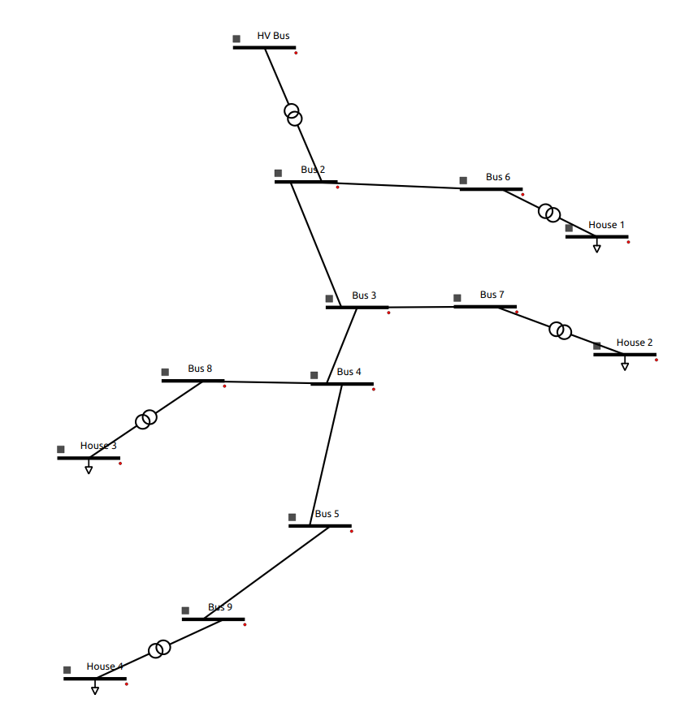

The system features:

- 9 Buses.
- 5 Transformers.
- 4 Loads.
- 7 Lines.

Solution file of the grid system can be found in 
[GitHub](https://github.com/SanPen/VeraGrid/blob/devel/Grids_and_profiles/grids/Some%20distribution%20grid%20(Video).veragrid)


### Step 1: Create a Transformer

Open VeraGrid:

1. 'Drag and drop' 2 'Bus' element to the diagram canvas:

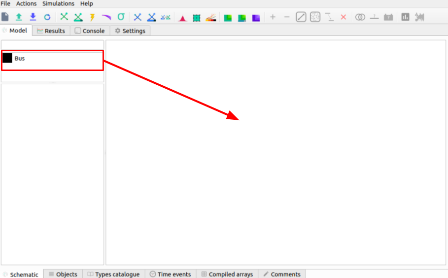

2. Select (double 'click') Bus 0 and change the parameters (on the left side pane):


| name     | HV Bus |
|----------|--------|
| Vnom[kV] |   20   |


3. Select (double 'click') Bus 1 and change the parameters (on the left side pane):

|   name   | Bus 2  |
|----------|--------|
| Vnom[kV] | 10     |

4. Hover over either bus element, 'click and drag' (when there is a cross) to the other bus to create a branch.

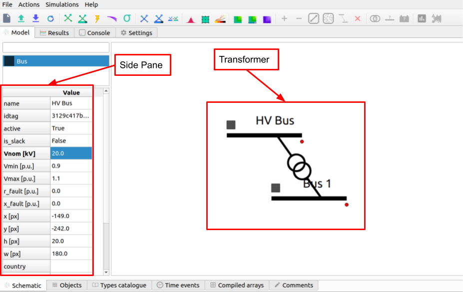

> Note: A transformer will be created between HV Bus and Bus 2 when nominal voltage values are different.

> Note: The name of an element may not change until you 'double click' the element on the diagram canvas after the change.

### Step 2: Create Lines of Different Lengths

1. Create 3 more Buses (Bus 3, Bus 4 and Bus 5) and create a branch between them.

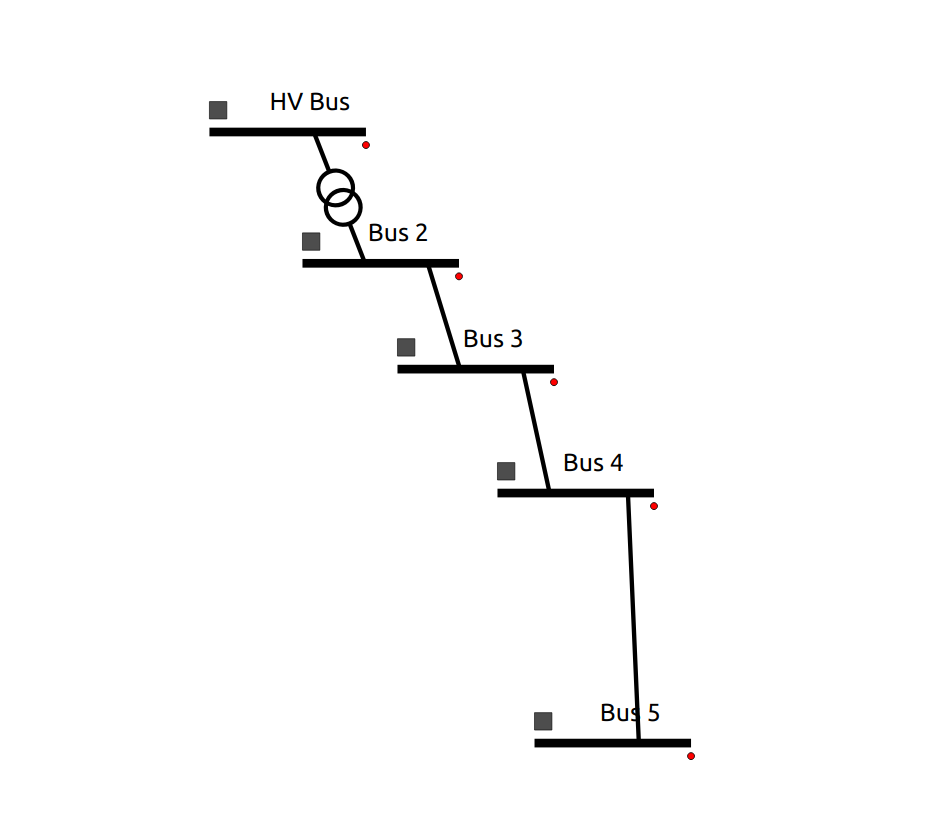


2. Select the branch between Bus 2 and Bus 3 and change its parameters to:


|   name     | Line 1 |
|------------|--------|
| length[km] | 5      |

3. Select the branch between Bus 3 and Bus 4 and change its parameters to:


|   name     | Line 2 |
|------------|--------|
| length[km] | 3      |


4. Select the branch between Bus 4 and Bus 5 and change its parameters to:

|   name     | Line 3 |
|------------|--------|
| length[km] | 7      |


> Note: Element placing can be changed by 'clicking' the square on the right hand side of a bus.

### Step 3: Add More Lines and Buses

1. Add Bus 6 to the right of Bus 2.
2. Add Bus 7 to the right of Bus 3.
3. Add Bus 8 and Bus 10 to the left of Bus 4.
4. Add Bus 9 and Bus 11 to the left of Bus 5.

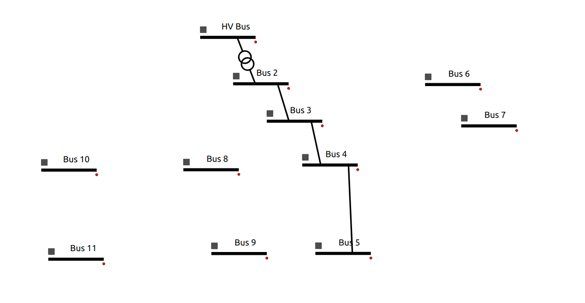

5. Select the branch between Bus 2 and Bus 6 and change its parameters to:

|   name     | Line 4 |
|------------|--------|
| length[km] | 2      |

5. Select the branch between Bus 3 and Bus 7 and change its parameters to:


|   name     | Line 5 |
|------------|--------|
| length[km] | 1.6    |

6. Select the branch between Bus 4 and Bus 8 and change its parameters to:


|   name     | Line 7 |
|------------|--------|
| length[km] | 1.5    |


7. Select the branch between Bus 5 and Bus 9 and change its parameters to:


|   name     | Line 8 |
|------------|--------|
| length[km] | 2      |

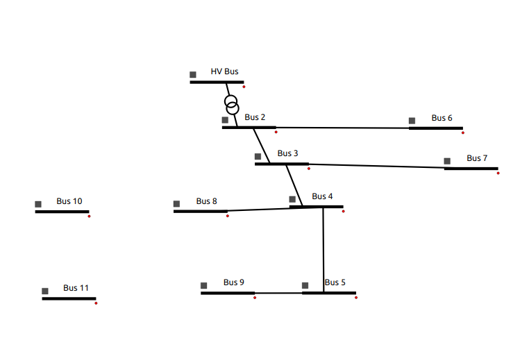


### Step 4: Create Loads

1. Select Bus 10 and change parameters to:


|   name   | House 3  |
|----------|----------|
| Vnom[kV] | 0.4      |

2. Create a line between Bus 8 and House 3 (a transformer will be created). Rename it to 'TR House 3'.

3. Select Bus 11 and change parameters to:

|   name   | House 4  |
|----------|----------|
| Vnom[kV] | 0.4      |

4. Create a line between Bus 9 and House 4 (a transformer will be created). Rename it to 'TR House 4'.

5. Right 'click' on House 3 and select 'Add Load'.

6. Right 'click' on House 4 and select 'Add Load'.

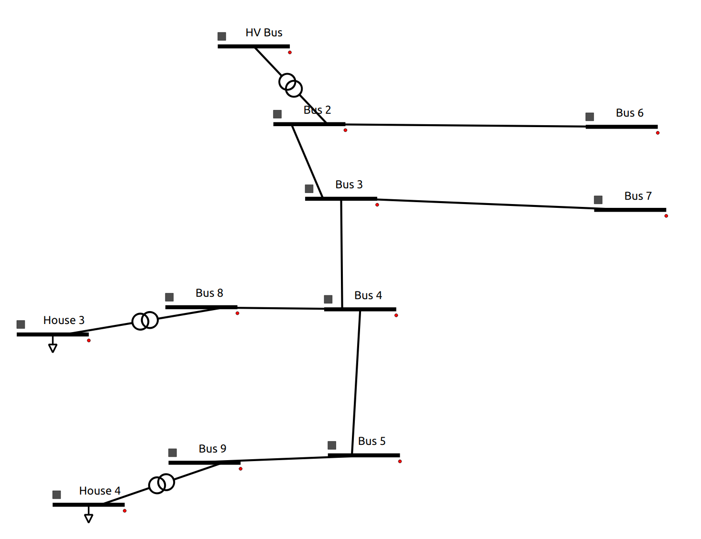


### Step 5: Create House 1 and House 2

1. Create load House 1: Create a new bus and name it 'House 1' to the right of Bus 6, and a transformer in the line between Bus 6 and House 1. The parameters are the following:

| name     | House 1  |
|----------|----------|
| Vnom[kV] |   0.4    |

2. Create load House 2: Create a new bus and name it 'House 2' to the right of Bus 7, and a transformer in the line between Bus 7 and House 2. The parameters are the following:

| name     | House 2  |
|----------|----------|
| Vnom[kV] |   0.4    |

The full system topology looks like:

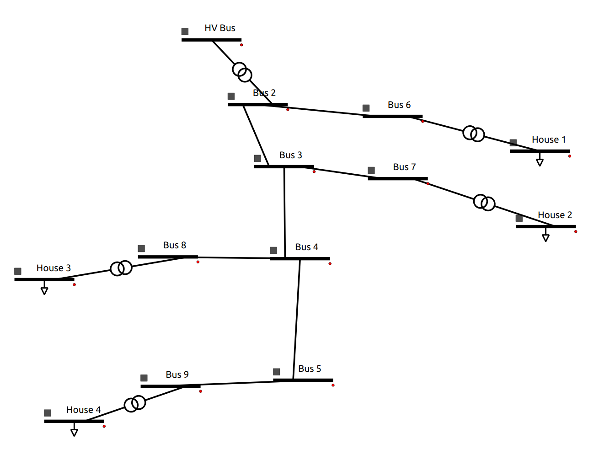


> Note: do not forget to add the load after you rename the House buses.

### Step 6: Defining the Main Transformer

In order to define the type of transformer a catalogue is available within the VeraGrid repository.

This transformer is the transformer between HV Bus and Bus 2. The transformer is: 25 MV 20/10 kV.

1. Access the catalogue (Excel file). It can be found in the repository at `VeraGrid/Grids_and_profiles/grids/equipment` and select 'equipment.ods'.

2. Select the 'Transformers' sheet.

3. Remove all filters on the 'Rate (MVA)' column by pressing on the downward arrow.

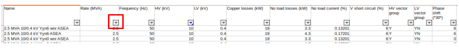


4. Select the '20 kV' filter on the 'HV (kV)' column using the downward arrow.

4. Select the '10 kV' filter on the 'LV (kV)' column using the downward arrow.


6. The parameters of the transformer are:

| name               | 25 MVA 20/10 kV |
|--------------------|-----------------|
| Rate[MVA]          | 25              |
| Frequency[Hz]      | 50              |
| HV[kV]             | 20              |
| LV[kV]             | 10              |
| Copper Losses[kW]  | 102.76          |
| No Load Losses[kW] | 10.96           |
| No Load Current[%] | 0.1             |
| V Short Circuit[%] | 10.3            |
| HV Vector Group    | YN              |
| LV Vector Group    | D               |
| Phase Shift        | 5               |

7. Double click on the transformer between HV Bus and Bus 2 and enter the 
following parameters (based on the model selected):

|   Sn   | 25     |
|--------|--------|
|  Pcu   | 102.76 |
|   Pfe  | 10.96  |
|   lo   | 0.1    |
|    Vsc | 10.3   |

8. Once the parameters are placed, right click and select 'Add to catalogue'. 
This way the branch p.u. values are calculated from the template values.

> Note: In the new VeraGrid version, a transformer can be defined by just 
  right clicking on the desired transformer and selecting the type from the drop down menu.

> Note: All of the element types can be found under the 'Types catalogue' 
> tab after clicking on the desired element, then clock 'Load Values' to change the parameters.

### Step 7: Defining Load Transformers

The transformers used for the 4 loads (houses) a 10 to 0.4 kV transformer will be used. 
The name is a '0.016 MVA 10/0.4 kV ET 16/23 SGB'.

1. Using the same catalogue find the transformer and do this for the transformer between Bus 6 and House 1.

2. The parameters of the transformer are:

|        name        | 0.016 MVA 10/0.4 kV ET 16/23 SGB  |
|--------------------|-----------------------------------|
|     Rate[MVA]      | 0.016                             |
|   Frequency[Hz]    | 50                                |
|       HV[kV]       | 10                                |
|       LV[kV]       | 0.4                               |
|  Copper Losses[kW] | 0.45                              |
| No Load Losses[kW] | 0.11                              |
| No Load Current[%] | 0.68751                           |
| V Short Circuit[%] | 3.75                              |
| HV Vector Group    | Y                                 |
|   LV Vector Group  | ZN                                |
|   Phase Shift      | 5                                 |

3. Fill these values out for the pop up menu:

|   Sn   | 0.016    |
|--------|----------|
|  Pcu   | 0.45     |
|   Pfe  | 0.11     |
|   lo   | 0.687510 |
|    Vsc | 3.75     |

4. Right click on the transformer and select 'Add to catalogue' this will create a template for quick add.

5. Rename the transformer to 'TR house 1'.

6. On the lower tabs select 'Types catalogue'.

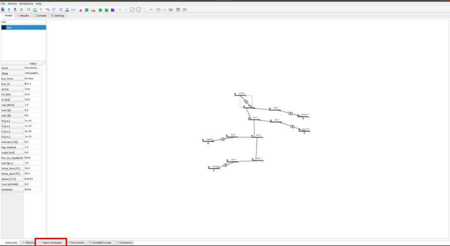


7. Select the transformer that has the characteristics of the 10 to 0.4 kV transformer and 
rename it to 'House trafo'. Now you have defined a transformer type that can be added to many transformers.

> Note: In the new VeraGrid version, a transformer can be defined by just right clicking on 
  the desired transformer and selecting the type from the drop down menu.

### Step 8: Defining Other Transformers

Now that 'House trafo' has been created, other transformers can be set to the same type.

1. In the 'Schematic' tab change the name of the other load transformers to their respective load (i.e. House 3 transformer rename to 'TR house 3').

2. Double click on the transformer

3. Click 'Load Values' to set the parameters.

4. Repeat for all desired transformers: TR house 3, TR house 4, TR house 2.

> Note: this can be done with all elements either to preloaded models or models you create.


### Step 9: Defining Wires and Overhead Lines

1. Just like in Step 7 access the 'Types catalouge' and select 'Wires'.

2. All of the wire types will show up and select the 17th option 'AWG SLD'. The parameters are:


|  R [Oh/Km]        | 1.485077  |
|-------------------|-----------|
|   X [Ohm/Km]      | 0         |
|    GMR [m]        | 0.001603  |
|  Max Current [kA] | 0.11      |

> Note: A new wire or custom wire can be added using the '+' button on the top right.

3. Now that you have located the wire you will use, in the same tab of 'Data structures' select 'Overhead Lines'.

4. Click on the '+' sign at the top right to create a new element. A new element '0:Tower' should come up.

5. Select the element '0: Tower' and click on the pencil on the top right corner to edit. A new window should pop up.

6. Rename the overhead line to: 'Distribution Line'.

7. Select the wire 'AWG SLD', highlight it and click on the '+' sign on the 'Wire composition' section below:

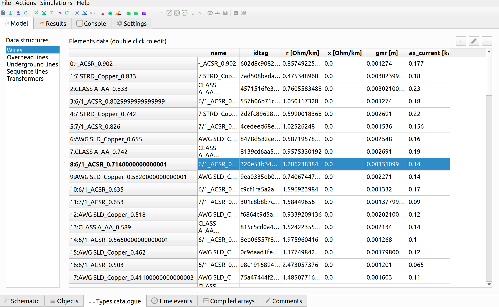


8. Add the 'AWG SLD' wire three times to enter the wire arrangement. The formulas come from ATP-EMTP.

9. Give each cable a different phase: 1, 2 and 3. Enter the following parameters for Phase 2 and Phase 3.

| Wire      | X[m] | Y [m] | Phase |
|-----------|------|-------|-------|
|  AWG SLD  |  0   |  7.0  | 1     |
|  AWG SLD  |0.4   |  7.3  | 2     |
|  AWG SLD  |0.8   |  7.0  | 3     |

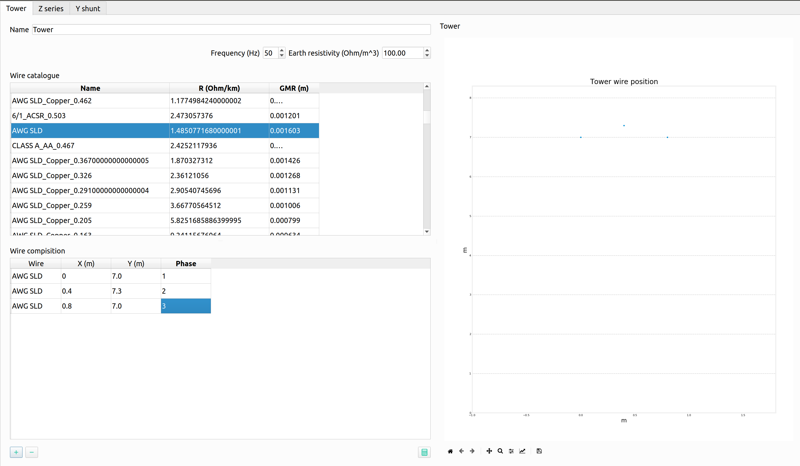


10. Click on the 'Compute matrices' button the little calculator on the bottom right and you will be able to see:

-Tower Wire Position (right).
- Z Series [Ohm/Km] for ABCN (under the 'Z series' tab at the top).
- Z Series [Ohm/Km] for ABC (under the 'Z series' tab at the top).
- Z Series [Ohm/Km] for the sequence components (under the 'Z series' tab at the top).
- Y shunt [uS/Km] for ABCN (under the 'Y shunt' tab at the top).
- Y shunt [uS/Km] for ABC (under the 'Y shunt' tab at the top).
- Y shunt [uS/Km] for the sequence components (under the 'Y shunt' tab at the top).

12. Close the window, and your 'Elements Data' tab should look lie:

13. To apply this model to the lines in the model: In the 'Schematic' tab change the name of the other load transformers to their respective load (i.e. House 3 transformer rename to 'TR house 3').

14. Double click on the desired line. Click 'Load Values' to set the parameters.

15. Repeat for all desired lines. In this case Line 1 to Line 8. The 'Objecs -> Line' Data tab should look like:


> Note: this can be done with all elements either to preloaded models or models you create.

### Step 10: Importing Load Profiles

1. Head to the 'Time Events' tab on the bottom part of the GUI. Then click on the left and select 'Import Profiles'. This should bring up the 'Profile Import Dialogue' box.

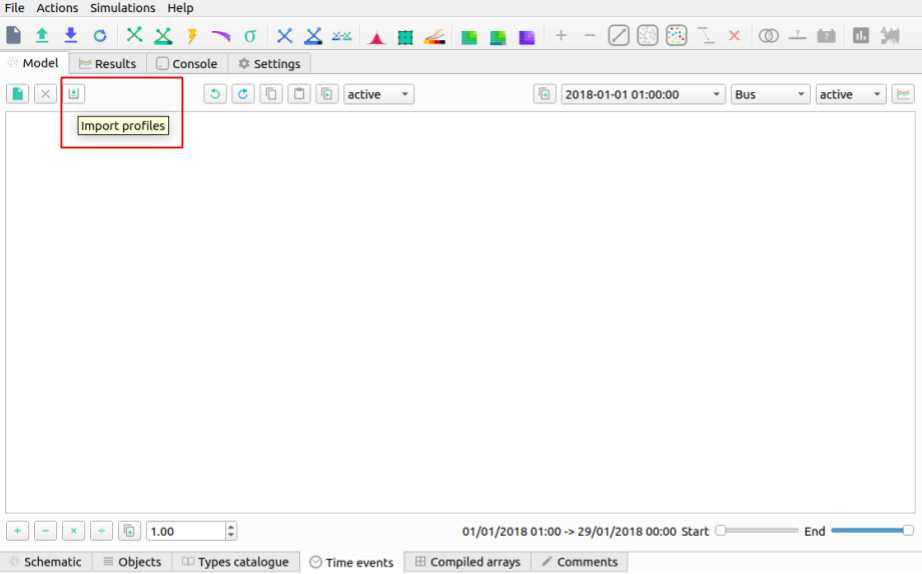

> Note: Make sure that the desired object is set to 'Load' and power types are both set to 'P'.

2. Click on 'Import file' box on the left. This will bring up a file explorer tab.

3. In the installation location head to '../VeraGrid/Grids_and_Profiles/profiles/..' then select the Excel file called: 'Total_profiles_1W_1H.xlsx'.

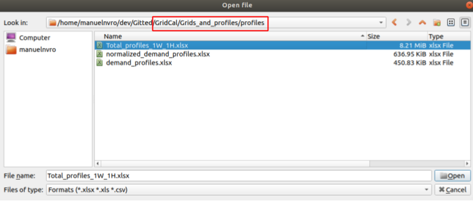


4. On the next dialogue box select 'Sheet 1' and 'OK'. Wait for all the profiles to load.

5. Any load profile can be selected. For example, click on 'USA_AL_Dothan.Muni.AP.7222268_TMY3_BASE(kW)'. Then select the 'Plot' tab to see the load profile in kW for January 2018.

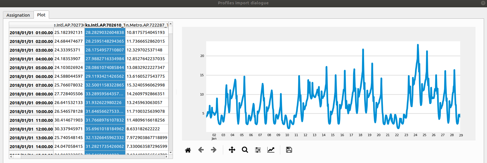

> Note: in the 'Assignation' tab, the units can be changed to: T, G, k , m Watts.

Set the units to 'k'.

6. On the right, you can see the different 'Objectives', fill the out by double-clicking on a profile and then double-clicking in the 'active' box of the desired 'Objective'. The profiles are assigned as follows:
    - Load@House 1: 'USA_AL_Muscle.Shoals.Rgni.AP.723235_TMY3_BASE(k@)'.
    - Load@House 2: 'USA_AZ_Douglas-Bisbee.Douglas.intl.AP.722735_TMY3_BASE(k@)'.
    - Load@House 3: 'USA_AL_Tuscaloosa.Muni.AP.722286_TMY3_BASE(k@)'.
    - Load@House 4: 'USA_AL_Birmingham.Muni.AP.722286_TMY3_BASE(k@)'.

The selection should look like this:

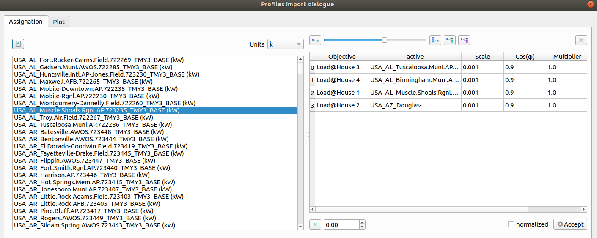

Click 'Accept' to load the profiles.

7. On the 'Time events' tab, confirm that the time series has bene added:

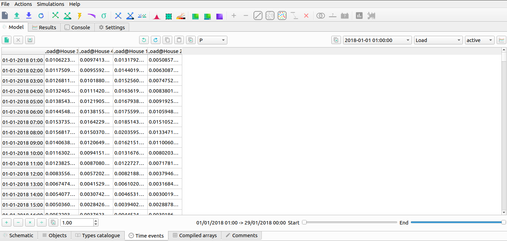

8. To set the reactive power as a copy of the active power and scale it, click on the dropdown menu and select 'Q'. Then click next to it on the 'Copy the selected profile into the profiles selected next to this button' button. When the pop up box comes on confirming the action select 'Yes'.

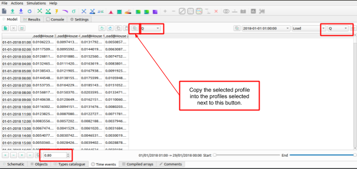

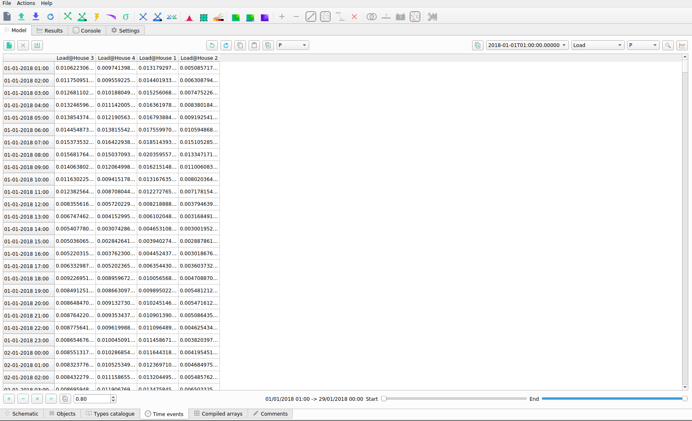


9. On the bottom left side scale it by 0.8 and click on the multiply button. The profile should look like this:


9. The profiles can be visualized by 1) selecting the times, and load, and clicking on the 'Plot the selected project's profile' button.

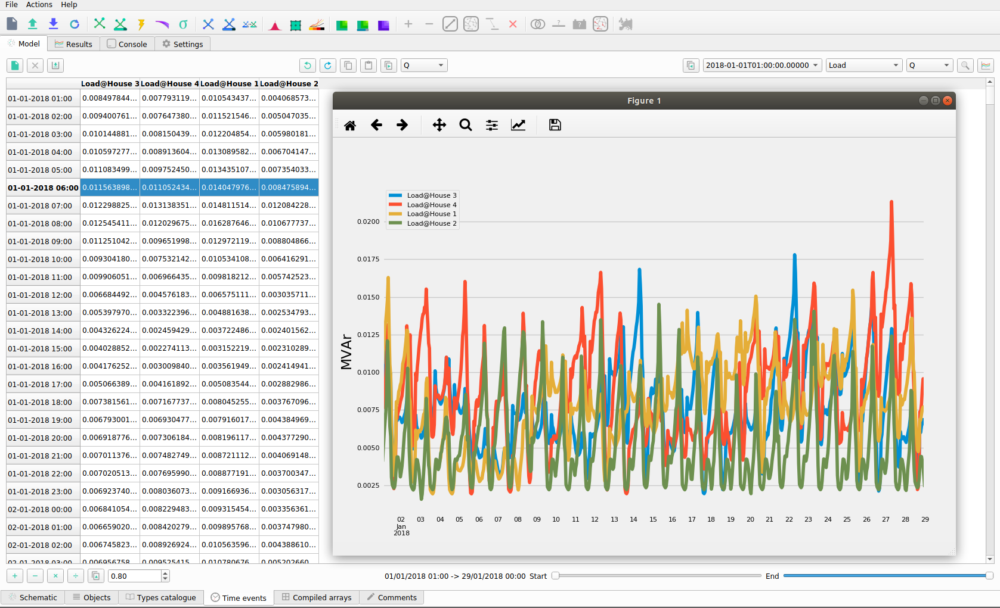


10. Power flow snapshots can be seen also by going to the 'Time events' tabs, and then

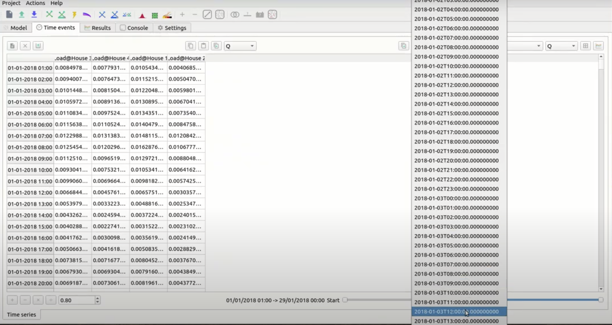


### Step 10: Set Power Flow From A Profile

Once we have checked that the profiles are okay, we can set the power flow snapshot from the profiles and run a power flow.

1. Head to the 'Time Series' Tab and select '2018+01-03T12:00:00.00000000000000'.

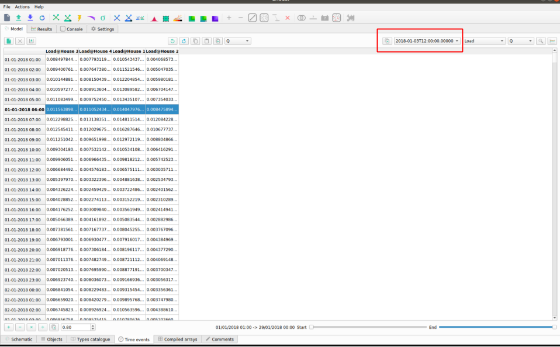


2. Select the 'Assign selected values to the selected time slot to the grid'.

3. Select 'Yes'.


### Step 11: Running a Power Flow

In order to run the power flow, we must select the slack bus. If you try run without one, you will get this error message:

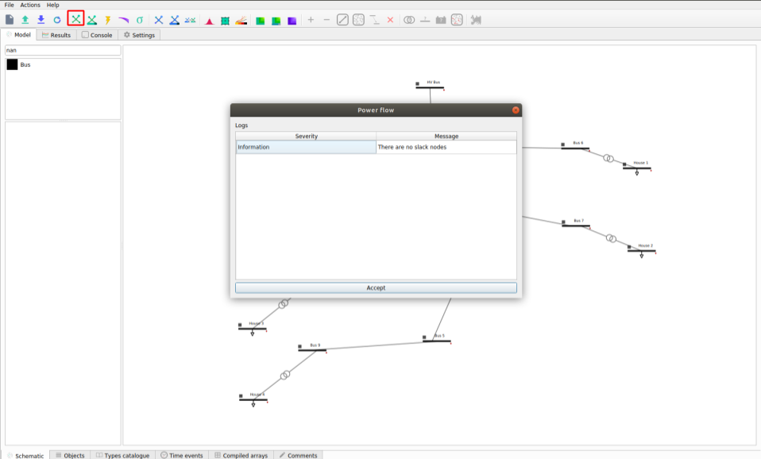


> Note: to run a Power Flow, select the 'Power Flow' button in the red square in the figure above.

1. Return to the 'Schematic' tab.

2. Select the 'HV Bus'.

3. On the left pane, select 'True' in the 'is_slack' option.

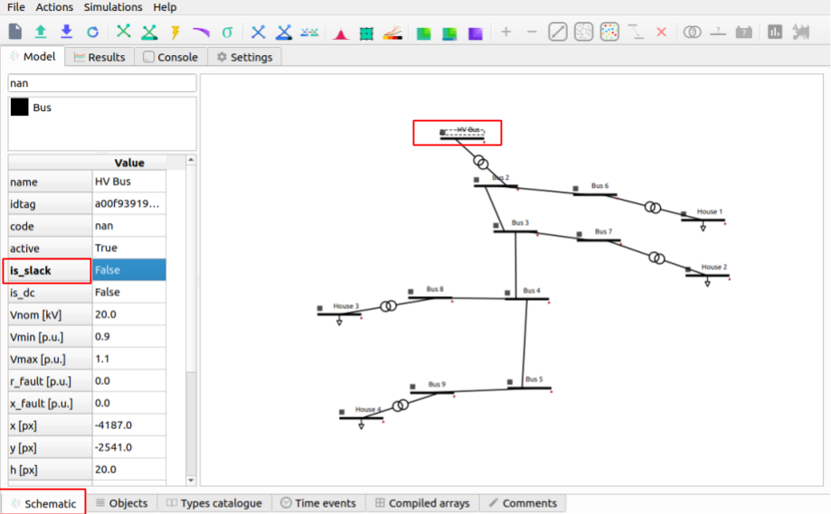


4. Click on the 'Power Flow' button and the grid will be colored according to the voltage or loading.

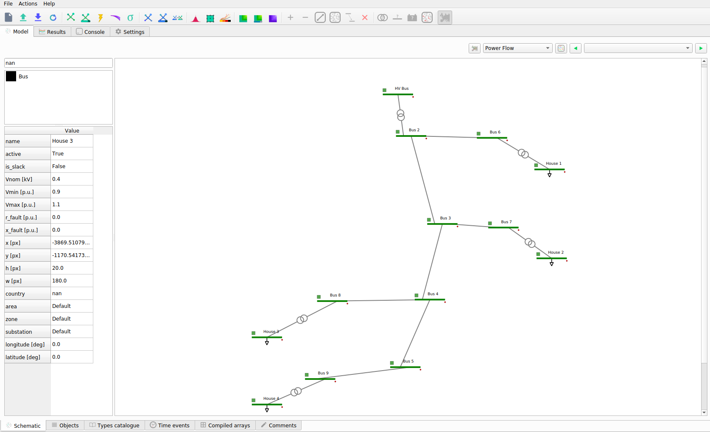


5. Click on the 'Power Flow Time Series' button and the grid will be colored according to th

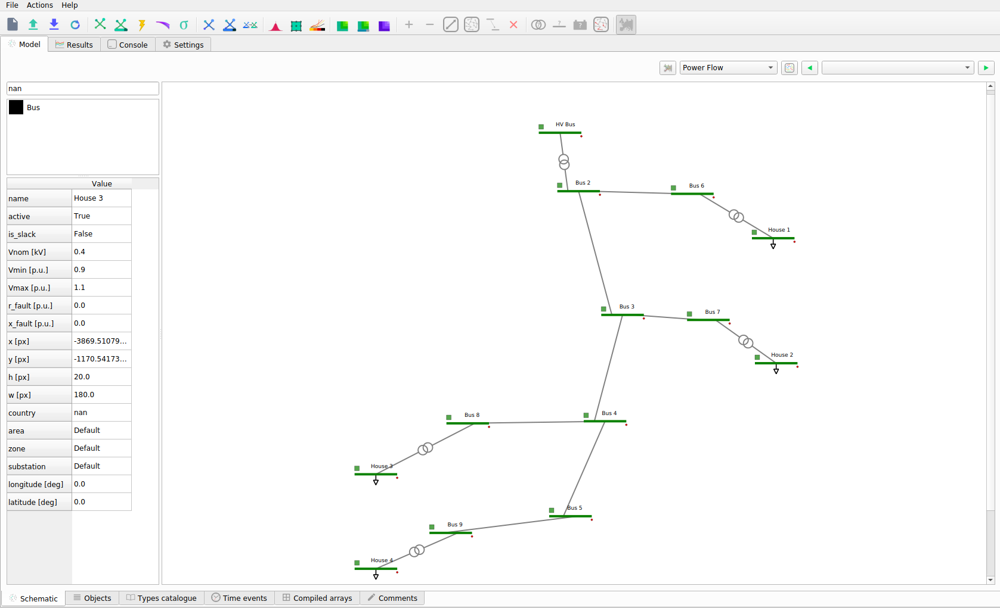


6. In addition by hovering above a transformer you can see the loading percentage and the power.

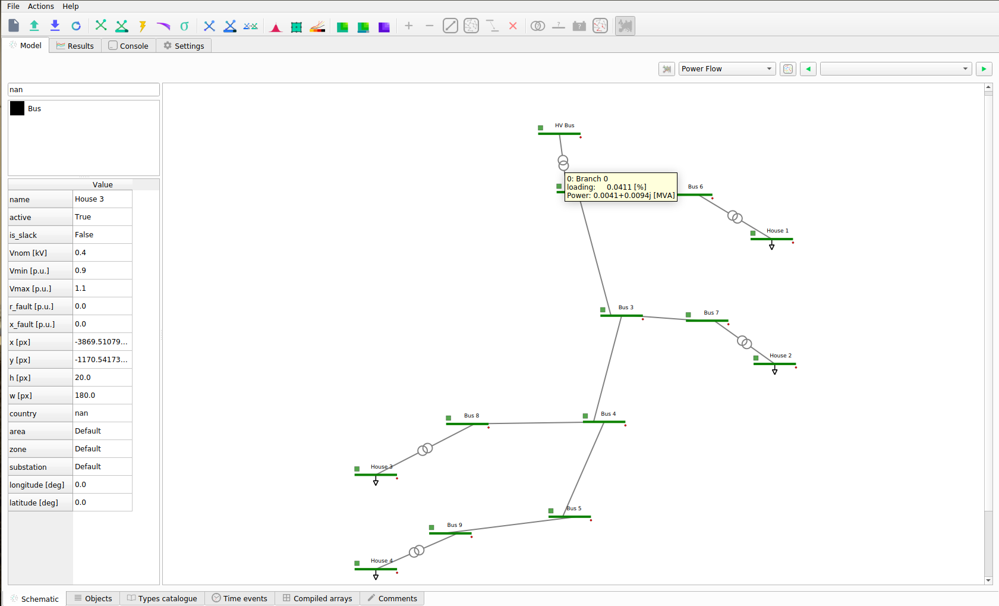


### Step 12: Results & Features

Here are some of the few results and features that are available with VeraGrid. All results can be found in the 'Results' tab. Here you can see a list of all studies perfomed and their respective results:

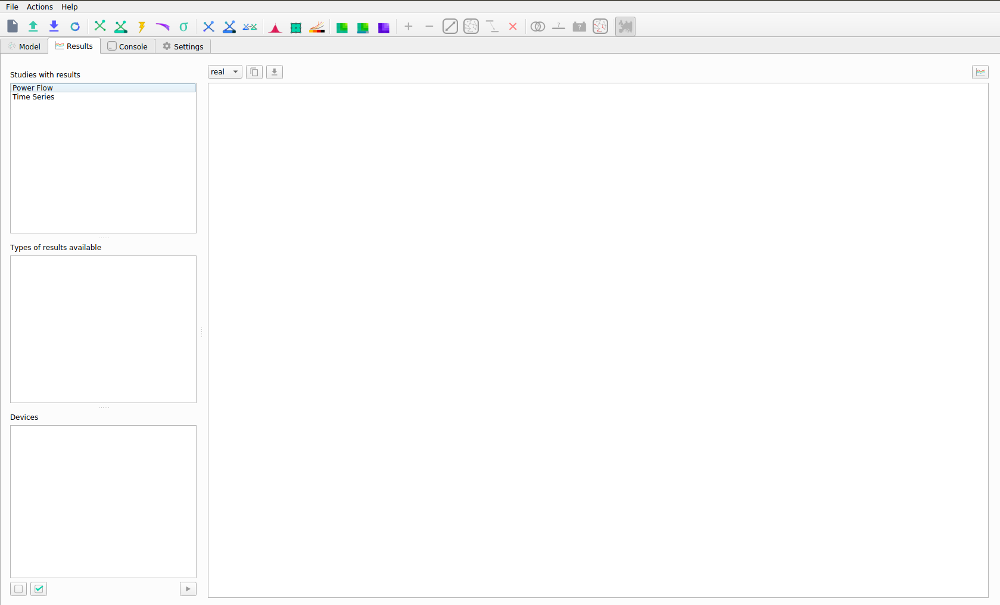


In the results you can also choose from:

- Study
- Result Type
- Devices

From here you can choose and customize the plot and results that are displayed to you.

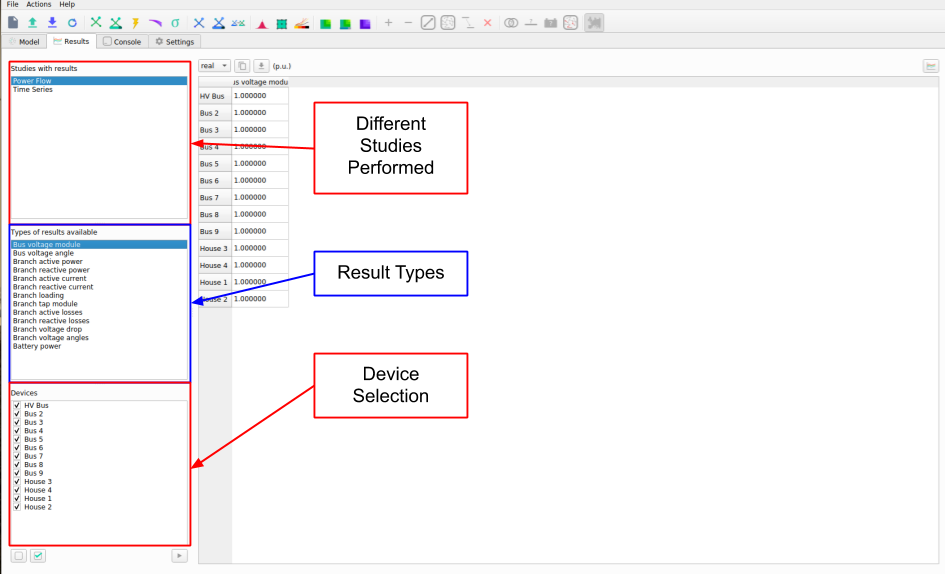


Select the Study, Result Type and Devices, then the Data will pop up in table format, 
to graph it use the 'Graph' button on the top right. The graph will come up on a new figure:

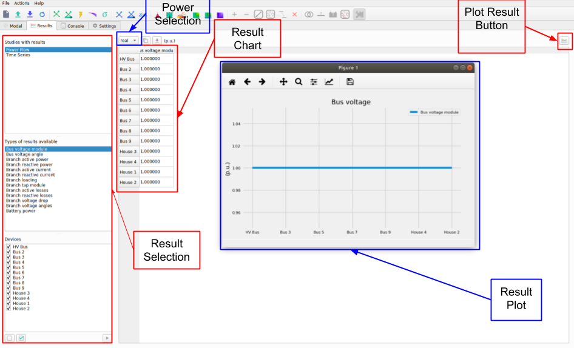

In the 'Schematic' Tab, you can visualize the result's profiles, by selection the load, right click and selecting 'Plot Profiles':

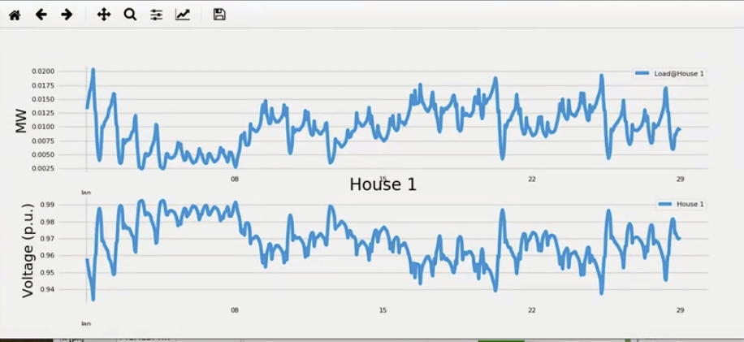

From the result plots you can do various things with the plot:

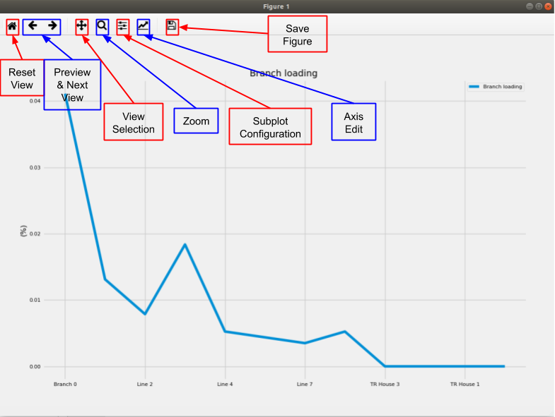

## Power Flow on the 5-Node Example Grid

This example creates the five-node grid from the fantastic book
"Power System Load Flow Analysis" and runs a power flow. After the power flow is executed,
the results are printed on the console.

```python
import VeraGridEngine.api as gce

# declare a circuit object
grid = gce.MultiCircuit()

# Add the buses and the generators and loads attached
bus1 = gce.Bus('Bus 1', Vnom=20)
# bus1.is_slack = True  # we may mark the bus a slack
grid.add_bus(bus1)

# add a generator to the bus 1
gen1 = gce.Generator('Slack Generator', vset=1.0)
grid.add_generator(bus1, gen1)

# add bus 2 with a load attached
bus2 = gce.Bus('Bus 2', Vnom=20)
grid.add_bus(bus2)
grid.add_load(bus2, gce.Load('load 2', P=40, Q=20))

# add bus 3 with a load attached
bus3 = gce.Bus('Bus 3', Vnom=20)
grid.add_bus(bus3)
grid.add_load(bus3, gce.Load('load 3', P=25, Q=15))

# add bus 4 with a load attached
bus4 = gce.Bus('Bus 4', Vnom=20)
grid.add_bus(bus4)
grid.add_load(bus4, gce.Load('load 4', P=40, Q=20))

# add bus 5 with a load attached
bus5 = gce.Bus('Bus 5', Vnom=20)
grid.add_bus(bus5)
grid.add_load(bus5, gce.Load('load 5', P=50, Q=20))

# add Lines connecting the buses
grid.add_line(gce.Line(bus1, bus2, name='line 1-2', r=0.05, x=0.11, b=0.02))
grid.add_line(gce.Line(bus1, bus3, name='line 1-3', r=0.05, x=0.11, b=0.02))
grid.add_line(gce.Line(bus1, bus5, name='line 1-5', r=0.03, x=0.08, b=0.02))
grid.add_line(gce.Line(bus2, bus3, name='line 2-3', r=0.04, x=0.09, b=0.02))
grid.add_line(gce.Line(bus2, bus5, name='line 2-5', r=0.04, x=0.09, b=0.02))
grid.add_line(gce.Line(bus3, bus4, name='line 3-4', r=0.06, x=0.13, b=0.03))
grid.add_line(gce.Line(bus4, bus5, name='line 4-5', r=0.04, x=0.09, b=0.02))

results = gce.power_flow(grid)

print(grid.name)
print('Converged:', results.converged, 'error:', results.error)
print(results.get_bus_df())
print(results.get_branch_df())
```
