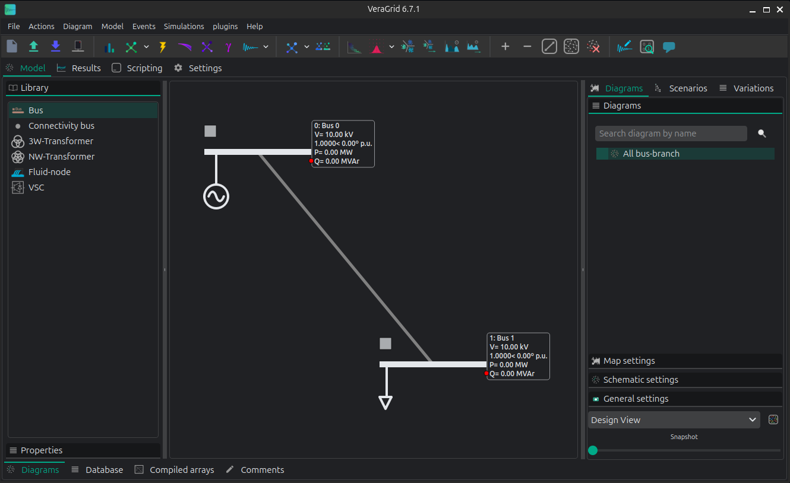
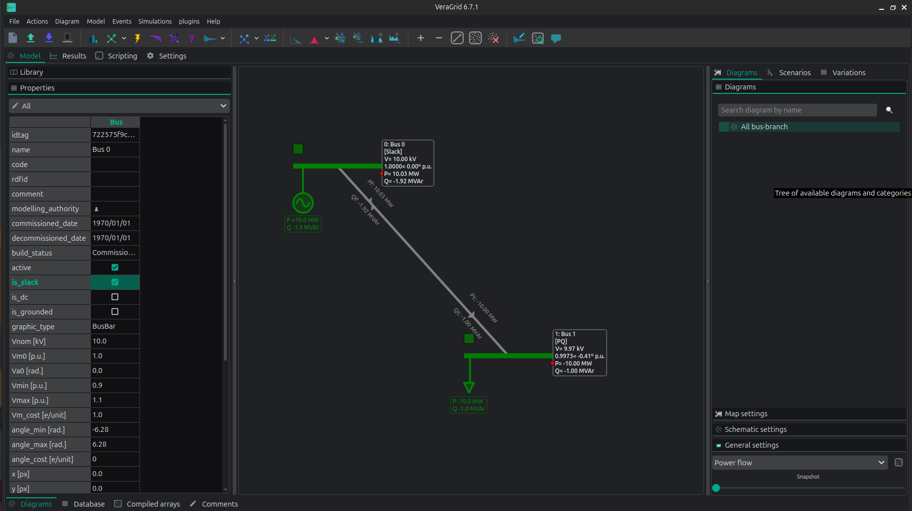
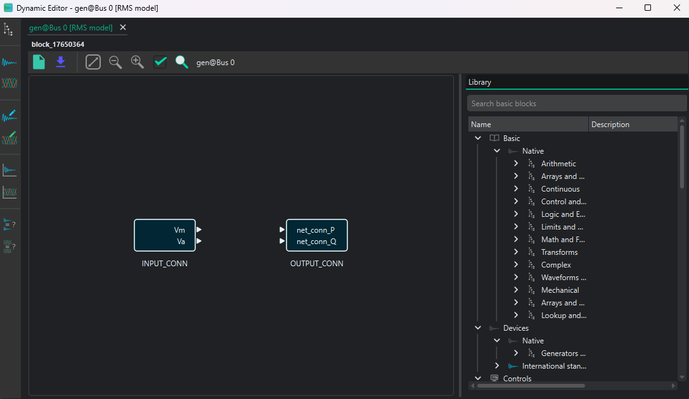
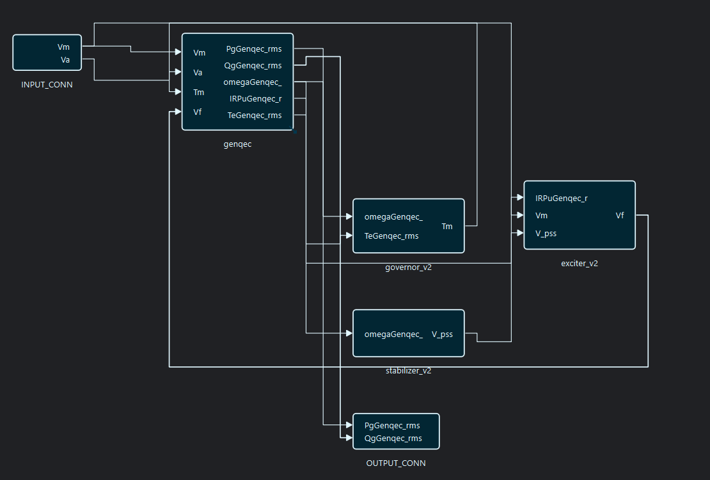

# ⏱️ RMS simulations

Root-mean-square (RMS) simulation is VeraGrid's phasor-domain workflow for electromechanical and controller time scales. It captures the system response without resolving the instantaneous waveform of every electrical cycle.

```{toctree}
:maxdepth: 1

RMS_practical_session
```

## When to use RMS

RMS is appropriate for:

- rotor-angle and transient-stability studies;
- system frequency and power-imbalance response;
- AVR, governor, PSS, and converter outer-loop dynamics;
- set-point, load, fault, and switching scenarios whose waveform detail is not essential;
- system-wide studies where computational efficiency matters.

Use [EMT simulation](emt_simulations.md) when instantaneous phase waveforms, switching detail, or fast inner-control interactions are required. The shared DAE and initialization concepts are described in [Dynamic simulation theory](dynamic_theory.md).

## RMS workflow

1. Build or import the static network.
2. Run and inspect a power flow.
3. Assign saved RMS models to the participating devices.
4. Create at least one RMS event group; an empty group represents the base case.
5. Add optional step or ramp events.
6. Prepare persistent plot groups if required.
7. Configure the RMS settings and run the simulation.
8. Check initialization, convergence, and trajectories for every scenario.

## Settings available in the GUI

The RMS settings panel exposes the following controls:

| GUI control | Meaning |
|---|---|
| Time step | Interval between integration samples |
| Simulation time | End time of the study |
| Tolerance | Numerical convergence tolerance, entered as an exponent in the GUI |
| Integration method | Time-integration method used by the RMS driver |
| Initialization method | `Explicit` or `PseudoTransient` |
| Problem type | `PowerBalance` or `PowerBalanceVectorized` |

The API uses `RmsOptions` and additionally permits script-level controls such as stored initialization values, iteration limits, verbosity, and FMI configuration. These are not separate controls in the standard GUI settings panel.

As a starting point, RMS studies commonly use a millisecond-scale time step. The required step depends on the fastest retained controller and must be checked by repeating sensitive cases with a smaller value.

## Events

An `RmsEventsGroup` is one complete scenario. An `RmsEvent` changes one eligible model parameter using either a step or a ramp. Multiple groups can reuse the same grid and dynamic models while representing different disturbances.

Create and edit scenarios in the **RMS Events** page of the [dynamic workspace](dynamic_editor.md). The parameter tree is derived from the saved RMS models, so apply model-editor changes before configuring events.

## GUI example

The complete guided example is available in the [RMS practical session](RMS_practical_session.md). It builds a two-bus system with one generator, one load, one line, and load-change events.



The power flow should be validated before opening the dynamic workspace.



The RMS editor supplies the grid connection blocks. Add and connect the required machine and controller blocks, set their parameters, validate the graph, and apply it to the device.





## Results in the GUI

Open **Results → RMS Dynamic** after the driver finishes. The view provides:

- a tree grouped by device and exported model variable;
- the persistent RMS plot groups defined in the RMS Plots page;
- a numerical table for the selected trajectory;
- the available event-group scenarios.

Double-click one variable to plot it directly. For a multi-signal plot, create or open a plot group and add the required variables. Time-series groups plot signals against simulation time; X-Y groups plot one selected signal against another.

Before interpreting a curve, select the intended event group and verify its initialization and convergence status. A declared group can exist without usable samples if that scenario was not completed.

## Results from the API

`RmsResults.values` is a three-dimensional array with shape:

```text
(number of time samples, number of exported variables, number of event groups)
```

The result object also provides:

- `time_array`: common time samples;
- `variables`: exported symbolic variables in column order;
- `uid2idx`: variable UID to `values` column mapping;
- `devices_vars_info`: variables grouped by owning device;
- `rms_events_group_names`: scenario labels;
- `has_event_group_results`: availability mask per scenario;
- `well_initialized` and `converged`: status per scenario;
- `get_vars_data(var_list, group_idx)`: selected variable trajectories for one scenario.

Use `has_event_group_results[group_idx]` before reading a scenario slice. For example, `results.values[:, :, group_idx]` returns all exported RMS variables for that scenario.

## API example

This example constructs the same type of two-bus case. The empty `RmsEventsGroup` is intentional: it defines the base-case scenario that the driver integrates.

```python
import numpy as np

import VeraGridEngine.api as vg
from VeraGridEngine.Devices.Injections.generator import Generator
from VeraGridEngine.Devices.Injections.load import Load
from VeraGridEngine.Devices.Substation.bus import Bus
from VeraGridEngine.Simulations.PowerFlow.power_flow_driver import PowerFlowOptions
from VeraGridEngine.Simulations.PowerFlow.power_flow_results import PowerFlowResults
from VeraGridEngine.Simulations.Rms.rms_driver import RmsSimulationDriver
from VeraGridEngine.Simulations.Rms.rms_options import RmsOptions
from VeraGridEngine.Simulations.Rms.rms_results import RmsResults
from VeraGridEngine.Templates.Rms.genqec_exc_gov_sat_template_v2 import get_complete_generator_template_rms
from VeraGridEngine.Templates.Rms.line_rms_template import get_line_rms_template
from VeraGridEngine.Templates.Rms.load_rms_template import get_load_rms_template
from VeraGridEngine.Utils.Symbolic.block import Block
from VeraGridEngine.Utils.Symbolic.bus_rms_template import initialize_bus_rms
from VeraGridEngine.Utils.Symbolic.templates_common_functions import set_rms_model
from VeraGridEngine.enumerations import DynamicIntegrationMethod, RmsInitializationMethod

grid: vg.MultiCircuit = vg.MultiCircuit(Sbase=100.0, fbase=50.0)

bus0: Bus = Bus(name="Bus0", Vnom=10.0, is_slack=True)
bus1: Bus = Bus(name="Bus1", Vnom=10.0)
grid.add_bus(bus0)
grid.add_bus(bus1)

bus: Bus
for bus in grid.buses:
    initialize_bus_rms(bus=bus, vf=grid.var_factory)

line: vg.Line = vg.Line(
    name="Line 0-1",
    bus_from=bus0,
    bus_to=bus1,
    r=0.029585,
    x=0.071005,
    b=0.03,
    rate=900.0,
)
grid.add_line(line)

load: Load = Load(name="Load1", P=9.999999, Q=0.999999)
grid.add_load(bus=bus1, api_obj=load)

generator: Generator = Generator(
    name="Gen0",
    P=10.0,
    vset=1.0,
    Snom=900.0,
    x1=0.86138701,
    r1=0.3,
    freq=50.0,
)
grid.add_generator(bus=bus0, api_obj=generator)

generator_model: Block = get_complete_generator_template_rms(grid.var_factory).block
line_model: Block = get_line_rms_template(grid.var_factory).block
load_model: Block = get_load_rms_template(grid.var_factory).block

set_rms_model(device=generator, model=generator_model, var_factory=grid.var_factory)
set_rms_model(device=line, model=line_model, var_factory=grid.var_factory)
set_rms_model(device=load, model=load_model, var_factory=grid.var_factory)

base_case: vg.RmsEventsGroup = vg.RmsEventsGroup(name="Base case")
grid.add_rms_events_group(base_case)

power_flow_options: PowerFlowOptions = PowerFlowOptions(
    solver_type=vg.SolverType.NR,
    verbose=0,
)
power_flow_results: PowerFlowResults = vg.power_flow(grid, options=power_flow_options)

rms_options: RmsOptions = RmsOptions(
    time_step=0.001,
    simulation_time=1.0,
    tolerance=1e-6,
    integration_method=DynamicIntegrationMethod.DaeBackEuler,
    initialization_method=RmsInitializationMethod.Explicit,
    use_init_values=False,
    max_iter=1000,
    verbose=0,
)

driver: RmsSimulationDriver = RmsSimulationDriver(
    grid=grid,
    options=rms_options,
    pf_results=power_flow_results,
)
driver.run()

results: RmsResults | None = driver.results
if results is not None:
    group_index: int = 0
    if results.has_event_group_results[group_index]:
        scenario_values: np.ndarray = results.values[:, :, group_index]
        print(results.converged[group_index])
        print(results.well_initialized[group_index])
        print(scenario_values.shape)
    else:
        print("The base-case scenario did not produce results.")
else:
    print("The RMS driver did not create a result object.")
```

The example shows the complete driver contract but is not a substitute for model-specific parameterization and validation. To add disturbances, create `RmsEvent` objects or use the RMS Events page instead of changing the model's stored base parameters.

## Practical checks

- Validate the power flow before initializing the RMS model.
- Save model-editor changes before opening Events or Plots.
- Create at least one event group, including for an undisturbed case.
- Check `well_initialized`, `converged`, and `has_event_group_results` per group.
- Reduce the time step when assessing numerical sensitivity.
- For modal analysis around an RMS operating point or trajectory point, see [Small-Signal stability](small_signal_stability_rms.md).
